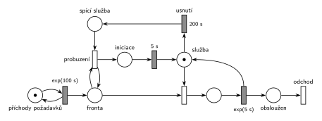

# 10–02 – Výpočetní služba se spánkem

## Zadání

> ⚠️ **Přepis.** Originální list se zadáním v materiálech chybí, existuje jen ruční přepis od studenta. Písmeno varianty ani závěrečná věta o odchodu transakce na přepisu nejsou.
>
> Do výpočetní služby přichází požadavky v intervalech daných exponenciálním rozložením se středem 100s. Server má kapacitu jedna pro obsluhu požadavků. Doba obsluhy se řídí exp. rozložením se středem 5s. Pokud je služba nečinná po dobu 200s, pak je převedena do spacího režimu. Z režimu spánku službu probere až nově příchozí požadavek. Po probuzení však služba potřebuje 5s na iniciační proceduru, a až po jejím dokončení může zahájit obsluhu požadavku.

Podobné úlohy: [04–08 – Spánek po nečinnosti](<../04–08 - Spánek po nečinnosti/04–08 - Spánek po nečinnosti.md>), [04–03 – Automat na kávu – uspání](<../04–03 - Automat na kávu – uspání/04–03 - Automat na kávu – uspání.md>), [04–01 – Automat na kávu – údržba po nečinnosti](<../04–01 - Automat na kávu – údržba po nečinnosti/04–01 - Automat na kávu – údržba po nečinnosti.md>), [09–09 – Trafika](<../09–09 - Trafika/09–09 - Trafika.md>).

## Interpretace

Zobrazit interpretaci (nápověda)

- **Služba** je místo s jednou značkou (kapacita 1). Značka je vždy právě v jednom ze stavů: volná (*Služba*), obsluhuje, spí (*spící služba*), nebo se probouzí (*iniciace*).
- **Nečinnost 200 s:** časovaný přechod `200 s` má jediný vstup, místo *Služba*. Odpočet tedy běží přesně po dobu, kdy je služba volná. Když přijde požadavek, obsazení (okamžitý přechod) si značku vezme a odpočet zanikne (slajd 139). Po každé obsluze začíná odpočet znovu od nuly.
- **Probuzení:** okamžitý přechod potřebuje značku *spící služby* a požadavek ve *Frontě*. K *Frontě* je připojený testovacími hranami (tam a zpět), takže požadavek ve frontě zůstane a po probuzení normálně obsadí službu.
- **Iniciační procedura** `5 s` vrací značku do *Služby* a teprve pak může proběhnout obsazení. Požadavky, které přijdou během probouzení, čekají ve *Frontě*.
- Doba nečinnosti je pevných 200 s, ne exponenciální.
- Výstupní přechod *odchod* odpovídá větě „V modelu jednoznačně ukažte (přechodem) moment, kdy transakce opouští systém“, kterou mají ostatní varianty téhož roku.

## Řešení

Zobrazit řešení

| Požadavek | Prvek sítě |
|---|---|
| příchody exp(100 s) | *generátor* ⇄ `exp(100 s)` → *Fronta* |
| kapacita 1, obsluha exp(5 s) | *Služba* (1 značka), obsazení, `exp(5 s)` vrací značku *Službě* |
| nečinnost 200 s → spánek | *Služba* → `200 s` (*usnutí*) → *spící služba* |
| probuzení příchozím požadavkem | *probuzení*: *spící služba* + test *Fronty* → *iniciace* |
| iniciace 5 s před obsluhou | *iniciace* → `5 s` → *Služba* |
| odchod ze systému | *odchod* |

Kontrola simulací: *Služba* + obsluha + *spící služba* + *iniciace* = 1. Služba usne asi po 13 % obsluh, což odpovídá pravděpodobnosti, že další požadavek nepřijde do 200 s (e⁻² ≈ 0,135). Fronta zůstává krátká.

## Časté chyby

Zobrazit časté chyby

- Odpočet `200 s` řízený samostatným „hlídacím“ procesem, který má značku pořád. Pak měří čas od libovolného okamžiku, ne dobu nečinnosti, a příchod požadavku ho nezruší.
- Přechod probuzení bez vstupu ze *spící služby*. Spouštěl by se při každém příchodu, i když služba nespí.
- Probuzení, které požadavek z *Fronty* odebere a nikam ho nepošle: požadavek se ztratí. Buď testovací hrany, nebo ho předat dál k obsazení.
- Obsluha zahájená hned po probuzení bez iniciace `5 s`.
- `exp(200 s)` místo pevných 200 s.

## Původ a zdroje

**Původ:** půlsemestrální písemka 2023/24, varianta neoznačená (pravděpodobně B: varianty A, C a D jsou známé). Body nejsou uvedené (ostatní varianty téhož roku mají 10 bodů).

**Zdroje:**

- `Fitcheats/Půlsemestrálky/Zadání z minulých let/2023-24.pdf`, str. 2 (zadání přepsané rukou a pod ním studentské řešení)

**Existující řešení:**

Zobrazit existující řešení

- **Studentské řešení (str. 2, pod přepisem zadání):** stejná síť jako výše, jen zrcadlově (služba a spánek jsou pod hlavní linkou). Generátor ⇄ `exp(100s)` → *Příchozí* → obsazení → `exp(5s)` („řešení“) → *Odchod*; *Služba* (1 značka) → `200s` → *spící služba* → probuzení s dvojicí hran ↓↑ k *Příchozí* (test) → *Procedura* `5s` → *Služba*. Je správné.
- Pozor na kreslení: student má vyplněné obdélníky u okamžitých přechodů (obsazení, probuzení) a prázdné u časovaných. V notaci předmětu je to naopak: časovaný přechod je vyplněný obdélník, okamžitý tenká čárka.

