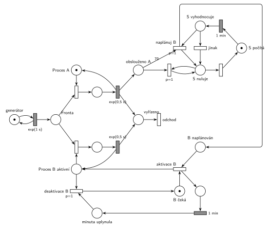

# 10–03 – Databázový server

## Zadání

> Do databázového serveru přichází vstupní požadavky v intervalech exp(1s). Požadavky obsluhuje databázový proces A, případně i proces B. Doba vyřízení požadavku se řídí exp(0.5s). Nezávislý systémový proces S v cyklech: po dobu jedné minuty čítá počet dokončených obsluh na procesu A, a pak podle potřeb zapojuje do práce dočasně druhý proces B. Pokud za uplynulou minutu proces A obsloužil 70 a více vstupních požadavků, pak systémový proces S naplánuje aktivaci procesu B. Proces B obsluhuje požadavky po dobu jedné minuty, pak čeká na další naplánování procesem S. Proces B lze naplánovat, i když momentálně běží.
>
> *Zadaný systém modelujte formou Petriho sítě s vyznačením všech potřebných parametrů.*

Věta „V modelu jednoznačně ukažte (přechodem) moment, kdy transakce opouští systém“ v tehdejších zadáních ještě nebyla. Výstupní přechod je v síti přesto, dnes se vyžaduje.

Podobné úlohy: [05–02 – Dočasně MM2 při dlouhé frontě](<../05–02 - Dočasně MM2 při dlouhé frontě/05–02 - Dočasně MM2 při dlouhé frontě.md>), [09–08 – Cestovní kancelář](<../09–08 - Cestovní kancelář/09–08 - Cestovní kancelář.md>), [10–01 – Server s údržbou po 1000 požadavcích](<../10–01 - Server s údržbou po 1000 požadavcích/10–01 - Server s údržbou po 1000 požadavcích.md>).

## Interpretace

Zobrazit interpretaci (nápověda)

- **Jednotky:** časy jsou v sekundách i minutách, u přechodů je proto vždy jednotka. `exp(0,5 s)` je střední doba vyřízení.
- **Procesy A a B** jsou dvě zařízení nad společnou *Frontou*. A je k dispozici stále. Značka *Procesu B* existuje, jen když je B aktivní. Když jsou volné oba, nerozhoduje se, který požadavek vezme (zadání pořadí neurčuje).
- **Čítač:** každé vyřízení na A přidá značku do *obslouženo A*. Obsluhy na B se nepočítají.
- **Proces S** je cyklus *S počítá* → `1 min` → *S vyhodnocuje*. Přechod *naplánuj B* (`p=1`) vezme z čítače 70 značek („70 a více“ = váha 70) a vloží značku do *B naplánován*. Když to nejde, provede se *jinak* (`p=0`). Pak *S nuluje*: přechod s `p=1` ve smyčce odebírá po jedné zbylé značky čítače, dokud nějaké jsou, a teprve potom (`p=0`) začne nový cyklus. Vše proběhne v jednom okamžiku, takže se žádná obsluha neztratí ani nezapočítá dvakrát.
- **Aktivace B:** *B naplánován* + *B čeká* → *Proces B aktivní* a spustí se samostatný odpočet `1 min`. Časovač nemůže být přímo na místě *Proces B aktivní*, protože značka z něj při každé obsluze odchází a odpočet by začínal znovu.
- **Konec minuty:** *deaktivace B* (`p=1`) vezme značku *Procesu B*, jakmile je volná. Rozpracovaný požadavek se tedy dokončí (zadání o přerušení nic neříká). Priorita zajistí, že B po uplynutí minuty už nový požadavek nevezme.
- **„Lze naplánovat, i když běží“:** plán počká v místě *B naplánován* a hned po deaktivaci B znovu aktivuje na další minutu. B tak běží nepřetržitě, dokud S každou minutu plánuje. (Jiný možný výklad: nové naplánování běžící minutu prodlouží od okamžiku plánu. Rozdíl je jen v tom, kdy přesně druhá minuta začne.)
- **Zatížení:** přichází v průměru 60 požadavků za minutu, A jich zvládne až 120. Hranice 70 se proto překročí jen při náhodném nahromadění (v simulaci asi v každé desáté minutě).

## Řešení

Zobrazit řešení

| Požadavek | Prvek sítě |
|---|---|
| požadavky exp(1 s) | *generátor* ⇄ `exp(1 s)` → *Fronta* |
| proces A, vyřízení exp(0,5 s) | *Proces A* (1 značka), obsazení, `exp(0,5 s)` vrací značku → *vyřízeno* → *odchod* |
| proces B, jen když je aktivní | *Proces B aktivní* (značka jen během aktivace), obsazení, `exp(0,5 s)` vrací značku |
| S minutu čítá obsluhy A | `exp(0,5 s)` procesu A přidává značku do *obslouženo A*; *S počítá* → `1 min` |
| ≥ 70 → naplánuj B | *naplánuj B* `p=1`: *S vyhodnocuje* + 70 značek čítače → *B naplánován*; jinak `p=0` |
| nový cyklus S | *S nuluje*: smyčka `p=1` odebírá zbytek čítače, pak nový cyklus → *S počítá* |
| B obsluhuje 1 min | *aktivace B*: *B naplánován* + *B čeká* → *Proces B aktivní* + odpočet `1 min` |
| pak čeká na další naplánování | *deaktivace B* `p=1`: *minuta uplynula* + *Proces B aktivní* → *B čeká* |

Kontrola simulací: *Proces A* + obsluha A = 1, *B čeká* + *Proces B aktivní* + obsluha B = 1 a S je vždy právě v jednom stavu. Za asi 1650 minut S naplánoval B zhruba 150–175krát, B vyřídil asi 5 % požadavků. Fronta zůstává krátká (nejvýš asi 20) a *B naplánován* má nejvýš jednu značku.

## Časté chyby

Zobrazit časté chyby

- Čítač, který se po vyhodnocení nevynuluje (nebo se vynuluje jen odebráním 70 značek). Zbylé obsluhy by se pak započítaly do další minuty.
- Vynulování hranou s pevnou váhou. Počet obsluh za minutu je náhodný, na „všechny“ je potřeba smyčka s prioritou.
- Počítání i obsluh procesu B. Zadání čítá jen dokončené obsluhy na A.
- Časovač 1 min přímo na místě aktivního procesu B, kterým procházejí obsluhy: odpočet by se s každým požadavkem spouštěl znovu.
- Vyhodnocení ≥ 70 jako „přesáhne 70“ (váha 71).
- Plán, který se zahodí, když B právě běží. Zadání výslovně říká, že naplánovat lze i běžící B.

## Původ a zdroje

**Původ:** půlsemestrálky 2014–19 (přehled zadání), úloha Z22. Rok, varianta ani body nejsou známé.

**Zdroje:**

- `Fitcheats/Půlsemestrálky/Zadání z minulých let/Přehled zadání 2014-19.pdf`, str. 5 (zadání, bez řešení)

**Existující řešení:**

Zobrazit existující řešení

- K této úloze v materiálech žádné řešení není.

