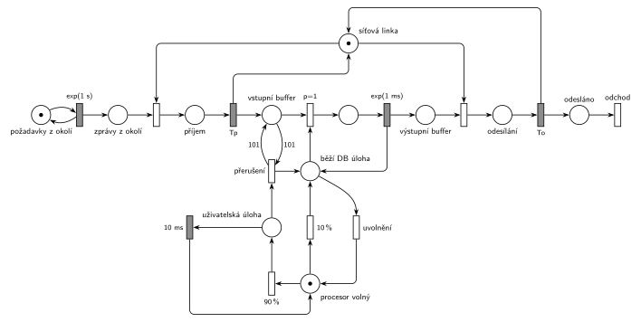

# 10–04 – Počítačový server

## Zadání

> Počítačový server obsahuje jeden procesor a síťovou linku pro spojení s okolím. Operační systém počítače umožňuje multi-tasking úloh. V systému existuje 10 uživatelských úloh a speciální úloha provozující databázovou službu. Síťová linka počítače je v počítači samostatné zařízení obsahující vstupní a výstupní buffery s neomezenou kapacitou. Linka může v jednom okamžiku buď přijímat zprávu z okolí do vstupního bufferu nebo odesílat zprávu z výstupního bufferu. V okolním prostředí vznikají požadavky na databázovou službu serveru v intervalech daných exponenciálním rozložením se středem 1 sekunda.
>
> Plánovač operačního systému přiděluje v 90 procentech případů procesor jedné z uživatelských úloh a v 10 procentech případů úloze databázové služby. Kromě toho se databázová úloha aktivuje ještě v případě, že ve vstupním bufferu je více než 100 požadavků — v takové případě může být přerušena uživatelská úloha, které se odebere zcela přidělený procesor. Časové kvantum přidělené uživatelské úloze na procesoru je vždy 10 milisekund. Databázová úloha drží přidělený procesor, dokud nezpracuje veškeré požadavky ze vstupního bufferu. Zpracování jednoho požadavku trvá dobu danou exponenciálním rozložením se středem 1 milisekunda. Výsledek požadavku je umístěn do výstupního bufferu síťové linky.
>
> *Zadaný systém modelujte formou Petriho sítě s vyznačením všech potřebných parametrů.*

Věta „V modelu jednoznačně ukažte (přechodem) moment, kdy transakce opouští systém“ přibyla až v roce 2022/23. Výstupní přechod je v síti přesto, dnes se vyžaduje.

Podobné úlohy: [10–03 – Databázový server](<../10–03 - Databázový server/10–03 - Databázový server.md>), [10–02 – Výpočetní služba se spánkem](<../10–02 - Výpočetní služba se spánkem/10–02 - Výpočetní služba se spánkem.md>), [10–01 – Server s údržbou po 1000 požadavcích](<../10–01 - Server s údržbou po 1000 požadavcích/10–01 - Server s údržbou po 1000 požadavcích.md>), [05–02 – Dočasně MM2 při dlouhé frontě](<../05–02 - Dočasně MM2 při dlouhé frontě/05–02 - Dočasně MM2 při dlouhé frontě.md>).

## Interpretace

Zobrazit interpretaci (nápověda)

 

- **Transakce je požadavek:** přijde z okolí, linka ho přijme do *Vstupního bufferu*, DB úloha ho zpracuje do *Výstupního bufferu*, linka výsledek odešle a požadavek odchází.
- **Síťová linka** je jedno zařízení sdílené příjmem a odesíláním, proto „buď přijímá, nebo odesílá“. Doby příjmu a odeslání zadání neuvádí, v síti jsou jako symboly `Tp` a `To` (pro simulaci 0,1 ms). Bez nějaké doby by vzájemné vyloučení nemělo smysl.
- **Procesor** je zařízení s 1 značkou *Procesor volný*. Plánovač je pravděpodobnostní větvení `90 %` / `10 %` z tohoto místa. Uživatelská úloha drží procesor `10 ms` a vrátí ho.
- **10 uživatelských úloh** je stále připravených a navzájem nerozlišitelných, takže je nemodelujeme zvlášť: značka *běží uživatelská úloha* znamená „běží jedna z nich“. Místo s 10 značkami by chování nezměnilo (běží vždy nejvýš jedna).
- **DB úloha drží procesor, dokud je co zpracovávat:** z místa *běží DB úloha* vede okamžitý přechod `p=1`, který vezme požadavek z bufferu (zpracování `exp(1 ms)` značku vrátí), a přechod s `p=0`, který procesor uvolní, až když je buffer prázdný. Zpracují se i požadavky, které přijdou během zpracování.
- **Víc než 100 požadavků:** okamžitý přechod *přerušení* testuje buffer dvojicí hran s váhou **101** („více než 100“) a vezme značku běžící uživatelské úlohy. Její kvantum `10 ms` tím zanikne (slajd 139) a procesor dostane DB úloha.
- S danými čísly se přerušení skoro neuplatní: DB úloha dostane procesor zhruba každých 100 ms, požadavky chodí po 1 s. Přechod v síti být musí, zadání ho výslovně popisuje.

## Petriho síť

Zobrazit Petriho síť

 

| Požadavek | Prvek sítě |
|---|---|
| požadavky z okolí po exp(1 s) | *generátor* ⇄ `exp(1 s)` → *Zprávy z okolí* |
| linka buď přijímá, nebo odesílá | *Síťová linka* (1 značka) obsazovaná příjmem (`Tp`) i odesíláním (`To`) |
| vstupní a výstupní buffer | místa *Vstupní buffer* a *Výstupní buffer* (bez omezení) |
| plánovač 90 % / 10 % | *Procesor volný* → `90 %` → *běží uživatelská úloha* / `10 %` → *běží DB úloha* |
| kvantum 10 ms | *běží uživatelská úloha* → `10 ms` → *Procesor volný* |
| DB úloha zpracuje celý buffer, exp(1 ms) | `p=1`: *běží DB úloha* + požadavek → `exp(1 ms)` → zpět + *Výstupní buffer*; `p=0`: uvolnění procesoru |
| > 100 požadavků přeruší uživatelskou úlohu | *přerušení*: test bufferu váhou 101 + *běží uživatelská úloha* → *běží DB úloha* |
| požadavek opouští systém | *odesláno* → *odchod* |

Kontrola simulací: platí *Síťová linka* + příjem + odesílání = 1 a *Procesor volný* + uživatelská + DB úloha + zpracovávaný požadavek = 1, buffery zůstávají malé. Přerušení se s danými čísly neprovede; se zrychlenými příchody (exp(1,3 ms)) se provádí a vstupní buffer nepřesáhne asi 120 požadavků.

## Časté chyby

Zobrazit časté chyby

 

- Dvě samostatné linky pro příjem a odesílání; zadání chce jedno zařízení, které dělá jedno nebo druhé.
- Test bufferu váhou 100 místo 101 („více než 100“), nebo hrana s váhou 101 jen do přechodu (bez návratu): přerušení by pak smazalo 101 požadavků.
- DB úloha, která zpracuje jen jeden požadavek a procesor vrátí; zadání chce zpracovat celý buffer.
- Uvolnění procesoru DB úlohou bez nižší priority než odběr požadavku: procesor by se mohl vrátit, i když v bufferu ještě něco je.
- Přerušení i DB úlohy nebo přerušení, které nevezme značku běžící uživatelské úlohy (kvantum by pak doběhlo a procesor by se zdvojil).

## Původ a zdroje

Zobrazit původ a zdroje

 

**Původ:** půlsemestrální písemka 2013/14, varianta C, 6 bodů (k příkladu patřila ještě otázka z teorie za 4 body).

**Zdroje:**

- `Fitcheats/Půlsemestrálky/Zadání z minulých let/2013-14.pdf`, str. 1–2 (zadání) a str. 3 (hlavička písemky s bodováním)
- `Fitcheats/Skripta/FIT - Studentská skripta 2015-16.pdf`, str. 50–51 (zadání zapsané po paměti, bez řešení)

**Existující řešení:**

- **Studentská skripta (str. 50–51):** jen zadání zapsané po paměti, řešení chybí. Je v něm „procesor je okamžitě přidělen databázové úloze“, originál říká jen „může být přerušena uživatelská úloha“.
- Jiné řešení v materiálech není.

