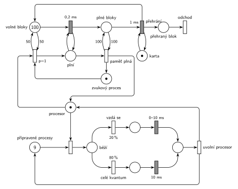

# 10–05 – Zvuková karta

## Zadání

> Mějme jednoprocesorový počítač se zvukovou kartou, na kterém běží 10 procesů. Jeden z nich je speciální a zapisuje do zvukové karty vzorky, které je schopen produkovat rychlostí 500 tisíc za sekundu. Karta má vyrovnávací paměť o velikosti 10 tisíc vzorků a je nastavena tak, že přehraje 100 tisíc vzorků za sekundu. Pokud se vyrovnávací paměť dostatečně vyprázdní (a je volný procesor), je procesor prioritně přidělen zvukovému procesu, který ji začne plnit po blocích 100 vzorků dokud nebude zcela plná a potom se vzdá procesoru. (Doporučení: tečka = volné místo pro jeden blok 100 vzorků)
>
> Všechny ostatní procesy mají stejnou prioritu a je jim spravedlivě (round-robin) přidělován procesor s časovým kvantem 10ms. Procesy se mohou vzdát procesoru s pravděpodobností 20 procent v libovolném okamžiku jim přiděleného časového kvanta. Dobu potřebnou pro přepnutí kontextu zanedbáváme.

Věta „V modelu jednoznačně ukažte (přechodem) moment, kdy transakce opouští systém“ v zadání není (přibyla až v roce 2022/23). Výstupní přechod je v síti přesto (pro přehrané bloky).

Podobné úlohy: [10–04 – Počítačový server](<../10–04 - Počítačový server/10–04 - Počítačový server.md>) (přidělování procesoru), [10–02 – Výpočetní služba se spánkem](<../10–02 - Výpočetní služba se spánkem/10–02 - Výpočetní služba se spánkem.md>).

## Interpretace

Zobrazit interpretaci (nápověda)

- **Jednotka je blok 100 vzorků**, jak radí doporučení. Paměť 10 000 vzorků je 100 bloků: místo *Volné bloky* (na počátku 100 značek, paměť je prázdná) a *Plné bloky*. Platí *Volné* + *Plné* = 100.
- **Časy:** zvukový proces vyrobí 100 vzorků za 100 / 500 000 s = **0,2 ms**, karta je přehraje za 100 / 100 000 s = **1 ms**. Obojí jsou pevné časy.
- **Karta** přehrává jeden blok po druhém, proto má jednu značku ve smyčce s přechodem `1 ms` (bez ní by běžný časovaný přechod přehrával všechny plné bloky najednou, slajd 138). Přehrání vrátí volné místo a **přehraný blok opouští systém**. To je jediná transakce, která systém opravdu opouští.
- **„Dostatečně vyprázdní“** zadání nečísluje. Síť používá polovinu paměti: testovací dvojice hran s váhou 50 na *Volné bloky*. Jiný práh je jen jiné číslo u hran.
- **Přednost zvukového procesu:** přidělení procesoru zvukovému procesu má `p=1`, ostatním `p=0`. Běžící proces se nepřerušuje („a je volný procesor“).
- **Plnění dokud není plná:** zvukový proces drží procesor a smyčka *plní* ⇄ `0,2 ms` bere po jednom volné místo. Přechod *paměť plná* (test váhou 100 na *Plné bloky*) vrátí procesor i značku zvukového procesu. Plnění je 5× rychlejší než přehrávání, takže se paměť naplní.
- **Ostatní procesy** (9 značek v *Připravené procesy*) dostávají procesor po jednom. Pořadí značek v místě síť nerozliší. Protože jsou procesy stejné, náhodný výběr odpovídá round-robinu.
- **20 % / 80 %:** proces se buď vzdá v náhodném okamžiku kvanta (`0–10 ms` rovnoměrně), nebo kvantum vyčerpá (`10 ms`). Pak uvolní procesor a vrací se mezi připravené.
- Procesy systém neopouštějí (běží pořád). Proto je výstupní přechod jen u přehraných bloků.

- **Jemnost sémantiky:** přechod *paměť plná* testuje místo *Plné bloky* hranou s váhou 100 tam a zpět. To místo je zároveň vstupem přehrávání `1 ms`, takže test probíhající přehrávání bloku formálně zruší a spustí znovu (slajdy 137–139). Stane se to jednou za cyklus plnění a zpozdí to přehrávání nejvýš o 1 ms, na podstatu modelu to nemá vliv. Přesný model by měl stav „paměť plná“ v samostatném místě.

## Petriho síť

Zobrazit Petriho síť

| Požadavek | Prvek sítě |
|---|---|
| paměť 10 000 vzorků, tečka = blok 100 | *Volné bloky* (100) a *Plné bloky* |
| karta přehraje 100 000 vzorků/s | *Karta* ⇄ `1 ms`: plný blok → volné místo + *přehraný blok* → *odchod* |
| paměť dostatečně prázdná + volný procesor → zvuk má přednost | `p=1`: *Zvuk. proces* + *Procesor* + test 50 *Volných bloků* |
| plnění po blocích, 500 000 vzorků/s | *plní* ⇄ `0,2 ms`: volné místo → plný blok |
| po naplnění se procesoru vzdá | *paměť plná* (test 100 *Plných bloků*) vrací *Procesor* a *Zvuk. proces* |
| 9 ostatních procesů, kvantum 10 ms | *Připravené procesy* (9) → přidělení → `20 %` `0–10 ms` / `80 %` `10 ms` → *uvolní procesor* |

Kontrola simulací: procesor je vždy právě u jednoho procesu nebo volný, *Volné* + *Plné* = 100 a všech 9 obyčejných procesů je pořád v síti. Karta hraje bez přerušení (za 9,5 s přehrála 9 544 bloků). Zvukový proces dostává procesor zhruba každých 65 ms.

## Časté chyby

Zobrazit časté chyby

- Přepočet rychlostí: 100 vzorků je 0,2 ms při 500 000/s a 1 ms při 100 000/s.
- Přehrávání bez značky karty: časovaný přechod s více značkami na vstupu má odpočet pro každou značku (slajd 138).
- Plnění bez smyčky nebo bez testu „paměť plná“: zvukový proces buď zapíše jediný blok, nebo procesor nikdy nevrátí.
- Zvukový proces, který přeruší běžící proces. Zadání chce přidělení, až je procesor volný.
- Procesy, které se po kvantu nevracejí do *Připravené procesy*.
- Pravděpodobnost i priorita u jednoho přechodu: `20 %`/`80 %` patří na samostatné přechody za přidělením.

## Původ a zdroje

Zobrazit původ a zdroje

**Původ:** půlsemestrální písemka, rok neznámý (zadání ve Studentských skriptech 2015/16 a v přípravném dokumentu 2021/22).

**Zdroje:**

- `Fitcheats/Skripta/FIT - Studentská skripta 2015-16.pdf`, str. 43 (zadání „Příklad se zvukovou kartou“, bez řešení)
- `Fitcheats/Půlsemestrálky/FIT - Příprava 2021-22.pdf`, str. 22 (totéž zadání a ručně kreslené studentské řešení)

**Existující řešení:**

- **Příprava 2021/22, str. 22 (ručně kreslené, bez hlasů):** „Procesor“ (1 značka) nahoře, vlevo zvukový proces „ZP“ s `p=1`, `a) 0,2 ms` (plnění), `b) 10ms` (přehrávání), `c)` s hranami `100` (paměť plná), místo „100V“ a legenda „1V = 1 volné miesto pre blok 100 vzorkov“. Vpravo 9 procesů, `20%` → `exp(10ms)` a druhá větev (číslo se čte spíš jako `90%`, má být 80 %) → `10 ms`. Chyby a nejasnosti:
  - přehrání bloku trvá 1 ms, ne 10 ms, a karta nemá vlastní značku, takže by se přehrávalo víc bloků souběžně;
  - `a) 0,2 ms` není ve smyčce, zvukový proces tak zapíše jen jeden blok. Značka „ZP“ se nikam nevrací;
  - vzdání v libovolném okamžiku kvanta jako `exp(10ms)` může trvat déle než celé kvantum; patří sem rovnoměrné `0–10 ms`;
  - z uvolnění procesoru vede hrana jen do „Procesor“, procesy se mezi připravené nevracejí (po jednom kvantu zmizí);
  - práh „dostatečně vyprázdní“ je jedna volná tečka v „100V“. To je přípustné čtení, jen se pak zvukový proces probouzí po každém přehraném bloku.
- Ve Studentských skriptech (str. 43) je jen zadání.

