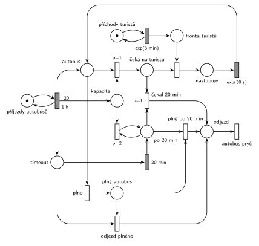

# Výletní autobus

## Zadání

⚠️ **Rekonstrukce.** Zadání z roku 2025/26 v materiálech chybí, existuje jen Hrubého řešení. Text níže je odvozený z jeho sítě a poznámek („proces „bus““, „proces timeout“, „čekám na turistu“, „Odjezd: *1 – plno, *2 – čekám ≥ 20min“). Čísla jsou převzatá z řešení. Že po 20 minutách autobus už nikoho nenabírá, je doplněné (podle podobné úlohy s lodí).

> Na zastávku výletního autobusu přichází turisté v intervalech exponenciálně se středem 3 minuty. Každou hodinu přijede autobus s kapacitou 20 míst. Turisté nastupují po jednom, nástup jednoho turisty trvá exponenciálně se středem 30 sekund. Autobus odjíždí, jakmile je plný, nebo když od jeho příjezdu uplynulo 20 minut. Pak už další turisty nenabírá.

Všimni si: turistů přijde v průměru 20 za hodinu a autobus jich za hodinu odveze nejvýš 20. Systém je na hraně stability, fronta turistů v dlouhém běhu pomalu roste.

Podobné úlohy: [Přehrada s vyhlídkovou lodí](<../14 - Přehrada s vyhlídkovou lodí/14 - Přehrada s vyhlídkovou lodí.md>) (nabírání do kapacity, nejvýš 15 minut), [Festivalový autobus](<../06 - Festivalový autobus/06 - Festivalový autobus.md>), [Vyhlídková loď na molu](<../07 - Vyhlídková loď na molu/07 - Vyhlídková loď na molu.md>), [Výletní loď](<../04 - Výletní loď/04 - Výletní loď.md>).

## Nápověda

<details>
<summary>Zobrazit nápovědu</summary>
<br>

- **Turisté** přichází ze smyčky *příchody turistů* ⇄ `exp(3 min)` do místa *fronta turistů*.
- **Autobus je proces** (značka), ne zařízení. Přechod `1 h` ve smyčce s místem *příjezdy autobusů* vytvoří značku *autobus*, 20 značek *kapacita* (volná místa) a značku *timeout* (odpočet 20 min pro tento autobus).
- **If–else „je volné místo?“:** přechod s `p=1` vezme *autobus* a jedno volné místo a autobus pak *čeká na turistu*. Když místo není, provede se přechod *plno* (`p=0`) a autobus je *plný*.
- **Nástup po jednom:** *čeká na turistu* + turista z *fronty turistů* → *nastupuje* → `exp(30 s)` → zpět *autobus*. Protože je značka autobusu jen jedna, nastupuje vždy jen jeden turista. Turista se v přechodu nástupu „spojí“ s autobusem a odjíždí s ním. Kdo ve frontě zůstane, čeká na další autobus.
- **Odjezd plného autobusu** (*odjezd plného*) bere *plný autobus* i značku *timeout*, takže odpočet `20 min` zanikne a nevyprší až u dalšího autobusu.
- **Po 20 minutách** přejde značka z *timeout* do *po 20 min*. Smyčka s `p=2` hned odebere všechna zbylá volná místa: autobus už nikoho nenabere a další autobus začíná přesně s 20 místy. Priorita 2 zajistí, že se místa vyprázdní dřív, než autobus odjede (jinak by zbylá místa přešla k dalšímu autobusu).
- **Odjezd po 20 minutách** (*čekal 20 min*): *po 20 min* + *čeká na turistu*. Priorita `p=1` zajistí, že autobus po vypršení odpočtu už nového turistu nenabere, i když někdo ve frontě stojí.
- **Odpočet může vypršet během nástupu.** Autobus se pak vrátí do místa *autobus* bez volného místa (zbylá zanikla, nebo nastoupil dvacátý turista) a přechodem *plno* se stane *plným autobusem*. *Odjezd plného* už nemůže (značka *timeout* je pryč) a *čekal 20 min* také ne (autobus nečeká na turistu). Bez přechodu *plný po 20 min* (*plný autobus* + *po 20 min*) by autobus zůstal na zastávce navždy.
- **Odchod ze systému:** všechny tři druhy odjezdu vedou do místa *odjezd* a autobus systém opouští přechodem *autobus pryč* bez výstupních hran.
- Autobus vždy odjede nejpozději za 20 minut a jeden nástup, takže se dva autobusy nikdy nepotkají.

</details>

## Petriho síť

<details>
<summary>Zobrazit Petriho síť</summary>
<br>



</details>

## Časté chyby

<details>
<summary>Zobrazit časté chyby</summary>
<br>

- Odjezd plného autobusu bez odebrání značky *timeout*: odpočet doběhne naprázdno a další autobus pak odjede předčasně, hned jak začne čekat na turistu.
- Zapomenuté vynulování zbylých míst: kapacita dalšího autobusu je pak větší než 20.
- Timeout `20 min` přímo na místě *čeká na turistu*: měří jen čekání na dalšího turistu (a s každým nástupem začíná znovu), ne dobu od příjezdu autobusu.
- Chybějící přechod pro případ „odpočet vypršel během nástupu posledního turisty“: autobus pak na zastávce uvízne.
- Kapacita testovaná inhibiční hranou místo if–else přes prioritu.

</details>

## SIMLIB

<details>
<summary>Zobrazit SIMLIB kód</summary>
<br>

Model je izomorfní k Petriho síti výše: každé místo, přechod a značka mají svůj protějšek v kódu.

```cpp
// Výletní autobus – model v SIMLIB/C++
#include "simlib.h"

Queue FrontaTuristu("Fronta turistů");      // místo „fronta turistů“
Histogram Cekani("Čekání turisty na nástup [min]", 0, 60, 20);
Histogram Obsazeno("Turistů v odjíždějícím autobusu", 0, 1, 21);
int odjezdPlny = 0, odjezdCekal = 0, odjezdPlnyPo20 = 0;  // tři druhy odjezdu
Process *cekajici = nullptr;                // autobus v místě „čeká na turistu“

class Turista : public Process {            // značka turisty
  void Behavior() {
    double prichod = Time;
    Into(FrontaTuristu);
    if (cekajici) cekajici->Activate();     // čekající autobus může nabrat
    Passivate();                            // čeká na přechod „nástup“
    Cekani(Time - prichod);
  }                                         // turista odjíždí s autobusem
};

class Autobus : public Process {            // značka „autobus“ (proces, ne zařízení)
 public:
  int kapacita = 20;                        // 20 značek v místě „kapacita“
  bool vyprselo = false;                    // značka v místě „po 20 min“
  Event *timeout = nullptr;                 // značka v místě „timeout“ (běžící odpočet)
  void Behavior() override;
};

class Odpocet : public Event {              // časovaný přechod 20 min
  Autobus *bus;
 public:
  Odpocet(Autobus *b) : bus(b) { Activate(Time + 20); }
  void Behavior() override {
    bus->timeout = nullptr;                 // „timeout“ → „po 20 min“
    bus->vyprselo = true;
    bus->kapacita = 0;                      // smyčka p=2: zbylá místa zaniknou
    if (cekajici == bus) bus->Activate();   // autobus čeká na turistu → čekal 20 min
  }
};

void Autobus::Behavior() {
  timeout = new Odpocet(this);              // přechod 1 h dal značku do „timeout“
  int nastoupilo = 0;
  for (;;) {                                // místo „autobus“
    if (kapacita > 0) {                     // p=1: je volné místo
      kapacita--;                           // → „čeká na turistu“
      while (FrontaTuristu.Empty() && !vyprselo) {
        cekajici = this;
        Passivate();
        cekajici = nullptr;
      }
      if (vyprselo) { odjezdCekal++; break; }  // čekal 20 min (p=1 před nástupem)
      FrontaTuristu.GetFirst()->Activate();    // přechod „nástup“ vezme turistu
      Wait(Exponential(0.5));               // nastupuje exp(30 s)
      nastoupilo++;
    } else if (timeout) {                   // plno (p=0) → plný autobus, odpočet běží
      delete timeout;                       // odjezd plného: odpočet zanikne
      timeout = nullptr;
      odjezdPlny++;
      break;
    } else {                                // plný a odpočet už vypršel
      odjezdPlnyPo20++;                     // plný po 20 min
      break;
    }
  }
  Obsazeno(nastoupilo);
}                                           // „odjezd“ → přechod „autobus pryč“

class PrijezdyAutobusu : public Event {     // místo „příjezdy autobusů“ ve smyčce s 1 h
  void Behavior() {
    (new Autobus)->Activate();
    Activate(Time + 60);
  }
};

class PrichodyTuristu : public Event {      // místo „příchody turistů“ ve smyčce s exp(3 min)
  void Behavior() {
    (new Turista)->Activate();
    Activate(Time + Exponential(3));
  }
};

int main() {
  Init(0, 60 * 1000);                       // modelový čas v minutách: 1000 hodin
  (new PrijezdyAutobusu)->Activate(60);     // první autobus po hodině
  (new PrichodyTuristu)->Activate();
  Run();
  Print("Odjezdy: plný %d, čekal 20 min %d, plný po 20 min %d\n",
        odjezdPlny, odjezdCekal, odjezdPlnyPo20);
  Obsazeno.Output();
  Cekani.Output();
  FrontaTuristu.Output();
}
```

| Petriho síť | SIMLIB |
|---|---|
| *příchody autobusů* ⇄ `1 h` | událost `PrijezdyAutobusu`, která se plánuje za 60 min |
| značka *autobus* | proces `Autobus` |
| 20 značek *kapacita* | atribut `kapacita = 20` |
| *timeout* → `20 min` → *po 20 min* | událost `Odpocet` naplánovaná na `Time + 20`, nastaví `vyprselo` |
| smyčka `p=2` na *kapacita* | `bus->kapacita = 0` v události `Odpocet` |
| if–else `p=1` / *plno* | `if (kapacita > 0) … else …` |
| *čeká na turistu* | `Passivate()` (budí ho příchod turisty nebo `Odpocet`) |
| *fronta turistů*, přechod nástup | `Queue FrontaTuristu`, `GetFirst()->Activate()` |
| *nastupuje* → `exp(30 s)` | `Wait(Exponential(0.5))` |
| *čekal 20 min* (`p=1`) | test `vyprselo` dřív než výběr turisty z fronty |
| *odjezd plného* (bere *timeout*) | `delete timeout` (zruší naplánovaný odpočet) |
| *plný po 20 min* | větev `else` při `timeout == nullptr` |
| přechod *autobus pryč* | konec metody `Behavior()` |

**Kontrola simulací.** Petriho síť: na zastávce je vždy nejvýš jeden autobus a ke každému patří jeho odpočet (*autobus* + *čeká na turistu* + *nastupuje* + *plný autobus* = *timeout* + *po 20 min*), *kapacita* nikdy nepřesáhne 20. Proběhnou všechny tři druhy odjezdu, *plný po 20 min* jen výjimečně. Fronta turistů je kriticky zatížená, proto se v kontrole nehlídá její omezenost (`make check`). SIMLIB model: za 1000 hodin odjelo 999 autobusů, z toho 978 plných, 19 po 20 minutách čekání a 2 plné po vypršení odpočtu; v průměru vezly 19,9 turisty. Fronta turistů v tom běhu měla průměrně 139 a nejvýš 276 čekajících, průměrné čekání bylo asi 7 hodin. To je důsledek kritického zatížení (20 turistů za hodinu = kapacita jednoho autobusu za hodinu), ne chyba modelu (`make simlib`).

</details>

## Původ a zdroje

<details>
<summary>Zobrazit původ a zdroje</summary>
<br>

**Původ:** půlsemestrální písemka 2025/26, varianta C, 10 bodů (bodování podle ostatních let).

**Původní znění:**

> Na zastávku výletního autobusu přichází turisté v intervalech daných exponenciálním rozložením se středem 3 minuty. Každou hodinu přijede autobus s kapacitou 20 míst. Turisté nastupují po jednom, nástup jednoho turisty trvá dobu danou exponenciálním rozložením se středem 30 sekund. Autobus odjíždí, jakmile je plný, nebo když od jeho příjezdu uplynulo 20 minut. Pak už další turisty nenabírá. V modelu jednoznačně ukažte (přechodem) moment, kdy transakce opouští systém.

**Zdroje:**

- `Fitcheats/Půlsemestrálky/Hrubý - Řešení 2025-26.pdf`, str. 3

**Existující řešení:**

- **Hrubý (str. 3):** stejná struktura: zdroj `1h` dává *proces „bus“*, váhou 20 *kapacitu* a *proces timeout*; if–else `p=1` → *čekám na turistu* → nástup `exp(30s)` → zpět; odjezd *1 (plno, bere i timeout) a *2 (`20min` + čekám na turistu); výstup *autobus pryč*. Pod sítí si poznamenal past „Hypoteticky může nastat timeout ∧ kapacita=0 ⇒ „bus“ uvízne“ a hnědě dokreslil přechod (*proces bus* + vypršený timeout), který ji řeší (tady *plný po 20 min*).
- Rozdíly: oba generátory kreslí jako přechod bez vstupního místa. *1 a hnědý přechod berou značku přímo z *procesu „bus“*; tady vede větev „není místo“ nejdřív do místa *plný autobus* (přechod *plno*, `p=0`), aby z místa *autobus* nevedlo pět hran. Zbylá místa u Hrubého maže smyčka `p=1` v místě *odjezd timeout*, za kterým následuje ještě místo *odjezd kapacitní*; tady je jedno místo *odjezd* a zbylá místa maže smyčka `p=2` hned po vypršení odpočtu (chování je stejné, autobus po 20 minutách stejně nikoho nenabere). Prioritu u odjezdu po 20 minutách Hrubý nepíše.

</details>

## Reference

- [Jak síť funguje](<../../../basics/Jak síť funguje.md>)
- [Notace a vzory](<../../../basics/Notace a vzory.md>)
- [Seznam úloh](<../../Seznam úloh.md>)
