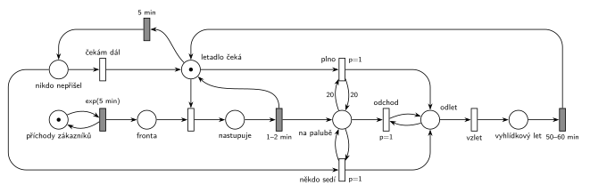

# Vyhlídkové lety

## Zadání

> Do Centra vyhlídkových letů přichází zákazníci v intervalech exponenciálně se středem 5 minut a čekají na nástup do vyhlídkového letadla. Centrum obsahuje jedno vyhlídkové letadlo, které po naložení zákazníků odlétá na vyhlídkovou trasu trvající rovnoměrně 50–60 minut. Cestující nastupují do letadla jednotlivě. Nastoupení jednoho zabere rovnoměrně 1–2 minuty. Kapacita letadla je 20 cestujících. Letadlo odlétá na trasu, pokud nastane jedna z okolností: 1) letadlo je naplněno, 2) od nastoupení posledního cestujícího uběhlo 5 minut (tj fronta se vyčerpala, nikdo další nejde a **v letadle už někdo sedí**). Vystupování cestujících po návratu letadla nemodelujeme.

Podobné úlohy: [Vyhlídková loď na molu](<../07 - Vyhlídková loď na molu/07 - Vyhlídková loď na molu.md>) (skoro stejné zadání s lodí, navíc netrpěliví cestující), [Výletní autobus](<../01 - Výletní autobus/01 - Výletní autobus.md>), [Výletní loď](<../04 - Výletní loď/04 - Výletní loď.md>), [Výletní loď na jezeře](<../11 - Výletní loď na jezeře/11 - Výletní loď na jezeře.md>).

## Interpretace

<details>
<summary>Zobrazit interpretaci (nápověda)</summary>
<br>

- **Příchody** modeluje smyčka *příchody zákazníků* ⇄ `exp(5 min)`, zákazníci čekají ve *frontě*.
- **Letadlo** je jedna značka, která je vždy v jednom stavu. Místo *čeká na cestující* je zařízení pro nástup: zákazník z *fronty* + letadlo → *nastupuje* → `1–2 min`. Po nástupu se letadlo vrací do místa *letadlo doma* a zákazník jde *na palubu*. Místo *na palubě* je zároveň čítač nastoupených.
- **Letadlo doma** je rozhodovací místo, kam se letadlo vrací po každém nástupu i po letu. Plné letadlo odlétá přechodem *plno* (`p=1`, testovací hrany s váhou 20 na *na palubě*), jinak přechod s `p=0` vrátí letadlo do stavu *čeká na cestující*. Dvacátý cestující tak odlet spustí hned a 21. zákazník nenastoupí.
- **5 minut od posledního nástupu:** časovaný přechod `5 min` má vstup z *čeká na cestující*. Odpočet běží jen, když letadlo stojí volné. Každý nástup mu značku vezme a po nástupu se odpočet spustí znovu, takže měří přesně dobu od dokončení posledního nástupu. Když ve frontě někdo je, nástup (okamžitý přechod) letadlo vezme dřív, než odpočet doběhne.
- **„V letadle už někdo sedí“:** po 5 minutách rozhoduje if–else přes prioritu. *Někdo sedí* (`p=1`) testuje aspoň jednu značku na palubě a letadlo odlétá, jinak *čekám dál* (`p=0`) vrátí letadlo do stavu *čeká na cestující* a odpočet běží znovu.
- **Odchod ze systému:** oba důvody odletu vedou do místa *odlet*. Smyčka `p=1` z něj bere cestující z *na palubě* po jednom, dokud tam nějací jsou, a každý cestující opouští systém přechodem *odchod*. Vystupování po návratu se nemodeluje, takže cestující odcházejí v okamžiku odletu.
- **Let:** *vzlet* (`p=0`, až po vyprázdnění paluby) pošle letadlo na trasu `50–60 min`, odkud se vrátí do místa *letadlo doma*.

</details>

## Petriho síť

<details>
<summary>Zobrazit Petriho síť</summary>
<br>



</details>

## Časté chyby

<details>
<summary>Zobrazit časté chyby</summary>
<br>

- Časovač 5 min jako netrpělivost na *Frontě*. Ten by měřil čekání zákazníka, ne dobu od posledního nástupu.
- Odlet po 5 minutách i s prázdným letadlem. Zadání chce, aby už někdo seděl. Bez if–else by letadlo létalo prázdné.
- Čítač nastoupených, který se po odletu nevynuluje. Při neplném letadle nestačí hrana s váhou, je potřeba cyklus s prioritou, který odebere všechny.
- Plno bez hrany z *letadlo doma* (jen váha 20 z čítače). Značka letadla pak zůstane doma, letadlo „odletí“ a zároveň dál nabírá cestující.
- Chybějící priorita u *plno*: obsazení letadla dalším zákazníkem by předběhlo odlet a na palubu by se dostal 21. cestující.

</details>

## SIMLIB

<details>
<summary>Zobrazit SIMLIB kód</summary>
<br>

Model je izomorfní k Petriho síti výše: každé místo, přechod a značka mají svůj protějšek v kódu.

```cpp
// Vyhlídkové lety – model v SIMLIB/C++
#include "simlib.h"

Queue Fronta("Fronta");                     // místo „fronta“
Queue Paluba("Na palubě");                  // místo „na palubě“ (čítač nastoupených)
Histogram Obsazeni("Cestujících v odlétajícím letadle", 0, 2, 11);
Histogram Doba("Doba zákazníka od příchodu do odletu [min]", 0, 10, 20);
int letuPlnych = 0, letuPo5min = 0;
Process *cekajici = nullptr;                // letadlo v místě „čeká na cestující“

class Zakaznik : public Process {           // značka zákazníka
  void Behavior() {
    double prichod = Time;
    Into(Fronta);
    if (cekajici) cekajici->Activate();     // nástup má přednost před odpočtem 5 min
    Passivate();                            // fronta → nástup → na palubě (letadlo ho přesouvá)
    Doba(Time - prichod);
  }                                         // konec Behavior = přechod „odchod“
};

class Letadlo : public Process {            // značka letadla
 public:
  bool vyprselo = false;                    // značka v místě „nikdo nepřišel“
  void Behavior() override;
};

class Pet : public Event {                  // časovaný přechod 5 min na „čeká na cestující“
  Letadlo *l;
 public:
  Pet(Letadlo *x) : l(x) { Activate(Time + 5); }
  void Behavior() override { l->vyprselo = true; l->Activate(); }
};

void Letadlo::Behavior() {
  for (;;) {                                // místo „letadlo doma“
    if (Paluba.Length() == 20) {            // plno (p=1, test 20 na palubě)
      letuPlnych++;
    } else {                                // p=0 → „čeká na cestující“
      bool odlet = false;
      while (Fronta.Empty()) {              // nikdo nečeká: běží odpočet 5 min
        vyprselo = false;
        Event *t = new Pet(this);
        cekajici = this;
        Passivate();                        // probudí ho zákazník nebo odpočet
        cekajici = nullptr;
        if (!vyprselo) { delete t; break; } // přišel zákazník: odpočet zanikne
        if (!Paluba.Empty()) { odlet = true; break; }  // někdo sedí (p=1)
      }                                     // jinak čekám dál (p=0): nový odpočet
      if (!odlet) {
        Entity *z = Fronta.GetFirst();      // přechod nástup
        Wait(Uniform(1, 2));                // nastupuje 1–2 min
        Paluba.Insert(z);                   // → na palubě, letadlo zpět domů
        continue;
      }
      letuPo5min++;
    }
    Obsazeni(Paluba.Length());              // místo „odlet“
    while (!Paluba.Empty())                 // smyčka p=1: cestující odcházejí
      Paluba.GetFirst()->Activate();
    Wait(Uniform(50, 60));                  // vzlet → vyhlídkový let 50–60 min
  }
}

class Prichody : public Event {             // místo „příchody zákazníků“ ve smyčce s exp(5 min)
  void Behavior() {
    (new Zakaznik)->Activate();
    Activate(Time + Exponential(5));
  }
};

int main() {
  Init(0, 60 * 1000);                       // modelový čas v minutách: 1000 hodin
  (new Letadlo)->Activate();                // letadlo je na začátku doma
  (new Prichody)->Activate();
  Run();
  Print("Lety: plné %d, po 5 minutách %d\n", letuPlnych, letuPo5min);
  Obsazeni.Output();
  Doba.Output();
  Fronta.Output();
}
```

| Petriho síť | SIMLIB |
|---|---|
| *příchody zákazníků* ⇄ `exp(5 min)` | událost `Prichody`, která se znovu plánuje za `Exponential(5)` |
| značka zákazníka, *fronta* | proces `Zakaznik`, `Queue Fronta` |
| značka letadla | proces `Letadlo` (jeden, nekonečný cyklus) |
| *letadlo doma*, *plno* (`p=1`) | začátek cyklu, `if (Paluba.Length() == 20)` |
| *čeká na cestující* | `Passivate()` (budí ho příchod zákazníka nebo událost `Pet`) |
| nástup, *nastupuje* → `1–2 min` | `Fronta.GetFirst()`, `Wait(Uniform(1, 2))` |
| *na palubě* (čítač) | `Queue Paluba` |
| `5 min` → *nikdo nepřišel* | událost `Pet` (při nástupu zrušená `delete t`) |
| *někdo sedí* (`p=1`) / *čekám dál* | `if (!Paluba.Empty())` / další průchod `while` |
| smyčka `p=1` z *odlet*, přechod *odchod* | `Paluba.GetFirst()->Activate()`, konec `Zakaznik::Behavior()` |
| *vzlet* → *vyhlídkový let* → `50–60 min` | `Wait(Uniform(50, 60))` |

**Kontrola simulací.** Petriho síť: letadlo je vždy v jednom stavu (*letadlo doma* + *čeká na cestující* + *nastupuje* + *nikdo nepřišel* + *odlet* + *vyhlídkový let* = 1), na palubě je nejvýš 20 cestujících a provedou se všechny přechody (`make check`). SIMLIB model: za 1000 hodin letadlo vzlétlo 705krát, 318krát plné a 387krát po pěti minutách bez nástupu, v průměru s 16,9 cestujícího. To je dohromady asi 11 900 cestujících, tedy všichni příchozí (12 za hodinu × 1000 h = 12 000, rozdíl dělá náhoda a zákazníci, kteří na konci běhu ještě čekají). Zákazník strávil od příchodu do odletu průměrně 50 minut, fronta měla nejvýš 37 zákazníků (`make simlib`).

</details>

## Původ a zdroje

<details>
<summary>Zobrazit původ a zdroje</summary>
<br>

**Původ:** půlsemestrální písemka 2024/25, varianta C, 10 bodů.

**Původní znění:**

> Do Centra vyhlídkových letů přichází zákazníci v intervalech daných exponenciálním rozložením se středem 5 min a čekají na nástup do vyhlídkového letadla. Centrum obsahuje jedno vyhlídkové letadlo, které po naložení zákazníků odlétá na vyhlídkovou trasu trvající 50-60 minut. Cestující nastupují do letadla jednotlivě. Nastoupení jednoho zabere 1-2 minuty rovnoměrně. Kapacita letadla je 20 cestujících. Letadlo odlétá na trasu, pokud nastane jedna z okolností: 1) letadlo je naplněno, 2) od nastoupení posledního cestujícího uběhlo 5 minut (tj fronta se vyčerpala, nikdo další nejde a **v letadle už někdo sedí**). Vystupování cestujících po návratu letadla nemodelujeme.
>
> Zadaný systém modelujte formou Petriho sítě s vyznačením všech potřebných parametrů. **V modelu jednoznačně ukažte (přechodem) moment, kdy transakce opouští systém.**

**Zdroje:**

- `Fitcheats/Půlsemestrálky/Zadání z minulých let/2024-25.pdf`, str. 1 (koláž zadání všech čtyř variant)
- `Fitcheats/Půlsemestrálky/Hrubý - Řešení 2024-25.pdf`, str. 3 (řešení od Hrubého, hodně přepisované)

**Existující řešení:**

- **Hrubý (str. 3):** stejný princip. *Letadlo je doma* (značka) je zařízení pro nástup `1-2m`, nastoupení přidávají značku do *čítače nastoupených*. *Signál pro odlet* (`p=1`, hrana s váhou 20 z čítače + letadlo) → *na cestě* → `50-60m` → zpět. Časovač `5min` má vstup z letadla, po něm if–else: `p=1`, když už někdo nastoupil, jinak *čekám dál* zpět k letadlu. Když někdo nastoupil, cyklus s `p=1` vyprázdní čítač a letadlo letí. Rozdíly: plné letadlo u Hrubého odebere 20 cestujících přímo hranou s váhou 20. Výstupní přechod pro cestující nekreslí, cestující prostě zmizí z čítače. Jeho místo *letadlo je doma* má šest hran (nástup, návrat z nástupu, `5min`, *čekám dál*, signál pro odlet, návrat z letu); tady je rozdělené na *letadlo doma* (kam se letadlo vrací a kde se testuje plno) a *čeká na cestující* (nástup a odpočet 5 min), spojené přechodem s `p=0`. Chování je stejné, jen každá hrana dostane vlastní stranu místa.

</details>
