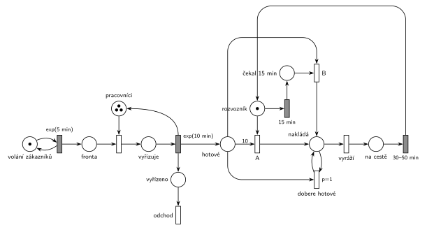

# Pizzerie s rozvozem

## Zadání

> Do pizzerie s rozvozem volají zákazníci v intervalech exponenciálně se středem 5 minut. Vyřízení jedné objednávky (rozhovor, výroba pizzy) zabere exponenciálně se středem 10 minut. V pizzerii jsou 3 pracovníci pro obsluhu volajících a jeden pracovník pro rozvoz. Rozvozový pracovník vyráží na trasu rozvozu se všemi hotovými objednávkami, pokud je splněna jedna z podmínek: A) buď je hotových objednávek alespoň 10, nebo B) je hotová alespoň nějaká a on už čeká 15 minut. Kompletní rozvoz trvá rovnoměrně 30–50 minut.

Podobné úlohy: [Výletní loď](<../04 - Výletní loď/04 - Výletní loď.md>), [Výletní autobus](<../01 - Výletní autobus/01 - Výletní autobus.md>), [Psí salon](<../../09 - Obsluha zákazníků/03 - Psí salon/03 - Psí salon.md>) (vyprázdnění místa smyčkou s prioritou).

## Nápověda

<details>
<summary>Zobrazit nápovědu</summary>
<br>

- **Hovory** přichází ze smyčky *volání zákazníků* ⇄ `exp(5 min)` do *fronty*.
- **3 pracovníci** jsou sklad se 3 značkami. Každý vyřídí celou objednávku (rozhovor i výrobu) za `exp(10 min)`, časovaný přechod pak značku pracovníka vrací.
- **Kdy transakce opouští systém:** transakce (hovor, objednávka) odchází hned po vyřízení přechodem *odchod* a časovaný přechod zároveň vloží značku do *hotové*. Značky v *hotové* jsou hotové pizzy, které rozvozník odveze. Druhá možnost je nechat odejít jednu značku až po návratu z rozvozu (transakcí je pak jízda, ne objednávka). Obojí je v pořádku, jen musí být jasné, co je transakce.
- **Rozvozník** je místo s 1 značkou a dvě cesty, jak vyrazit:
  - **A)** okamžitý přechod s hranou váhy 10 z *hotové*. Provede se, jakmile je hotová desátá pizza, nebo hned po návratu, když jich mezitím přibylo aspoň 10.
  - **B)** časovaný přechod `15 min` se vstupem jen z *rozvozník*: odpočet běží od chvíle, kdy rozvozník čeká. Pokud mezitím vyrazí podle A, značka zmizí a odpočet zanikne. Po 15 minutách je značka v *čekal 15 min* a přechod B se provede s první hotovou pizzou. Když žádná není, čeká rozvozník libovolně dlouho, dokud nějaká nebude.
- **„se všemi hotovými“:** hrana váhy 10 odebere přesně 10 pizz a přechod B jen jednu. Zbytek naloží smyčka *dobere hotové* s `p=1`, která bere po jedné, dokud *hotové* není prázdné. Teprve pak se může provést *vyráží* (`p=0`). Pizzy dokončené během jízdy čekají na další rozvoz.
- **Rozvoz** `30–50 min` (rovnoměrně) vrací značku *rozvozník*; tím začne nové čekání.

</details>

## Petriho síť

<details>
<summary>Zobrazit Petriho síť</summary>
<br>



</details>

## Časté chyby

<details>
<summary>Zobrazit časté chyby</summary>
<br>

- **Nevzít všechny hotové** (Hrubý: „nedobrat všechny hotové – malá chyba“): přechod A vezme jen 10, přechod B jen jednu a smyčka *dobere hotové* chybí. Rozvozník pak odveze jen část hotových objednávek.
- **Chybný model timeoutu** (Hrubý: „model timeoutu – malá chyba“): časovaný `15 min` se vstupy *rozvozník* i *hotové*. Odpočet pak začne až s první hotovou pizzou, takže rozvozník odjede 15 minut po ní, ne po 15 minutách čekání. Hrubý to na str. 4 ukazuje na ose modelového času. Navíc má pak každá hotová pizza vlastní odpočet (slajd 138).
- Po 15 minutách odjezd bez kontroly, že je hotová aspoň jedna pizza: rozvozník pak vyrazí naprázdno.
- Smyčka *dobere hotové* bez priority: se stejnou prioritou jako *vyráží* může rozvozník odjet dřív, než naloží všechno.
- Chybějící návrat značky *rozvozník* po rozvozu, nebo chybějící výstupní přechod.

</details>

## SIMLIB

<details>
<summary>Zobrazit SIMLIB kód</summary>
<br>

Model je izomorfní k Petriho síti výše: každé místo, přechod a značka mají svůj protějšek v kódu.

```cpp
// Pizzerie s rozvozem – model v SIMLIB/C++
#include "simlib.h"

Store Pracovnici("Pracovníci", 3);          // místo „pracovníci“ se 3 značkami
int hotove = 0;                             // počet značek v místě „hotové“
Histogram Nalozeno("Pizz v jednom rozvozu", 0, 2, 15);
Histogram Cekani("Čekání rozvozníka před odjezdem [min]", 0, 5, 20);
int podleA = 0, podleB = 0;

class Rozvoznik;
Rozvoznik *cekajici = nullptr;              // rozvozník v místě „rozvozník“

class Rozvoznik : public Process {          // značka rozvozníka
 public:
  bool cekal = false;                       // značka v místě „čekal 15 min“
  void Behavior() override;
};

class Patnact : public Event {              // časovaný přechod 15 min na „rozvozník“
  Rozvoznik *r;
 public:
  Patnact(Rozvoznik *x) : r(x) { Activate(Time + 15); }
  void Behavior() override { r->cekal = true; r->Activate(); }
};

void Rozvoznik::Behavior() {
  for (;;) {                                // místo „rozvozník“
    double zacatek = Time;
    cekal = false;
    Event *t = new Patnact(this);           // odpočet 15 min běží od začátku čekání
    cekajici = this;
    while (!(hotove >= 10 || (cekal && hotove >= 1)))
      Passivate();                          // budí ho hotová pizza nebo konec odpočtu
    cekajici = nullptr;
    if (hotove >= 10 && !cekal) {           // A: hrana váhy 10, odpočet zanikne
      delete t;
      podleA++;
    } else {
      podleB++;                             // B: čekal 15 min + aspoň jedna hotová
    }
    Cekani(Time - zacatek);
    Nalozeno(hotove);
    hotove = 0;                             // „nakládá“ + smyčka p=1 „dobere hotové“
    Wait(Uniform(30, 50));                  // vyráží → na cestě → rozvoz 30–50 min
  }
}

class Objednavka : public Process {         // transakce = hovor (objednávka)
  void Behavior() {
    Enter(Pracovnici, 1);                   // fronta + obsazení pracovníka
    Wait(Exponential(10));                  // vyřízení exp(10 min) ...
    Leave(Pracovnici, 1);                   // ... vrací značku pracovníka
    hotove++;                               // značka do „hotové“
    if (cekajici) cekajici->Activate();
  }                                         // vyřízeno → přechod „odchod“
};

class Volani : public Event {               // místo „volání zákazníků“ ve smyčce s exp(5 min)
  void Behavior() {
    (new Objednavka)->Activate();
    Activate(Time + Exponential(5));
  }
};

int main() {
  Init(0, 60 * 1000);                       // modelový čas v minutách: 1000 hodin
  (new Rozvoznik)->Activate();
  (new Volani)->Activate();
  Run();
  Print("Rozvozy: podle A %d, podle B %d\n", podleA, podleB);
  Pracovnici.Output();
  Nalozeno.Output();
  Cekani.Output();
}
```

| Petriho síť | SIMLIB |
|---|---|
| *volání zákazníků* ⇄ `exp(5 min)` | událost `Volani`, která se znovu plánuje za `Exponential(5)` |
| značka objednávky | proces `Objednavka` |
| *pracovníci* (3 značky), obsazení, `exp(10 min)` | `Store Pracovnici(3)`, `Enter`, `Wait(Exponential(10))`, `Leave` |
| *vyřízeno* → *odchod* | konec `Objednavka::Behavior()` |
| *hotové* | čítač `int hotove` |
| *rozvozník* (1 značka) | proces `Rozvoznik` (jeden, nekonečný cyklus) |
| `15 min` → *čekal 15 min* | událost `Patnact`, nastaví `cekal` |
| A (váha 10), B (*čekal 15 min* + 1 hotová) | podmínka `while` (buď `hotove >= 10`, nebo `cekal && hotove >= 1`), při A `delete t` |
| *nakládá* + smyčka *dobere hotové* (`p=1`) | `hotove = 0` (vezme všechny hotové) |
| *vyráží* → *na cestě* → `30–50 min` | `Wait(Uniform(30, 50))` |

**Kontrola simulací.** Petriho síť: platí *pracovníci* + *vyřizuje* = 3 a *rozvozník* + *čekal 15 min* + *nakládá* + *na cestě* = 1, každá hotová pizza je naložena právě jednou (10 × A + B + *dobere hotové* = počet vyřízených) a provedou se všechny přechody (`make check`). SIMLIB model: za 1000 hodin vyjel rozvozník 1256krát, 823krát podle A a 433krát podle B (65 % a 35 %), v průměru s 9,5 pizzy; dohromady asi 11 900 pizz, tedy všechny objednávky (12 za hodinu). Pracovníci byli v průměru obsazení 1,97 z 3, teoreticky 2 (příchody 1/5 za minutu × 10 min obsluhy), tj. vytížení 66 % (`make simlib`).

</details>

## Původ a zdroje

<details>
<summary>Zobrazit původ a zdroje</summary>
<br>

**Původ:** půlsemestrální písemka 2022/23, varianta C, 10 bodů.

**Původní znění:**

> Do pizzerie s rozvozem volají zákazníci v intervalech daných exponenciálním rozložením se středem 5 minut. Vyřízení jedné objednávky (rozhovor, výroba pizzy) zabere dobu danou exponenciálním rozložením se středem 10 minut. V pizzerii jsou 3 pracovníci pro obsluhu volajících a jeden pracovník pro rozvoz. Rozvozový pracovník vyráží na trasu rozvozu se všemi hotovými objednávkami, pokud je splněna jedna z podmínek: A) buď je hotových objednávek alespoň 10, nebo B) je hotová alespoň nějaká a on už čeká 15 minut. Kompletní rozvoz trvá rovnoměrně 30-50 minut.
>
> **V modelu jednoznačně ukažte (přechodem) moment, kdy transakce opouští systém.**

**Zdroje:**

- `Fitcheats/Půlsemestrálky/Zadání z minulých let/2022-23.pdf`, str. 3 (fotka zadání)
- `Fitcheats/Půlsemestrálky/Hrubý - Řešení 2022-23.pdf`, str. 3 (řešení od Hrubého) a str. 4 (jeho poznámky k častým chybám)

**Existující řešení:**

- **Hrubý (str. 3):** síť výše je jeho řešení překreslené: *FRONTA* → obsazení „zam.“ (3) → `exp(10min)` → „Hotová pizza“; „Rozvozník“ s přechodem „10+ hotovo“ (váha 10) a s `15min` čekání → „uběhl timeout“ → přechod s hranou z *Hotová pizza*; obě cesty vedou do místa se smyčkou `P=1` „dobere zbylých hotových zakázek“ → „vyráží“ → „je na cestě“ → rozvoz → *Rozvozník*. Výstup kreslí ve dvou variantách: „varianta A“ hned po `exp(10min)`, „var B“ za rozvozem. Rozdíly: u rozvozu má napsáno `30-60min`, ale zadání říká 30–50 minut; generátor kreslí bez místa. Poznámka vedle sítě zdůrazňuje, že nezáleží na tom, kolik zakázek rozvozník veze, ale musí vzít všechny hotové. K přechodu B si poznamenal, že po timeoutu „pak bude čekat na aspoň jednu hotovou (lib. dlouho)“. Síť výše používá jeho variantu A výstupu.
- **Hrubý (str. 4):** seznam častých chyb (viz níže) a srovnání správného a chybného modelu čekání na ose modelového času.

</details>
