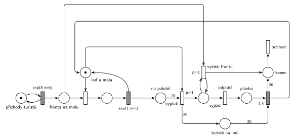

# Výletní loď (11/04)

## Zadání

> Na molo výletní lodi přichází turisté v intervalech exponenciálně se středem 5 minut. Turisté nastupují na přistavenou loď po jednom. Nástup jednoho turisty trvá exponenciálně se středem 1 minuta. Po nastoupení dvacátého turisty loď ukončuje nástup, zvedá kotvu a vyjíždí na okružní jízdu trvající přesně 1 hodinu. S okamžikem vyplutí lodi opouští všichni čekající turisté molo.

Podobné úlohy: [Vyhlídková loď na molu](<../07 - Vyhlídková loď na molu/07 - Vyhlídková loď na molu.md>), [Vyhlídkové lety](<../02 - Vyhlídkové lety/02 - Vyhlídkové lety.md>), [Výletní autobus](<../01 - Výletní autobus/01 - Výletní autobus.md>), [Každá 100. transakce vyprázdní frontu](<../../05 - Délka fronty a kapacita/07 - Každá 100. transakce vyprázdní frontu/07 - Každá 100. transakce vyprázdní frontu.md>).

## Nápověda

<details>
<summary>Zobrazit nápovědu</summary>
<br>

- **Příchody** modeluje smyčka *příchody turistů* ⇄ `exp(5 min)`, turisté čekají ve *frontě na molu*.
- **Loď u mola** (1 značka) je zároveň zařízení pro nástup „po jednom“ a informace, že loď stojí u mola. Nástup je obsazení, `exp(1 min)` a vrácení značky lodi.
- **Čítač nastoupených** je místo *na palubě*. **Vyplutí** je okamžitý přechod s hranou váhy 20 z *na palubě* a se značkou *loď u mola*. Priorita `p=1` zajistí, že po 20. turistovi loď vypluje dřív, než by začal nastupovat 21. (oba přechody potřebují značku lodi).
- **Vyprázdnění mola:** *vyjíždí* je mezistav, který trvá nulový čas. Smyčka `p=1` *vyčisti frontu* bere čekající jednoho po druhém, dokud fronta není prázdná. Teprve pak se provede *odplutí* (`p=0`). Turisté, kteří přijdou během plavby, normálně čekají na další jízdu: odcházejí jen ti, kdo čekají v okamžiku vyplutí.
- **Turisté na lodi** přejdou při vyplutí do místa *turisté na lodi* (váha 20) a ze systému odcházejí po návratu lodi (`1 h`), kdy se zároveň vrací značka *loď u mola*. Dobu vystupování zadání neuvádí, takže je nulová. Odebrat je ze sítě už při vyplutí je také přijatelné.
- **Odchod ze systému:** vyhnaní z mola i turisté po jízdě jdou do místa *konec* a odcházejí přechodem *odchod*.
- Na počátku stojí prázdná loď u mola.

</details>

## Petriho síť

<details>
<summary>Zobrazit Petriho síť</summary>
<br>



</details>

## Časté chyby

<details>
<summary>Zobrazit časté chyby</summary>
<br>

- Vyprázdnění fronty jedním přechodem s váhou hrany. Váha bere přesný počet, ne „všechny“; na „všechny“ je potřeba smyčka s prioritou.
- Smyčka bez návratu značky do *Vyjíždí*: odejde jen jeden turista.
- Fronta se čistí po celou dobu plavby (podmínka „loď je pryč“ místo okamžiku vyplutí). Pak odcházejí i turisté, kteří přišli během jízdy.
- Vyplutí bez `p=1`: může začít nastupovat 21. turista.
- Vyplutí, které nebere značku lodi: během plavby by se dál nastupovalo.
- Zapomenutý návrat značky lodi po 1 h nebo čítač nastoupených, který se při vyplutí nevynuluje.

</details>

## SIMLIB

<details>
<summary>Zobrazit SIMLIB kód</summary>
<br>

Model je izomorfní k Petriho síti výše: každé místo, přechod a značka mají svůj protějšek v kódu.

```cpp
// Výletní loď – model v SIMLIB/C++
#include "simlib.h"

Queue Fronta("Fronta na molu");             // místo „fronta na molu“
Queue NaLodi("Na palubě");                  // místa „na palubě“ a „turisté na lodi“
Histogram Doba("Doba turisty od příchodu do konce jízdy [min]", 0, 20, 15);
int vyhnanych = 0, plaveb = 0;
Process *cekajici = nullptr;                // loď u mola čeká na turistu

class Turista : public Process {            // značka turisty
 public:
  bool vyhnan = false;
  void Behavior() override {
    double prichod = Time;
    Into(Fronta);
    if (cekajici) cekajici->Activate();     // volná loď u mola může začít nástup
    Passivate();                            // čeká; budí ho vyčištění fronty nebo návrat lodi
    if (vyhnan) vyhnanych++;
    else Doba(Time - prichod);
  }                                         // konec → přechod „odchod“
};

class Lod : public Process {                // značka lodi
  void Behavior() override {
    for (;;) {                              // místo „loď u mola“
      int naPalube = 0;                     // čítač „na palubě“
      while (naPalube < 20) {               // vyplutí (p=1) má přednost před nástupem
        while (Fronta.Empty()) {
          cekajici = this;
          Passivate();
          cekajici = nullptr;
        }
        Entity *t = Fronta.GetFirst();      // obsazení lodi turistou
        Wait(Exponential(1));               // nástup exp(1 min), loď se vrací k molu
        NaLodi.Insert(t);
        naPalube++;
      }
      plaveb++;                             // vyplutí → „vyjíždí“
      while (!Fronta.Empty()) {             // smyčka p=1 „vyčisti frontu“
        Turista *t = (Turista *)Fronta.GetFirst();
        t->vyhnan = true;
        t->Activate();
      }
      Wait(60);                             // odplutí → plavba 1 h
      while (!NaLodi.Empty())               // návrat: turisté na lodi → konec
        NaLodi.GetFirst()->Activate();
    }
  }
};

class Prichody : public Event {             // místo „příchody turistů“ ve smyčce s exp(5 min)
  void Behavior() override {
    (new Turista)->Activate();
    Activate(Time + Exponential(5));
  }
};

int main() {
  Init(0, 60 * 1000);                       // modelový čas v minutách: 1000 hodin
  (new Lod)->Activate();                    // na počátku stojí prázdná loď u mola
  (new Prichody)->Activate();
  Run();
  Print("Plaveb: %d, vyhnaných z mola: %d\n", plaveb, vyhnanych);
  Doba.Output();
  Fronta.Output();
}
```

| Petriho síť | SIMLIB |
|---|---|
| *příchody turistů* ⇄ `exp(5 min)` | událost `Prichody`, která se znovu plánuje za `Exponential(5)` |
| značka turisty, *fronta na molu* | proces `Turista`, `Queue Fronta` |
| značka *loď u mola* | proces `Lod`, který čeká v `Passivate()` |
| obsazení lodi, `exp(1 min)` | `Fronta.GetFirst()`, `Wait(Exponential(1))` |
| *na palubě*, *turisté na lodi* | čítač `naPalube`, `Queue NaLodi` |
| *vyplutí* (`p=1`, váha 20) | konec cyklu `while (naPalube < 20)` dřív, než se vezme další turista |
| *vyjíždí* + smyčka *vyčisti frontu* (`p=1`) | `while (!Fronta.Empty())`, `vyhnan = true` |
| *odplutí* → *plavba* → `1 h` | `Wait(60)` |
| *konec* → *odchod* | aktivace turistů a konec `Turista::Behavior()` |

**Kontrola simulací.** Petriho síť: loď je vždy v jednom stavu (*loď u mola* + nastupující + *vyjíždí* + *plavba* = 1), *na palubě* i *turisté na lodi* ≤ 20 a provedou se všechny přechody (`make check`). SIMLIB model: za 1000 hodin loď vyplula 580krát, tedy v průměru každých 103 minut (20 turistů přichází v průměru za 20 × 5 = 100 minut). Odvezla 580 × 20 = 11 600 turistů a 420 jich odešlo z mola při vyplutí; dohromady to jsou všichni příchozí (12 028). Turista, který jel, strávil v systému průměrně 111 minut, z toho 60 minut plavba (`make simlib`).

</details>

## Původ a zdroje

<details>
<summary>Zobrazit původ a zdroje</summary>
<br>

**Původ:** půlsemestrální písemka 2021/22, varianta C, 10 bodů.

**Původní znění:**

> Na molo výletní lodi přichází turisté v intervalech daných exponenciálním rozložením se středem 5 minut. Turisté nastupují na přistavenou loď po jednom. Doba nástupu jednoho turisty je 1 minuta exponenciálně. Po nastoupení dvacátého turisty loď ukončuje nástup, zvedá kotvu a vyjíždí na okružní jízdu trvající 1 hodinu. S okamžikem vyplutí lodi opouští všichni čekající turisté molo.
>
> *Zadaný systém modelujte formou Petriho sítě s vyznačením všech potřebných parametrů.*

**Zdroje:**

- `Fitcheats/Půlsemestrálky/Zadání z minulých let/2021-22.pdf`, str. 3 (zadání)
- `Fitcheats/Půlsemestrálky/Hrubý - Řešení 2021-22.pdf`, str. 3 (řešení od Hrubého)

**Existující řešení:**

- **Hrubý (str. 3):** stejná struktura: generátor `exp(5min)` (bez místa) → „Fronta na molu“ → obsazení místa „Loď je k nástupu“ → `exp(1min)` „NÁSTUP“ (vrací loď) → „Počet nastoupených“ → přechod s váhou 20, `p=1`, „(trigger)“, který bere i značku lodi → „Vyjíždí“ → smyčka `p=1` „Vyčisti frontu“ → přechod s nižší prioritou → „na cestě“ → `1h` → „návrat“ do místa lodi. Vedle sítě opsal větu ze zadání „S okamžikem vyplutí opouští všichni čekající turisté molo“.
  - Červeně jsou zakroužkované obsazení lodi a trigger a spojené čarou, nejspíš kvůli soupeření o značku lodi (odtud `p=1`).
  - Rozdíl: u Hrubého 20 turistů zaniká už při vyplutí a vyhnaní turisté zanikají ve smyčce. Výstupní přechod se tehdy nevyžadoval.

</details>

## Reference

- [Jak síť funguje](<../../../basics/Jak síť funguje.md>)
- [Notace a vzory](<../../../basics/Notace a vzory.md>)

<!-- -->

- [Studijní plán](<../../Studijní plán.md>)
- [Seznam úloh](<../../Seznam úloh.md>)
