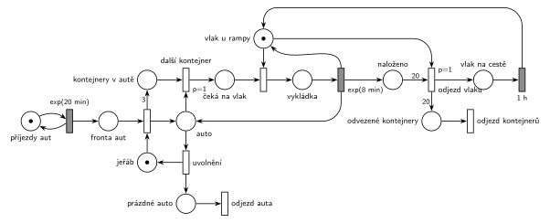

# Překladiště kontejnerů (11/05)

## Zadání

> Do překladiště přijíždí nákladní auta v intervalech exponenciálně se středem 20 minut. Každé auto veze 3 kontejnery. Překládání kontejnerů z aut do přistaveného vlaku zajišťuje jeden jeřáb. Vykládka jednoho kontejneru zabere exponenciálně se středem 8 minut. Vlak má kapacitu 20 kontejnerů. Po naplnění vlaku vlak odjíždí a vrací se přesně po jedné hodině. Během nepřítomnosti vlaku v překladišti je vykládka z aut pozastavena. Na počátku stojí v překladišti prázdný vlak.

Podobné úlohy: [Překladiště s jeřábem](<../09 - Překladiště s jeřábem/09 - Překladiště s jeřábem.md>), [Bagrista a nákladní auta](<../10 - Bagrista a nákladní auta/10 - Bagrista a nákladní auta.md>), [Pizzerie s rozvozem](<../03 - Pizzerie s rozvozem/03 - Pizzerie s rozvozem.md>).

## Nápověda

<details>
<summary>Zobrazit nápovědu</summary>
<br>

- **Příjezdy** modeluje smyčka *příjezdy aut* ⇄ `exp(20 min)`, auta čekají ve *frontě aut*.
- **Transakce je auto**, ne kontejner. Auto obsadí *jeřáb* a stejný přechod vloží 3 značky do *kontejnery v autě* (hrana s váhou 3). Kontejnery jsou čítač, který říká, kolik cyklů vykládky auto ještě potřebuje.
- **Cyklus vykládky:** *další kontejner* (`p=1`) vezme auto a jeden kontejner. Auto pak čeká na vlak, obsadí *vlak u rampy*, po `exp(8 min)` se vrátí zpět do místa *auto*, vlak se uvolní a kontejner přibude do *naloženo*. Když už v autě žádný kontejner není, přijde na řadu *uvolnění* (`p=0`): jeřáb je volný a auto odjíždí přechodem *odjezd auta*.
- **Proč dva kroky (další kontejner, pak obsazení vlaku):** kdyby jeden přechod bral auto, kontejner i vlak, pak by při nepřítomném vlaku nebyl proveditelný a místo něj by se provedlo *uvolnění*. Auto by odjelo s nevyloženými kontejnery. Takhle auto čeká v *čeká na vlak* a drží jeřáb, takže vykládka je pozastavená.
- **Vlak** je místo se značkou: vlak stojí u rampy a nic se do něj právě nevykládá. Vykládka ho drží jako zařízení.
- **Odjezd vlaku:** hrana s váhou 20 z *naloženo* a značka *vlak u rampy*. Priorita `p=1` zajistí, že po 20. kontejneru vlak odjede dřív, než začne další vykládka (oba přechody potřebují značku vlaku). Kontejnery odjíždějí s vlakem, značky zaniknou (nejsou to transakce). Po `1 h` se vrací prázdný vlak.
- **Počáteční stav:** značka ve *vlak u rampy*, *naloženo* = 0 (prázdný vlak u rampy).
- **Systém je přetížený:** vykládka auta trvá v průměru 3 × 8 = 24 min, auta přijíždějí po 20 min a vlak je navíc po každých 20 kontejnerech hodinu pryč. Fronta aut proto roste do nekonečna. To je vlastnost zadání, ne chyba sítě.

</details>

## Petriho síť

<details>
<summary>Zobrazit Petriho síť</summary>
<br>



</details>

## Časté chyby

<details>
<summary>Zobrazit časté chyby</summary>
<br>

- Kontejner jako transakce (generátor kontejnerů). Pak není vidět, kdy je auto vyložené a odjíždí, a jeřáb může střídat kontejnery různých aut.
- Uvolnění jeřábu, které nečeká na vyložení všech tří kontejnerů (chybí priorita `p=1` u dalšího kontejneru nebo dvoukrokový cyklus). Auto pak odjede naložené.
- Odjezd vlaku bez priority: po 20. kontejneru může začít 21. vykládka do plného vlaku.
- Odjezd vlaku jen z čítače, bez značky *Vlak*: vlak by „odjel“ uprostřed vykládky a vykládka by pokračovala dál.
- Čítač kontejnerů, který se při odjezdu nevynuluje (hrana s váhou 20 musí odebrat všech 20).
- Zapomenutý návrat vlaku po 1 h nebo vlak, který na začátku není u rampy.

</details>

## SIMLIB

<details>
<summary>Zobrazit SIMLIB kód</summary>
<br>

Model je izomorfní k Petriho síti výše: každé místo, přechod a značka mají svůj protějšek v kódu.

```cpp
// Překladiště kontejnerů – model v SIMLIB/C++
#include "simlib.h"

Facility Jerab("Jeřáb");                    // místo „jeřáb“ (1 značka)
Facility Vlak("Vlak u rampy");              // místo „vlak u rampy“ (1 značka)
int nalozeno = 0;                           // místo „naloženo“
int odjezduVlaku = 0;
Histogram Doba("Doba auta v překladišti [h]", 0, 10, 20);

class OdjezdVlaku : public Process {        // odjezd vlaku → vlak na cestě → 1 h
  void Behavior() override {
    Seize(Vlak, 1);                         // p=1: vlak odjede dřív než další vykládka
    odjezduVlaku++;
    Wait(60);                               // vlak na cestě 1 h
    Release(Vlak);                          // vrací se prázdný vlak
  }
};

class Auto : public Process {               // transakce = auto
  void Behavior() override {
    double prijezd = Time;
    Seize(Jerab);                           // fronta aut + obsazení jeřábu
    for (int kontejnery = 3; kontejnery > 0; kontejnery--) {  // váha 3, „další kontejner“ p=1
      Seize(Vlak);                          // čeká na vlak + obsazení vlaku
      Wait(Exponential(8));                 // vykládka exp(8 min) ...
      Release(Vlak);                        // ... vrací vlak
      if (++nalozeno == 20) {               // hrana s váhou 20 z „naloženo“
        nalozeno = 0;
        (new OdjezdVlaku)->Activate();
      }
    }
    Release(Jerab);                         // uvolnění (p=0, až po třech kontejnerech)
    Doba((Time - prijezd) / 60);
  }                                         // prázdné auto → přechod „odjezd auta“
};

class Prijezdy : public Event {             // místo „příjezdy aut“ ve smyčce s exp(20 min)
  void Behavior() override {
    (new Auto)->Activate();
    Activate(Time + Exponential(20));
  }
};

int main() {
  Init(0, 60 * 1000);                       // modelový čas v minutách: 1000 hodin
  (new Prijezdy)->Activate();               // na počátku stojí prázdný vlak u rampy
  Run();
  Print("Odjezdů vlaku: %d\n", odjezduVlaku);
  Jerab.Output();
  Vlak.Output();
  Doba.Output();
}
```

| Petriho síť | SIMLIB |
|---|---|
| *příjezdy aut* ⇄ `exp(20 min)` | událost `Prijezdy`, která se znovu plánuje za `Exponential(20)` |
| značka auta, *fronta aut*, obsazení *jeřábu* | proces `Auto`, `Seize(Jerab)` |
| *kontejnery v autě* (váha 3), *další kontejner* (`p=1`) | cyklus `for` přes tři kontejnery |
| *čeká na vlak*, obsazení *vlaku u rampy* | `Seize(Vlak)` |
| *vykládka* → `exp(8 min)` (vrací vlak i auto) | `Wait(Exponential(8)); Release(Vlak);` |
| *naloženo*, *odjezd vlaku* (váha 20) | čítač `nalozeno`, při 20 nový proces `OdjezdVlaku` |
| `p=1` odjezdu vlaku | `Seize(Vlak, 1)`: vyšší priorita obsluhy; vykládku, která v tomtéž okamžiku začala, odsune až za návrat vlaku |
| *vlak na cestě* → `1 h` | `Wait(60); Release(Vlak);` |
| *uvolnění* → *prázdné auto* → *odjezd auta* | `Release(Jerab)` a konec `Auto::Behavior()` |

**Kontrola simulací.** Petriho síť: *jeřáb* + auto ve třech fázích vykládky = 1, *vlak u rampy* + *vykládka* + *vlak na cestě* = 1, *kontejnery v autě* ≤ 3, *naloženo* ≤ 20; na každé auto připadají právě tři vykládky a vlak odjíždí po každých 20. Fronta aut podle očekávání roste (`make check`). SIMLIB model: za 1000 hodin odjel vlak 273krát, tedy 5460 kontejnerů neboli 1820 aut (1,82 auta za hodinu). To je teoretické maximum: 20 kontejnerů zabere 20 × 8 = 160 min vykládky a 60 min čekání na vlak, tj. 20 kontejnerů za 220 min = 1,82 auta za hodinu. Přijelo 2957 aut, jeřáb byl vytížený na 100 % a fronta aut rostla až na 1135 aut (`make simlib`).

</details>

## Původ a zdroje

<details>
<summary>Zobrazit původ a zdroje</summary>
<br>

**Původ:** půlsemestrální písemka 2021/22, varianta A, 10 bodů.

**Původní znění:**

> Do překladiště přijíždí nákladní auta v intervalech daných exponenciálním rozložením se středem 20 minut. Každé auto veze 3 kontejnery. Překládání kontejnerů z aut do přistaveného vlaku zajišťuje jeden jeřáb. Vykládka jednoho kontejneru zabere 8 minut exponenciálně. Vlak má kapacitu 20 kontejnerů. Po naplnění vlaku vlak odjíždí a vrací se po jedné hodině. Během nepřítomnosti vlaku v překladišti je vykládka z aut pozastavena. Na počátku stojí v překladišti prázdný vlak.
>
> *Zadaný systém modelujte formou Petriho sítě s vyznačením všech potřebných parametrů.*

**Zdroje:**

- `Fitcheats/Půlsemestrálky/Zadání z minulých let/2021-22.pdf`, str. 1 (zadání)
- `Fitcheats/Půlsemestrálky/Hrubý - Řešení 2021-22.pdf`, str. 1 (řešení od Hrubého)

**Existující řešení:**

- **Hrubý (str. 1):** stejná struktura, s poznámkou „Pozn.: Transakce je AUTO, ne kontejner!“: „Fronta aut“ → „Seize“ jeřábu (výstup do místa auta a s váhou 3 do místa kontejnerů) → okamžitý přechod `p=1` (popisek pod ním je špatně čitelný) → „Seize“ vlaku → `exp(8min)` vrací vlak, auto a přidává do místa „Složeno“ → odjezd `p=1` s váhou 20 → místo odjíždějícího vlaku → `1h` → zpět „Vlak“. Jeřáb uvolňuje samostatný přechod „Release“ a auto v něm zaniká (výstupní přechod se tehdy nevyžadoval). Generátor je bez místa.
  - Červené poznámky: „TŘI CYKLY VYKLÁDKY (anebo čítač v systému)“, „Chování vlaku“, podtržené váhy 3 a 20. Obsazení vlaku a odjezd vlaku jsou červeně zakroužkované a propojené, nejspíš proto, že oba soupeří o značku *Vlak* (odtud `p=1` u odjezdu).

</details>

## Reference

- [Jak síť funguje](<../../../basics/Jak síť funguje.md>)
- [Notace a vzory](<../../../basics/Notace a vzory.md>)

<!-- -->

- [Studijní plán](<../../Studijní plán.md>)
- [Seznam úloh](<../../Seznam úloh.md>)
