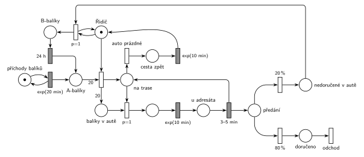

# Přepravní firma

## Zadání

> Do centrály přepravní firmy přichází balíky k rozvozu v intervalech exponenciálně se středem 20 minut. Firma zaměstnává jednoho řidiče, který balíky z centrály rozváží autem o kapacitě 20 balíků. V systému rozlišujeme nově podané A-balíky a B-balíky, u kterých se zatím nepodařilo zastihnout adresáta. Řidič vyráží z centrály po plném naložení auta A-balíky. Dobu nakládání balíku zanedbáváme. Doba každé cesty (z centrály k adresátovi, mezi adresáty, zpět do centrály) se řídí exponenciálním rozložením se středem 10 minut. Zastávka u každého adresáta trvá rovnoměrně 3–5 minut. Adresát je s pravděpodobností 20% nezastižen a balík se tudíž vrací do centrály. Balíky s nezastiženým adresátem (tzv. B-balíky) se odkládají na další pokusy o doručení. Dobu vykládání B-balíků zanedbáváme. B-balík se stává A-balíkem po 24 hodinách. V počátečním stavu nejsou v systému žádné B-balíky.
>
> Zadaný systém modelujte formou Petriho sítě s vyznačením všech potřebných parametrů.

Podobné úlohy: [Festivalový autobus](<../06 - Festivalový autobus/06 - Festivalový autobus.md>) (svozová jízda po jednom), [Pizzerie s rozvozem](<../03 - Pizzerie s rozvozem/03 - Pizzerie s rozvozem.md>), [Výletní loď](<../04 - Výletní loď/04 - Výletní loď.md>) (odjezd po naplnění kapacity).

## Interpretace

<details>
<summary>Zobrazit interpretaci (nápověda)</summary>
<br>

- **Transakce** jsou balíky. *Příchody balíků* ve smyčce s `exp(20 min)` je dávají do místa *A-balíky*.
- **Naložení:** okamžitý přechod vezme *Řidiče* a 20 *A-balíků* (váha 20) a dá řidiče *na trasu* a 20 značek do *balíků v autě*. Řidič tedy čeká v centrále, dokud A-balíků není 20, a nakládání netrvá žádný čas. Kapacita auta je dodržena tím, že se nakládá právě 20 kusů.
- **Rozvoz:** řidič *na trase* bere po jednom (`p=1`) další balík z auta a jede `exp(10 min)` k adresátovi (cesta z centrály i mezi adresáty), zastávka trvá `3–5 min`. Zastávka vrací řidiče *na trasu* a balík dá do *předání*.
- **Předání:** `80 %` doručeno (balík přes *doručeno* opouští systém přechodem *odchod*), `20 %` nezastižen.
- **Cesta zpět:** když v autě nic nezbývá, provede se *auto prázdné* (p=0) a cesta zpět `exp(10 min)` vrátí *Řidiče* do centrály.
- **Nezastižený balík jede zpět v autě** (*nedoručené v autě*) a B-balíkem se stane až po vyložení v centrále. Vyložení je okamžitý přechod `p=1` se smyčkou na *Řidiči* (řidič je v centrále) a opakuje se, dokud něco v autě zbývá. Má přednost před naložením, takže se nejdřív vyloží a teprve pak nakládá. Nedoručené balíky v autě místo navíc nezabírají, jsou to tytéž balíky.
- **24 h** se počítá od vyložení. Časovaný přechod `24 h` má pro každý B-balík vlastní odpočet (slajd 138). Pak balík přejde mezi *A-balíky* a pojede s některým dalším autem.

</details>

## Petriho síť

<details>
<summary>Zobrazit Petriho síť</summary>
<br>



</details>

## Časté chyby

<details>
<summary>Zobrazit časté chyby</summary>
<br>

- Odpočet 24 h hned po nezastižení. Balík se nejdřív musí vrátit do centrály a vyložit.
- Naložení bez váhy 20 (řidič odjede s jedním balíkem), nebo jen test 20 balíků bez jejich odebrání.
- Ukončení jízdy bez priority: *auto prázdné* by mohlo předběhnout jízdu k dalšímu adresátovi a zbylé balíky by v autě zůstaly.
- Chybějící cesta zpět `exp(10 min)`: zadání ji výslovně počítá mezi cesty.
- Vykládání B-balíků bez priority nad naložením. Pak by řidič mohl odjet a nedoručené balíky by zůstaly v autě do další jízdy.

</details>

## SIMLIB

<details>
<summary>Zobrazit SIMLIB kód</summary>
<br>

Model je izomorfní k Petriho síti výše: každé místo, přechod a značka mají svůj protějšek v kódu.

```cpp
// Přepravní firma – model v SIMLIB/C++
#include "simlib.h"

const int KAPACITA = 20;                // kapacita auta (váha hran naložení)

Queue ABaliky("A-balíky v centrále");   // místo A-balíky
Queue VAute("Balíky v autě");           // místo balíky v autě
Queue Nedorucene("Nedoručené v autě");  // místo nedoručené v autě
Histogram Doba("Doba od podání do doručení [h]", 0, 6, 20);
int doruceno = 0, nezastizeno = 0, jizdy = 0;
Process *ridic;                         // řidič čekající v centrále (místo Řidič)
bool ridic_ceka = false;

class Balik : public Process {          // transakce = balík
 public:
  bool dorucen = false;
  void Behavior() {
    double podani = Time;
    for (;;) {
      Into(ABaliky);                    // místo A-balíky
      if (ridic_ceka && ABaliky.Length() >= KAPACITA)
        ridic->Activate();              // naložení je proveditelné
      Passivate();                      // naloží ho řidič; probudí ho u adresáta nebo po vyložení
      if (dorucen) break;               // 80 % -> doručeno
      Wait(24 * 60);                    // B-balík: časovaný přechod 24 h -> A-balíky
    }
    Doba((Time - podani) / 60);
  }                                     // přechod odchod
};

class Ridic : public Process {          // značka řidiče obíhá: Řidič -> na trase -> ... -> cesta zpět
  void Behavior() {
    for (;;) {                          // místo Řidič (řidič v centrále)
      while (ABaliky.Length() < KAPACITA) {       // naložení: hrana s váhou 20
        ridic_ceka = true;
        Passivate();                    // probudí ho dvacátý A-balík
        ridic_ceka = false;
      }
      for (int i = 0; i < KAPACITA; i++)
        VAute.Insert(ABaliky.GetFirst());         // 20 značek do místa balíky v autě
      jizdy++;
      while (!VAute.Empty()) {          // k adresátovi (p=1), dokud je balík v autě
        Balik *b = (Balik *)VAute.GetFirst();
        Wait(Exponential(10));          // jízda exp(10 min)
        Wait(Uniform(3, 5));            // zastávka 3–5 min, pak předání
        if (Random() < 0.8) {           // 80 % doručeno
          doruceno++;
          b->dorucen = true;
          b->Activate();
        } else {                        // 20 % nezastižen: balík jede v autě zpět
          nezastizeno++;
          Nedorucene.Insert(b);
        }
      }
      Wait(Exponential(10));            // auto prázdné (p=0): cesta zpět exp(10 min)
      while (!Nedorucene.Empty())       // vyložení (p=1) v centrále: z balíku je B-balík
        Nedorucene.GetFirst()->Activate();
    }
  }
};

class Generator : public Event {        // místo příchody balíků ve smyčce s exp(20 min)
  void Behavior() {
    (new Balik)->Activate();
    Activate(Time + Exponential(20));
  }
};

int main() {
  Init(0, 100 * 24 * 60);               // modelový čas v minutách: 100 dní
  (new Generator)->Activate(Exponential(20));
  ridic = new Ridic;
  ridic->Activate();
  Run();
  Print("Jízd: %d, doručeno: %d, nezastiženo: %d (%.1f %%)\n", jizdy, doruceno,
        nezastizeno, 100.0 * nezastizeno / (doruceno + nezastizeno));
  ABaliky.Output();
  Doba.Output();
}
```

| Petriho síť | SIMLIB |
|---|---|
| *příchody balíků* ⇄ `exp(20 min)` | událost `Generator`, která se znovu plánuje za `Exponential(20)` |
| značka balíku | proces `Balik` |
| místa *A-balíky*, *balíky v autě*, *nedoručené v autě* | fronty `ABaliky`, `VAute`, `Nedorucene` (pasivní balíky) |
| značka řidiče (*Řidič*, *na trase*, *u adresáta*, *cesta zpět*) | proces `Ridic`, jeho stav je místo v kódu |
| naložení (váha 20) | čekání na 20 balíků, pak přesun 20 balíků do `VAute` |
| *k adresátovi* (`p=1`) / *auto prázdné* (p=0) | `while (!VAute.Empty())` a kód za cyklem |
| `exp(10 min)`, `3–5 min` | `Wait(Exponential(10))`, `Wait(Uniform(3, 5))` |
| `80 %` / `20 %` | `if (Random() < 0.8)` |
| vyložení (`p=1`) → *B-balíky* | aktivace balíků z `Nedorucene` po návratu |
| `24 h` (vlastní odpočet pro každý balík) | `Wait(24 * 60)` v procesu balíku |
| přechod *odchod* | konec metody `Behavior()` balíku |

**Kontrola simulací.** Petriho síť: řidič je vždy v právě jednom stavu, v autě je nejvýš 20 balíků (`make check`). Za 74 simulovaných dní vyjel řidič asi 327krát, adresát nebyl zastižen u 20 % zastávek a nedoručených se vracelo nejvýš 10 v jednom autě. Systém je hodně vytížený: jízda s 20 balíky trvá asi 5 h, za tu dobu přijde asi 15 nových balíků a k tomu se vracejí B-balíky. SIMLIB model: za 100 dní 449 jízd, doručeno 7189 balíků (72 denně, tedy všechny podané: 24 h / 20 min = 72), nezastiženo 19,9 % zastávek. V centrále čekalo průměrně 13 A-balíků, nejvýš 46; od podání do doručení uplyne průměrně 14 h, u balíků s nezastiženým adresátem kvůli 24 h čekání 30–48 h (`make simlib`).

</details>

## Původ a zdroje

<details>
<summary>Zobrazit původ a zdroje</summary>
<br>

**Původ:** půlsemestrálky 2014–19 (přehled zadání), úloha Z12.

**Původní znění:**

> Do centrály přepravní firmy přichází balíky k rozvozu v intervalech exp(20min). Firma zaměstnává jednoho řidiče, který balíky z centrály rozváží autem o kapacitě 20 balíků. V systému rozlišujeme nově podané A-balíky a B-balíky, u kterých se zatím nepodařilo zastihnout adresáta. Řidič vyráží z centrály po plném naložení auta A-balíky. Dobu nakládání balíku zanedbáváme. Doba každé cesty (z centrály k adresátovi, mezi adresáty, zpět do centrály) se řídí exp(10min). Zastávka u každého adresáta trvá rovnoměrně 3-5 minut. Adresát je s pravděpodobností 20% nezastižen a balík se tudíž vrací do centrály. Balíky s nezastiženým adresátem (tzv. B-balíky) se odkládají na další pokusy o doručení. Dobu vykládání B-balíků zanedbáváme. B-balík se stává A-balíkem po 24 hodinách. V počátečním stavu nejsou v systému žádné B-balíky.
>
> Zadaný systém modelujte formou Petriho sítě s vyznačením všech potřebných parametrů.

**Zdroje:**

- `Fitcheats/Půlsemestrálky/Zadání z minulých let/Přehled zadání 2014-19.pdf`, str. 3 (zadání)
- `Fitcheats/Půlsemestrálky/FIT - Příprava 2021-22.pdf`, str. 15 (studentské řešení, „Opravena verze (asi)“, 4 pro / 0 proti)
- `Fitcheats/Příprava na zkoušku/luppo - Tabule.png` (studentské řešení na tabuli)

**Existující řešení:**

- **Příprava 2021/22 (str. 15, „Opravena verze (asi)“, 4 pro / 0 proti):** obrácené značení (šrafovaně okamžité přechody), jinak v podstatě stejná síť. Naložení bere 20 A-balíků a *řidiče*, dá 20 značek do počitadla balíků v autě. `P=1` → `exp(10m)` → `3-5m` → `80%` zpět na trasu / `20%` → *nezastižen*. Po vyčerpání balíků `exp(10)` zpět k *řidiči*, B-balíky se vykládají přechodem `P=1` se smyčkou na *řidiče* a po `24h` jsou zase A-balíky. Doručený balík ale nemá vlastní výstupní přechod: zmizí v přechodu `80%`, který vrací řidiče na trasu. Komentář pod řešením kritizoval starší verzi, kde B-balíky odpočítávaly 24 h hned u adresáta. Opravená verze je vykládá až v centrále, správně.
- **Tabule luppo:** naložení 20 balíků s *Řidičem*, *Counter 20*, `3-5min`, `80%` *odevzdán* / `20%` → `24h` → *A-Balík*. Cesta k adresátovi má `exp(20)` místo `exp(10)` a nezastižený balík jde na `24h` rovnou od adresáta, bez návratu do centrály.

</details>
