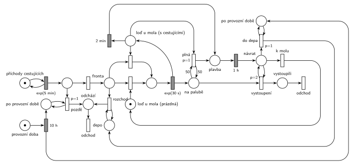

# Výletní loď na jezeře

## Zadání

> Po jezeře jezdí jedna výletní loď s kapacitou 50 cestujících. Provozní doba lodi začíná ráno u nástupního mola pro cestující. Provozní doba lodi trvá přesně 10 hodin. Cestující přichází na molo v intervalech exponenciálně se středem 5 minut. Pokud cestující příjde po ukončení provozní doby, okamžitě systém opouští. Cestující nastupují na loď jednotlivě. Nástup jednoho cestujícího na loď trvá dobu exponenciálně se středem 30 sekund. Loď odjíždí od mola na výletní jízdu, pokud nastane jeden z těchto dvou případů (nastupování cestujícího se vždy dokončí): 1) loď je naplněna cestujícími, 2) uplynuly 2 minuty od nastoupení posledního cestujícího z fronty (tj. loď na molu čeká) Výlet trvá přesně 1 hodinu a končí vždy na molu. Po ukončení provozní doby loď dokončí případné nabírání cestujících dle výše uvedených pravidel a vyrazí na výlet. Pokud se přistaví k molu po dokončení provozní doby, cestující už nenabírá a přesune se do depa. Cestovní doby mezi molem a depem neuvažujeme. Také neuvažujeme dobu vystupování cestujících po návratu z výletu.
>
> Modelujte jeden den provozu výletní lodi.

Podobné úlohy: [Výletní loď](<../04 - Výletní loď/04 - Výletní loď.md>) (2021/22), [Vyhlídková loď na molu](<../07 - Vyhlídková loď na molu/07 - Vyhlídková loď na molu.md>), [Přehrada s vyhlídkovou lodí](<../14 - Přehrada s vyhlídkovou lodí/14 - Přehrada s vyhlídkovou lodí.md>), [Vyhlídkové lety](<../02 - Vyhlídkové lety/02 - Vyhlídkové lety.md>), [Výletní autobus](<../01 - Výletní autobus/01 - Výletní autobus.md>).

## Nápověda

<details>
<summary>Zobrazit nápovědu</summary>
<br>

- **Transakce** jsou cestující. *Příchody cestujících* ve smyčce s `exp(5 min)` je posílají k rozhodnutí: po provozní době hned odchází přechodem *pozdě* (`p=1`, test příznaku *po provozní době*), jinak jdou do *fronty* (p=0). Generátor běží dál, pozdě příchozí jen hned odcházejí.
- **Loď u mola má dva stavy:** *loď u mola (prázdná)* (na začátku dne a po každém návratu k molu) a *loď u mola (s cestujícími)*, když už někdo nastoupil. V obou stavech je to zařízení pro nástup „jednotlivě“: obsazení (jeden přechod pro každý stav lodi), `exp(30 s)` a vrácení značky do *lodi s cestujícími*. Odjezdové přechody tu značku také potřebují, takže během nástupu loď odjet nemůže („nastupování cestujícího se vždy dokončí“).
- **Odjezd po 2 minutách** je časovaný přechod `2 min` se vstupem *loď u mola (s cestujícími)*. Odpočet začne, když se loď po nástupu vrátí do stavu „čeká“. Když mezitím přijde cestující, obsazení si značku lodi vezme a odpočet zanikne (slajd 139). Po jeho nástupu běží odpočet znovu, tedy „2 minuty od nastoupení posledního cestujícího“. Prázdná loď odpočet nemá, takže na začátku dne ani po návratu k prázdnému molu neodpluje prázdná na hodinovou jízdu.
- **Plná loď:** přechod *plná* s `p=1` a testovací hranou váhy 50 z *na palubě*. Po 50. nástupu má přednost před obsazením lodi dalším cestujícím, takže 51. nenastoupí. Zvláštní místo s volnými místy proto není potřeba.
- **Výlet:** *plavba* → `1 h` → *návrat*. Cestující zůstávají *na palubě* během výletu a vystupují po návratu (`p=2` smyčka *vystoupení*, dokud je někdo na palubě), pak přes *vystoupili* odcházejí. Teprve potom se rozhoduje *k molu* (p=0), nebo *do depa* (p=1, jen po provozní době). V podobné úloze [Výletní loď](<../04 - Výletní loď/04 - Výletní loď.md>) cestující zanikají už při vyplutí; to by šlo i tady.
- **Konec provozní doby:** `10 h` proběhne jednou (modelujeme jeden den) a nastaví dva příznaky *po provozní době*: jeden testuje přechod *pozdě* u příchodů, druhý přechod *do depa*. Je to jen kvůli přehlednosti kresby; jedno místo se dvěma testovacími hranami by bylo totéž.
- **Po provozní době** loď u mola nabírá dál podle stejných pravidel a odjede na výlet (fronta se už nezvětšuje). Po návratu jede do depa. **Cestující, kteří na molu zůstali** (přišli ještě v provozní době, ale loď byla na výletě), zadání neřeší. Model je po odjezdu lodi do depa pošle pryč (*rozchod* se smyčkou na *depu*) přes *odchází* a *odchod*, jinak by zůstali v síti navždy.
- **Prázdná loď u mola v okamžiku konce provozu** (nikdo nečeká ani nesedí na palubě) zůstane stát u mola. Zadání posílá do depa jen loď, která se k molu přistaví po konci provozu.

</details>

## Petriho síť

<details>
<summary>Zobrazit Petriho síť</summary>
<br>



</details>

## Časté chyby

<details>
<summary>Zobrazit časté chyby</summary>
<br>

- Časovač 2 min bez podmínky, že někdo nastoupil: prázdná loď odplouvá každé 2 minuty.
- Časovač 2 min jako samostatný proces, který nezaniká s nástupem dalšího cestujícího. Musí ho zrušit obsazení lodi (vstupem je značka lodi).
- Odjezd, který nebere značku lodi u mola: loď by mohla odjet uprostřed nástupu, nebo by se během výletu dál nastupovalo.
- Plná loď bez priority před dalším nástupem: nastoupí 51. cestující.
- Cestující na palubě se po výletu nevynulují (smyčka *vystoupení* chybí nebo nemá přednost před návratem k molu). Další jízda pak začíná s „plnou“ lodí.
- Příchody po konci provozní doby, které se řadí do fronty. Zadání chce okamžitý odchod.

</details>

## SIMLIB

<details>
<summary>Zobrazit SIMLIB kód</summary>
<br>

Model je izomorfní k Petriho síti výše: každé místo, přechod a značka mají svůj protějšek v kódu.

```cpp
// Výletní loď na jezeře – model v SIMLIB/C++
#include "simlib.h"

const int KAPACITA = 50;

Queue Fronta("Fronta na molu");         // místo fronta
Queue Paluba("Na palubě");              // místo na palubě
bool po_provozu = false;                // oba příznaky po provozní době
int pozde = 0, rozchod = 0, vylety = 0;
Histogram Obsazeni("Cestujících na výletě", 0, 5, 11);

class Lod : public Process {            // značka lodi: u mola -> plavba -> návrat -> (depo)
 public:
  bool ceka = false;                    // loď u mola a nikdo nenastupuje
  bool vyprselo = false;
  void Nastup() {                       // obsazení lodi a nástup exp(30 s)
    Entity *c = Fronta.GetFirst();
    Wait(Exponential(0.5));
    Paluba.Insert(c);                   // značka do na palubě, loď je znovu volná
  }
  void Behavior();
};
Lod *lod;

class Odpocet : public Event {          // časovaný přechod 2 min (vstup: loď s cestujícími)
  void Behavior() {
    lod->vyprselo = true;
    lod->Activate();
  }
};

void Lod::Behavior() {
  for (;;) {
    while (Fronta.Empty()) {            // místo loď u mola (prázdná)
      ceka = true;
      Passivate();                      // probudí ji příchozí cestující
      ceka = false;
    }
    Nastup();                           // obsazení prázdné lodi
    for (;;) {                          // místo loď u mola (s cestujícími)
      if ((int)Paluba.Length() >= KAPACITA)
        break;                          // plná (p=1, test 50)
      if (Fronta.Empty()) {
        vyprselo = false;
        Odpocet *o = new Odpocet;
        o->Activate(Time + 2);          // odpočet 2 min od posledního nástupu
        ceka = true;
        Passivate();
        ceka = false;
        bool odjezd = vyprselo;
        delete o;                       // příchod cestujícího odpočet zruší (obsazení bere loď)
        if (odjezd)
          break;
        continue;
      }
      Nastup();                         // obsazení lodi s cestujícími
    }
    vylety++;                           // Plavba
    Obsazeni(Paluba.Length());
    Wait(60);                           // výlet 1 h -> návrat k molu
    while (!Paluba.Empty())             // vystoupení (p=2): cestující odcházejí
      Paluba.GetFirst()->Activate();
    if (po_provozu)                     // do depa (p=1)
      break;
  }                                     // jinak k molu (p=0)
  while (!Fronta.Empty()) {             // místo Depo: rozchod čekajících
    Fronta.GetFirst()->Activate();
    rozchod++;
  }
  Passivate();                          // loď zůstává v depu
}

class Cestujici : public Process {      // transakce = cestující
  void Behavior() {
    if (po_provozu) {                   // pozdě (p=1): okamžitý odchod
      pozde++;
      return;
    }
    Into(Fronta);                       // do fronty (p=0)
    if (lod->ceka)
      lod->Activate();                  // loď u mola čeká: začne nástup
    Passivate();                        // nástup, výlet, vystoupení nebo rozchod
  }                                     // odchod
};

class Generator : public Event {        // místo příchody cestujících ve smyčce s exp(5 min)
  void Behavior() {
    (new Cestujici)->Activate();
    Activate(Time + Exponential(5));
  }
};

class KonecProvozu : public Event {     // provozní doba -> 10 h -> po provozní době
  void Behavior() { po_provozu = true; }
};

int main() {
  Init(0, 24 * 60);                     // modelový čas v minutách: jeden den
  lod = new Lod;
  lod->Activate();
  (new Generator)->Activate(Exponential(5));
  (new KonecProvozu)->Activate(10 * 60);
  Run();
  Print("Výletů: %d, pozdě příchozích: %d, rozchod z mola: %d\n", vylety, pozde, rozchod);
  Fronta.Output();
  Obsazeni.Output();
}
```

| Petriho síť | SIMLIB |
|---|---|
| *příchody cestujících* ⇄ `exp(5 min)` | událost `Generator`, která se znovu plánuje za `Exponential(5)` |
| značka cestujícího | proces `Cestujici` |
| *pozdě* (`p=1`) / do *fronty* (p=0) | `if (po_provozu)` / `Into(Fronta)` |
| *provozní doba* → `10 h` → oba příznaky | událost `KonecProvozu` v čase 600 nastaví `po_provozu` |
| značka lodi (*loď u mola*, *plavba*, *návrat*, *depo*) | proces `Lod`, jeho stav je místo v kódu |
| *loď u mola (prázdná)* / *(s cestujícími)* | první a druhý cyklus v `Lod::Behavior()` |
| obsazení lodi (z obou stavů) + nástup `exp(30 s)` | `Nastup()`: `GetFirst`, `Wait(Exponential(0.5))`, `Paluba.Insert` |
| *na palubě* | fronta `Paluba` (pasivní cestující) |
| *plná* (`p=1`, test 50) | `if (Paluba.Length() >= KAPACITA) break;` |
| `2 min` (zaniká s nástupem) | událost `Odpocet`, kterou příchod cestujícího zruší (`delete o`) |
| `1 h`, *vystoupení* (`p=2`) | `Wait(60)` a aktivace všech z `Paluba` |
| *do depa* (`p=1`) / *k molu* (p=0) | `if (po_provozu) break;` / další průchod cyklem |
| *rozchod* | aktivace všech z `Fronta` po odjezdu do depa |
| přechody *odchod* | konec metody `Behavior()` cestujícího |

**Kontrola simulací.** Petriho síť: *loď u mola (prázdná)* + *loď u mola (s cestujícími)* + nastupující + *plavba* + *návrat* + *depo* = 1, *na palubě* ≤ 50 (`make check`). Za den proběhne asi 9 výletů (na palubě nejvýš 19–23 cestujících), v 10 h je loď obvykle na výletě, pak odjede do depa a 7–19 čekajících odejde. S příchody exp(5 min) se loď nikdy nenaplní, proto byla větev *plná* ověřena zvlášť se zrychlenými příchody exp(20 s): loď pak odplouvá s 50 cestujícími. SIMLIB model (jeden den): 9 výletů, průměrně 15 cestujících na výletě (nejvýš 24), 179 pozdě příchozích (14 h po provozní době × 12 za hodinu ≈ 168) a 4 cestující odešli z mola rozchodem (`make simlib`).

</details>

## Původ a zdroje

<details>
<summary>Zobrazit původ a zdroje</summary>
<br>

**Původ:** půlsemestrálky 2014–19 (přehled zadání), úloha Z1. Přesný rok a varianta nejsou známé.

**Původní znění:**

> Po jezeře jezdí jedna výletní loď s kapacitou 50 cestujících. Provozní doba lodi začíná ráno u nástupního mola pro cestující. Provozní doba lodi trvá 10 hodin. Cestující přichází na molo v intervalech daných exponenciálním rozložením se středem 5 minut. Pokud cestující příjde po ukončení provozní doby, okamžitě systém opouští. Cestující nastupují na loď jednotlivě. Nástup jednoho cestujícího na loď trvá dobu danou exp. rozložením se středem 30 sekund. Loď odjíždí od mola na výletní jízdu, pokud nastane jeden z těchto dvou případů (nastupování cestujícího se vždy dokončí): 1) loď je naplněna cestujícími, 2) uplynuly 2 minuty od nastoupení posledního cestujícího z fronty (tj. loď na molu čeká) Výlet trvá jednu hodinu a končí vždy na molu. Po ukončení provozní doby loď dokončí případné nabírání cestujících dle výše uvedených pravidel a vyrazí na výlet. Pokud se přistaví k molu po dokončení provozní doby, cestující už nenabírá a přesune se do depa. Cestovní doby mezi molem a depem neuvažujeme. Také neuvažujeme dobu vystupování cestujících po návratu z výletu.
>
> Modelujte jeden den provozu výletní lodi.
>
> *Zadaný systém modelujte formou Petriho sítě s vyznačením všech potřebných parametrů.*

**Zdroje:**

- `Fitcheats/Půlsemestrálky/Zadání z minulých let/Přehled zadání 2014-19.pdf`, str. 1 (zadání)
- `Fitcheats/Půlsemestrálky/FIT - Příprava 2021-22.pdf`, str. 3–4 (dvě studentská řešení s komentáři)

**Existující řešení:**

- **Studentské řešení (Příprava 2021/22, str. 3, bílé na černém, bez hlasování):** místa *loď na molu*, *kapacita* (hrana 50 k přechodu `p=3` pro odjezd plné lodi), časovaný přechod „nikdo nenastupuje 2m“, *vyplutí*, *plavba* `1h`, *vyprázdnění* s `p=4` a *depo* přes `p=1` s testem konce provozní doby. Komentář na str. 4 správně vytýká, že časovač 2 min běží i před prvním nástupem: na začátku dne loď odpluje dřív, než přijde první cestující. Autor odpovídá, že zadání říká „loď na molu čeká“. Rozhodující je ale „od nastoupení posledního cestujícího“, tedy někdo musí nastoupit.
- **Studentské řešení (str. 4, fotka modrým perem, souhlasí 0, nesouhlasí 2):** hrany s váhou 50, `1h`, `2 min`, smyčky s `p=1`, `exp(30s)`, `10h`. Komentář: „z toho horního přechodu nemá jít 50 a po uplynutí hodiny se má zase vrátit 50“. Kapacita se tedy neobnovuje správně.
- Hrubého řešení ani řešení ze cvičení v materiálech není.

</details>
