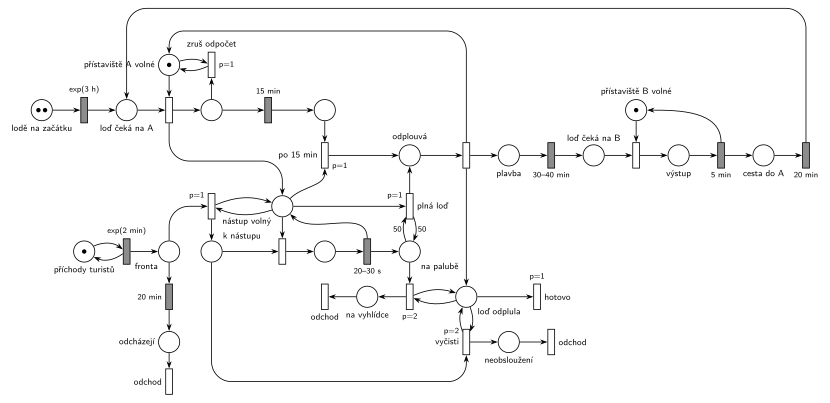

# Přehrada s přístavišti

## Zadání

> Na přehradě jsou přístaviště A a B, každé s kapacitou jedna pro přistavení lodi. Mezi přístavišti A a B jezdí dvě vyhlídkové lodě s kapacitou 50 turistů. Na přístaviště A přichází turisti v intervalech exponenciálně se středem 2 minuty. Každý jednotlivý turista je ochoten čekat na příjezd lodi nejvýše 20 minut, pak opouští systém. Po přistavení lodi k molu přístaviště začnou turisti po jednom nastupovat. Nastoupení každého trvá rovnoměrně 20–30 sekund. Loď z přístaviště odjíždí po naplnění svojí kapacity, nejpozději však po 15 minutách od přistavené k molu (aktuálně nastupující turista smí dokončit nastupování). Neobsloužení turisti po odplutí lodi opouští systém. Vyhlídková jízda lodě trvá rovnoměrně 30–40 minut a končí v přístavišti B, kde během přesně 5 minut všichni turisti najednou vystoupí. V přístavišti B žádní cestující nenastupují a loď se vrací po vyprázdnění do přístaviště A. Cesta z B do A jí trvá přesně 20 minut. V počátečním stavu sítě platí, že každá z lodí se poprvé do přístaviště A dostane po době exponenciálně se středem 3 hodiny.

Podobné úlohy: [Přehrada s vyhlídkovou lodí](<../14 - Přehrada s vyhlídkovou lodí/14 - Přehrada s vyhlídkovou lodí.md>), [Výletní loď](<../04 - Výletní loď/04 - Výletní loď.md>), [Vyhlídková loď na molu](<../07 - Vyhlídková loď na molu/07 - Vyhlídková loď na molu.md>), [Výletní loď na jezeře](<../11 - Výletní loď na jezeře/11 - Výletní loď na jezeře.md>).

## Nápověda

<details>
<summary>Zobrazit nápovědu</summary>
<br>

- **Transakce** jsou turisté. *Příchody turistů* ve smyčce s `exp(2 min)` je dávají do *fronty*, kde čekají na příjezd lodi.
- **„Čekat na příjezd lodi nejvýše 20 minut“:** časovaný přechod `20 min` přímo na místě *fronta*, takže každý turista má vlastní odpočet (slajd 138). Netrpěliví přes *odcházejí* opouštějí systém.
- **Lodě** jsou dvě značky. Na začátku jsou v místě *lodě na začátku* a každá má vlastní odpočet `exp(3 h)`. **Přístaviště A a B** jsou místa s 1 značkou (*přístaviště A volné*, *přístaviště B volné*); loď ho zabere při přistání, takže u mola stojí nejvýš jedna loď.
- **Nástup po jednom:** přistání v A vytvoří značku *nástup volný*. Je to zařízení pro nástup (obsazení, `20–30 s`, vrácení) a zároveň informace, že u mola stojí loď.
- **fronta k nástupu:** když loď stojí u mola a nikdo nenastupuje, přechod `p=1` se smyčkou na *nástupu volném* přesouvá čekající do místa *k nástupu*, kde už netrpělivost neplatí (čekají na nástup, ne na příjezd lodi). Odpočet přesunutého turisty tím zanikne.
- **Odjezd nejpozději po 15 min:** přistání spustí odpočet `15 min`. Odjezd *po 15 min* i odjezd *plné lodi* (test 50 turistů *na palubě*) berou značku *nástup volný*, takže čekají, až aktuálně nastupující turista dokončí nástup. Oba mají `p=1`, aby vyhrály nad nástupem dalšího turisty.
- Když loď odjede plná, odpočet 15 min ještě běží; přechod *zruš odpočet* (`p=1`, test *přístaviště A volné*) ho po odplutí zruší dřív, než přistane další loď. S danými čísly to nenastane: 50 nástupů trvá aspoň 17 minut, loď tedy vždy odjíždí po 15 minutách.
- **Po odplutí** vznikne značka *loď odplula*. Smyčky `p=2` z ní pošlou všechny turisty z paluby na vyhlídku (*na vyhlídce* → *odchod*) a všechny neobsloužené z místa *k nástupu* pryč (*neobsloužení* → *odchod*). Pak ji přechod *hotovo* (`p=1`) odebere. Priority zaručí, že úklid skončí dřív, než může přistát další loď (přistání má p=0).
- **Turisté na palubě opouštějí model při odplutí.** Při dvou lodích by se ve společném místě „na lodi“ míchali cestující různých lodí (Petriho síť značky nerozlišuje). Jízda do B (`30–40 min`), výstup `5 min` v B a návrat `20 min` jsou proto modelované jen jako cesta lodě. Stejně je to v úloze [Výletní loď](<../04 - Výletní loď/04 - Výletní loď.md>).

</details>

## Petriho síť

<details>
<summary>Zobrazit Petriho síť</summary>
<br>



</details>

## Časté chyby

<details>
<summary>Zobrazit časté chyby</summary>
<br>

- Netrpělivost jako jeden časovač pro celou frontu, nebo časovač s testovací hranou na „volné přístaviště“: pak se proveditelnost omezí na jednu značku a turisté nemají každý vlastní odpočet.
- Odjezd po 15 minutách, který nečeká na dokončení nástupu (nebere značku nástupu).
- Odjezd bez priority: po skončení nástupu by mohl začít nastupovat další turista.
- Smazání čekajících jen jedním přechodem s váhou; „všichni neobsloužení“ potřebují smyčku s prioritou.
- Přístaviště bez kapacity 1: obě lodě by mohly stát u mola současně.
- Počet turistů na palubě, který se při odjezdu nevynuluje; další loď by pak odjela „plná“ dřív.
- Úklid po odplutí se stejnou prioritou jako přistání další lodi (p=0): když druhá loď čeká na přístaviště, může přistát dřív, než příznak *loď odplula* zmizí, a úklid pak pošle pryč i turisty, kteří už čekají na ni.

</details>

## SIMLIB

<details>
<summary>Zobrazit SIMLIB kód</summary>
<br>

Model je izomorfní k Petriho síti výše: každé místo, přechod a značka mají svůj protějšek v kódu.

```cpp
// Přehrada s přístavišti – model v SIMLIB/C++
#include "simlib.h"

const int KAPACITA = 50;

Facility MoloA("Přístaviště A");        // místo přístaviště A volné (1 značka)
Facility MoloB("Přístaviště B");        // místo přístaviště B volné (1 značka)
Queue Cekaji("Čekají na loď");          // místo fronta (s netrpělivostí)
Queue KNastupu("K nástupu");            // místo k nástupu
Queue Paluba("Na palubě");              // místo na palubě
int netrpelivi = 0, neobslouzeni = 0, na_vyhlidce = 0;
Histogram Obsazeni("Turistů na jedné lodi", 0, 5, 11);

class Turista : public Process {        // transakce = turista
 public:
  Event *netrpelivost = nullptr;
  void Behavior();
};

class Netrpelivost : public Event {     // časovaný přechod 20 min přímo na místě fronta
  Turista *t;
 public:
  Netrpelivost(Turista *x) : t(x) { Activate(Time + 20); }
  void Behavior() {
    t->Out();                           // odchází z fronty
    netrpelivi++;
    t->netrpelivost = nullptr;
    t->Activate();
  }
};

class Lod : public Process {            // dvě lodě, každá svou značkou
 public:
  bool ceka = false;                    // značka nástup volný a nikdo k nástupu
  bool vyprselo = false;                // místo po 15 min
  void Behavior();
};
Lod *u_mola = nullptr;                  // loď u přístaviště A (značka nástup volný existuje)

class Odpocet : public Event {          // přistání -> odpočet -> 15 min
  Lod *l;
 public:
  Odpocet(Lod *x) : l(x) { Activate(Time + 15); }
  void Behavior() {
    l->vyprselo = true;
    if (l->ceka)
      l->Activate();
  }
};

void Lod::Behavior() {
  Wait(Exponential(180));               // lodě na začátku -> exp(3 h)
  for (;;) {
    Seize(MoloA);                       // loď čeká na A -> přistání
    vyprselo = false;
    Odpocet *odpocet = new Odpocet(this);
    u_mola = this;
    for (;;) {
      while (!Cekaji.Empty()) {         // na_molo (p=1): čekající přejdou k nástupu
        Turista *t = (Turista *)Cekaji.GetFirst();
        delete t->netrpelivost;         // odpočet 20 min zanikne
        t->netrpelivost = nullptr;
        KNastupu.Insert(t);
      }
      if ((int)Paluba.Length() >= KAPACITA || vyprselo)
        break;                          // plná loď / po 15 min (p=1 před nástupem)
      if (KNastupu.Empty()) {           // nikdo nenastupuje: loď čeká
        ceka = true;
        Passivate();
        ceka = false;
        continue;
      }
      Entity *t = KNastupu.GetFirst();  // obsazení nástupu
      Wait(Uniform(20, 30) / 60);       // nástup 20–30 s
      Paluba.Insert(t);                 // na palubě, nástup je zase volný
    }
    delete odpocet;                     // zruš odpočet (po odjezdu plné lodi ještě běží)
    u_mola = nullptr;                   // odjezd bere značku nástup volný
    Obsazeni(Paluba.Length());
    while (!Paluba.Empty()) {           // loď odplula (p=2): turisté jedou na vyhlídku
      Paluba.GetFirst()->Activate();
      na_vyhlidce++;
    }
    while (!KNastupu.Empty()) {         // vyčisti (p=2): neobsloužení odcházejí
      KNastupu.GetFirst()->Activate();
      neobslouzeni++;
    }
    Release(MoloA);                     // odplutí: přístaviště A volné
    Wait(Uniform(30, 40));              // plavba 30–40 min
    Seize(MoloB);                       // loď čeká na B -> přistání v B
    Wait(5);                            // výstup 5 min
    Release(MoloB);
    Wait(20);                           // cesta do A 20 min
  }
}

void Turista::Behavior() {
  Into(Cekaji);                         // místo fronta
  netrpelivost = new Netrpelivost(this);
  if (u_mola && u_mola->ceka)
    u_mola->Activate();                 // u mola čeká loď: na_molo
  Passivate();                          // netrpělivost, nebo loď (odjezd / vyčištění)
}                                       // odchod

class Generator : public Event {        // místo příchody turistů ve smyčce s exp(2 min)
  void Behavior() {
    (new Turista)->Activate();
    Activate(Time + Exponential(2));
  }
};

int main() {
  Init(0, 30 * 24 * 60);                // modelový čas v minutách: 30 dní
  (new Lod)->Activate();
  (new Lod)->Activate();
  (new Generator)->Activate(Exponential(2));
  Run();
  Print("Na vyhlídku: %d, netrpěliví: %d, neobsloužení: %d\n", na_vyhlidce, netrpelivi,
        neobslouzeni);
  MoloA.Output();
  Obsazeni.Output();
}
```

| Petriho síť | SIMLIB |
|---|---|
| *příchody turistů* ⇄ `exp(2 min)` | událost `Generator`, která se znovu plánuje za `Exponential(2)` |
| značka turisty | proces `Turista` |
| *fronta*, *k nástupu*, *na palubě* | fronty `Cekaji`, `KNastupu`, `Paluba` (pasivní turisté) |
| `20 min` na místě *fronta* | událost `Netrpelivost` každého turisty; přesun k nástupu ji zruší (`delete`) |
| *lodě na začátku* (2 značky) → `exp(3 h)` | dva procesy `Lod`, každý začíná `Wait(Exponential(180))` |
| *přístaviště A volné*, *přístaviště B volné* | `Facility MoloA`, `Facility MoloB` |
| *nástup volný* | ukazatel `u_mola` a příznak `ceka` (loď u mola, nikdo nenastupuje) |
| přesun do *k nástupu* (`p=1`) | cyklus `while (!Cekaji.Empty())` na začátku každého kola |
| obsazení + `20–30 s` | `KNastupu.GetFirst()`, `Wait(Uniform(20, 30) / 60)`, `Paluba.Insert` |
| `15 min` → *po 15 min* / *plná loď* (`p=1`) | událost `Odpocet` nastaví `vyprselo`; `break` před dalším nástupem |
| *zruš odpočet* | `delete odpocet` po odjezdu |
| *loď odplula*: smyčky `p=2`, *hotovo* | aktivace všech z `Paluba` a `KNastupu` před `Release(MoloA)` |
| plavba, výstup v B, návrat | `Wait(Uniform(30, 40))`, `Seize(MoloB)`, `Wait(5)`, `Release(MoloB)`, `Wait(20)` |
| přechody *odchod* | konec metody `Behavior()` turisty |

**Kontrola simulací.** Petriho síť: lodě jsou vždy dvě, přístaviště A i B má nejvýš jednu loď, na palubě nejvýš 50 turistů (`make check`). Loď přistává zhruba každých 38 minut a odjíždí po 15 minutách s asi 15 turisty; zhruba pětina turistů odejde netrpělivá. Odjezd plné lodi byl ověřen se zrychleným nástupem. SIMLIB model (30 dní): 1148 odjezdů z A, tedy jeden za 37,6 min (teoreticky 75 min na oběh jedné lodi při dvou lodích, 15 + 35 + 5 + 20 = 75); průměrně 14,9 turisty na lodi (nejvýš 30), netrpělivých 4578 z asi 21 700 příchozích (21 %) a 40 neobsloužených (`make simlib`).

</details>

## Původ a zdroje

<details>
<summary>Zobrazit původ a zdroje</summary>
<br>

**Původ:** půlsemestrální písemka 2011/12, příklad 3 (bodování v zadání není).

**Původní znění:**

> Na přehradě jsou přístaviště A a B, každé s kapacitou jedna pro přistavení lodi. Mezi přístavišti A a B jezdí dvě vyhlídkové lodě s kapacitou 50 turistů. Na přístaviště A přichází turisti v intervalech exp(2min). Každý jednotlivý turista je ochoten čekat na příjezd lodi nejvýše 20 minut, pak opouští systém. Po přistavení lodi k molu přístaviště začnou turisti po jednom nastupovat. Nastoupení každého trvá 20-30 sekund. Loď z přístaviště odjíždí po naplnění svojí kapacity, nejpozději však po 15 minutách od přistavené k molu (aktuálně nastupující turista smí dokončit nastupování). Neobsloužení turisti po odplutí lodi opouští systém. Vyhlídková jízda lodě trvá 30-40 minut a končí v přístavišti B, kde během 5 minut všichni turisti najednou vystoupí. V přístavišti B žádní cestující nenastupují a loď se vrací po vyprázdnění do přístaviště A. Cesta z B do A jí trvá 20 minut. V počátečním stavu sítě platí, že každá z lodí se poprvé do přístaviště A dostane po době dané exp(3 hodiny).
>
> Modelujte zadaný systém ve formě Petriho sítě s vyznačením všech potřebných parametrů.

**Zdroje:**

- `Fitcheats/Půlsemestrálky/Zadání z minulých let/2011-12.pdf`, str. 1 (zadání, příklad 3)

**Existující řešení:**

- K zadáním z roku 2011/12 v materiálech žádné řešení není.

</details>

## Reference

- [Jak síť funguje](<../../../basics/Jak síť funguje.md>)
- [Notace a vzory](<../../../basics/Notace a vzory.md>)

<!-- -->

- [Studijní plán](<../../Studijní plán.md>)
- [Seznam úloh](<../../Seznam úloh.md>)
