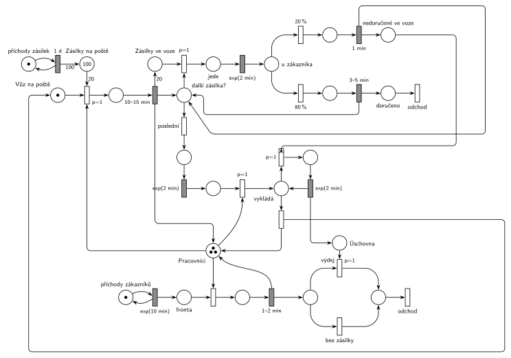

# Pošta s doporučenými zásilkami

## Zadání

> Poštovní pobočka má každý den rozvézt 100 nových doporučených zásilek. K dispozici má jeden poštovní vůz s doručovatelem. Poštovní vůz za dobu rovnoměrně 10–15 minut nabere najednou zásilky až po svou kapacitu 20 zásilek. Pak vyrazí do terénu. Každý úsek trasy (z pošty k zákazníkovi, od zákazníka k jinému zákazníkovi, od zákazníka zpět na poštu) trvá dobu exponenciálně se středem 2 minuty. Po příjezdu k zákazníkovi je pravděpodobnost 20 procent, že zákazník nebude zastižen. Pokud je zastižen, pak je doba vyřizování rovnoměrně 3–5 minut, jinak je přesně 1 minutu. Vůz se po posledním zákazníkovi vrací na pobočku, kde vyloží jednotlivě nedoručené zásilky, které se uloží pro přímý odběr zákazníky. Vyložení každé jednotlivé nedoručené zásilky trvá exponenciálně se středem 2 minuty. Zákazníci přichází na pobočku pro nedoručené balíky v intervalech exponenciálně se středem 10 minut a čekají ve frontě libovolně dlouho. K dispozici mají 3 poštovní přepážky, každou s jedním pracovníkem pošty. Obsluha zákazníka trvá rovnoměrně 1–2 minuty. Při nakládání a vykládání vozu asistuje doručovateli vždy jeden z pracovníků na přepážce.

Podobné úlohy: [Pizzerie s rozvozem](<../03 - Pizzerie s rozvozem/03 - Pizzerie s rozvozem.md>), [Přepravní firma](<../08 - Přepravní firma/08 - Přepravní firma.md>), [Výletní loď](<../04 - Výletní loď/04 - Výletní loď.md>).

## Nápověda

<details>
<summary>Zobrazit nápovědu</summary>
<br>

- **Zásilky** jsou transakce: *příchody zásilek* ve smyčce s `1 d` přidají každý den 100 zásilek (váha 100), první dávka je v místě *Zásilky na poště* od začátku. Zásilka odchází při doručení, nebo jako nedoručená přes *Úschovnu* se zákazníkem.
- **Vůz** je proces s jednou značkou, která obíhá: *Vůz na poště* → nakládání → jízdy a zákazníci → návrat → vykládka → *Vůz na poště*.
- **Nakládání „až po kapacitu 20“:** 100 je násobek 20, takže vůz nabere vždy právě 20 zásilek. Stačí jeden přechod s hranou váhy 20 (`p=1`, proveditelný, až je na poště aspoň 20 zásilek), který vezme i pracovníka. Nakládání `10–15 min` pak vrátí pracovníka a dá 20 značek do *Zásilek ve voze*. Obecně („vezmi, co zbývá, nejvýš 20“) by bylo potřeba ještě smyčku s prioritou, která nabírá po jedné, dokud je zásilka a volné místo.
- **Pracovníci** jsou sklad se 3 značkami. Nakládání i vykládka si vezmou jednoho pracovníka a vrátí ho. Zadání neříká, kdo má přednost; tady má vůz `p=1` před zákazníky („asistuje vždy“).
- **Rozvoz:** v místě *další zásilka?* se rozhoduje. Je-li ve voze zásilka, `p=1` ji vezme a vůz *jede* `exp(2 min)` k zákazníkovi. Jinak (p=0, *poslední*) jede `exp(2 min)` zpět. Každý úsek trasy má tedy svůj vlastní odpočet.
- **U zákazníka** okamžité přechody `80 %` / `20 %`. Zastižený: `3–5 min`, zásilka → *doručeno* → *odchod*. Nezastižený: `1 min`, zásilka zůstane ve voze jako *nedoručená*. Vůz se pak vrací do rozhodování *další zásilka?*.
- **Vykládka po jedné:** `p=1` vezme vrácený vůz a pracovníka (*vykládá*), smyčka `p=1` bere nedoručené zásilky a každou vykládá `exp(2 min)` do *Úschovny*. Když ve voze žádná nezbyla, přechod p=0 pod *vykládá* vrátí vůz i pracovníka.
- **Zákazníci** pro nedoručené zásilky tvoří samostatný proud (*příchody zákazníků* ve smyčce s `exp(10 min)`) s *frontou* ke 3 pracovníkům, obsluha trvá `1–2 min`. Zadání nespojuje zákazníka s konkrétní zásilkou; po obsluze si zákazník vezme zásilku z *Úschovny*, je-li tam nějaká (*výdej*, `p=1`), jinak odejde *bez zásilky*. Při exp(10 min) jde o 144 zákazníků denně, nedoručených zásilek je jen asi 20, takže většina odchází bez zásilky; zadání to neřeší.

</details>

## Petriho síť

<details>
<summary>Zobrazit Petriho síť</summary>
<br>



</details>

## Časté chyby

<details>
<summary>Zobrazit časté chyby</summary>
<br>

- Jeden časovaný přechod pro celou trasu místo `exp(2 min)` pro každý úsek (včetně cesty zpět).
- Rozhodnutí „další zákazník, nebo zpět“ bez priority: vůz by se mohl vrátit, i když v něm zbývají zásilky.
- Vykládka všech nedoručených zásilek najednou (hrana s váhou); zadání chce vykládat jednotlivě, každou `exp(2 min)`.
- Pracovník u nakládání nebo vykládky, který se nevrátí na přepážku; po čase by nezbyl nikdo pro zákazníky.
- Zastižený a nezastižený zákazník bez rozlišení doby (3–5 min vs. 1 min) nebo pravděpodobnost napsaná na hraně místo na přechodu.

</details>

## SIMLIB

<details>
<summary>Zobrazit SIMLIB kód</summary>
<br>

Model je izomorfní k Petriho síti výše: každé místo, přechod a značka mají svůj protějšek v kódu.

```cpp
// Pošta s doporučenými zásilkami – model v SIMLIB/C++
#include "simlib.h"

const int KAPACITA = 20;                // vůz nabere 20 zásilek

Store Pracovnici("Pracovníci", 3);      // místo Pracovníci (3 značky)
int na_poste = 100;                     // místo Zásilky na poště (první dávka od začátku)
int uschovna = 0;                       // místo Úschovna
int doruceno = 0, nedoruceno = 0, s_vydejem = 0, bez_zasilky = 0, jizdy = 0;
Histogram Fronta("Čekání zákazníka na přepážku [min]", 0, 0.5, 10);

class Vuz : public Process {            // značka vozu obíhá: nakládání -> rozvoz -> vykládka
 public:
  Vuz() : Process(1) {}                 // p=1: o pracovníka má vůz přednost před zákazníky
  bool ceka = false;
  void Behavior() {
    for (;;) {
      while (na_poste < KAPACITA) {     // naložení: hrana s váhou 20 z místa Zásilky na poště
        ceka = true;
        Passivate();                    // probudí ho další dávka zásilek
        ceka = false;
      }
      na_poste -= KAPACITA;
      Enter(Pracovnici, 1);             // nakládání s pracovníkem
      Wait(Uniform(10, 15));
      Leave(Pracovnici, 1);
      jizdy++;
      int ve_voze = KAPACITA;           // místo Zásilky ve voze
      int nedoruc = 0;                  // místo nedoručené ve voze
      while (ve_voze > 0) {             // další zásilka? -> vezmi (p=1)
        ve_voze--;
        Wait(Exponential(2));           // jízda k zákazníkovi
        if (Random() < 0.8) {           // 80 % zastižen
          Wait(Uniform(3, 5));
          doruceno++;                   // doručeno -> odchod
        } else {                        // 20 % nezastižen
          Wait(1);
          nedoruc++;
        }
      }
      Wait(Exponential(2));             // poslední (p=0): cesta zpět
      Enter(Pracovnici, 1);             // vyklad (p=1): vůz + pracovník
      while (nedoruc > 0) {             // vezmi_n (p=1): po jedné
        nedoruc--;
        Wait(Exponential(2));
        uschovna++;
        nedoruceno++;
      }
      Leave(Pracovnici, 1);             // hotovo (p=0): vůz a pracovník zpět
    }
  }
};
Vuz *vuz;

class Den : public Event {              // místo příchody zásilek ve smyčce s 1 d
  void Behavior() {
    na_poste += 100;                    // hrana s váhou 100
    if (vuz->ceka)
      vuz->Activate();
    Activate(Time + 24 * 60);
  }
};

class Zakaznik : public Process {       // transakce = zákazník
  void Behavior() {
    double prichod = Time;
    Enter(Pracovnici, 1);               // Fronta + obsazení přepážky
    Fronta(Time - prichod);
    Wait(Uniform(1, 2));                // obsluha 1–2 min
    Leave(Pracovnici, 1);
    if (uschovna > 0) {                 // výdej (p=1)
      uschovna--;
      s_vydejem++;
    } else                              // bez zásilky (p=0)
      bez_zasilky++;
  }                                     // odchod
};

class Generator : public Event {        // místo příchody zákazníků ve smyčce s exp(10 min)
  void Behavior() {
    (new Zakaznik)->Activate();
    Activate(Time + Exponential(10));
  }
};

int main() {
  Init(0, 100 * 24 * 60);               // modelový čas v minutách: 100 dní
  vuz = new Vuz;
  vuz->Activate();
  (new Den)->Activate(24 * 60);
  (new Generator)->Activate(Exponential(10));
  Run();
  Print("Jízd: %d, doručeno: %d, nedoručeno: %d (%.1f %%)\n", jizdy, doruceno, nedoruceno,
        100.0 * nedoruceno / (doruceno + nedoruceno));
  Print("Zákazníci se zásilkou: %d, bez zásilky: %d\n", s_vydejem, bez_zasilky);
  Pracovnici.Output();
  Fronta.Output();
}
```

| Petriho síť | SIMLIB |
|---|---|
| *příchody zásilek* ⇄ `1 d` (váha 100) | událost `Den`: `na_poste += 100`, znovu za 24 h |
| *Zásilky na poště*, *Úschovna* | čítače `na_poste`, `uschovna` (zásilky nemají v kódu vlastní proces) |
| *Pracovníci* (3 značky) | `Store Pracovnici` s kapacitou 3: `Enter` / `Leave` |
| `p=1` vozu před zákazníky | priorita procesu `Vuz() : Process(1)` (řazení ve frontě skladu) |
| značka vozu | proces `Vuz`, jeho stav je místo v kódu |
| nakládání (váha 20, s pracovníkem) → `10–15 min` | `na_poste -= 20; Enter(Pracovnici, 1); Wait(Uniform(10, 15)); Leave(…)` |
| *Zásilky ve voze*, *nedoručené ve voze* | čítače `ve_voze`, `nedoruc` |
| *další zásilka?*: `p=1` / *poslední* | `while (ve_voze > 0)` a kód za cyklem |
| `exp(2 min)` každého úseku | `Wait(Exponential(2))` |
| `80 %` / `20 %`, `3–5 min` / `1 min` | `if (Random() < 0.8)`, `Wait(Uniform(3, 5))` / `Wait(1)` |
| vykládka po jedné `exp(2 min)` | `Enter`, cyklus `while (nedoruc > 0)`, `Leave` |
| *příchody zákazníků* ⇄ `exp(10 min)` | událost `Generator` |
| *fronta* + obsazení, `1–2 min` | `Enter(Pracovnici, 1); Wait(Uniform(1, 2)); Leave(…)` |
| *výdej* (`p=1`) / *bez zásilky* | `if (uschovna > 0)` … `else` |

**Kontrola simulací.** Petriho síť: vůz je vždy v jednom stavu, pracovníků je vždy 3 (volní + u vozu + u zákazníků), ve voze nejvýš 20 zásilek (`make check`). Vůz denně udělá 5 jízd, asi 20 % zásilek se nedoručí a skončí v úschovně, fronty zůstávají krátké. SIMLIB model (100 dní): 500 jízd (5 denně), nedoručeno 20,0 % zásilek, všech 2001 nedoručených si zákazníci vyzvedli, 12 447 zákazníků odešlo bez zásilky. Pracovníci jsou vytížení na 7 % (průměrně 0,22 obsazené přepážky ze 3; teoreticky 144 × 1,5 min + 5 × 12,5 min + asi 20 × 2 min ≈ 320 min denně ze 3 × 1440 min) a zákazník téměř nečeká (`make simlib`).

</details>

## Původ a zdroje

<details>
<summary>Zobrazit původ a zdroje</summary>
<br>

**Původ:** půlsemestrální písemka 2011/12, příklad 2 (bodování v zadání není).

**Původní znění:**

> Poštovní pobočka má každý den rozvézt 100 nových doporučených zásilek. K dispozici má jeden poštovní vůz s doručovatelem. Poštovní vůz za dobu 10-15 minut nabere najednou zásilky až po svou kapacitu 20 zásilek. Pak vyrazí do terénu. Každý úsek trasy (z pošty k zákazníkovi, od zákazníka k jinému zákazníkovi, od zákazníka zpět na poštu) trvá dobu exp(2min). Po příjezdu k zákazníkovi je pravděpodobnost 20 procent, že zákazník nebude zastižen. Pokud je zastižen, pak je doba vyřizování 3-5 minut, jinak je 1 minutu. Vůz se po posledním zákazníkovi vrací na pobočku, kde vyloží jednotlivě nedoručené zásilky, které se uloží pro přímý odběr zákazníky. Vyložení každé jednotlivé nedoručené zásilky trvá exp(2min). Zákazníci přichází na pobočku pro nedoručené balíky v intervalech exp(10min) a čekají ve frontě libovolně dlouho. K dispozici mají 3 poštovní přepážky, každou s jedním pracovníkem pošty. Obsluha zákazníka trvá 1-2 minuty. Při nakládání a vykládání vozu asistuje doručovateli vždy jeden z pracovníků na přepážce.
>
> Modelujte zadaný systém ve formě Petriho sítě s vyznačením všech potřebných parametrů.

**Zdroje:**

- `Fitcheats/Půlsemestrálky/Zadání z minulých let/2011-12.pdf`, str. 1 (zadání, příklad 2)

**Existující řešení:**

- K zadáním z roku 2011/12 v materiálech žádné řešení není.

</details>
