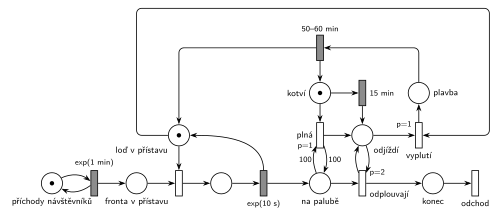

# Přehrada s vyhlídkovou lodí

## Zadání

> Na přehradě jezdí jedna vyhlídková loď s kapacitou 100 návštěvníků. Vyhlídková jízda trvá rovnoměrně 50–60 minut. Loď přijede do přístavu a nabírá návštěvníky až po svou kapacitu, maximálně však v přístavišti kotví 15 minut. Nástup jednoho návštěvníka trvá exponenciálně se středem 10 sekund. Návštěvníci přichází do přístavu v intervalech exponenciálně se středem 1 minuta.
>
> Poznámka: Po uplynutí 15 minut přítomnosti lodi v přístavu (bez ohledu na počet návštěvníků) loď další návštěvníky nenaloží a odjíždí.

Podobné úlohy: [Výletní loď](<../04 - Výletní loď/04 - Výletní loď.md>), [Vyhlídková loď na molu](<../07 - Vyhlídková loď na molu/07 - Vyhlídková loď na molu.md>), [Výletní loď na jezeře](<../11 - Výletní loď na jezeře/11 - Výletní loď na jezeře.md>), [Přehrada s přístavišti](<../12 - Přehrada s přístavišti/12 - Přehrada s přístavišti.md>).

## Nápověda

<details>
<summary>Zobrazit nápovědu</summary>
<br>

- **Transakce** jsou návštěvníci. *Příchody návštěvníků* ve smyčce s `exp(1 min)` je dávají do *fronty v přístavu*. Ti, kteří se na loď nevešli, čekají na další jízdu (netrpělivost zadání nemá).
- **Loď v přístavu** (1 značka) je stejně jako ve [výletní lodi](<../04 - Výletní loď/04 - Výletní loď.md>) zároveň zařízení pro nástup po jednom a informace, že loď stojí v přístavu. Nástup je obsazení, `exp(10 s)` a vrácení značky. Na počátku stojí loď v přístavu.
- **Dva důvody k odjezdu** vedou do stejného místa *odjíždí*:
  - *plná* (`p=1`): testovací dvojice hran s váhou 100 na *na palubě*. Bere značku *kotví*, takže odpočet 15 minut zanikne;
  - `15 min`: časovaný přechod na místě *kotví*. Odpočet začíná příjezdem lodi do přístavu a na nástupech nezávisí.
- **Přesný počet cestujících není předem známý**, proto nejde vzít z *na palubě* hranou s pevnou váhou (jako 20 u výletní lodi). Smyčka *odplouvají* (`p=2`) je bere po jednom, dokud je loď ve stavu *odjíždí*, a přes *konec* odcházejí přechodem *odchod*.
- Cestující tím **opouštějí modelovaný systém už při vyplutí**. Během jízdy se s nimi nic neděje, takže je dál nesledujeme. (U výletní lodi zůstávají na palubě až do návratu, ale tam jich je vždy přesně 20. Tady by vystupování po návratu potřebovalo druhou smyčku.)
- **Vyplutí** (`p=1`) potřebuje *odjíždí* a značku *loď v přístavu*. Vyprší-li 15 minut uprostřed nástupu, návštěvník nastoupí, a teprve pak loď vypluje. Díky `p=1` dřív, než by začal nastupovat další (obsazení má p=0). Kotvení se tak může protáhnout nejvýš o jeden nástup. Smyčka `p=2` proběhne před vyplutím.
- Po *plavbě* `50–60 min` se loď vrací: značka zpět do *loď v přístavu* a do *kotví* (nový odpočet 15 minut).
- Plná loď je vzácná: za 15 minut stihne nastoupit nejvýš asi 90 lidí a za jeden cyklus (asi 70 minut) jich přijde zhruba 70.

</details>

## Petriho síť

<details>
<summary>Zobrazit Petriho síť</summary>
<br>



</details>

## Časté chyby

<details>
<summary>Zobrazit časté chyby</summary>
<br>

- Odpočet 15 minut, který se při odjezdu plné lodi nezruší. Při příštím kotvení by loď odjela hned (proto *plná* bere značku *kotví*).
- Odpočet 15 minut na místě, které nástup bere a vrací. Po každém nástupu by se počítalo znovu od nuly.
- Odebrání cestujících hranou s váhou 100 i při odjezdu po 15 minutách. Váha bere přesný počet; na „všechny“ je potřeba smyčka s prioritou.
- Vyplutí bez priority nad obsazením: po vypršení času by mohl nastoupit ještě další návštěvník.
- Hrana z místa do místa (komentář u studentského řešení).

</details>

## SIMLIB

<details>
<summary>Zobrazit SIMLIB kód</summary>
<br>

Model je izomorfní k Petriho síti výše: každé místo, přechod a značka mají svůj protějšek v kódu.

```cpp
// Přehrada s vyhlídkovou lodí – model v SIMLIB/C++
#include "simlib.h"

const int KAPACITA = 100;

Queue Fronta("Fronta v přístavu");      // místo fronta v přístavu
Queue Paluba("Na palubě");              // místo na palubě
int jizdy = 0, plne = 0;
Histogram Obsazeni("Návštěvníků na jedné jízdě", 0, 10, 11);

class Lod : public Process {            // značka lodi: loď v přístavu / kotví -> plavba
 public:
  bool ceka = false;                    // loď v přístavu, nikdo nenastupuje
  bool vyprselo = false;                // odpočet 15 min skončil
  void Behavior();
};
Lod *lod;

class Kotveni : public Event {          // časovaný přechod 15 min na místě kotví
  void Behavior() {
    lod->vyprselo = true;
    if (lod->ceka)
      lod->Activate();
  }
};

void Lod::Behavior() {
  for (;;) {                            // místa loď v přístavu + kotví
    vyprselo = false;
    Kotveni *kotvi = new Kotveni;
    kotvi->Activate(Time + 15);         // odpočet začíná příjezdem lodi
    for (;;) {
      if ((int)Paluba.Length() >= KAPACITA) {
        plne++;                         // plná (p=1): bere značku kotví
        break;
      }
      if (vyprselo)
        break;                          // 15 min -> odjíždí
      if (Fronta.Empty()) {
        ceka = true;
        Passivate();                    // probudí ji návštěvník nebo konec kotvení
        ceka = false;
        continue;
      }
      Entity *n = Fronta.GetFirst();    // obsazení lodi (p=0)
      Wait(Exponential(10.0 / 60));     // nástup exp(10 s)
      Paluba.Insert(n);                 // značka do na palubě, loď je zase volná
    }
    delete kotvi;                       // po odjezdu plné lodi odpočet zanikne
    jizdy++;
    Obsazeni(Paluba.Length());
    while (!Paluba.Empty())             // odplouvají (p=2): návštěvníci opouštějí model
      Paluba.GetFirst()->Activate();
    Wait(Uniform(50, 60));              // vyplutí (p=1) -> plavba 50–60 min
  }                                     // návrat: loď v přístavu + kotví
}

class Navstevnik : public Process {     // transakce = návštěvník
  void Behavior() {
    Into(Fronta);
    if (lod->ceka)
      lod->Activate();                  // loď v přístavu čeká: začne nástup
    Passivate();                        // nástup a odjezd s lodí
  }                                     // odchod
};

class Generator : public Event {        // místo příchody návštěvníků ve smyčce s exp(1 min)
  void Behavior() {
    (new Navstevnik)->Activate();
    Activate(Time + Exponential(1));
  }
};

int main() {
  Init(0, 100 * 24 * 60);               // modelový čas v minutách: 100 dní
  lod = new Lod;
  lod->Activate();
  (new Generator)->Activate(Exponential(1));
  Run();
  Print("Jízd: %d, z toho plných: %d\n", jizdy, plne);
  Fronta.Output();
  Obsazeni.Output();
}
```

| Petriho síť | SIMLIB |
|---|---|
| *příchody návštěvníků* ⇄ `exp(1 min)` | událost `Generator`, která se znovu plánuje za `Exponential(1)` |
| značka návštěvníka | proces `Navstevnik` |
| *fronta v přístavu*, *na palubě* | fronty `Fronta`, `Paluba` (pasivní návštěvníci) |
| značka lodi (*loď v přístavu*, *kotví*, *odjíždí*, *plavba*) | proces `Lod`, jeho stav je místo v kódu |
| obsazení + `exp(10 s)` | `Fronta.GetFirst()`, `Wait(Exponential(10.0 / 60))`, `Paluba.Insert` |
| `15 min` na místě *kotví* | událost `Kotveni` nastaví `vyprselo` |
| *plná* (`p=1`, test 100, bere *kotví*) | `if (Paluba.Length() >= KAPACITA)` a `delete kotvi` |
| *odplouvají* (`p=2`) → *konec* → *odchod* | aktivace všech z `Paluba`, konec `Behavior()` návštěvníka |
| *vyplutí* (`p=1`) před dalším obsazením | `break` z cyklu nástupu, než se vezme další návštěvník |
| `50–60 min` → *loď v přístavu* + *kotví* | `Wait(Uniform(50, 60))` a nové kolo cyklu |

**Kontrola simulací.** Petriho síť: platí *loď v přístavu* + nastupující + *plavba* = 1 a *kotví* + *odjíždí* + *plavba* = 1, *na palubě* ≤ 100 (`make check`). Jeden cyklus trvá asi 70 minut a odveze asi 70 lidí. Plná loď se objeví jen zřídka, proto simulace běží 300 000 událostí. SIMLIB model (100 dní): 2054 jízd, tedy jedna za 70 min (15 min kotvení + v průměru 55 min plavby), průměrně 70 návštěvníků na jízdu (nejvýš 99); plná loď v tomto běhu nenastala. Ve frontě čekalo průměrně 26 návštěvníků, nejvýš 86 (`make simlib`).

</details>

## Původ a zdroje

<details>
<summary>Zobrazit původ a zdroje</summary>
<br>

**Původ:** půlsemestrální písemka, rok neznámý (fotka starého zadání „Příklad 3“ v přípravném dokumentu 2021/22).

**Původní znění:**

> Na přehradě jezdí jedna vyhlídková loď s kapacitou 100 návštěvníků. Vyhlídková jízda trvá rovnoměrně 50 – 60 minut. Loď přijede do přístavu a nabírá návštěvníky až po svou kapacitu, maximálně však v přístavišti kotví 15 minut. Doba nástupu jednoho návštěvníka se řídí exponenciálním rozložením se středem 10 vteřin. Návštěvníci přichází do přístavu v intervalech daných exponenciálním rozložením se středem 1 minuta.
>
> Poznámka: Po uplynutí 15 minut přítomnosti lodi v přístavu (bez ohledu na počet návštěvníků) loď další návštěvníky nenaloží a odjíždí.

**Zdroje:**

- `Fitcheats/Půlsemestrálky/FIT - Příprava 2021-22.pdf`, str. 2 (fotka zadání a studentské řešení s hlasováním a komentáři)

**Existující řešení:**

- **Příprava 2021/22, str. 2 (studentské řešení na tabletu):** „LOĎ“ (1 značka) → přechod, který vloží 100 značek do „KAPACITA“ a značku do „PŘÍSTAV“ a spustí odpočet `15min`. Nástup `prio 1` → `exp(10s)`, generátor „NÁVŠTĚVNÍCI“ `exp(1min)`, jízda `50-60 min` a návrat do „LOĎ“. Zbylé volné místo uklízí několik přechodů `prio 2`/`prio 1`; barevné šipky jsou podle autora „jen pro prehlednost“. Hlasování 2 souhlasí / 3 nesouhlasí. Komentář: „Mas tam syntaticku chybu s toho casovaca ktory vyprazdnuje kapacitu ides z miesta na miesto.“ (hrana místo → místo). Zapojení je na fotce jen částečně čitelné.
- Rozdíl v přístupu: student počítá **volná místa** (100 značek, které je po odjezdu nutné vyčistit), tady se počítají **nastoupení** (*na palubě*), která odcházejí s lodí. Obojí potřebuje smyčku s prioritou, protože počet zbylých značek není předem známý.

</details>
