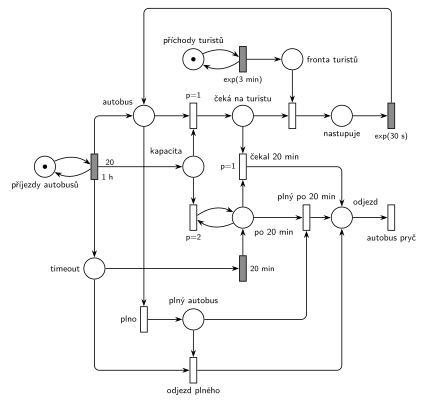

# 11–01 – Výletní autobus

## Zadání

> ⚠️ **Rekonstrukce.** Zadání z roku 2025/26 v materiálech chybí, existuje jen Hrubého řešení. Text níže je odvozený z jeho sítě a poznámek („proces „bus““, „proces timeout“, „čekám na turistu“, „Odjezd: *1 – plno, *2 – čekám ≥ 20min“). Čísla jsou převzatá z řešení. Že po 20 minutách autobus už nikoho nenabírá, je doplněné (podle podobné úlohy s lodí).
>
> Na zastávku výletního autobusu přichází turisté v intervalech daných exponenciálním rozložením se středem 3 minuty. Každou hodinu přijede autobus s kapacitou 20 míst. Turisté nastupují po jednom, nástup jednoho turisty trvá dobu danou exponenciálním rozložením se středem 30 sekund. Autobus odjíždí, jakmile je plný, nebo když od jeho příjezdu uplynulo 20 minut. Pak už další turisty nenabírá. V modelu jednoznačně ukažte (přechodem) moment, kdy transakce opouští systém.

Všimni si: turistů přijde v průměru 20 za hodinu a autobus jich za hodinu odveze nejvýš 20. Systém je na hraně stability, fronta turistů v dlouhém běhu pomalu roste.

Podobné úlohy: [11–14 – Přehrada s vyhlídkovou lodí](<../11–14 - Přehrada s vyhlídkovou lodí/11–14 - Přehrada s vyhlídkovou lodí.md>) (nabírání do kapacity, nejvýš 15 minut), [11–06 – Festivalový autobus](<../11–06 - Festivalový autobus/11–06 - Festivalový autobus.md>), [11–07 – Vyhlídková loď na molu](<../11–07 - Vyhlídková loď na molu/11–07 - Vyhlídková loď na molu.md>), [11–04 – Výletní loď](<../11–04 - Výletní loď/11–04 - Výletní loď.md>).

## Interpretace

Zobrazit interpretaci (nápověda)

- **Autobus je proces** (značka), ne zařízení. Přechod `1 h` vytvoří značku *autobus*, 20 značek *kapacita* (volná místa) a značku *timeout* (odpočet 20 min pro tento autobus).
- **If-else „je volné místo?“:** přechod s `p=1` vezme *autobus* a jedno volné místo a autobus pak *čeká na turistu*. Když místo není, provede se přechod *plno* (p=0).
- **Nástup po jednom:** *čeká na turistu* + turista z *Fronty turistů* → `exp(30 s)` → zpět *autobus*. Protože je značka autobusu jen jedna, nastupuje vždy jen jeden turista. Turista se v přechodu nástupu „spojí“ s autobusem a se systémem odjíždí v přechodu *autobus pryč*. Kdo ve frontě zůstane, čeká na další autobus.
- **Odjezd plného autobusu** bere i značku *timeout*, takže odpočet `20 min` zanikne a nevyprší až u dalšího autobusu.
- **Odjezd po 20 minutách:** *po 20 min* + *čeká na turistu* → *čekal 20 min*. Priorita `p=1` (Hrubý ji nepíše) zajistí, že autobus, který se po vypršení odpočtu vrátí z nástupu a má ještě místo, už nového turistu nenabere a odjede.
- **Past, na kterou upozorňuje Hrubý** („Hypoteticky může nastat timeout ∧ kapacita=0“): odpočet vyprší, zatímco nastupuje poslední turista. Autobus se pak vrátí do místa *autobus* bez volného místa. *Plno* nemůže (značka *timeout* už je pryč) a *čekal 20 min* také ne (autobus nečeká na turistu). Autobus by na zastávce zůstal navždy. Proto přechod *plno po 20 min* (*autobus* + *po 20 min*), který Hrubý dokreslil hnědě.
- **Zbylá volná místa** odstraní při odjezdu smyčka `p=1` z místa *kapacita*, aby další autobus začínal přesně s 20 místy. Při odjezdu plného autobusu je *kapacita* prázdná a smyčka se neprovede.
- Autobus vždy odjede nejpozději za 20 minut a jeden nástup, takže se dva autobusy nikdy nepotkají.

## Řešení

Zobrazit řešení

| Požadavek | Prvek sítě |
|---|---|
| turisté exp(3 min) | *generátor turistů* ⇄ `exp(3 min)` → *Fronta turistů* |
| každou hodinu autobus s 20 místy | *generátor* ⇄ `1 h` → *autobus*, 20× *kapacita*, *timeout* |
| nabírání do kapacity | `p=1`: *autobus* + *kapacita* → *čeká na turistu* (jinak *plno*) |
| nástup jednoho turisty exp(30 s) | *čeká na turistu* + turista → `exp(30 s)` → *autobus* |
| odjezd, když je plno | *plno*: *autobus* + *timeout* → *odjezd* |
| odjezd po 20 min | *timeout* → `20 min` → *po 20 min*; `p=1` *čekal 20 min* (+ *čeká na turistu*), případně *plno po 20 min* (+ *autobus*) |
| zbylá místa zaniknou | `p=1`: *odjezd* + *kapacita* → *odjezd* |
| odchod ze systému | *odjezd* → přechod *autobus pryč* bez výstupu |

Kontrola simulací: na zastávce je vždy nejvýš jeden autobus a ke každému patří jeho odpočet (*autobus* + *čeká* + *nastupuje* = *timeout* + *po 20 min*), *kapacita* nikdy nepřesáhne 20. Proběhnou všechny tři druhy odjezdu, *plno po 20 min* jen výjimečně. Fronta turistů je kriticky zatížená, proto se v kontrole nehlídá její omezenost.

## Časté chyby

Zobrazit časté chyby

- Odjezd plného autobusu bez odebrání značky *timeout*: odpočet doběhne naprázdno a další autobus pak odjede předčasně, hned jak začne čekat na turistu.
- Zapomenuté vynulování zbylých míst: kapacita dalšího autobusu je pak větší než 20.
- Timeout `20 min` přímo na místě *čeká na turistu*: měří jen čekání na dalšího turistu (a s každým nástupem začíná znovu), ne dobu od příjezdu autobusu.
- Chybějící přechod pro případ „odpočet vypršel během nástupu posledního turisty“ (Hrubý ho dokreslil až dodatečně).
- Kapacita testovaná inhibiční hranou místo if-else přes prioritu.

## Původ a zdroje

**Původ:** půlsemestrální písemka 2025/26, varianta C, 10 bodů (bodování podle ostatních let).

**Zdroj:**

- `Fitcheats/Půlsemestrálky/Hrubý - Řešení 2025-26.pdf`, str. 3

**Existující řešení:**

Zobrazit existující řešení

- **Hrubý (str. 3):** stejná struktura: zdroj `1h` dává *proces „bus“*, váhou 20 *kapacitu* a *proces timeout*; if-else `p=1` → *čekám na turistu* → nástup `exp(30s)` → zpět; odjezd *1 (plno, bere i timeout) a *2 (`20min` + čekám na turistu) s `p=1` smyčkou na *kapacitu*; výstup *autobus pryč*. Hnědě dokreslený přechod (*proces bus* + vypršený timeout) řeší past popsanou v Interpretaci. Rozdíly: oba generátory kreslí jako přechod bez vstupního místa; má dvě místa *odjezd kapacitní* a *odjezd timeout* (tady jedno místo *odjezd*, smyčka na kapacitu u plného autobusu nic nedělá); nemá prioritu u odjezdu po 20 minutách.

