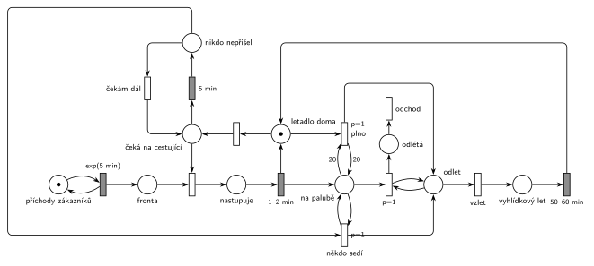

# 11–02 – Vyhlídkové lety

## Zadání

> Do Centra vyhlídkových letů přichází zákazníci v intervalech daných exponenciálním rozložením se středem 5 min a čekají na nástup do vyhlídkového letadla. Centrum obsahuje jedno vyhlídkové letadlo, které po naložení zákazníků odlétá na vyhlídkovou trasu trvající 50-60 minut. Cestující nastupují do letadla jednotlivě. Nastoupení jednoho zabere 1-2 minuty rovnoměrně. Kapacita letadla je 20 cestujících. Letadlo odlétá na trasu, pokud nastane jedna z okolností: 1) letadlo je naplněno, 2) od nastoupení posledního cestujícího uběhlo 5 minut (tj fronta se vyčerpala, nikdo další nejde a **v letadle už někdo sedí**). Vystupování cestujících po návratu letadla nemodelujeme.
>
> Zadaný systém modelujte formou Petriho sítě s vyznačením všech potřebných parametrů. **V modelu jednoznačně ukažte (přechodem) moment, kdy transakce opouští systém.**

Podobné úlohy: [11–07 – Vyhlídková loď na molu](<../11–07 - Vyhlídková loď na molu/11–07 - Vyhlídková loď na molu.md>) (skoro stejné zadání s lodí, navíc netrpěliví cestující), [11–01 – Výletní autobus](<../11–01 - Výletní autobus/11–01 - Výletní autobus.md>), [11–04 – Výletní loď](<../11–04 - Výletní loď/11–04 - Výletní loď.md>), [11–11 – Výletní loď na jezeře](<../11–11 - Výletní loď na jezeře/11–11 - Výletní loď na jezeře.md>).

## Interpretace

Zobrazit interpretaci (nápověda)

 

- **Letadlo** je zařízení s jednou značkou (*letadlo doma*). Nástup je obsazení: zákazník z *Fronty* + letadlo → *nastupuje* → `1–2 min` vrátí letadlo a zákazníka posune do *na palubě*. Místo *na palubě* je zároveň čítač nastoupených.
- **Plné letadlo:** přechod *plno* (`p=1`) potřebuje letadlo doma a 20 značek na palubě (testovací hrany s váhou 20). Hned po dvacátém nástupu má přednost před dalším obsazením (p=0), takže 21. zákazník nenastoupí.
- **5 minut od posledního nástupu:** časovaný přechod `5 min` má vstup z *letadlo doma*. Odpočet běží jen, když letadlo stojí volné. Každý nástup mu značku vezme a po nástupu se odpočet spustí znovu, takže měří přesně dobu od dokončení posledního nástupu. Když ve frontě někdo je, obsazení (okamžitý přechod) letadlo vezme dřív, než odpočet doběhne.
- **„V letadle už někdo sedí“:** po 5 minutách rozhoduje if–else přes prioritu. *Někdo sedí* (`p=1`) testuje aspoň jednu značku na palubě, jinak *čekám dál* (p=0) vrátí letadlo domů a odpočet běží znovu.
- **Odlet a odchod ze systému:** oba důvody odletu vedou do místa *odlet*. Smyčka `p=1` z něj bere cestující z *na palubě* po jednom, dokud tam nějací jsou. Každý cestující odchází přechodem *odchod*. Pak *vzlet* (p=0) pošle letadlo na trasu `50–60 min` a to se vrátí domů. Vystupování po návratu se nemodeluje, takže cestující opouštějí systém v okamžiku odletu.

## Petriho síť

Zobrazit Petriho síť

 

| Požadavek | Prvek sítě |
|---|---|
| příchody exp(5 min) | *generátor* ⇄ `exp(5 min)` → *Fronta* |
| nástup po jednom, 1–2 min | *Fronta* + *letadlo doma* → *nastupuje* → `1–2 min` → *letadlo doma* + *na palubě* |
| odlet při 20 cestujících | *plno* (`p=1`): *letadlo doma* + test 20 na *na palubě* → *odlet* |
| odlet 5 min po posledním nástupu, jen když někdo sedí | *letadlo doma* → `5 min` → *nikdo nepřišel* → *někdo sedí* (`p=1`, test 1) → *odlet*, jinak *čekám dál* |
| cestující opouštějí systém | `p=1` smyčka *odlet* + *na palubě* → *odlétá* → *odchod* |
| trasa 50–60 min | *vzlet* → *vyhlídkový let* → `50–60 min` → *letadlo doma* |

Kontrola simulací: letadlo je vždy v jednom stavu (*letadlo doma* + *nastupuje* + *nikdo nepřišel* + *odlet* + *vyhlídkový let* = 1), na palubě je nejvýš 20 cestujících. Zhruba polovina letů odlétá plná, ostatní po pětiminutovém čekání. *Čekám dál* nastane jen výjimečně, když se letadlo vrátí k prázdné frontě.

## Časté chyby

Zobrazit časté chyby

 

- Časovač 5 min jako netrpělivost na *Frontě*. Ten by měřil čekání zákazníka, ne dobu od posledního nástupu.
- Odlet po 5 minutách i s prázdným letadlem. Zadání chce, aby už někdo seděl. Bez if–else by letadlo létalo prázdné.
- Čítač nastoupených, který se po odletu nevynuluje. Při neplném letadle nestačí hrana s váhou, je potřeba cyklus s prioritou, který odebere všechny.
- Plno bez hrany z *letadlo doma* (jen váha 20 z čítače). Značka letadla pak zůstane doma, letadlo „odletí“ a zároveň dál nabírá cestující.
- Chybějící priorita u *plno*: obsazení letadla dalším zákazníkem by předběhlo odlet a na palubu by se dostal 21. cestující.

## Původ a zdroje

Zobrazit původ a zdroje

 

**Původ:** půlsemestrální písemka 2024/25, varianta C, 10 bodů.

**Zdroje:**

- `Fitcheats/Půlsemestrálky/Zadání z minulých let/2024-25.pdf`, str. 1 (koláž zadání všech čtyř variant)
- `Fitcheats/Půlsemestrálky/Hrubý - Řešení 2024-25.pdf`, str. 3 (řešení od Hrubého, hodně přepisované)

**Existující řešení:**

- **Hrubý (str. 3):** stejný princip. *Letadlo je doma* (značka) je zařízení pro nástup `1-2m`, nastoupení přidávají značku do *čítače nastoupených*. *Signál pro odlet* (`p=1`, hrana s váhou 20 z čítače + letadlo) → *na cestě* → `50-60m` → zpět. Časovač `5min` má vstup z letadla, po něm if–else: `p=1`, když už někdo nastoupil, jinak *čekám dál* zpět k letadlu. Když někdo nastoupil, cyklus s `p=1` vyprázdní čítač a letadlo letí. Rozdíly: plné letadlo u Hrubého odebere 20 cestujících přímo hranou s váhou 20. Výstupní přechod pro cestující nekreslí, cestující prostě zmizí z čítače.

