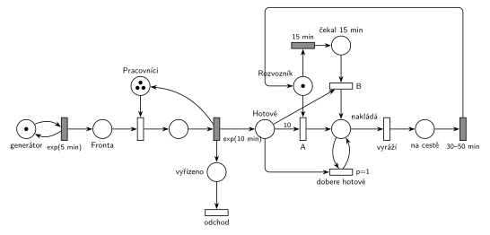

# 11–03 – Pizzerie s rozvozem

## Zadání

> Do pizzerie s rozvozem volají zákazníci v intervalech daných exponenciálním rozložením se středem 5 minut. Vyřízení jedné objednávky (rozhovor, výroba pizzy) zabere dobu danou exponenciálním rozložením se středem 10 minut. V pizzerii jsou 3 pracovníci pro obsluhu volajících a jeden pracovník pro rozvoz. Rozvozový pracovník vyráží na trasu rozvozu se všemi hotovými objednávkami, pokud je splněna jedna z podmínek: A) buď je hotových objednávek alespoň 10, nebo B) je hotová alespoň nějaká a on už čeká 15 minut. Kompletní rozvoz trvá rovnoměrně 30-50 minut.
>
> **V modelu jednoznačně ukažte (přechodem) moment, kdy transakce opouští systém.**

Podobné úlohy: [11–04 – Výletní loď](<../11–04 - Výletní loď/11–04 - Výletní loď.md>), [11–01 – Výletní autobus](<../11–01 - Výletní autobus/11–01 - Výletní autobus.md>), [09–03 – Psí salon](<../09–03 - Psí salon/09–03 - Psí salon.md>) (vyprázdnění místa smyčkou s prioritou).

## Interpretace

Zobrazit interpretaci (nápověda)

- **3 pracovníci** jsou sklad se 3 značkami. Každý vyřídí celou objednávku (rozhovor i výrobu) za `exp(10 min)`.
- **Kdy transakce opouští systém:** Hrubý nabízí dvě varianty. Tady je jeho *varianta A*: transakce (hovor, objednávka) odchází hned po vyřízení a časovaný přechod zároveň vloží značku do *Hotové*. Značky v *Hotové* jsou pak hotové pizzy, které rozvozník odveze. *Varianta B* nechává odejít jednu značku až po návratu z rozvozu (transakcí je pak jízda, ne objednávka). Obojí je v pořádku, jen musí být jasné, co je transakce.
- **Rozvozník** je místo s 1 značkou a dvě cesty, jak vyrazit:
  - **A)** okamžitý přechod s hranou váhy 10 z *Hotové*. Provede se, jakmile je hotová desátá pizza, nebo hned po návratu, když jich mezitím přibylo aspoň 10.
  - **B)** časovaný přechod `15 min` se vstupem jen z *Rozvozník*: odpočet běží od chvíle, kdy rozvozník čeká. Pokud mezitím vyrazí podle A, značka zmizí a odpočet zanikne. Po 15 minutách je značka v *čekal 15 min* a přechod B se provede s první hotovou pizzou. Když žádná není, čeká rozvozník libovolně dlouho, dokud nějaká nebude (Hrubý: „ale pak bude čekat na aspoň jednu hotovou (lib. dlouho)“).
- **„se všemi hotovými“:** hrana váhy 10 odebere přesně 10 pizz a přechod B jen jednu. Zbytek naloží smyčka *dobere hotové* s `p=1`, která bere po jedné, dokud *Hotové* není prázdné. Teprve pak se může provést *vyráží* (`p=0`). Pizzy dokončené během jízdy čekají na další rozvoz.
- **Rozvoz** `30–50 min` (rovnoměrně) vrací značku *Rozvozník*; tím začne nové čekání.

## Petriho síť

Zobrazit Petriho síť

| Požadavek | Prvek sítě |
|---|---|
| hovory exp(5 min) | *generátor* ⇄ `exp(5 min)` → *Fronta* |
| 3 pracovníci, vyřízení exp(10 min) | *Pracovníci* (3 značky), obsazení, `exp(10 min)` vrací značku |
| objednávka opouští systém (varianta A) | `exp(10 min)` → *vyřízeno* → přechod *odchod* bez výstupu |
| hotová pizza čeká na rozvoz | `exp(10 min)` → *Hotové* |
| A) aspoň 10 hotových | přechod *A*: *Rozvozník* + 10 × *Hotové* → *nakládá* |
| B) čeká 15 min a je hotová aspoň jedna | *Rozvozník* → `15 min` → *čekal 15 min*; přechod *B*: + 1 × *Hotové* → *nakládá* |
| vyráží se všemi hotovými | `p=1` smyčka *dobere hotové*, pak *vyráží* (`p=0`) → *na cestě* |
| rozvoz 30–50 min | `30–50 min` → zpět *Rozvozník* |

Kontrola simulací: platí *Pracovníci* + vyřizované = 3 a *Rozvozník* + *čekal 15 min* + *nakládá* + *na cestě* = 1. Každá hotová pizza je naložena právě jednou (10 × A + B + *dobere hotové* = počet vyřízených). Asi 65 % jízd začne podle podmínky A a 35 % podle B; v *Hotové* bylo nejvýš 20 pizz.

## Časté chyby

Zobrazit časté chyby

- **Nevzít všechny hotové** (Hrubý: „nedobrat všechny hotové – malá chyba“): přechod A vezme jen 10, přechod B jen jednu a smyčka *dobere hotové* chybí. Rozvozník pak odveze jen část hotových objednávek.
- **Chybný model timeoutu** (Hrubý: „model timeoutu – malá chyba“): časovaný `15 min` se vstupy *Rozvozník* i *Hotové*. Odpočet pak začne až s první hotovou pizzou, takže rozvozník odjede 15 minut po ní, ne po 15 minutách čekání. Hrubý to na str. 4 ukazuje na ose modelového času. Navíc má pak každá hotová pizza vlastní odpočet (slajd 138).
- Po 15 minutách odjezd bez kontroly, že je hotová aspoň jedna pizza: rozvozník pak vyrazí naprázdno.
- Smyčka *dobere hotové* bez priority: se stejnou prioritou jako *vyráží* může rozvozník odjet dřív, než naloží všechno.
- Chybějící návrat značky *Rozvozník* po rozvozu, nebo chybějící výstupní přechod.

## Původ a zdroje

**Původ:** půlsemestrální písemka 2022/23, varianta C, 10 bodů.

**Zdroje:**

- `Fitcheats/Půlsemestrálky/Zadání z minulých let/2022-23.pdf`, str. 3 (fotka zadání)
- `Fitcheats/Půlsemestrálky/Hrubý - Řešení 2022-23.pdf`, str. 3 (řešení od Hrubého) a str. 4 (jeho poznámky k častým chybám)

**Existující řešení:**

Zobrazit existující řešení

- **Hrubý (str. 3):** síť výše je jeho řešení překreslené: *FRONTA* → obsazení „zam.“ (3) → `exp(10min)` → „Hotová pizza“; „Rozvozník“ s přechodem „10+ hotovo“ (váha 10) a s `15min` čekání → „uběhl timeout“ → přechod s hranou z *Hotová pizza*; obě cesty vedou do místa se smyčkou `P=1` „dobere zbylých hotových zakázek“ → „vyráží“ → „je na cestě“ → rozvoz → *Rozvozník*. Výstup kreslí ve dvou variantách: „varianta A“ hned po `exp(10min)`, „var B“ za rozvozem. Rozdíly: u rozvozu má napsáno `30-60min`, ale zadání říká 30–50 minut; generátor kreslí bez místa. Poznámka vedle sítě zdůrazňuje, že nezáleží na tom, kolik zakázek rozvozník veze, ale musí vzít všechny hotové.
- **Hrubý (str. 4):** seznam častých chyb (viz níže) a srovnání správného a chybného modelu čekání na ose modelového času.

