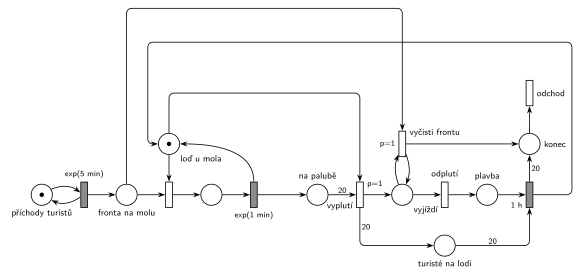

# 11–04 – Výletní loď

## Zadání

> Na molo výletní lodi přichází turisté v intervalech daných exponenciálním rozložením se středem 5 minut. Turisté nastupují na přistavenou loď po jednom. Doba nástupu jednoho turisty je 1 minuta exponenciálně. Po nastoupení dvacátého turisty loď ukončuje nástup, zvedá kotvu a vyjíždí na okružní jízdu trvající 1 hodinu. S okamžikem vyplutí lodi opouští všichni čekající turisté molo.
>
> *Zadaný systém modelujte formou Petriho sítě s vyznačením všech potřebných parametrů.*

Věta „V modelu jednoznačně ukažte (přechodem) moment, kdy transakce opouští systém“ přibyla až v roce 2022/23. Výstupní přechod je v síti přesto, dnes se vyžaduje.

Podobné úlohy: [11–07 – Vyhlídková loď na molu](<../11–07 - Vyhlídková loď na molu/11–07 - Vyhlídková loď na molu.md>), [11–02 – Vyhlídkové lety](<../11–02 - Vyhlídkové lety/11–02 - Vyhlídkové lety.md>), [11–01 – Výletní autobus](<../11–01 - Výletní autobus/11–01 - Výletní autobus.md>), [05–07 – Každá 100. transakce vyprázdní frontu](<../05–07 - Každá 100. transakce vyprázdní frontu/05–07 - Každá 100. transakce vyprázdní frontu.md>).

## Interpretace

Zobrazit interpretaci (nápověda)

- **Loď u mola** (1 značka) je zároveň zařízení pro nástup „po jednom“ a informace, že loď stojí u mola. Nástup je obsazení, `exp(1 min)` a vrácení značky lodi.
- **Čítač nastoupených** je místo *Na palubě*. **Vyplutí** je okamžitý přechod s hranou váhy 20 z *Na palubě* a se značkou *Loď u mola*. Priorita `p=1` zajistí, že po 20. turistovi loď vypluje dřív, než by začal nastupovat 21. (oba přechody potřebují značku lodi). Hrubý ho označuje „(trigger)“.
- **Vyprázdnění mola:** *Vyjíždí* je mezistav, který trvá nulový čas. Smyčka `p=1` *vyčisti frontu* bere čekající jednoho po druhém, dokud fronta není prázdná. Teprve pak se provede *odplutí* (p=0). Turisté, kteří přijdou během plavby, normálně čekají na další jízdu: odcházejí jen ti, kdo čekají v okamžiku vyplutí.
- **Turisté na lodi** přejdou při vyplutí do místa *turisté na lodi* (váha 20) a ze systému odcházejí po návratu lodi. Dobu vystupování zadání neuvádí, takže je nulová. Hrubý je ze sítě odebírá už při vyplutí; to je také přijatelné.
- Na počátku stojí prázdná loď u mola.

## Petriho síť

Zobrazit Petriho síť

| Požadavek | Prvek sítě |
|---|---|
| turisté po exp(5 min) | *generátor* ⇄ `exp(5 min)` → *Fronta na molu* |
| nástup po jednom, exp(1 min) | obsazení *Lodi u mola*, `exp(1 min)` vrací značku lodi → *Na palubě* |
| po 20. turistovi loď vyplouvá | `p=1` *vyplutí*: váha 20 z *Na palubě* + *Loď u mola* → *Vyjíždí* |
| čekající v okamžiku vyplutí odcházejí | smyčka `p=1` *vyčisti frontu* (*Vyjíždí* + *Fronta* → *Vyjíždí* + *konec*) |
| okružní jízda 1 h | *odplutí* → *Plavba* → `1 h` vrací značku *Lodi u mola* |
| odchod ze systému | *konec* → *odchod* (vyhnaní z mola i turisté po jízdě) |

Kontrola simulací: *Loď u mola* + nastupující + *Vyjíždí* + *Plavba* = 1, *Na palubě* i *turisté na lodi* ≤ 20. Loď vyplouvá zhruba každých 100 minut (20 turistů × 5 min), fronta na molu zůstává malá.

## Časté chyby

Zobrazit časté chyby

- Vyprázdnění fronty jedním přechodem s váhou hrany. Váha bere přesný počet, ne „všechny“; na „všechny“ je potřeba smyčka s prioritou.
- Smyčka bez návratu značky do *Vyjíždí*: odejde jen jeden turista.
- Fronta se čistí po celou dobu plavby (podmínka „loď je pryč“ místo okamžiku vyplutí). Pak odcházejí i turisté, kteří přišli během jízdy.
- Vyplutí bez `p=1`: může začít nastupovat 21. turista.
- Vyplutí, které nebere značku lodi: během plavby by se dál nastupovalo.
- Zapomenutý návrat značky lodi po 1 h nebo čítač nastoupených, který se při vyplutí nevynuluje.

## Původ a zdroje

**Původ:** půlsemestrální písemka 2021/22, varianta C, 10 bodů.

**Zdroje:**

- `Fitcheats/Půlsemestrálky/Zadání z minulých let/2021-22.pdf`, str. 3 (zadání)
- `Fitcheats/Půlsemestrálky/Hrubý - Řešení 2021-22.pdf`, str. 3 (řešení od Hrubého)

**Existující řešení:**

Zobrazit existující řešení

- **Hrubý (str. 3):** stejná struktura: generátor `exp(5min)` (bez místa) → „Fronta na molu“ → obsazení místa „Loď je k nástupu“ → `exp(1min)` „NÁSTUP“ (vrací loď) → „Počet nastoupených“ → přechod s váhou 20, `p=1`, „(trigger)“, který bere i značku lodi → „Vyjíždí“ → smyčka `p=1` „Vyčisti frontu“ → přechod s nižší prioritou → „na cestě“ → `1h` → „návrat“ do místa lodi. Vedle sítě opsal větu ze zadání „S okamžikem vyplutí opouští všichni čekající turisté molo“.
  - Červeně jsou zakroužkované obsazení lodi a trigger a spojené čarou, nejspíš kvůli soupeření o značku lodi (odtud `p=1`).
  - Rozdíl: u Hrubého 20 turistů zaniká už při vyplutí a vyhnaní turisté zanikají ve smyčce. Výstupní přechod se tehdy nevyžadoval.

