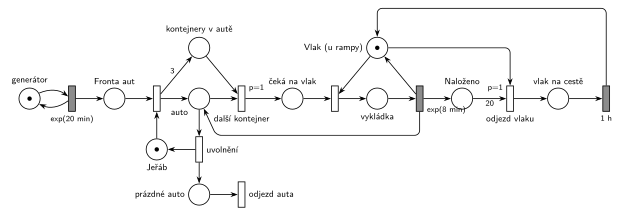

# 11–05 – Překladiště kontejnerů

**Původ:** půlsemestrální písemka 2021/22, varianta A, 10 bodů.

**Zdroje:**

- `Fitcheats/Půlsemestrálky/Zadání z minulých let/2021-22.pdf`, str. 1 (zadání)
- `Fitcheats/Půlsemestrálky/Hrubý - Řešení 2021-22.pdf`, str. 1 (řešení od Hrubého)

## Zadání

> Do překladiště přijíždí nákladní auta v intervalech daných exponenciálním rozložením se středem 20 minut. Každé auto veze 3 kontejnery. Překládání kontejnerů z aut do přistaveného vlaku zajišťuje jeden jeřáb. Vykládka jednoho kontejneru zabere 8 minut exponenciálně. Vlak má kapacitu 20 kontejnerů. Po naplnění vlaku vlak odjíždí a vrací se po jedné hodině. Během nepřítomnosti vlaku v překladišti je vykládka z aut pozastavena. Na počátku stojí v překladišti prázdný vlak.
>
> *Zadaný systém modelujte formou Petriho sítě s vyznačením všech potřebných parametrů.*

Věta „V modelu jednoznačně ukažte (přechodem) moment, kdy transakce opouští systém“ přibyla až v roce 2022/23. Výstupní přechod je v síti přesto, dnes se vyžaduje.

Podobné úlohy: [11–09 – Překladiště s jeřábem](<../11–09 - Překladiště s jeřábem/11–09 - Překladiště s jeřábem.md>), [11–10 – Bagrista a nákladní auta](<../11–10 - Bagrista a nákladní auta/11–10 - Bagrista a nákladní auta.md>), [11–03 – Pizzerie s rozvozem](<../11–03 - Pizzerie s rozvozem/11–03 - Pizzerie s rozvozem.md>).

## Interpretace

Zobrazit interpretaci (nápověda)

- **Transakce je auto**, ne kontejner (Hrubý: „Pozn.: Transakce je AUTO, ne kontejner!“). Auto obsadí *Jeřáb* a stejný přechod vloží 3 značky do *kontejnery v autě* (hrana s váhou 3). Kontejnery jsou čítač, který říká, kolik cyklů vykládky auto ještě potřebuje.
- **Cyklus vykládky:** *další kontejner* (`p=1`) vezme auto a jeden kontejner. Auto pak čeká na vlak, obsadí *Vlak*, po `exp(8 min)` se vrátí zpět do místa *auto*, vlak se uvolní a kontejner přibude do *Naloženo*. Když už v autě žádný kontejner není, přijde na řadu *uvolnění* (p=0): jeřáb je volný a auto odjíždí.
- **Proč dva kroky (další kontejner, pak obsazení vlaku):** kdyby jeden přechod bral auto, kontejner i vlak, pak by při nepřítomném vlaku nebyl proveditelný a místo něj by se provedlo *uvolnění*. Auto by odjelo s nevyloženými kontejnery. Takhle auto čeká v *čeká na vlak* a drží jeřáb, takže vykládka je pozastavená.
- **Vlak** je místo se značkou: vlak stojí u rampy a nic se do něj právě nevykládá. Vykládka ho drží jako zařízení.
- **Odjezd vlaku:** hrana s váhou 20 z *Naloženo* a značka *Vlak*. Priorita `p=1` zajistí, že po 20. kontejneru vlak odjede dřív, než začne další vykládka (oba přechody potřebují značku *Vlak*). Kontejnery odjíždějí s vlakem, značky zaniknou (nejsou to transakce). Po `1 h` se vrací prázdný vlak.
- **Počáteční stav:** značka ve *Vlak*, *Naloženo* = 0 (prázdný vlak u rampy).
- **Systém je přetížený:** vykládka auta trvá v průměru 3 × 8 = 24 min, auta přijíždějí po 20 min a vlak je navíc po každých 20 kontejnerech hodinu pryč. Fronta aut proto roste do nekonečna. To je vlastnost zadání, ne chyba sítě.

## Řešení

Zobrazit řešení

| Požadavek | Prvek sítě |
|---|---|
| auta po exp(20 min) | *generátor* ⇄ `exp(20 min)` → *Fronta aut* |
| jeden jeřáb, auto veze 3 kontejnery | obsazení *Jeřábu*: auto do *auto*, váha 3 do *kontejnery v autě* |
| vykládka kontejneru exp(8 min) | `p=1` *další kontejner* → obsazení *Vlaku* → `exp(8 min)` (vrací *Vlak* a auto, přidá do *Naloženo*) |
| auto je vyložené | *uvolnění* (p=0) vrací *Jeřáb* → *prázdné auto* → *odjezd auta* |
| vlak s kapacitou 20 odjíždí plný | `p=1` *odjezd vlaku*: váha 20 z *Naloženo* + *Vlak* → *vlak na cestě* |
| návrat po 1 h | `1 h` vrací značku do *Vlak* |
| vykládka pozastavena bez vlaku | obsazení vlaku potřebuje značku *Vlak* |
| na počátku prázdný vlak | *Vlak* = 1, *Naloženo* = 0 |

Kontrola simulací: *Jeřáb* + auto ve třech fázích vykládky = 1, *Vlak* + *vykládka* + *vlak na cestě* = 1, *kontejnery v autě* ≤ 3, *Naloženo* ≤ 20. Na každé auto připadají právě tři vykládky a vlak odjíždí po každých 20. Fronta aut podle očekávání roste (odbaví se asi 1,8 auta za hodinu, přijíždějí 3).

## Existující řešení

Zobrazit srovnání s existujícími řešeními

- **Hrubý (str. 1):** stejná struktura: „Fronta aut“ → „Seize“ jeřábu (výstup do místa auta a s váhou 3 do místa kontejnerů) → okamžitý přechod `p=1` (popisek pod ním je špatně čitelný) → „Seize“ vlaku → `exp(8min)` vrací vlak, auto a přidává do místa „Složeno“ → odjezd `p=1` s váhou 20 → místo odjíždějícího vlaku → `1h` → zpět „Vlak“. Jeřáb uvolňuje samostatný přechod „Release“ a auto v něm zaniká (výstupní přechod se tehdy nevyžadoval). Generátor je bez místa.
  - Červené poznámky: „TŘI CYKLY VYKLÁDKY (anebo čítač v systému)“, „Chování vlaku“, podtržené váhy 3 a 20. Obsazení vlaku a odjezd vlaku jsou červeně zakroužkované a propojené, nejspíš proto, že oba soupeří o značku *Vlak* (odtud `p=1` u odjezdu).

## Časté chyby

Zobrazit časté chyby

- Kontejner jako transakce (generátor kontejnerů). Pak není vidět, kdy je auto vyložené a odjíždí, a jeřáb může střídat kontejnery různých aut.
- Uvolnění jeřábu, které nečeká na vyložení všech tří kontejnerů (chybí priorita `p=1` u dalšího kontejneru nebo dvoukrokový cyklus). Auto pak odjede naložené.
- Odjezd vlaku bez priority: po 20. kontejneru může začít 21. vykládka do plného vlaku.
- Odjezd vlaku jen z čítače, bez značky *Vlak*: vlak by „odjel“ uprostřed vykládky a vykládka by pokračovala dál.
- Čítač kontejnerů, který se při odjezdu nevynuluje (hrana s váhou 20 musí odebrat všech 20).
- Zapomenutý návrat vlaku po 1 h nebo vlak, který na začátku není u rampy.

