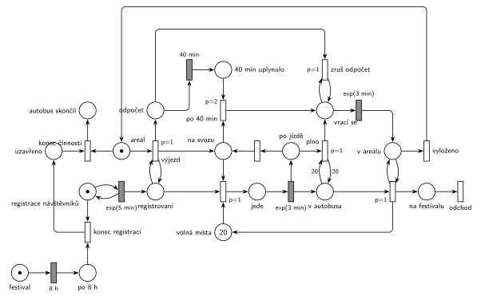

# 11–06 – Festivalový autobus

## Zadání

> Městský festivalový autobus sváží návštěvníky z jejich domovů do areálu festivalu. Kapacita autobusu je 20 míst. Návštěvníci registrují svůj požadavek na odvoz v intervalech exponenciálně se středem 5 minut. Autobus při své jízdě po jednom nabírá registrované návštěvníky. Každá jízda autobusu (z areálu k návštěvníkovi, mezi návštěvníky, zpět do areálu) trvá exponenciálně se středem 3 minuty. Autobus se vrací do areálu buď po naplnění kapacity, nebo pokud je již na svozové jízdě déle než 40 minut. Po příjezdu do areálu vyloží návštěvníky (dobu zanedbáváme) a vyráží na další svozovou jízdu. Festival trvá 12 hodin. Čtyři hodiny před koncem festivalu už se návštěvníci neregistrují ke svozu, a pokud už není koho svážet, tak končí i činnost autobusu.
>
> *Zadaný systém modelujte formou Petriho sítě s vyznačením všech potřebných parametrů.*

Věta „V modelu jednoznačně ukažte (přechodem) moment, kdy transakce opouští systém“ v tehdejších zadáních ještě nebyla. Výstupní přechod je v síti přesto, dnes se vyžaduje.

Podobné úlohy: [11–01 – Výletní autobus](<../11–01 - Výletní autobus/11–01 - Výletní autobus.md>), [11–08 – Přepravní firma](<../11–08 - Přepravní firma/11–08 - Přepravní firma.md>), [11–07 – Vyhlídková loď na molu](<../11–07 - Vyhlídková loď na molu/11–07 - Vyhlídková loď na molu.md>).

## Interpretace

<details>
<summary>Zobrazit interpretaci (nápověda)</summary>
<br>

- **Transakce** jsou návštěvníci: registrace (smyčka *registrace návštěvníků* ⇄ `exp(5 min)`) → *registrovaní* → vyzvednutí → *v autobusu* → vyložení v areálu → *na festivalu* → *odchod*. Autobus je jedna značka, která obíhá stavy *areál* → *na svozu* → *vrací se* → *v areálu* → *areál*.
- **Výjezd** (`p=1`) testuje, že je někdo registrovaný. Autobus tedy z areálu nevyjíždí naprázdno, odpočet 40 minut začne až s výjezdem. Je to výklad zadání („vyráží na další svozovou jízdu“), jinak by autobus po uzávěrce jezdil prázdné okruhy.
- **Jízdy:** každé vyzvednutí je jedna jízda `exp(3 min)` (z areálu k prvnímu návštěvníkovi, pak mezi návštěvníky). Okamžitý přechod vyzvednutí (`p=1`) vezme registrovaného návštěvníka, volné místo a autobus. Po jízdě je návštěvník *v autobusu* a autobus *po jízdě*, kde se rozhoduje o dalším kroku: plný se vrací (*plno*, `p=1`), jinak jde zpět *na svoz* (`p=0`). Návrat do areálu je další jízda `exp(3 min)`.
- **Kapacita:** *volná místa* (20) se berou při vyzvednutí a vrací při vyložení. *Plno* testuje 20 návštěvníků *v autobusu* hranami s váhou 20 tam i zpět.
- **40 minut:** výjezd spustí samostatný *odpočet* (časovaný přechod `40 min`), který běží nezávisle na jízdách. Časovač přímo na místě *na svozu* by nešel, protože autobus to místo při každé jízdě opouští a odpočet by začínal znovu. Po uplynutí se autobus vrátí, jakmile je *na svozu*: rozjetou jízdu k návštěvníkovi dokončí. Priorita `p=2` zajistí, že návrat vyhraje nad dalším vyzvednutím.
- **Plný autobus se vrací dřív, než odpočet uplyne.** Smyčka *zruš odpočet* (`p=1`) v místě *vrací se* pak běžící odpočet odebere, aby neuplynul až během dalšího okruhu.
- **Když není koho vyzvednout**, autobus čeká *na svozu*. Zadání zná jen dva důvody k návratu (plno, 40 min), proto se nevrací dřív.
- **Vyložení** (`p=1`) bere po jednom všechny návštěvníky *v autobusu* a testuje, že je autobus *v areálu*. Pak přechod *vyloženo* (`p=0`) vrátí autobus do *areálu*.
- **Konec festivalu:** po `8 h` (12 h − 4 h) přechod *konec registrací* odebere značku generátoru a značka přejde do *uzavřeno*. *Konec činnosti* (`p=0`) se provede, když je autobus v *areálu*, registrace jsou uzavřené a nikdo nečeká (jinak vyhraje výjezd s `p=1`). Samotný konec festivalu ve 12 h modelovat není potřeba: autobus skončí dřív (v simulacích zhruba v 8,1–8,6 h).
- **Plno prakticky nenastane:** 20 jízd po `exp(3 min)` trvá v průměru 60 minut, svoz ale končí po 40. Přechod *plno* je přesto nutný, zadání ho výslovně uvádí.

</details>

## Petriho síť

<details>
<summary>Zobrazit Petriho síť</summary>
<br>



</details>

## Časté chyby

<details>
<summary>Zobrazit časté chyby</summary>
<br>

- Odpočet 40 min jako časovaný přechod na místě, které autobus při každé jízdě opouští (např. *na svozu*). Odpočet se pak s každým vyzvednutím spouští znovu a měří jen čekání na dalšího návštěvníka.
- Odpočet, který po návratu kvůli zaplnění zůstane v síti: uplyne během další jízdy a autobus pošle zpět příliš brzy.
- Kapacita jako hrana s váhou 20 při výjezdu bez vrácení volných míst při vyložení, nebo nabrání 20 lidí najednou. Návštěvníci se nabírají po jednom a každý stojí jednu jízdu.
- Vyložení jedním přechodem s hranou s váhou 20. V autobusu bývá méně lidí, proto vyložení po jednom ve smyčce s prioritou.
- Zastavení registrací po 12 h místo po 8 h, nebo zastavení autobusu hned po 8 h, i když ještě někdo čeká na odvoz.
- Chybějící priorita u návratu po 40 min: autobus by mohl dál nabírat, i když čas vypršel.

</details>

## SIMLIB

<details>
<summary>Zobrazit SIMLIB kód</summary>
<br>

Model je izomorfní k Petriho síti výše: každé místo, přechod a značka mají svůj protějšek v kódu.

```cpp
// 11–06 Festivalový autobus – model v SIMLIB/C++
#include "simlib.h"

Queue Registrovani("Registrovaní");         // místo „registrovaní“
Queue VAutobusu("V autobusu");              // místo „v autobusu“ (volná místa = 20 − délka)
Histogram Pocet("Návštěvníků v autobusu při návratu", 0, 2, 11);
Histogram Doba("Doba od registrace do příjezdu na festival [min]", 0, 10, 15);
bool uzavreno = false;                      // značka v místě „uzavřeno“
int okruhu = 0, plnych = 0;
double konecAutobusu = 0;
Process *cekajici = nullptr;                // autobus v „areálu“ nebo „na svozu“ bez práce

class Navstevnik : public Process {         // transakce = návštěvník
  void Behavior() override {
    double registrace = Time;
    Into(Registrovani);
    if (cekajici) cekajici->Activate();
    Passivate();                            // vyzvednutí, jízda, vyložení dělá autobus
    Doba(Time - registrace);
  }                                         // na festivalu → přechod „odchod“
};

class Autobus : public Process {            // značka autobusu
 public:
  bool vyprselo = false;                    // značka v místě „40 min uplynulo“
  Event *odpocet = nullptr;                 // značka v místě „odpočet“
  void Behavior() override;
};

class Odpocet40 : public Event {            // časovaný přechod 40 min
  Autobus *bus;
 public:
  Odpocet40(Autobus *b) : bus(b) { Activate(Time + 40); }
  void Behavior() override {
    bus->odpocet = nullptr;
    bus->vyprselo = true;
    if (cekajici == bus) bus->Activate();   // čeká na svozu → po 40 min (p=2)
  }
};

void Autobus::Behavior() {
  for (;;) {                                // místo „areál“
    while (Registrovani.Empty()) {          // výjezd (p=1) má přednost před koncem
      if (uzavreno) {                       // konec činnosti (p=0)
        konecAutobusu = Time;
        return;                             // „autobus skončil“
      }
      cekajici = this;
      Passivate();
      cekajici = nullptr;
    }
    okruhu++;                               // výjezd: spustí odpočet 40 min
    vyprselo = false;
    odpocet = new Odpocet40(this);
    for (;;) {                              // místo „na svozu“
      while (Registrovani.Empty() && !vyprselo) {
        cekajici = this;
        Passivate();
        cekajici = nullptr;
      }
      if (vyprselo) break;                  // po 40 min (p=2 před vyzvednutím)
      Entity *n = Registrovani.GetFirst();  // vyzvednutí (p=1) bere volné místo
      Wait(Exponential(3));                 // jízda k návštěvníkovi exp(3 min)
      VAutobusu.Insert(n);                  // → v autobusu, autobus „po jízdě“
      if (VAutobusu.Length() == 20) {       // plno (p=1)
        plnych++;
        if (odpocet) delete odpocet;        // zruš odpočet (p=1 v „vrací se“)
        odpocet = nullptr;
        break;
      }                                     // jinak (p=0) zpět na svoz
    }
    Pocet(VAutobusu.Length());
    Wait(Exponential(3));                   // vrací se: jízda do areálu exp(3 min)
    while (!VAutobusu.Empty())              // vyložení (p=1) po jednom
      VAutobusu.GetFirst()->Activate();
  }                                         // vyloženo → areál
}

class Registrace : public Event {           // místo „registrace návštěvníků“ ve smyčce s exp(5 min)
  void Behavior() override {
    if (uzavreno) return;                   // konec registrací vzal značku generátoru
    (new Navstevnik)->Activate();
    Activate(Time + Exponential(5));
  }
};

class KonecRegistraci : public Event {      // festival → 8 h → konec registrací
  void Behavior() override {
    uzavreno = true;
    if (cekajici) cekajici->Activate();     // autobus v areálu může skončit
  }
};

int main() {
  Init(0, 12 * 60);                         // modelový čas v minutách: festival trvá 12 h
  (new Autobus)->Activate();
  (new Registrace)->Activate();
  (new KonecRegistraci)->Activate(8 * 60);
  Run();
  Print("Okruhů: %d, z toho plných: %d, autobus skončil v %.0f min\n",
        okruhu, plnych, konecAutobusu);
  Pocet.Output();
  Doba.Output();
}
```

| Petriho síť | SIMLIB |
|---|---|
| *registrace návštěvníků* ⇄ `exp(5 min)` | událost `Registrace`, která se znovu plánuje za `Exponential(5)` |
| *festival* → `8 h` → *konec registrací* → *uzavřeno* | událost `KonecRegistraci` v čase 480, `uzavreno = true` (generátor se už nenaplánuje) |
| značka návštěvníka, *registrovaní* | proces `Navstevnik`, `Queue Registrovani` |
| značka autobusu, *areál* | proces `Autobus`, začátek vnějšího cyklu |
| *výjezd* (`p=1`, test *registrovaní*) / *konec činnosti* | `while (Registrovani.Empty())` / `return` při `uzavreno` |
| *odpočet* → `40 min` → *40 min uplynulo* | událost `Odpocet40`, nastaví `vyprselo` |
| *na svozu*, *po 40 min* (`p=2`) | vnitřní cyklus, `if (vyprselo) break;` |
| *volná místa* (20), vyzvednutí (`p=1`) | délka fronty `VAutobusu` (nejvýš 20), `Registrovani.GetFirst()` |
| *jede* → `exp(3 min)` → *v autobusu* + *po jízdě* | `Wait(Exponential(3))`, `VAutobusu.Insert(n)` |
| *plno* (`p=1`, test 20), *zruš odpočet* | `if (VAutobusu.Length() == 20)`, `delete odpocet` |
| *vrací se* → `exp(3 min)` → *v areálu* | `Wait(Exponential(3))` |
| vyložení (`p=1`) → *na festivalu* → *odchod* | `VAutobusu.GetFirst()->Activate()`, konec `Navstevnik::Behavior()` |

**Kontrola simulací.** Petriho síť: autobus je vždy právě v jednom stavu, *volná místa* + *jede* + *v autobusu* = 20, *odpočet* i *40 min uplynulo* mají nejvýš jednu značku. Za 8 h se zaregistruje asi 80–110 návštěvníků, autobus udělá asi 10–11 okruhů, vždy se vrací po 40 minutách; pak všechny rozveze a síť se zastaví (`make check`). Přechody *plno* a *zruš odpočet* jsem ověřil zvlášť s registracemi po `exp(0,5 min)`: provedou se a odpočet se nehromadí. SIMLIB model: v jednom festivalu se zaregistrovalo 94 návštěvníků, autobus udělal 11 okruhů, ani jednou se nevrátil plný (v autobusu nejvýš 11, průměrně 8,5 návštěvníka) a činnost ukončil v 515. minutě (8,6 h). Návštěvník čekal od registrace do příjezdu na festival průměrně 32 minut (`make simlib`).

</details>

## Původ a zdroje

<details>
<summary>Zobrazit původ a zdroje</summary>
<br>

**Původ:** půlsemestrálky 2014–19 (přehled zadání), úloha Z21. Rok, varianta ani body nejsou známé.

**Původní znění:**

> Městský festivalový autobus sváží návštěvníky z jejich domovů do areálu festivalu. Kapacita autobusu je 20 míst. Návštěvníci registrují svůj požadavek na odvoz v intervalech daných exp(5min). Autobus při své jízdě po jednom nabírá registrované návštěvníky. Každá jízda autobusu (z areálu k návštěvníkovi, mezi návštěvníky, zpět do areálu) se řídí exp(3min). Autobus se vrací do areálu buď po naplnění kapacity, nebo pokud je již na svozové jízdě déle než 40 minut. Po příjezdu do areálu vyloží návštěvníky (dobu zanedbáváme) a vyráží na další svozovou jízdu. Festival trvá 12 hodin. Čtyři hodiny před koncem festivalu už se návštěvníci neregistrují ke svozu, a pokud už není koho svážet, tak končí i činnost autobusu.
>
> *Zadaný systém modelujte formou Petriho sítě s vyznačením všech potřebných parametrů.*

**Zdroje:**

- `Fitcheats/Půlsemestrálky/Zadání z minulých let/Přehled zadání 2014-19.pdf`, str. 5 (zadání, bez řešení)

**Existující řešení:**

- K této úloze v materiálech žádné řešení není. Nejbližší je výletní autobus z roku 2025/26 ([11–01](<../11–01 - Výletní autobus/11–01 - Výletní autobus.md>)), který také odjíždí buď plný, nebo po uplynutí času, s kapacitou jako místem s 20 značkami.

</details>
