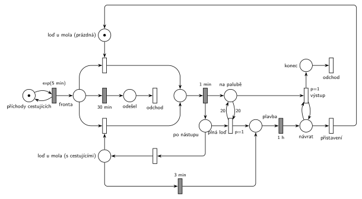

# 11–07 – Vyhlídková loď na molu

## Zadání

> Na nástupní molo pro vyhlídkové jízdy lodí přichází cestující v intervalech exponenciálně se středem 5 minut. Jízdy provádí jedna výletní loď. Každý cestující po 30 minutách svého čekání ve frontě z fronty odchází. Pokud je k molu přistavena loď, cestující po jednom nastupují. Nastoupení jednoho trvá přesně 1 minutu. Loď od mola vyráží, pokud nastane jedna ze dvou okolností: 1) nastoupilo 20 cestujících (naplněna kapacita lodi), 2) od nastoupení posledního uběhly 3 minuty (prázdná fronta). Vyhlídková trasa trvá přesně 1 hodinu, a pak se loď vrací k molu. Dobu vystupování cestujících neuvažujeme.
>
> *Zadaný systém modelujte formou Petriho sítě s vyznačením všech potřebných parametrů.*

Věta „V modelu jednoznačně ukažte (přechodem) moment, kdy transakce opouští systém“ přibyla až v roce 2022/23. Výstupní přechody jsou v síti přesto, dnes se vyžadují.

Podobné úlohy: [11–04 – Výletní loď](<../11–04 - Výletní loď/11–04 - Výletní loď.md>) (stejný typ, s Hrubého řešením), [11–11 – Výletní loď na jezeře](<../11–11 - Výletní loď na jezeře/11–11 - Výletní loď na jezeře.md>), [11–14 – Přehrada s vyhlídkovou lodí](<../11–14 - Přehrada s vyhlídkovou lodí/11–14 - Přehrada s vyhlídkovou lodí.md>), [02–01 – Netrpělivé požadavky](<../02–01 - Netrpělivé požadavky/02–01 - Netrpělivé požadavky.md>).

## Interpretace

<details>
<summary>Zobrazit interpretaci (nápověda)</summary>
<br>

- **Příchody** modeluje smyčka *příchody cestujících* ⇄ `exp(5 min)`, cestující čekají ve *frontě*.
- **Netrpělivost:** časovaný `30 min` přímo na *frontě*, každý čekající má vlastní odpočet. Kdo nastoupí dřív, tomu odpočet zanikne. Kdo čeká 30 minut, jde do *odešel* a opouští systém přechodem *odchod*. Fronta se při vyplutí nevyprazdňuje; čekající odcházejí jen po 30 min.
- **Loď u mola** je zařízení pro nástup „po jednom“ (jako v [11–04 – Výletní loď](<../11–04 - Výletní loď/11–04 - Výletní loď.md>)), jen má dva stavy: *prázdná* (nikdo ještě nenastoupil) a *s cestujícími*. Nástup jde z obou stavů (dvě symetrické větve) a po `1 min` přejde loď do *po nástupu*; cestující přibude do *na palubě*.
- **20 cestujících:** v místě *po nástupu* se provede *plná loď* (`p=1`, test 20 na *na palubě* hranami s váhou 20 tam i zpět) a loď vyplouvá. Jinak přechod s `p=0` vrátí loď do stavu *s cestujícími*. Dvacátý cestující tak vyplutí spustí hned a 21. nenastoupí.
- **3 minuty od posledního nástupu:** časovaný přechod `3 min` na místě *s cestujícími*. Odpočet začne po každém nástupu. Když je někdo ve frontě (nebo během 3 min přijde), nástup vezme značku lodi a odpočet zanikne; po jeho nástupu začne nový. Přechod se tedy provede jen při prázdné frontě, přesně 3 min po posledním nástupu.
- Prázdná loď na odpočet nemá: dokud nikdo nenastoupil, není od čeho počítat, a loď čeká na prvního cestujícího. Proto dva stavy lodi.
- **Plavba** trvá `1 h`, pak je loď v místě *návrat*.
- **Cestující zůstávají v *na palubě* po celou jízdu** a ze systému odcházejí po návratu (dobu vystupování neuvažujeme). Jejich počet je 1 až 20, proto výstup není hrana s váhou, ale smyčka `p=1` *výstup* na místě *návrat* → *konec* → *odchod*. Teprve pak *přistavení* (`p=0`) vrátí prázdnou loď k molu.
- Na počátku je prázdná loď u mola.

</details>

## Petriho síť

<details>
<summary>Zobrazit Petriho síť</summary>
<br>



</details>

## Časté chyby

<details>
<summary>Zobrazit časté chyby</summary>
<br>

- Odpočet 3 min, který se nezruší, když někdo nastoupí (např. přechod `3 min` na místě, které nástup nebere). Pak loď odpluje 3 min po prvním nástupu, ne po posledním.
- Odpočet 3 min i u prázdné lodi: loď by jezdila prázdná.
- Vyplutí při 20 cestujících bez `p=1`: může začít nastupovat 21.
- Výstup po návratu hranou s váhou 20: při vyplutí po 3 min je cestujících méně a přechod by se nikdy neprovedl.
- Netrpělivost jako jeden společný odpočet pro celou frontu místo vlastního pro každého cestujícího.
- Zapomenutý návrat lodi k molu po jízdě.

</details>

## SIMLIB

<details>
<summary>Zobrazit SIMLIB kód</summary>
<br>

Model je izomorfní k Petriho síti výše: každé místo, přechod a značka mají svůj protějšek v kódu.

```cpp
// 11–07 Vyhlídková loď na molu – model v SIMLIB/C++
#include "simlib.h"

Queue Fronta("Fronta");                     // místo „fronta“
Queue NaPalube("Na palubě");                // místo „na palubě“
Histogram Obsazeni("Cestujících v lodi při vyplutí", 0, 2, 11);
Histogram Doba("Doba cestujícího od příchodu do výstupu [min]", 60, 5, 12);
int odeslo = 0, plnych = 0, po3min = 0;
Process *cekajici = nullptr;                // loď u mola bez cestujícího ve frontě

class Cestujici : public Process {          // značka cestujícího
 public:
  bool odesel = false;
  Event *netrpelivost = nullptr;            // odpočet 30 min na „frontě“
  void Behavior() override;
};

class Netrpelivost : public Event {         // časovaný přechod 30 min z „fronty“
  Cestujici *c;
 public:
  Netrpelivost(Cestujici *x) : c(x) { Activate(Time + 30); }
  void Behavior() override {
    c->netrpelivost = nullptr;
    c->Out();                               // vyjde z fronty → „odešel“
    c->odesel = true;
    c->Activate();
  }
};

void Cestujici::Behavior() {
  double prichod = Time;
  Into(Fronta);
  netrpelivost = new Netrpelivost(this);
  if (cekajici) cekajici->Activate();       // loď u mola může začít nástup
  Passivate();                              // čeká; budí ho netrpělivost nebo výstup
  if (odesel) odeslo++;
  else Doba(Time - prichod);                // jen ti, kdo jeli
}                                           // přechod „odchod“ (z fronty nebo po výstupu)

class Lod : public Process {                // značka lodi
 public:
  bool vyprselo = false;
  void Behavior() override;
};

class Tri : public Event {                  // časovaný přechod 3 min na „s cestujícími“
  Lod *l;
 public:
  Tri(Lod *x) : l(x) { Activate(Time + 3); }
  void Behavior() override { l->vyprselo = true; l->Activate(); }
};

void Lod::Behavior() {
  for (;;) {                                // místo „loď u mola (prázdná)“
    while (Fronta.Empty()) {
      cekajici = this;
      Passivate();
      cekajici = nullptr;
    }
    for (;;) {                              // nástup (z prázdné i ze „s cestujícími“)
      Cestujici *c = (Cestujici *)Fronta.GetFirst();
      delete c->netrpelivost;               // odpočet 30 min zanikne
      c->netrpelivost = nullptr;
      Wait(1);                              // nástup 1 min
      NaPalube.Insert(c);                   // → na palubě, loď „po nástupu“
      if (NaPalube.Length() == 20) {        // plná loď (p=1)
        plnych++;
        break;
      }
      if (Fronta.Empty()) {                 // p=0 → „s cestujícími“: běží odpočet 3 min
        vyprselo = false;
        Event *t = new Tri(this);
        cekajici = this;
        Passivate();                        // budí ho další cestující nebo 3 min
        cekajici = nullptr;
        if (vyprselo) { po3min++; break; }  // 3 min od posledního nástupu
        delete t;                           // přišel cestující: odpočet zanikne
      }
    }
    Obsazeni(NaPalube.Length());
    Wait(60);                               // plavba 1 h
    while (!NaPalube.Empty())               // návrat: výstup (p=1) po jednom
      NaPalube.GetFirst()->Activate();
  }                                         // přistavení → loď prázdná u mola
}

class Prichody : public Event {             // místo „příchody cestujících“ ve smyčce s exp(5 min)
  void Behavior() override {
    (new Cestujici)->Activate();
    Activate(Time + Exponential(5));
  }
};

int main() {
  Init(0, 60 * 1000);                       // modelový čas v minutách: 1000 hodin
  (new Lod)->Activate();                    // na počátku je prázdná loď u mola
  (new Prichody)->Activate();
  Run();
  Print("Vyplutí: plná %d, po 3 minutách %d; odešlo z fronty %d\n", plnych, po3min, odeslo);
  Obsazeni.Output();
  Doba.Output();
  Fronta.Output();
}
```

| Petriho síť | SIMLIB |
|---|---|
| *příchody cestujících* ⇄ `exp(5 min)` | událost `Prichody`, která se znovu plánuje za `Exponential(5)` |
| značka cestujícího, *fronta* | proces `Cestujici`, `Queue Fronta` |
| `30 min` z *fronty* → *odešel* → *odchod* | událost `Netrpelivost` (`Out()`, `Activate()`), při nástupu zrušená `delete` |
| značka lodi, *loď u mola (prázdná)* | proces `Lod`, vnější cyklus |
| nástup z obou stavů, *nastupuje* → `1 min` | `Fronta.GetFirst()`, `Wait(1)` |
| *na palubě*, *po nástupu*, *plná loď* (`p=1`, test 20) | `Queue NaPalube`, `if (NaPalube.Length() == 20)` |
| *loď u mola (s cestujícími)* → `3 min` | `Passivate()` s událostí `Tri` (zrušená, když přijde cestující) |
| *plavba* → `1 h` → *návrat* | `Wait(60)` |
| smyčka *výstup* (`p=1`) → *konec* → *odchod* | `NaPalube.GetFirst()->Activate()`, konec `Cestujici::Behavior()` |
| *přistavení* | další průchod vnějším cyklem |

**Kontrola simulací.** Petriho síť: loď je vždy v jednom stavu (prázdná u mola + s cestujícími + *nastupuje* + *po nástupu* + *plavba* + *návrat* = 1), *na palubě* je nejvýš 20 a provedou se všechny přechody (`make check`). SIMLIB model: za 1000 hodin loď vyplula 827krát, jen 6krát plná a 821krát po třech minutách bez nástupu, v průměru s 8,4 cestujícího. Z 11 984 příchozích jelo 6956 a 5016 (42 %) odešlo po 30 minutách čekání, hlavně ti, kdo přišli během jízdy: plavba trvá 60 min, déle než trpělivost (`make simlib`).

</details>

## Původ a zdroje

<details>
<summary>Zobrazit původ a zdroje</summary>
<br>

**Původ:** půlsemestrálky 2014–19 (přehled zadání), úloha Z18.

**Původní znění:**

> Na nástupní molo pro vyhlídkové jízdy lodí přichází cestující v intervalech daných exp(5min). Jízdy provádí jedna výletní loď. Každý cestující po 30 minutách svého čekání ve frontě z fronty odchází. Pokud je k molu přistavena loď, cestující po jednom nastupují. Nastoupení jednoho trvá 1 minutu. Loď od mola vyráží, pokud nastane jedna ze dvou okolností: 1) nastoupilo 20 cestujících (naplněna kapacita lodi), 2) od nastoupení posledního uběhly 3 minuty (prázdná fronta). Vyhlídková trasa trvá 1 hodinu, a pak se loď vrací k molu. Dobu vystupování cestujících neuvažujeme.
>
> *Zadaný systém modelujte formou Petriho sítě s vyznačením všech potřebných parametrů.*

**Zdroje:**

- `Fitcheats/Půlsemestrálky/Zadání z minulých let/Přehled zadání 2014-19.pdf`, str. 4–5 (zadání; řešení v materiálech není)

**Existující řešení:**

- Řešení této úlohy v materiálech není. Síť vychází z Hrubého řešení příbuzné [11–04 – Výletní loď](<../11–04 - Výletní loď/11–04 - Výletní loď.md>): loď u mola jako zařízení pro nástup, čítač nastoupených, vyplutí `p=1` s hranou váhy 20. Hrubý v 11–04 bere 20 turistů hranou s váhou 20; tady počet cestujících při vyplutí není pevný (1 až 20), proto výstup smyčkou. Místo *po nástupu* (kam se loď vrací po každém nástupu) odděluje test plné lodi od stavu *s cestujícími*, aby žádné místo nemělo víc než čtyři hrany.

</details>
