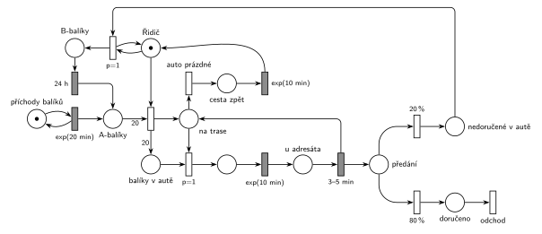

# 11–08 – Přepravní firma

## Zadání

> Do centrály přepravní firmy přichází balíky k rozvozu v intervalech exp(20min). Firma zaměstnává jednoho řidiče, který balíky z centrály rozváží autem o kapacitě 20 balíků. V systému rozlišujeme nově podané A-balíky a B-balíky, u kterých se zatím nepodařilo zastihnout adresáta. Řidič vyráží z centrály po plném naložení auta A-balíky. Dobu nakládání balíku zanedbáváme. Doba každé cesty (z centrály k adresátovi, mezi adresáty, zpět do centrály) se řídí exp(10min). Zastávka u každého adresáta trvá rovnoměrně 3-5 minut. Adresát je s pravděpodobností 20% nezastižen a balík se tudíž vrací do centrály. Balíky s nezastiženým adresátem (tzv. B-balíky) se odkládají na další pokusy o doručení. Dobu vykládání B-balíků zanedbáváme. B-balík se stává A-balíkem po 24 hodinách. V počátečním stavu nejsou v systému žádné B-balíky.
>
> Zadaný systém modelujte formou Petriho sítě s vyznačením všech potřebných parametrů.

Podobné úlohy: [11–06 – Festivalový autobus](<../11–06 - Festivalový autobus/11–06 - Festivalový autobus.md>) (svozová jízda po jednom), [11–03 – Pizzerie s rozvozem](<../11–03 - Pizzerie s rozvozem/11–03 - Pizzerie s rozvozem.md>), [11–04 – Výletní loď](<../11–04 - Výletní loď/11–04 - Výletní loď.md>) (odjezd po naplnění kapacity).

## Interpretace

Zobrazit interpretaci (nápověda)

- **Naložení:** okamžitý přechod vezme *Řidiče* a 20 *A-balíků* (váha 20). Řidič tedy čeká v centrále, dokud A-balíků není 20, a nakládání netrvá žádný čas.
- **Rozvoz:** balíky jsou v autě jako 20 značek. Řidič *na trase* bere po jednom (`p=1`) další balík a jede `exp(10 min)` k adresátovi, zastávka trvá `3–5 min`. Když v autě nic nezbývá, provede se *auto prázdné* (p=0) a cesta zpět `exp(10 min)`.
- Zastávka vrací řidiče *na trasu* a balík dá do *předání*. Tam se rozhodne `80 %` doručeno (balík odchází ze systému), `20 %` nezastižen.
- **Nezastižený balík jede zpět v autě** (*nedoručené v autě*) a B-balíkem se stane až po vyložení v centrále. Vykládání je okamžitý přechod `p=1` se smyčkou na *Řidiči* (řidič je v centrále), opakuje se, dokud něco nevyložil. Má přednost před naložením, takže se nejdřív vyloží a pak teprve nakládá.
- **24 h** se počítá od vyložení. Časovaný přechod `24 h` má pro každý B-balík vlastní odpočet (slajd 138). Pak balík přejde mezi *A-balíky* a pojede s některým dalším autem.
- Kapacita auta je dodržena tím, že se nakládá právě 20 kusů. Nedoručené balíky v autě místo nezabírají navíc, jsou to tytéž balíky.

## Petriho síť

Zobrazit Petriho síť

| Požadavek | Prvek sítě |
|---|---|
| balíky exp(20 min) | *generátor* ⇄ `exp(20 min)` → *A-balíky* |
| odjezd po naložení 20 A-balíků | *naložení*: *Řidič* + 20 × *A-balíky* → *na trase* + 20 × *balíky v autě* |
| cesta k adresátovi i mezi adresáty exp(10 min) | *k adresátovi* (`p=1`, vezme balík) → `exp(10 min)` → *u adresáta* |
| zastávka 3–5 min | `3–5 min` → *na trase* + *předání* |
| 80 % doručeno, 20 % nezastižen | `80 %` → *doručeno* → *odchod*; `20 %` → *nedoručené v autě* |
| cesta zpět exp(10 min) | *auto prázdné* (p=0) → *cesta zpět* → `exp(10 min)` → *Řidič* |
| B-balíky se vyloží v centrále | `p=1`: *nedoručené v autě* + test *Řidič* → *B-balíky* |
| B-balík se po 24 h stane A-balíkem | *B-balíky* → `24 h` → *A-balíky* |

Kontrola simulací: řidič je vždy v právě jednom stavu, v autě je nejvýš 20 balíků. Za 74 simulovaných dní vyjel řidič asi 327krát, adresát nebyl zastižen u 20 % zastávek a nedoručených se vracelo nejvýš 10 v jednom autě. Systém je hodně vytížený (jízda s 20 balíky trvá asi 5 h, za tu dobu přijde asi 15 nových balíků a k tomu se vracejí B-balíky), takže A-balíků v centrále se občas nahromadí i 100.

## Časté chyby

Zobrazit časté chyby

- Odpočet 24 h hned po nezastižení. Balík se nejdřív musí vrátit do centrály a vyložit.
- Naložení bez váhy 20 (řidič odjede s jedním balíkem), nebo jen test 20 balíků bez jejich odebrání.
- Ukončení jízdy bez priority: *auto prázdné* by mohlo předběhnout jízdu k dalšímu adresátovi a zbylé balíky by v autě zůstaly.
- Chybějící cesta zpět `exp(10 min)`: zadání ji výslovně počítá mezi cesty.
- Vykládání B-balíků bez priority nad naložením. Pak by řidič mohl odjet a nedoručené balíky by zůstaly v autě do další jízdy.

## Původ a zdroje

**Původ:** půlsemestrálky 2014–19 (přehled zadání), úloha Z12.

**Zdroje:**

- `Fitcheats/Půlsemestrálky/Zadání z minulých let/Přehled zadání 2014-19.pdf`, str. 3 (zadání)
- `Fitcheats/Půlsemestrálky/FIT - Příprava 2021-22.pdf`, str. 15 (studentské řešení, „Opravena verze (asi)“, 4 pro / 0 proti)
- `Fitcheats/Příprava na zkoušku/luppo - Tabule.png` (studentské řešení na tabuli)

**Existující řešení:**

Zobrazit existující řešení

- **Příprava 2021/22 (str. 15, „Opravena verze (asi)“, 4 pro / 0 proti):** obrácené značení (šrafovaně okamžité přechody), jinak v podstatě stejná síť. Naložení bere 20 A-balíků a *řidiče*, dá 20 značek do počitadla balíků v autě. `P=1` → `exp(10m)` → `3-5m` → `80%` zpět na trasu / `20%` → *nezastižen*. Po vyčerpání balíků `exp(10)` zpět k *řidiči*, B-balíky se vykládají přechodem `P=1` se smyčkou na *řidiče* a po `24h` jsou zase A-balíky. Doručený balík ale nemá vlastní výstupní přechod: zmizí v přechodu `80%`, který vrací řidiče na trasu. Komentář pod řešením kritizoval starší verzi, kde B-balíky odpočítávaly 24 h hned u adresáta. Opravená verze je vykládá až v centrále, správně.
- **Tabule luppo:** naložení 20 balíků s *Řidičem*, *Counter 20*, `3-5min`, `80%` *odevzdán* / `20%` → `24h` → *A-Balík*. Cesta k adresátovi má `exp(20)` místo `exp(10)` a nezastižený balík jde na `24h` rovnou od adresáta, bez návratu do centrály.

