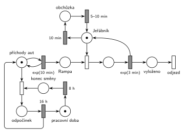

# 11–09 – Překladiště s jeřábem

## Zadání

> Životní cyklus překladiště se skládá z osmihodinové pracovní doby a 16 hodin odpočinku. Auta s nákladem přijíždí na rampu překladiště pouze během pracovní doby v intervalech exponenciálně se středem 10 minut. Auto je přistaveno na rampu a čeká dokud z něj jeřáb nevyloží 1 jednotku nákladu. Jeřábník přesouvá jednotku nákladu z auta do místa určení dobu exponenciálně se středem 3 minuty. Pokud nemá 10 minut co přesouvat (na rampě není auto), pak jeřábník vyráží na obchůzku po překladišti, která trvá rovnoměrně 5–10 minut.
>
> *Zadaný systém modelujte formou Petriho sítě s vyznačením všech potřebných parametrů.*

Podobné úlohy: [04–07 – Údržbář na obchůzce](<../04–07 - Údržbář na obchůzce/04–07 - Údržbář na obchůzce.md>), [04–08 – Spánek po nečinnosti](<../04–08 - Spánek po nečinnosti/04–08 - Spánek po nečinnosti.md>), [09–15 – Úřad s dodatečnými přepážkami](<../09–15 - Úřad s dodatečnými přepážkami/09–15 - Úřad s dodatečnými přepážkami.md>) (pracovní doba 8 h / 16 h), [11–10 – Bagrista a nákladní auta](<../11–10 - Bagrista a nákladní auta/11–10 - Bagrista a nákladní auta.md>).

## Interpretace

<details>
<summary>Zobrazit interpretaci (nápověda)</summary>
<br>

- **Transakce** jsou auta. *Příchody aut* ve smyčce s `exp(10 min)` je dávají na *Rampu*, kde může stát víc aut.
- **Pracovní doba** jsou hodiny *pracovní doba* → `8 h` → *konec směny* → zastavení příchodů → *odpočinek* → `16 h` → *pracovní doba*. Příchody se zastaví tak, že okamžitý přechod pod generátorem vezme značku *příchodů aut* (odpočet `exp(10 min)` zanikne). Přechod `16 h` značku generátoru vrátí a příchody začnou znovu.
- **Jeřábník** je jedno zařízení: obsazení, přesun `exp(3 min)`, který vrací značku, a vyložené auto přes *vyloženo* odjíždí (výstupní přechod *odjezd*).
- **Auta, která na rampě stojí v okamžiku konce směny,** se vyloží. Zadání omezuje jen příjezdy aut, ne práci jeřábu.
- **Nečinnost 10 min:** časovaný přechod `10 min` se vstupem *Jeřábník*. Odpočet běží, kdykoli je jeřábník volný. Když přijede auto, obsazení si značku vezme a odpočet zanikne (slajd 139). Testovat „na rampě není auto“ zvlášť netřeba: s autem na rampě volný jeřábník nikdy nezůstane, okamžité obsazení má přednost.
- **Obchůzka** `5–10 min` (rovnoměrně) vrací jeřábníka. Auta, která mezitím přijedou, čekají na rampě. Když po obchůzce stále nic není, za dalších 10 min jde jeřábník znovu.
- **Obchůzky během odpočinku:** zadání to výslovně neomezuje, takže jeřábník chodí na obchůzky i v noci. Kdo chce, aby v době odpočinku nepracoval ani jeřábník, musí ho na konci směny „uspat“ (vzít mu značku stejně jako generátoru) a dořešit auta, která na rampě zbyla. Zadání o tom nic neříká.

</details>

## Petriho síť

<details>
<summary>Zobrazit Petriho síť</summary>
<br>



</details>

## Časté chyby

<details>
<summary>Zobrazit časté chyby</summary>
<br>

- Časovač `10 min` jako samostatný proces, který se nezruší příjezdem auta. Jeřábník pak odejde na obchůzku, i když auto stojí na rampě.
- Hodiny 8 h / 16 h, které příchody jen „testují“ přímo na místě hodin: smyčka generátoru by při každém příjezdu zrušila odpočet `8 h` (slajd 139). Proto zastavení příchodů odebráním značky generátoru, nebo samostatná stavová místa.
- Zastavení příchodů odebráním značky z *Rampy* místo z generátoru.
- Obchůzka bez návratu značky jeřábníka.

</details>

## SIMLIB

<details>
<summary>Zobrazit SIMLIB kód</summary>
<br>

Model je izomorfní k Petriho síti výše: každé místo, přechod a značka mají svůj protějšek v kódu.

```cpp
// 11–09 Překladiště s jeřábem – model v SIMLIB/C++
#include "simlib.h"

Facility Jerabnik("Jeřábník");          // místo Jeřábník (1 značka), fronta = Rampa
Histogram Doba("Doba auta na rampě [min]", 0, 5, 12);
int obchuzky = 0;

class Necinnost : public Event {        // časovaný přechod 10 min na místě Jeřábník
  void Behavior();
};
Necinnost *necinnost;

class Auto : public Process {           // transakce = auto s nákladem
  void Behavior() {
    double prijezd = Time;
    necinnost->Passivate();             // obsazení vezme značku Jeřábník: odpočet 10 min zanikne
    Seize(Jerabnik);                    // Rampa + obsazení jeřábníka
    Wait(Exponential(3));               // přesun jednotky exp(3 min) ...
    Release(Jerabnik);                  // ... vrací značku Jeřábník
    if (!Jerabnik.Busy())
      necinnost->Activate(Time + 10);   // jeřábník volný: nový odpočet 10 min
    Doba(Time - prijezd);
  }                                     // odjezd
};

class Obchuzka : public Process {       // místo obchůzka
  void Behavior() {
    Seize(Jerabnik);                    // jeřábník je volný (jinak by odpočet zanikl)
    obchuzky++;
    Wait(Uniform(5, 10));               // obchůzka 5–10 min
    Release(Jerabnik);                  // návrat do místa Jeřábník
    if (!Jerabnik.Busy())
      necinnost->Activate(Time + 10);
  }
};

void Necinnost::Behavior() { (new Obchuzka)->Activate(); }

class Generator : public Event {        // místo příchody aut ve smyčce s exp(10 min)
  void Behavior() {
    (new Auto)->Activate();
    Activate(Time + Exponential(10));
  }
};
Generator *gen;

class Smena : public Process {          // místa pracovní doba -> konec směny -> odpočinek
  void Behavior() {
    for (;;) {
      Wait(8 * 60);                     // přechod 8 h
      gen->Passivate();                 // zastavení příchodů: vezme značku generátoru
      Wait(16 * 60);                    // přechod 16 h
      gen->Activate(Time + Exponential(10));  // značka zpět: odpočet příchodu začíná znovu
    }
  }
};

int main() {
  Init(0, 100 * 24 * 60);               // modelový čas v minutách: 100 dní
  necinnost = new Necinnost;
  necinnost->Activate(10);              // jeřábník je na začátku volný
  gen = new Generator;
  gen->Activate(Exponential(10));
  (new Smena)->Activate();
  Run();
  Print("Obchůzek: %d (%.1f za den)\n", obchuzky, obchuzky / 100.0);
  Jerabnik.Output();
  Doba.Output();
}
```

| Petriho síť | SIMLIB |
|---|---|
| *příchody aut* ⇄ `exp(10 min)` | událost `Generator`, která se znovu plánuje za `Exponential(10)` |
| značka auta | proces `Auto` |
| *Rampa* + obsazení jeřábníka | `Seize(Jerabnik)` (rampa je vnitřní fronta zařízení) |
| *Jeřábník* (1 značka) | `Facility Jerabnik` |
| `exp(3 min)` se sloučeným vrácením | `Wait(Exponential(3)); Release(Jerabnik);` |
| `10 min` na místě *Jeřábník* | událost `Necinnost` naplánovaná při uvolnění jeřábníka, zrušená (`Passivate`) při obsazení |
| *obchůzka* → `5–10 min` | proces `Obchuzka`: `Seize`, `Wait(Uniform(5, 10))`, `Release` |
| hodiny `8 h` / `16 h` | proces `Smena` |
| zastavení příchodů / návrat značky generátoru | `gen->Passivate()` / `gen->Activate(Time + Exponential(10))` |
| přechod *odjezd* | konec metody `Behavior()` auta |

**Kontrola simulací.** Petriho síť (213 dní): jeřábník je vždy právě v jednom stavu (*Jeřábník* + vykládka + *obchůzka* = 1), *příchody aut* + *odpočinek* = 1, tedy příchody jen v pracovní době (`make check`). Za den přijede v průměru 48 aut (8 h po 10 min), na rampě čekají nejvýš 7. Obchůzek je asi 68 denně, většina v noci. SIMLIB model (100 dní): 4829 aut, tedy 48 denně; jeřábník šel na obchůzku 68krát denně. Auto stráví na rampě průměrně 5,6 min (3 min vykládka a 2,6 min čekání, protože jeřábník bývá zrovna na obchůzce), na rampě čekalo nejvýš 7 aut (`make simlib`). Vytížení zařízení *Jeřábník* 46 % v SIMLIB zahrnuje i obchůzky.

</details>

## Původ a zdroje

<details>
<summary>Zobrazit původ a zdroje</summary>
<br>

**Původ:** půlsemestrálky 2014–19 (přehled zadání), úloha Z5. Přesný rok a varianta nejsou známé.

**Původní znění:**

> Životní cyklus překladiště se skládá z osmihodinové pracovní doby a 16 hodin odpočinku. Auta s nákladem přijíždí na rampu překladiště pouze během pracovní doby v intervalech daných exp. rozložením se středem 10 minut. Auto je přistaveno na rampu a čeká dokud z něj jeřáb nevyloží 1 jednotku nákladu. Jeřábník přesouvá jednotku nákladu z auta do místa určení dobu danou exponenciálním rozložením se středem 3 minuty. Pokud nemá 10 minut co přesouvat (na rampě není auto), pak jeřábník vyráží na obchůzku po překladišti, která trvá 5-10 minut rovnoměrně.
>
> *Zadaný systém modelujte formou Petriho sítě s vyznačením všech potřebných parametrů.*

**Zdroje:**

- `Fitcheats/Půlsemestrálky/Zadání z minulých let/Přehled zadání 2014-19.pdf`, str. 2 (zadání)
- `Fitcheats/Půlsemestrálky/FIT - Příprava 2021-22.pdf`, str. 9 (studentské řešení)
- `Fitcheats/Příprava na zkoušku/luppo - Tabule.png` (nedokončené studentské řešení na tabuli)

**Existující řešení:**

- **Studentské řešení (Příprava 2021/22, str. 9, souhlasí 1):** stejné hodiny se signálními místy a stavovými místy *práce* / *volno* (`8h`, `16h`), generátor `exp(10m)` s testem na *práce*. Navíc místo *volná rampa*, obsazení jeřábu `P=1`, `exp(3m)`, časovač `10min` a obchůzka `5-10m`. U hrany z *práce* k časovači `10min` si autor připsal „extra?“, tedy také váhal, jestli mají být obchůzky jen v pracovní době.
- **Tabule luppo:** hodiny *Rest* / *Work* (`8h`, `16h`) s místy *Rest check* / *Work check*, *Auto* ⇄ `Exp(10)` → *Rampa* → *Je auto* → `Exp(3)`, *Jeřáb*, *Čekání* `10min`, *Obchůzka* `Rov(5-10)`. Nedokončené, v červeně ohraničené části tabule.
- Hrubého řešení ani řešení ze cvičení v materiálech není.

</details>
