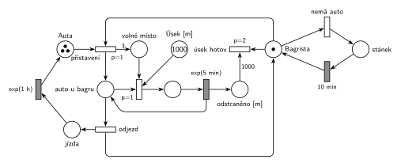

# 11–10 – Bagrista a nákladní auta

## Zadání

> Bagrista má odstranit zeminu z 1000 metrů dlouhého úseku pro stavbu silnice. Zeminu ukládá na jedno aktuálně přistavené nákladní auto. V systému jsou 3 nákladní auta, která jsou v počátečním stavu přítomna na stavbě. Jedno auto pojme zeminu z úseku 3 metrů stavby. Bagrování jednoho metru úseku trvá dobu danou exponenciálním rozložením se středem 5 minut. Naložené auto odjíždí a vrací se prázdné za dobu danou expenciálním rozložením se středem 1 hodina. Pokud bagrista nemá přistaveno nákladní auto, přeruší práci a odchází na dobu 10 minut do nedalekého stánku s občerstvením.
>
> *Zadaný systém modelujte formou Petriho sítě s vyznačením všech potřebných parametrů.*

Podobné úlohy: [01–06 – Kravín](<../01–06 - Kravín/01–06 - Kravín.md>) (nakládání auta s kapacitou), [11–05 – Překladiště kontejnerů](<../11–05 - Překladiště kontejnerů/11–05 - Překladiště kontejnerů.md>), [11–09 – Překladiště s jeřábem](<../11–09 - Překladiště s jeřábem/11–09 - Překladiště s jeřábem.md>) (odchod na obchůzku při nečinnosti).

## Interpretace

Zobrazit interpretaci (nápověda)

- **Přistavení** (`p=1`) vezme volného *Bagristu* a prázdné auto z *Aut* a vytvoří *auto u bagru* plus 3 značky *volné místo* (kapacita auta). Auto zůstává přistavené, dokud neodjede, tedy po všechny 3 metry, ne jen na jeden.
- **Bagrování metru** (`p=1`) potřebuje *auto u bagru*, *volné místo* a metr z *Úseku*. Po `exp(5 min)` se značka *auto u bagru* vrátí a metr přibude do *odstraněno*.
- **Odjezd** (p=0) se provede, když bagrování nejde: auto je plné, nebo úsek došel. Protože 1000 = 333 · 3 + 1, poslední auto odveze jen 1 metr a 2 volná místa zůstanou nevyužitá. Bez odjezdu při „úsek došel“ by poslední auto čekalo navždy.
- **Odjezd vrací *Bagristu*** (volný, bez auta) a auto jede `exp(1 h)` zpět do *Aut*.
- **Občerstvení:** nemá-li volný bagrista auto (přistavení se nemůže provést), provede se *nemá auto* (p=0) a bagrista jde na `10 min` do *stánku*. Pak to zkusí znovu; když auto stále není, jde zase.
- **Konec práce:** *úsek hotov* (`p=2`) vezme 1000 značek z *odstraněno* a volného bagristu. To je výstupní přechod. Pak se síť zastaví, auta jen dojedou zpět. Testovat „úsek je prázdný“ přímo nejde (to by byla inhibiční hrana), proto se metry počítají v *odstraněno*.

## Řešení

Zobrazit řešení

| Požadavek | Prvek sítě |
|---|---|
| úsek 1000 m | *Úsek* (1000) |
| 3 auta, na počátku na stavbě | *Auta* (3 značky) |
| zemina na jedno přistavené auto | *přistavení* (p=1): *Bagrista* + auto → *auto u bagru* |
| auto pojme 3 m | *přistavení* → 3 × *volné místo*; každý metr jedno spotřebuje |
| metr exp(5 min) | *bagrování* (p=1) → `exp(5 min)` → *auto u bagru* + *odstraněno* |
| naložené auto odjíždí, vrací se za exp(1 h) | *odjezd* → *jízda* → `exp(1 h)` → *Auta*, bagrista je volný |
| bez auta 10 min ve stánku | *nemá auto* (p=0) → *stánek* → `10 min` → *Bagrista* |
| úsek odstraněn | *úsek hotov* (p=2, váha 1000) |

Kontrola simulací: auta jsou vždy 3 (*Auta* + *auto u bagru* + bagrování + *jízda*), volná místa nejvýš 3. Práce trvá asi 160 h, auta odjedou 334× (333 plných, poslední s 1 m) a bagrista jde do stánku zhruba 430–470×: 3 auta naloží za 45 min, pak čeká, až se vrátí. Simulace končí přechodem *úsek hotov*.

## Časté chyby

Zobrazit časté chyby

- Auto obsazené jen na jeden metr a hned vrácené: nejde pak o „jedno aktuálně přistavené auto“.
- Odjezd jen při plném autě (hrana váhy 3): poslední metr se nikdy neodveze.
- Bez přechodu pro konec práce: bagrista po 1000 m dál přistavuje prázdná auta nebo donekonečna chodí do stánku.
- Přestávka ve stánku s vyšší prioritou než přistavení auta: bagrista odchází, i když auto stojí na stavbě.
- Zapomenuté vrácení bagristy při odjezdu auta.

## Původ a zdroje

**Původ:** půlsemestrálky 2014–19 (přehled zadání), úloha Z4. Přesný rok a varianta nejsou známé.

**Zdroje:**

- `Fitcheats/Půlsemestrálky/Zadání z minulých let/Přehled zadání 2014-19.pdf`, str. 2 (zadání)
- `Fitcheats/Půlsemestrálky/Democvičení 2020-21 - Z4 zadání a řešení.pdf`, str. 1 (řešení z democvičení; totéž jako dlouhý obrázek v `Democvičení 2020-21 - Z4 řešení.pdf`)
- `Fitcheats/Půlsemestrálky/FIT - Příprava 2021-22.pdf`, str. 8 (studentské řešení s hlasováním)
- `Fitcheats/Příprava na zkoušku/luppo - Tabule.png` (studentské řešení na tabuli)

**Existující řešení:**

Zobrazit existující řešení

- **Řešení z democvičení 2020/21 (str. 1):** stejná struktura jako síť výše. Modrý přechod `p=1` vezme *Bagr* a auto z *Aut* („…“) a dá 3 značky kapacity a místo „auto u bagru“. Červený přechod `p=1` bere metr z místa *1000*, kapacitu a auto u bagru, `exp(5m)` vrací auto u bagru. Tučný přechod bez priority (odjezd) vrací *Bagr* a posílá auto přes `exp(1h)` zpět do *Aut*. Modře *Bagr* → přechod → `10m` → *Bagr*. Chybí konec práce: po odstranění úseku bagrista dál přistavuje auta, ta hned prázdná odjíždějí a značky kapacity se hromadí. Výstupní přechod tehdy zadání nevyžadovalo.
- **Studentské řešení (Příprava 2021/22, str. 8, souhlasí 1, nesouhlasí 1):** `P=1` vezme bagristu a *nákl. auto* → *bagruje* `exp(5m)`, metry se sčítají, hrana váhy 3 → *naložení* → *odvoz* `exp(1h)`; *odstraněno* s váhou 1000 → `P=2` konec; *bagrista* ⇄ *bufet* `10m`. Auto se vrací do *nákl. auto* po každém metru, takže není „přistavené“ (to vytýká i komentář). Poslední metr (1000 není dělitelné 3) nikdy neodjede, protože odjezd potřebuje přesně 3.
- **Tabule luppo:** *Bagrista* `P=2`, *Bagrujeme* → `Exp(5min)` s místem *1000*, `P=2` s váhou 3 a *Nákladní auto* (3), `Exp(1hod)`, *Bufet* `10min`. Věta o občerstvení je v zadání na tabuli přeškrtnutá. Leží v červeně ohraničené části tabule.

