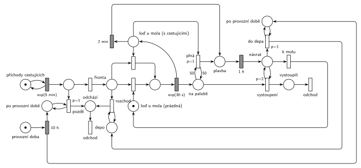

# 11–11 – Výletní loď na jezeře

## Zadání

> Po jezeře jezdí jedna výletní loď s kapacitou 50 cestujících. Provozní doba lodi začíná ráno u nástupního mola pro cestující. Provozní doba lodi trvá 10 hodin. Cestující přichází na molo v intervalech daných exponenciálním rozložením se středem 5 minut. Pokud cestující příjde po ukončení provozní doby, okamžitě systém opouští. Cestující nastupují na loď jednotlivě. Nástup jednoho cestujícího na loď trvá dobu danou exp. rozložením se středem 30 sekund. Loď odjíždí od mola na výletní jízdu, pokud nastane jeden z těchto dvou případů (nastupování cestujícího se vždy dokončí): 1) loď je naplněna cestujícími, 2) uplynuly 2 minuty od nastoupení posledního cestujícího z fronty (tj. loď na molu čeká) Výlet trvá jednu hodinu a končí vždy na molu. Po ukončení provozní doby loď dokončí případné nabírání cestujících dle výše uvedených pravidel a vyrazí na výlet. Pokud se přistaví k molu po dokončení provozní doby, cestující už nenabírá a přesune se do depa. Cestovní doby mezi molem a depem neuvažujeme. Také neuvažujeme dobu vystupování cestujících po návratu z výletu.
>
> Modelujte jeden den provozu výletní lodi.
>
> *Zadaný systém modelujte formou Petriho sítě s vyznačením všech potřebných parametrů.*

Věta „V modelu jednoznačně ukažte (přechodem) moment, kdy transakce opouští systém“ přibyla až v roce 2022/23. Výstupní přechody jsou v síti přesto, dnes se vyžadují.

Podobné úlohy: [11–04 – Výletní loď](<../11–04 - Výletní loď/11–04 - Výletní loď.md>) (2021/22), [11–07 – Vyhlídková loď na molu](<../11–07 - Vyhlídková loď na molu/11–07 - Vyhlídková loď na molu.md>), [11–14 – Přehrada s vyhlídkovou lodí](<../11–14 - Přehrada s vyhlídkovou lodí/11–14 - Přehrada s vyhlídkovou lodí.md>), [11–02 – Vyhlídkové lety](<../11–02 - Vyhlídkové lety/11–02 - Vyhlídkové lety.md>), [11–01 – Výletní autobus](<../11–01 - Výletní autobus/11–01 - Výletní autobus.md>).

## Interpretace

Zobrazit interpretaci (nápověda)

- **Loď u mola** (1 značka) je zařízení pro nástup „jednotlivě“: obsazení, `exp(30 s)` a vrácení značky. Odjezdové přechody tu značku také potřebují, takže během nástupu loď odjet nemůže („nastupování cestujícího se vždy dokončí“).
- **Odjezd po 2 minutách** je časovaný přechod `2 min` se vstupem *Loď u mola*. Odpočet začne, když se loď po nástupu vrátí do stavu „čeká“. Když mezitím přijde cestující, obsazení si značku lodi vezme a odpočet zanikne (slajd 139). Po jeho nástupu běží odpočet znovu, tedy „2 minuty od nastoupení posledního cestujícího“.
- **Testovací hrana z *Na palubě*** u přechodu `2 min`: odpočet běží jen tehdy, když už někdo nastoupil. Bez ní by na začátku dne (i po každém návratu k prázdnému molu) odplula prázdná loď na hodinovou jízdu. Přesně tohle vytýká komentář k jednomu ze studentských řešení.
- **Plná loď:** přechod *plná* s `p=1` a testovací hranou váhy 50 z *Na palubě*. Po 50. nástupu má přednost před obsazením lodi dalším cestujícím, takže 51. nenastoupí. Zvláštní místo s volnými místy proto není potřeba.
- **Cestující zůstávají *Na palubě* během výletu** a vystupují po návratu (`p=2` smyčka *vystoupení*, dokud je někdo na palubě). Teprve pak se rozhoduje *k molu* (p=0), nebo *do depa* (p=1, jen po provozní době). Hrubý v podobné úloze [11–04](<../11–04 - Výletní loď/11–04 - Výletní loď.md>) nechává cestující zaniknout už při vyplutí; to by tu šlo také.
- **Konec provozní doby:** `10 h` proběhne jednou (modelujeme jeden den) a nastaví dva příznaky *po provozní době*: jeden testuje přechod *pozdě* u příchodů, druhý přechod *do depa*. Je to jen kvůli přehlednosti kresby; jedno místo se dvěma testovacími hranami by bylo totéž.
- **Pozdě příchozí** odcházejí přechodem *pozdě* (`p=1`, test příznaku), jinak jde cestující do *Fronty* (p=0). Generátor běží dál, příchozí jen hned odcházejí.
- **Po provozní době** loď u mola nabírá dál podle stejných pravidel a odjede na výlet (fronta se už nezvětšuje). Po návratu jede do depa. **Cestující, kteří na molu zůstali** (přišli ještě v provozní době, ale loď byla na výletě), zadání neřeší. Model je po odjezdu lodi do depa pošle pryč (*rozchod*), jinak by zůstali v síti navždy.
- **Prázdná loď u mola v okamžiku konce provozu** (nikdo nečeká ani nesedí na palubě) zůstane stát u mola. Zadání posílá do depa jen loď, která se k molu přistaví po konci provozu.

## Řešení

Zobrazit řešení

| Požadavek | Prvek sítě |
|---|---|
| příchody exp(5 min) | *generátor* ⇄ `exp(5 min)` → rozhodnutí: *pozdě* (p=1, po provozní době) / *Fronta* |
| provozní doba 10 h, jeden den | *provozní doba* → `10 h` → dva příznaky *po provozní době* |
| nástup jednotlivě exp(30 s) | obsazení *Lodi u mola*, `exp(30 s)` vrací značku lodi → *Na palubě* |
| odjezd plné lodi | *plná* (p=1): *Loď u mola* + test 50 na *Na palubě* → *Plavba* |
| odjezd 2 min po posledním nástupu | `2 min`: *Loď u mola* + test 1 na *Na palubě* → *Plavba* |
| výlet 1 h, končí na molu | *Plavba* → `1 h` → *návrat k molu* |
| výstup bez časové ztráty | smyčka *vystoupení* (p=2) → *vystoupili* → *odchod* |
| po provozní době do depa | *do depa* (p=1, test příznaku) → *Depo*, jinak *k molu* → *Loď u mola* |
| zbylí čekající po odjezdu do depa | *rozchod*: *Depo* (test) + *Fronta* → *odchází* → *odchod* |

Kontrola simulací: *Loď u mola* + nastupující + *Plavba* + *návrat k molu* + *Depo* = 1, *Na palubě* ≤ 50. Za den proběhne asi 9 výletů (na palubě nejvýš 19–23 cestujících), v 10 h je loď obvykle na výletě, pak odjede do depa a 7–19 čekajících odejde. S příchody exp(5 min) se loď nikdy nenaplní, proto byla větev *plná* ověřena zvlášť se zrychlenými příchody exp(20 s): loď pak odplouvá s 50 cestujícími.

## Časté chyby

Zobrazit časté chyby

- Časovač 2 min bez podmínky, že někdo nastoupil: prázdná loď odplouvá každé 2 minuty.
- Časovač 2 min jako samostatný proces, který nezaniká s nástupem dalšího cestujícího. Musí ho zrušit obsazení lodi (vstupem je *Loď u mola*).
- Odjezd, který nebere značku *Loď u mola*: loď by mohla odjet uprostřed nástupu, nebo by se během výletu dál nastupovalo.
- Plná loď bez priority před dalším nástupem: nastoupí 51. cestující.
- Cestující na palubě se po výletu nevynulují (smyčka *vystoupení* chybí nebo nemá přednost před návratem k molu). Další jízda pak začíná s „plnou“ lodí.
- Příchody po konci provozní doby, které se řadí do fronty. Zadání chce okamžitý odchod.

## Původ a zdroje

**Původ:** půlsemestrálky 2014–19 (přehled zadání), úloha Z1. Přesný rok a varianta nejsou známé.

**Zdroje:**

- `Fitcheats/Půlsemestrálky/Zadání z minulých let/Přehled zadání 2014-19.pdf`, str. 1 (zadání)
- `Fitcheats/Půlsemestrálky/FIT - Příprava 2021-22.pdf`, str. 3–4 (dvě studentská řešení s komentáři)

**Existující řešení:**

Zobrazit existující řešení

- **Studentské řešení (Příprava 2021/22, str. 3, bílé na černém, bez hlasování):** místa *loď na molu*, *kapacita* (hrana 50 k přechodu `p=3` pro odjezd plné lodi), časovaný přechod „nikdo nenastupuje 2m“, *vyplutí*, *plavba* `1h`, *vyprázdnění* s `p=4` a *depo* přes `p=1` s testem konce provozní doby. Komentář na str. 4 správně vytýká, že časovač 2 min běží i před prvním nástupem: na začátku dne loď odpluje dřív, než přijde první cestující. Autor odpovídá, že zadání říká „loď na molu čeká“. Rozhodující je ale „od nastoupení posledního cestujícího“, tedy někdo musí nastoupit.
- **Studentské řešení (str. 4, fotka modrým perem, souhlasí 0, nesouhlasí 2):** hrany s váhou 50, `1h`, `2 min`, smyčky s `p=1`, `exp(30s)`, `10h`. Komentář: „z toho horního přechodu nemá jít 50 a po uplynutí hodiny se má zase vrátit 50“. Kapacita se tedy neobnovuje správně.
- Hrubého řešení ani řešení ze cvičení v materiálech není.

