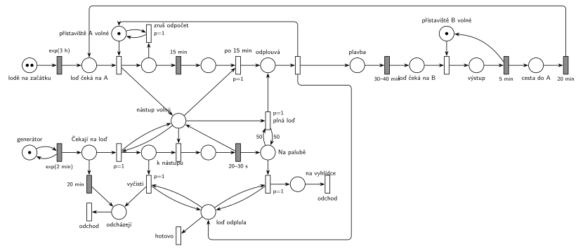

# 11–12 – Přehrada s přístavišti

## Zadání

> Na přehradě jsou přístaviště A a B, každé s kapacitou jedna pro přistavení lodi. Mezi přístavišti A a B jezdí dvě vyhlídkové lodě s kapacitou 50 turistů. Na přístaviště A přichází turisti v intervalech exp(2min). Každý jednotlivý turista je ochoten čekat na příjezd lodi nejvýše 20 minut, pak opouští systém. Po přistavení lodi k molu přístaviště začnou turisti po jednom nastupovat. Nastoupení každého trvá 20-30 sekund. Loď z přístaviště odjíždí po naplnění svojí kapacity, nejpozději však po 15 minutách od přistavené k molu (aktuálně nastupující turista smí dokončit nastupování). Neobsloužení turisti po odplutí lodi opouští systém. Vyhlídková jízda lodě trvá 30-40 minut a končí v přístavišti B, kde během 5 minut všichni turisti najednou vystoupí. V přístavišti B žádní cestující nenastupují a loď se vrací po vyprázdnění do přístaviště A. Cesta z B do A jí trvá 20 minut. V počátečním stavu sítě platí, že každá z lodí se poprvé do přístaviště A dostane po době dané exp(3 hodiny).
>
> Modelujte zadaný systém ve formě Petriho sítě s vyznačením všech potřebných parametrů.

Věta „V modelu jednoznačně ukažte (přechodem) moment, kdy transakce opouští systém“ přibyla až v roce 2022/23. Výstupní přechody jsou v síti přesto, dnes se vyžadují.

Podobné úlohy: [11–14 – Přehrada s vyhlídkovou lodí](<../11–14 - Přehrada s vyhlídkovou lodí/11–14 - Přehrada s vyhlídkovou lodí.md>), [11–04 – Výletní loď](<../11–04 - Výletní loď/11–04 - Výletní loď.md>), [11–07 – Vyhlídková loď na molu](<../11–07 - Vyhlídková loď na molu/11–07 - Vyhlídková loď na molu.md>), [11–11 – Výletní loď na jezeře](<../11–11 - Výletní loď na jezeře/11–11 - Výletní loď na jezeře.md>).

## Interpretace

Zobrazit interpretaci (nápověda)

- **Lodě** jsou dvě značky. Na začátku jsou v místě *lodě na začátku* a každá má vlastní odpočet `exp(3 h)` (slajd 138). **Přístaviště A a B** jsou místa s 1 značkou (volné přístaviště); loď ho zabere při přistání.
- **Nástup po jednom:** přistání vytvoří značku *nástup volný*. Je to zařízení pro nástup (obsazení, `20–30 s`, vrácení) a zároveň informace, že u mola stojí loď.
- **„Čekat na příjezd lodi nejvýše 20 minut“:** časovaný přechod `20 min` přímo na místě *Čekají na loď*, takže každý turista má vlastní odpočet. Když loď stojí u mola, přechod `p=1` testuje *nástup volný* a přesouvá čekající do fronty *k nástupu*, kde už netrpělivost neplatí (čekají na nástup, ne na příjezd lodi). Odpočet přesunutého turisty tím zanikne.
- **Odjezd nejpozději po 15 min:** přistání spustí odpočet `15 min`. Odjezd *po 15 min* i odjezd *plné lodi* (test 50 turistů na palubě) berou značku *nástup volný*, takže čekají, až aktuálně nastupující turista dokončí nástup. Oba mají `p=1`, aby vyhrály nad nástupem dalšího turisty.
- Když loď odjede plná, odpočet 15 min ještě běží; přechod *zruš odpočet* ho po odplutí zruší dřív, než přistane další loď. S danými čísly to nenastane: 50 nástupů trvá aspoň 17 minut, loď tedy vždy odjíždí po 15 minutách.
- **Po odplutí** vznikne značka *loď odplula*. Smyčky `p=1` z ní pošlou všechny turisty z paluby na jízdu a všechny neobsloužené z fronty *k nástupu* pryč; pak ji přechod *hotovo* (p=0) odebere.
- **Turisté na palubě opouštějí model při odplutí.** Při dvou lodích by se ve společném místě „na lodi“ míchali cestující různých lodí (Petriho síť značky nerozlišuje). Jízda do B, výstup `5 min` a návrat `20 min` jsou proto modelované jen jako cesta lodě. Stejně to dělá Hrubý ve [11–04 – Výletní loď](<../11–04 - Výletní loď/11–04 - Výletní loď.md>).

## Petriho síť

Zobrazit Petriho síť

| Požadavek | Prvek sítě |
|---|---|
| turisté po exp(2 min) | *generátor* ⇄ `exp(2 min)` → *Čekají na loď* |
| na loď čekají nejvýš 20 min | `20 min` přímo na *Čekají na loď* → *odcházejí* → *odchod* |
| 2 lodě, první příjezd po exp(3 h) | *lodě na začátku* (2 značky) → `exp(3 h)` → *loď čeká na A* |
| přístaviště A a B s kapacitou 1 | *přístaviště A volné*, *přístaviště B volné* (1 značka) |
| nástup po jednom 20–30 s | *nástup volný* (vzniká přistáním), obsazení, `20–30 s` → *Na palubě* |
| odjezd plné lodi (50) | `p=1` *plná loď*: test 50 na palubě + *nástup volný* → *odplouvá* |
| odjezd nejpozději po 15 min, nastupující dokončí | `15 min` → `p=1` *po 15 min* (bere *nástup volný*) → *odplouvá* |
| neobsloužení po odplutí odcházejí | *loď odplula*: smyčka `p=1` *vyčisti* → *odcházejí* |
| jízda 30–40 min, výstup 5 min v B, návrat 20 min | *plavba* → `30–40 min` → *přístaviště B* → `5 min` → `20 min` → *loď čeká na A* |
| turisté odjíždějí na vyhlídku | smyčka `p=1` z *Na palubě* → *na vyhlídce* → *odchod* |

Kontrola simulací: lodě jsou vždy dvě, přístaviště A i B má nejvýš jednu loď, na palubě nejvýš 50 turistů. Loď přistává zhruba každých 38 minut a odjíždí po 15 minutách s asi 15 turisty; zhruba pětina turistů odejde netrpělivá. Odjezd plné lodi ověřen se zrychleným nástupem.

## Časté chyby

Zobrazit časté chyby

- Netrpělivost jako jeden časovač pro celou frontu, nebo časovač s testovací hranou na „volné přístaviště“: pak se proveditelnost omezí na jednu značku a turisté nemají každý vlastní odpočet.
- Odjezd po 15 minutách, který nečeká na dokončení nástupu (nebere značku nástupu).
- Odjezd bez priority: po skončení nástupu by mohl začít nastupovat další turista.
- Smazání čekajících jen jedním přechodem s váhou; „všichni neobsloužení“ potřebují smyčku s prioritou.
- Přístaviště bez kapacity 1: obě lodě by mohly stát u mola současně.
- Počet turistů na palubě, který se při odjezdu nevynuluje; další loď by pak odjela „plná“ dřív.

## Původ a zdroje

Zobrazit původ a zdroje

**Původ:** půlsemestrální písemka 2011/12, příklad 3 (bodování v zadání není).

**Zdroje:**

- `Fitcheats/Půlsemestrálky/Zadání z minulých let/2011-12.pdf`, str. 1 (zadání, příklad 3)

**Existující řešení:**

- K zadáním z roku 2011/12 v materiálech žádné řešení není.

