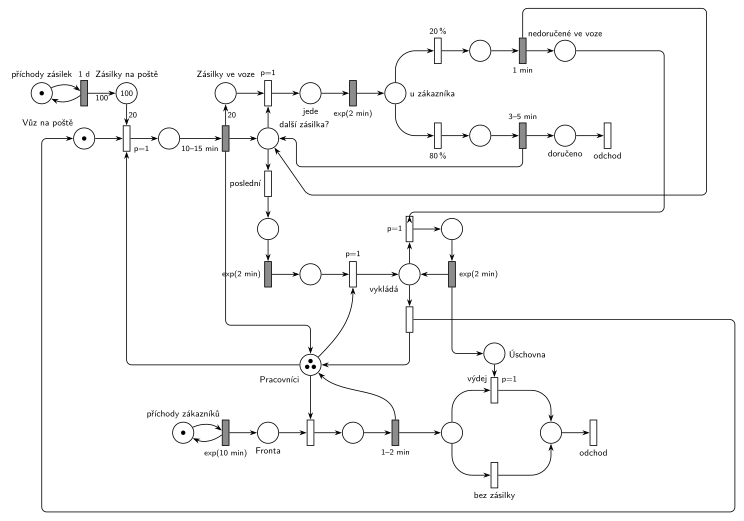

# 11–13 – Pošta s doporučenými zásilkami

## Zadání

> Poštovní pobočka má každý den rozvézt 100 nových doporučených zásilek. K dispozici má jeden poštovní vůz s doručovatelem. Poštovní vůz za dobu 10-15 minut nabere najednou zásilky až po svou kapacitu 20 zásilek. Pak vyrazí do terénu. Každý úsek trasy (z pošty k zákazníkovi, od zákazníka k jinému zákazníkovi, od zákazníka zpět na poštu) trvá dobu exp(2min). Po příjezdu k zákazníkovi je pravděpodobnost 20 procent, že zákazník nebude zastižen. Pokud je zastižen, pak je doba vyřizování 3-5 minut, jinak je 1 minutu. Vůz se po posledním zákazníkovi vrací na pobočku, kde vyloží jednotlivě nedoručené zásilky, které se uloží pro přímý odběr zákazníky. Vyložení každé jednotlivé nedoručené zásilky trvá exp(2min). Zákazníci přichází na pobočku pro nedoručené balíky v intervalech exp(10min) a čekají ve frontě libovolně dlouho. K dispozici mají 3 poštovní přepážky, každou s jedním pracovníkem pošty. Obsluha zákazníka trvá 1-2 minuty. Při nakládání a vykládání vozu asistuje doručovateli vždy jeden z pracovníků na přepážce.
>
> Modelujte zadaný systém ve formě Petriho sítě s vyznačením všech potřebných parametrů.

Věta „V modelu jednoznačně ukažte (přechodem) moment, kdy transakce opouští systém“ přibyla až v roce 2022/23. Výstupní přechody jsou v síti přesto, dnes se vyžadují.

Podobné úlohy: [11–03 – Pizzerie s rozvozem](<../11–03 - Pizzerie s rozvozem/11–03 - Pizzerie s rozvozem.md>), [11–08 – Přepravní firma](<../11–08 - Přepravní firma/11–08 - Přepravní firma.md>), [11–04 – Výletní loď](<../11–04 - Výletní loď/11–04 - Výletní loď.md>).

## Interpretace

Zobrazit interpretaci (nápověda)

- **Zásilky** jsou transakce: generátor `1 d` přidá 100 zásilek (váha 100), první dávka je v místě *Zásilky na poště* od začátku. Zásilka odchází při doručení, nebo jako nedoručená přes *Úschovnu* se zákazníkem.
- **Vůz** je proces s jednou značkou, která obíhá: nakládání → jízdy a zákazníci → návrat → vykládka → *Vůz na poště*.
- **Nakládání „až po kapacitu 20“:** 100 je násobek 20, takže vůz nabere vždy právě 20 zásilek. Stačí jeden přechod s hranou váhy 20 (proveditelný, až je na poště aspoň 20 zásilek). Obecně („vezmi, co zbývá, nejvýš 20“) by bylo potřeba ještě smyčku s prioritou, která nabírá po jedné, dokud je zásilka a volné místo.
- **Pracovníci** jsou sklad se 3 značkami. Nakládání i vykládka si vezmou jednoho pracovníka a vrátí ho. Zadání neříká, kdo má přednost; tady má vůz `p=1` před zákazníky („asistuje vždy“).
- **Rozvoz:** v místě *další zásilka?* se rozhoduje. Je-li ve voze zásilka, `p=1` ji vezme a vůz jede `exp(2 min)` k zákazníkovi. Jinak (`p=0`, *poslední*) jede `exp(2 min)` zpět. Každý úsek trasy má tedy svůj vlastní odpočet.
- **U zákazníka** okamžité přechody `80 %` / `20 %`. Zastižený: `3–5 min`, zásilka → *doručeno* → *odchod*. Nezastižený: `1 min`, zásilka zůstane ve voze jako *nedoručená*. Vůz se pak vrací do rozhodování.
- **Vykládka po jedné:** smyčka `p=1` bere nedoručené zásilky a každou vykládá `exp(2 min)` do *Úschovny*. Když ve voze žádná nezbyla, přechod `p=0` (bez názvu, vlevo) vrátí vůz i pracovníka.
- **Zákazníci** pro nedoručené zásilky tvoří samostatný proud s frontou ke 3 pracovníkům. Zadání nespojuje zákazníka s konkrétní zásilkou; po obsluze si zákazník vezme zásilku z *Úschovny*, je-li tam nějaká (`p=1`), jinak odejde bez ní. Při exp(10 min) jde o 144 zákazníků denně, nedoručených zásilek je jen asi 20, takže většina odchází bez zásilky; zadání to neřeší.

## Petriho síť

Zobrazit Petriho síť

| Požadavek | Prvek sítě |
|---|---|
| 100 nových zásilek denně | *generátor* ⇄ `1 d` → váha 100 → *Zásilky na poště* (počátečně 100) |
| nakládání 20 zásilek, 10–15 min, s pracovníkem | `p=1`: *Vůz na poště* + pracovník + 20 zásilek → `10–15 min` → *Zásilky ve voze* (20), pracovník zpět |
| každý úsek trasy exp(2 min) | `exp(2 min)` k zákazníkovi i `exp(2 min)` zpět na poštu |
| 20 % nezastiženo; vyřízení 3–5 min / 1 min | `80 %` → `3–5 min` → *doručeno*; `20 %` → `1 min` → *nedoručené ve voze* |
| po posledním zákazníkovi zpět | *další zásilka?*: `p=1` vezme zásilku a jede, jinak *poslední* → `exp(2 min)` |
| vykládka po jedné exp(2 min), s pracovníkem | `p=1` (vůz + pracovník) → smyčka `p=1` → `exp(2 min)` → *Úschovna*; `p=0` vrátí vůz a pracovníka |
| zákazníci exp(10 min), 3 přepážky, 1–2 min | *generátor* ⇄ `exp(10 min)` → *Fronta* → *Pracovníci* (3) → `1–2 min` |
| odchod zásilky / zákazníka | *doručeno* → *odchod*; po obsluze *výdej* (`p=1`, se zásilkou) nebo *bez zásilky* → *odchod* |

Kontrola simulací: vůz je vždy v jednom stavu, pracovníků je vždy 3 (volní + u vozu + u zákazníků), ve voze nejvýš 20 zásilek. Vůz denně udělá 5 jízd, asi 20 % zásilek se nedoručí a skončí v úschovně, fronty zůstávají krátké.

## Časté chyby

Zobrazit časté chyby

- Jeden časovaný přechod pro celou trasu místo `exp(2 min)` pro každý úsek (včetně cesty zpět).
- Rozhodnutí „další zákazník, nebo zpět“ bez priority: vůz by se mohl vrátit, i když v něm zbývají zásilky.
- Vykládka všech nedoručených zásilek najednou (hrana s váhou); zadání chce vykládat jednotlivě, každou `exp(2 min)`.
- Pracovník u nakládání nebo vykládky, který se nevrátí na přepážku; po čase by nezbyl nikdo pro zákazníky.
- Zastižený a nezastižený zákazník bez rozlišení doby (3–5 min vs. 1 min) nebo pravděpodobnost napsaná na hraně místo na přechodu.

## Původ a zdroje

**Původ:** půlsemestrální písemka 2011/12, příklad 2 (bodování v zadání není).

**Zdroje:**

- `Fitcheats/Půlsemestrálky/Zadání z minulých let/2011-12.pdf`, str. 1 (zadání, příklad 2)

**Existující řešení:**

Zobrazit existující řešení

- K zadáním z roku 2011/12 v materiálech žádné řešení není.

