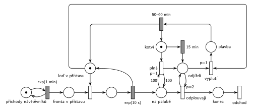

# 11–14 – Přehrada s vyhlídkovou lodí

## Zadání

> Na přehradě jezdí jedna vyhlídková loď s kapacitou 100 návštěvníků. Vyhlídková jízda trvá rovnoměrně 50 – 60 minut. Loď přijede do přístavu a nabírá návštěvníky až po svou kapacitu, maximálně však v přístavišti kotví 15 minut. Doba nástupu jednoho návštěvníka se řídí exponenciálním rozložením se středem 10 vteřin. Návštěvníci přichází do přístavu v intervalech daných exponenciálním rozložením se středem 1 minuta.
>
> Poznámka: Po uplynutí 15 minut přítomnosti lodi v přístavu (bez ohledu na počet návštěvníků) loď další návštěvníky nenaloží a odjíždí.

Věta „V modelu jednoznačně ukažte (přechodem) moment, kdy transakce opouští systém“ v zadání není (přibyla až v roce 2022/23). Výstupní přechod je v síti přesto, dnes se vyžaduje.

Podobné úlohy: [11–04 – Výletní loď](<../11–04 - Výletní loď/11–04 - Výletní loď.md>), [11–07 – Vyhlídková loď na molu](<../11–07 - Vyhlídková loď na molu/11–07 - Vyhlídková loď na molu.md>), [11–11 – Výletní loď na jezeře](<../11–11 - Výletní loď na jezeře/11–11 - Výletní loď na jezeře.md>), [11–12 – Přehrada s přístavišti](<../11–12 - Přehrada s přístavišti/11–12 - Přehrada s přístavišti.md>).

## Interpretace

Zobrazit interpretaci (nápověda)

 

- **Loď v přístavu** (1 značka) je stejně jako ve [výletní lodi](<../11–04 - Výletní loď/11–04 - Výletní loď.md>) zároveň zařízení pro nástup po jednom a informace, že loď stojí v přístavu. Nástup je obsazení, `exp(10 s)` a vrácení značky.
- **Dva důvody k odjezdu** vedou do stejného místa *Odjíždí*:
  - *plná* (`p=1`): testovací dvojice hran s váhou 100 na *Na palubě*. Bere značku *Kotví*, takže odpočet 15 minut zanikne;
  - `15 min`: časovaný přechod na místě *Kotví*. Odpočet začíná příjezdem lodi do přístavu a na nástupech nezávisí.
- **Přesný počet cestujících není předem známý**, proto nejde vzít z *Na palubě* hranou s pevnou váhou (jako 20 u výletní lodi). Smyčka *cestující odplouvají* (`p=2`) je bere po jednom, dokud je loď ve stavu *Odjíždí*.
- Cestující tím **opouštějí modelovaný systém už při vyplutí**. Během jízdy se s nimi nic neděje, takže je dál nesledujeme. (U výletní lodi zůstávají na palubě až do návratu, ale tam jich je vždy přesně 20. Tady by vystupování po návratu potřebovalo druhou smyčku.)
- **Vyplutí** (`p=1`) potřebuje *Odjíždí* a značku *Loď v přístavu*. Vyprší-li 15 minut uprostřed nástupu, návštěvník nastoupí, a teprve pak loď vypluje. Díky `p=1` dřív, než by začal nastupovat další (obsazení má `p=0`). Kotvení se tak může protáhnout nejvýš o jeden nástup. Smyčka `p=2` proběhne před vyplutím.
- Po `50–60 min` se loď vrací: značka zpět do *Loď v přístavu* a do *Kotví* (nový odpočet 15 minut). Na počátku stojí loď v přístavu.
- Návštěvníci, kteří se na loď nevešli, čekají ve *Frontě* na další jízdu (netrpělivost zadání nemá).
- Plná loď je vzácná: za 15 minut stihne nastoupit nejvýš asi 90 lidí a za jeden cyklus (asi 70 minut) jich přijde zhruba 70.

## Petriho síť

Zobrazit Petriho síť

 

| Požadavek | Prvek sítě |
|---|---|
| návštěvníci po exp(1 min) | *generátor* ⇄ `exp(1 min)` → *Fronta v přístavu* |
| nástup po jednom, exp(10 s) | obsazení *Lodi v přístavu*, `exp(10 s)` vrací značku → *Na palubě* |
| kapacita 100 | *plná* (`p=1`): test váhou 100 na *Na palubě* + *Kotví* → *Odjíždí* |
| nejvýš 15 min v přístavu | `15 min` na *Kotví* → *Odjíždí* |
| odjezd: další nenaloží | *vyplutí* (`p=1`) bere *Loď v přístavu* dřív než obsazení (`p=0`) |
| návštěvníci odjíždějí s lodí | smyčka *cestující odplouvají* (`p=2`) → *konec* → *odchod* |
| jízda 50–60 min | *Plavba* → `50–60 min` → *Loď v přístavu* + *Kotví* |

Kontrola simulací: platí *Loď v přístavu* + nastupující + *Plavba* = 1 a *Kotví* + *Odjíždí* + *Plavba* = 1, *Na palubě* ≤ 100. Jeden cyklus trvá asi 70 minut a odveze asi 70 lidí. Plná loď se objeví jen zřídka, proto simulace běží 300 000 událostí.

## Časté chyby

Zobrazit časté chyby

 

- Odpočet 15 minut, který se při odjezdu plné lodi nezruší. Při příštím kotvení by loď odjela hned (proto *plná* bere značku *Kotví*).
- Odpočet 15 minut na místě, které nástup bere a vrací. Po každém nástupu by se počítalo znovu od nuly.
- Odebrání cestujících hranou s váhou 100 i při odjezdu po 15 minutách. Váha bere přesný počet; na „všechny“ je potřeba smyčka s prioritou.
- Vyplutí bez priority nad obsazením: po vypršení času by mohl nastoupit ještě další návštěvník.
- Hrana z místa do místa (komentář u studentského řešení).

## Původ a zdroje

Zobrazit původ a zdroje

 

**Původ:** půlsemestrální písemka, rok neznámý (fotka starého zadání „Příklad 3“ v přípravném dokumentu 2021/22).

**Zdroje:**

- `Fitcheats/Půlsemestrálky/FIT - Příprava 2021-22.pdf`, str. 2 (fotka zadání a studentské řešení s hlasováním a komentáři)

**Existující řešení:**

- **Příprava 2021/22, str. 2 (studentské řešení na tabletu):** „LOĎ“ (1 značka) → přechod, který vloží 100 značek do „KAPACITA“ a značku do „PŘÍSTAV“ a spustí odpočet `15min`. Nástup `prio 1` → `exp(10s)`, generátor „NÁVŠTĚVNÍCI“ `exp(1min)`, jízda `50-60 min` a návrat do „LOĎ“. Zbylé volné místo uklízí několik přechodů `prio 2`/`prio 1`; barevné šipky jsou podle autora „jen pro prehlednost“. Hlasování 2 souhlasí / 3 nesouhlasí. Komentář: „Mas tam syntaticku chybu s toho casovaca ktory vyprazdnuje kapacitu ides z miesta na miesto.“ (hrana místo → místo). Zapojení je na fotce jen částečně čitelné.
- Rozdíl v přístupu: student počítá **volná místa** (100 značek, které je po odjezdu nutné vyčistit), tady se počítají **nastoupení** (*Na palubě*), která odcházejí s lodí. Obojí potřebuje smyčku s prioritou, protože počet zbylých značek není předem známý.

