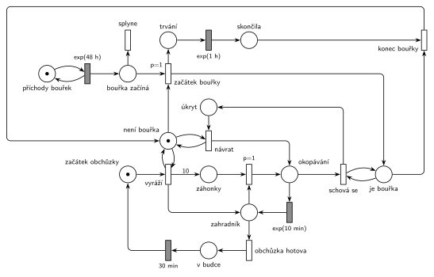

# Zahradnictví a bouřka

## Zadání

> Zahradnictví tvoří 10 záhonků, jeden zahradník a zahradní budka. Zahradník pravidelně vyráží na obchůzku okopávat všechny záhonky. Okopání jednoho záhonku trvá exponenciálně se středem 10 minut. Po okopání všech záhonků zahradník přesně 30 minut odpočívá v zahradní budce. V intervalech exponenciálně se středem 48 hodin začne bouřka, která trvá exponenciálně se středem 1 hodina. Zahradník nevyráží na obchůzku za bouřky. Pokud ho bouřka zastihne při práci, pak se schová v budce, dokud bouřka neskončí. Po bouřce pokračuje zahradník na záhonku, u kterého byl bouřkou přerušen, ovšem **začíná okopávání od začátku**.

Podobné úlohy: [Zahradník na FIT](<../10 - Zahradník na FIT/10 - Zahradník na FIT.md>) (obchůzka po květinách), [Porucha vrací transakci do fronty](<../../03 - Poruchy/02 - Porucha vrací transakci do fronty/02 - Porucha vrací transakci do fronty.md>) (přerušení a opakování od začátku).

## Interpretace

<details>
<summary>Zobrazit interpretaci (nápověda)</summary>
<br>

- Model má tři části: život zahradníka, život bouřky a jejich interakci.
- **Obchůzka:** přechod *vyráží* vezme značku *začátek obchůzky*, vloží 10 značek (váha hrany 10) do *záhonky* a jednu značku do *zahradník*. Transakcí je záhonek.
- **Okopání:** zahradník je zařízení. *okopat* (`p=1`) vezme záhonek a zahradníka do *okopávání*, `exp(10 min)` zahradníka vrátí a okopaný záhonek pošle do *okopáno*.
- **Konec obchůzky:** když záhonky dojdou, provede se *obchůzka hotova* (p=0) → *v budce* → `30 min` → *začátek obchůzky*. Priorita zajistí, že obchůzka skončí, až když nic nezbývá.
- **„Pravidelně vyráží“** bez udaného intervalu: po 30 min v budce vyráží hned znovu.
- **„Nevyráží za bouřky“:** *vyráží* testuje místo *není bouřka* (hrana tam a zpět). Za bouřky čeká v *začátku obchůzky*. Bouřka během odpočinku v budce odpočinek neovlivní.
- **Bouřka** je samostatný proces: *příchody bouřek* → `exp(48 h)` → *bouřka začíná* → *začátek bouřky* (vezme *není bouřka*, dá *je bouřka*) → *trvání* → `exp(1 h)` → *skončila* → *konec bouřky* (vrátí *není bouřka* i značku do *příchodů bouřek*). Značka příchodů se vrací až po konci bouřky, takže se bouřky nepřekrývají.
- Stav bouřky (*není bouřka* / *je bouřka*) je v jiných místech než odpočty `exp(48 h)` a `exp(1 h)`. Testovací hrany tak nikdy neberou značku časovanému přechodu a jeho odpočet se nepřeruší.
- **Interakce:** *schová se* je okamžitý přechod, který testuje *je bouřka*. Vezme značku z *okopávání* (zahradník + rozpracovaný záhonek), takže odpočet `exp(10 min)` zanikne (slajd 139). Značka čeká v *úkrytu*, dokud nepřijde *není bouřka*, a *návrat* ji vrátí do *okopávání*. Tam začne nový odpočet `exp(10 min)`, tedy okopávání **od začátku a na stejném záhonku** (značka záhonku se mezitím nevrátila do *záhonků*).
- **Odchod ze systému:** zahradník ani bouřka systém neopouštějí, jsou to cyklické procesy. Okopaný záhonek odchází přechodem *odchod* z místa *okopáno*; zadání výstupní přechod výslovně chce.

</details>

## Petriho síť

<details>
<summary>Zobrazit Petriho síť</summary>
<br>



</details>

## Časté chyby

<details>
<summary>Zobrazit časté chyby</summary>
<br>

- Testování bouřky přímo na místě, které je vstupem časovaného přechodu bouřky. Testovací hrana značku vezme a hned vrátí, a tím by odpočet přerušila (slajd 139). Proto stav bouřky (*je/není bouřka*) a její odpočty patří do různých míst.
- Po bouřce vrátit záhonek do *záhonky k okopání* místo do *okopávání*. Pak by zahradník mohl začít jiný záhonek, ale zadání chce ten přerušený.
- Navázat přerušení i na odpočinek v budce nebo na čekání před obchůzkou. Bouřka mění jen práci na záhonku.
- Konec obchůzky bez priority: přechod *obchůzka hotova* by mohl předběhnout okopání a obchůzka by skončila s neokopanými záhonky.
- Více bouřek najednou: generátor bouřky musí být ve smyčce přes celou bouřku, ne jen přes `exp(48 h)`.

</details>

## SIMLIB

<details>
<summary>Zobrazit SIMLIB kód</summary>
<br>

Model je izomorfní k Petriho síti výše: každé místo, přechod a značka mají svůj protějšek v kódu.

```cpp
// Zahradnictví a bouřka – model v SIMLIB/C++
#define I_REALLY_KNOW_HOW_TO_USE_WAITUNTIL   // SIMLIB zpřístupní WaitUntil jen s tímto makrem
#include "simlib.h"

Facility Zahradnik("Zahradník");      // místo „zahradník“ (jedna značka během obchůzky)
bool bourka = false;                  // místa „není bouřka“ (false) / „je bouřka“ (true)
Process *okopavany = nullptr;         // značka v místě „okopávání“ (záhonek se zahradníkem)
bool prerusen = false;                // přechod „schová se“ právě vzal značku z „okopávání“
int zbyva = 0;                        // záhonky této obchůzky, které ještě neodešly
long bourek = 0, preruseni = 0, okopano = 0;
Histogram Doba("Doba od začátku obchůzky do okopání záhonku [min]", 0, 30, 20);

class Zahonek : public Process {      // transakce = záhonek k okopání
  double start;
 public:
  Zahonek(double t) : start(t) {}
  void Behavior() {
    Seize(Zahradnik);                 // „okopat“ (p=1): záhonek + zahradník
    do {
      okopavany = this;               // místo „okopávání“
      prerusen = false;
      Wait(Exponential(10));          // exp(10 min); bouřka odpočet zruší (Activate)
      okopavany = nullptr;
      if (prerusen)                   // „schová se“ → „úkryt“
        WaitUntil(!bourka);           // „návrat“ testuje „není bouřka“
    } while (prerusen);               // zpět do „okopávání“: nový odpočet od začátku
    Release(Zahradnik);               // exp(10 min) vrací značku zahradníka
    okopano++;
    Doba(Time - start);
    zbyva--;                          // „okopáno“ → přechod „odchod“
  }
};

class Obchuzky : public Process {     // cyklus zahradníka: začátek obchůzky → … → v budce
  void Behavior() {
    for (;;) {
      WaitUntil(!bourka);             // „vyráží“ testuje „není bouřka“
      zbyva = 10;                     // hrana s váhou 10 do „záhonky“
      for (int i = 0; i < 10; i++)
        (new Zahonek(Time))->Activate();
      WaitUntil(zbyva == 0);          // „obchůzka hotova“ (p=0): záhonky došly
      Wait(30);                       // „v budce“ → 30 min → „začátek obchůzky“
    }
  }
};

class Bourky : public Process {       // místo „příchody bouřek“ a cyklus bouřky
  void Behavior() {
    for (;;) {
      Wait(Exponential(48 * 60));     // exp(48 h) → „bouřka začíná“
      bourka = true;                  // „začátek bouřky“: „není bouřka“ → „je bouřka“
      bourek++;
      if (okopavany) {                // „schová se“: vezme značku z „okopávání“,
        prerusen = true;              // takže odpočet exp(10 min) zanikne
        okopavany->Activate();
        preruseni++;
      }
      Wait(Exponential(60));          // „trvání“ → exp(1 h) → „skončila“
      bourka = false;                 // „konec bouřky“: „je bouřka“ → „není bouřka“
    }
  }
};

int main() {
  Init(0, 1000 * 24 * 60);            // modelový čas v minutách: 1000 dní
  (new Obchuzky)->Activate();
  (new Bourky)->Activate();
  Run();
  Zahradnik.Output();
  Doba.Output();
  Print("Bouřek: %ld, z toho zastihlo zahradníka při okopávání: %ld\n", bourek, preruseni);
  Print("Okopaných záhonků: %ld\n", okopano);
}
```

| Petriho síť | SIMLIB |
|---|---|
| značka záhonku (transakce) | proces `Zahonek` |
| *začátek obchůzky* → *vyráží* (test *není bouřka*) → 10 značek do *záhonky* | proces `Obchuzky`: `WaitUntil(!bourka)`, pak 10× `new Zahonek` |
| *zahradník* (1 značka) + *okopat* `p=1` | `Facility Zahradnik`, `Seize(Zahradnik)`; čekající záhonky jsou ve frontě zařízení |
| *okopávání* → `exp(10 min)`, který vrací zahradníka | `Wait(Exponential(10)); … Release(Zahradnik);` |
| *obchůzka hotova* (p=0) → *v budce* → `30 min` | `WaitUntil(zbyva == 0); Wait(30);` |
| *příchody bouřek* → `exp(48 h)` → *začátek bouřky* | proces `Bourky`: `Wait(Exponential(48 * 60)); bourka = true;` |
| *trvání* → `exp(1 h)` → *konec bouřky* | `Wait(Exponential(60)); bourka = false;` |
| *není bouřka* / *je bouřka* | `bool bourka` |
| *schová se* (zruší odpočet `exp(10 min)`) | `prerusen = true; okopavany->Activate();` (předčasně ukončí `Wait`) |
| *úkryt* → *návrat* (test *není bouřka*) → *okopávání* | `WaitUntil(!bourka)` a nové `Wait(Exponential(10))` v cyklu `do … while` |
| *okopáno* → *odchod* | konec metody `Behavior()` záhonku |

**Kontrola simulací.** Petriho síť: zahradník je vždy právě v jednom stavu (*začátek obchůzky* + *zahradník* + *okopávání* + *úkryt* + *v budce* = 1), *není bouřka* + *je bouřka* = 1, v *záhonkách* nikdy není víc než 10 značek a všechny přechody se provádějí (`make check`). Za 500 simulovaných dní přišlo 244 bouřek (zhruba po 48 h) a 187 z nich zastihlo zahradníka při okopávání. To odpovídá tomu, že okopáváním tráví asi 100 ze 130 minut cyklu. SIMLIB model: za 1000 dní přišlo 477 bouřek (teoreticky 24 000 h / 49 h ≈ 490) a 377 z nich (79 %) zastihlo zahradníka při okopávání; zahradník byl vytížen na 77 %, teoreticky 100 / 130 = 77 % (`make simlib`).

</details>

## Původ a zdroje

<details>
<summary>Zobrazit původ a zdroje</summary>
<br>

**Původ:** půlsemestrální písemka 2024/25, varianta A, 10 bodů.

**Původní znění:**

> Zahradnictví tvoří 10 záhonků, jeden zahradník a zahradní budka. Zahradník pravidelně vyráží na obchůzku okopávat všechny záhonky. Okopání jednoho záhonku se řídí exponenciálním rozložením (EXP) se středem 10 minut. Po okopání všech záhonků zahradník 30 minut odpočívá v zahradní budce. V intervalech EXP(48hod) začne bouřka, jejíž délka se řídí EXP(1h). Zahradník nevyráží na obchůzku za bouřky. Pokud ho bouřka zastihne při práci, pak se schová v budce, dokud bouřka neskončí. Po bouřce pokračuje zahradník na záhonku, u kterého byl bouřkou přerušen, ovšem **začíná okopávání od začátku**.
>
> Zadaný systém modelujte formou Petriho sítě s vyznačením všech potřebných parametrů. **V modelu jednoznačně ukažte (přechodem) moment, kdy transakce opouští systém.**

**Zdroje:**

- `Fitcheats/Půlsemestrálky/Zadání z minulých let/2024-25.pdf`, str. 1 (koláž zadání všech čtyř variant)
- `Fitcheats/Půlsemestrálky/Hrubý - Řešení 2024-25.pdf`, str. 1 (řešení od Hrubého)

**Existující řešení:**

- **Hrubý (str. 1):** síť výše má stejnou strukturu; model si rozdělil na tři části: život zahradníka, život bouřky a jejich interakci. Po odpočinku v budce vyráží zahradník hned znovu. Místa *začátek* a *není bouřka* vedou do přechodu, který dá 10 značek do *práce* a značku zahradníkovi. Dál `p=1` → `exp(10m)` zpět k zahradníkovi, přechod do *hotovo* → `30m v budce` → *začátek*. Bouřka: `exp(48h)` → *je bouřka* + *proces bouřky* → `exp(1h)` → *konec*. Interakce: *je bouřka* + okopávání → *čekám na konec* → po bouřce zpět do místa před `exp(10m)`. Rozdíly: Hrubý nemá výstupní přechod (zadání ho výslovně chce) a záhonek u něj zmizí už při zahájení okopávání (*práce* + zahradník → okopávání). Tady záhonek odchází až po okopání přes *odchod*.

</details>
