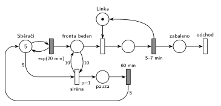

# Sběrači jahod

## Zadání

> Na poli pracuje 5 sběračů jahod. Každému sběrači zabere exponenciálně se středem 20 minut nasbírat bedýnku jahod a donést ji do sběrného místa. Ve sběrném místě pracuje jedna balicí linka. Lince zabere rovnoměrně 5–7 minut zabalit obsah jedné bedýnky. Pokud fronta k lince dosáhne délky alespoň 10 bedýnek, pak linka hlásí sirénou přeplněnost. Na signál sirény si všichni sběrači dají pauzu v práci na dobu přesně 60 minut a pak obnoví činnost od počátku.

Podobné úlohy: [Jahodová farma](<../04 - Jahodová farma/04 - Jahodová farma.md>), [Přerušení příchodů při plné frontě](<../../05 - Délka fronty a kapacita/05 - Přerušení příchodů při plné frontě/05 - Přerušení příchodů při plné frontě.md>), [Psí salon](<../../09 - Obsluha zákazníků/03 - Psí salon/03 - Psí salon.md>).

## Nápověda

<details>
<summary>Zobrazit nápovědu</summary>
<br>

- **Sběrači** jsou místo s 5 značkami ve smyčce s `exp(20 min)`. Běžný časovaný přechod má pro každou značku vlastní odpočet (slajd 138), takže je to 5 nezávislých sběračů. Každé provedení přinese jednu bedýnku (transakci) do *fronty beden*.
- **Balicí linka** je zařízení: *Linka* s jednou značkou, obsazení, `5–7 min` vrací značku linky a bedýnku pošle do *zabaleno*.
- **Siréna** testuje frontu dvojicí hran s váhou 10 (dovnitř a zpět), takže z fronty nic nebere. „Dosáhne délky alespoň 10“ znamená váhu 10, ne 11. Priorita `p=1` zajistí, že siréna zazní dřív, než linka desátou bedýnku z fronty odebere (oba okamžité přechody jsou v tu chvíli proveditelné).
- **Pauza:** siréna vezme všech 5 značek ze *Sběračů* (hrana s váhou 5). Značky čekají v časovaném přechodu sběru, takže jejich odpočty zaniknou (slajd 139). Po `60 min` se všech 5 vrátí a každý sběrač začíná nový sběr. To je „obnoví činnost od počátku“.
- **Siréna zazní jen jednou za pauzu:** během pauzy jsou *Sběrači* prázdní, takže siréna není proveditelná. Když je fronta i po hodině pořád alespoň 10, zazní hned znovu. To odpovídá zadání, fronta je pořád přeplněná.
- Linka během pauzy normálně balí dál. Zabalená bedýnka odchází ze systému přechodem *odchod*.
- Sběrači dodají v průměru 15 bedýnek za hodinu, linka zvládne 10. Bez sirény by fronta rostla do nekonečna, takhle nikdy nepřesáhne 10.

</details>

## Petriho síť

<details>
<summary>Zobrazit Petriho síť</summary>
<br>



</details>

## Časté chyby

<details>
<summary>Zobrazit časté chyby</summary>
<br>

- Siréna, která bedýnky z fronty odebere (jen vstupní hrana s váhou 10 bez hrany zpět). Fronta se „vyprázdní“, ale nikdo bedýnky nezabalil.
- Test s váhou 11 („přesáhne 10“) místo „alespoň 10“.
- Siréna bez `p=1`: linka může desátou bedýnku odebrat dřív a siréna nezazní.
- Odvolání jen jednoho sběrače (hrana bez váhy 5), nebo vrácení jiného počtu, než se odebralo.
- Siréna, kterou nic neblokuje (jen test fronty, žádná spotřebovaná značka). Okamžitý přechod, který jen testuje, by se při plné frontě prováděl stále dokola. Blokovat ho musí značky *Sběračů* (nebo místo „Pracuje“ jako u Hrubého).

</details>

## SIMLIB

<details>
<summary>Zobrazit SIMLIB kód</summary>
<br>

Model je izomorfní k Petriho síti výše: každé místo, přechod a značka mají svůj protějšek v kódu.

```cpp
// Sběrači jahod – model v SIMLIB/C++
#define I_REALLY_KNOW_HOW_TO_USE_WAITUNTIL   // SIMLIB zpřístupní WaitUntil jen s tímto makrem
#include "simlib.h"

Facility Linka("Balicí linka");       // místo „Linka“ (1 značka); fronta zařízení = „Fronta beden“
Histogram Doba("Doba bedýnky ve sběrném místě [min]", 0, 10, 15);
long siren = 0;

class Bedna : public Process {        // transakce = bedýnka
  void Behavior() {
    double prichod = Time;            // bedýnka přišla do „Fronty beden“
    Seize(Linka);                     // obsazení linky
    Wait(Uniform(5, 7));              // časovaný přechod 5–7 min ...
    Release(Linka);                   // ... který vrací značku linky
    Doba(Time - prichod);
  }                                   // „zabaleno“ → přechod „odchod“
};

class Sberac : public Process {       // jedna z 5 značek místa „Sběrači“
  void Behavior() {
    for (;;) {
      Wait(Exponential(20));          // exp(20 min): každá značka má vlastní odpočet
      (new Bedna)->Activate();        // nová bedýnka do „Fronty beden“
    }
  }
};

Sberac *sberaci[5];                   // místo „Sběrači“

class Sirena : public Process {       // přechod „siréna“ (p=1)
  void Behavior() {
    for (;;) {
      WaitUntil(Linka.QueueLen() >= 10);   // test fronty hranami s váhou 10 tam i zpět
      siren++;
      for (Sberac *&s : sberaci)
        delete s;                     // hrana s váhou 5: odpočty sběru zaniknou
      Wait(60);                       // „pauza“ → 60 min
      for (Sberac *&s : sberaci)      // hrana s váhou 5 zpět: každý sbírá od začátku
        (s = new Sberac)->Activate();
    }
  }
};

int main() {
  Init(0, 1000 * 60);                 // modelový čas v minutách: 1000 hodin
  for (Sberac *&s : sberaci)
    (s = new Sberac)->Activate();
  (new Sirena)->Activate();
  Run();
  Linka.Output();
  Doba.Output();
  Print("Sirén: %ld (průměrně jedna za %.1f h)\n", siren, 1000.0 / siren);
}
```

| Petriho síť | SIMLIB |
|---|---|
| *Sběrači* (5 značek) ⇄ `exp(20 min)` | pole `sberaci` s 5 procesy `Sberac`, každý v cyklu `Wait(Exponential(20))` |
| značka (bedýnka) | proces `Bedna` |
| *fronta beden* + obsazení linky | `Seize(Linka)` (fronta je vnitřní fronta zařízení) |
| *Linka* (1 značka) | `Facility Linka` |
| `5–7 min` se sloučeným uvolněním | `Wait(Uniform(5, 7)); Release(Linka);` |
| *siréna* `p=1`, test fronty s váhou 10 | proces `Sirena`: `WaitUntil(Linka.QueueLen() >= 10)` |
| hrana s váhou 5 ze *Sběračů* (odpočty zaniknou) | `delete` všech pěti procesů `Sberac` |
| *pauza* → `60 min` → 5 značek zpět | `Wait(60)`, pak 5 nových procesů `Sberac` (sběr od začátku) |
| *zabaleno* → *odchod* | konec metody `Behavior()` bedýnky |

**Kontrola simulací.** Petriho síť: *Linka* + balená bedýnka = 1, *Sběrači* + 5 × *pauza* = 5, *fronta beden* nikdy nepřesáhne 10 a všechny přechody se provádějí (`make check`). Siréna zaznívá zhruba každé 3 hodiny a linka zabalí asi 9,7 bedýnky za hodinu, je tedy téměř stále vytížená. SIMLIB model: za 1000 h zazněla siréna 362× (jednou za 2,8 h), linka byla vytížena na 97 % (9,7 bedýnky za hodinu, teoreticky nejvýš 10) a fronta měla nejvýš 10 bedýnek (`make simlib`).

</details>

## Původ a zdroje

<details>
<summary>Zobrazit původ a zdroje</summary>
<br>

**Původ:** půlsemestrální písemka 2021/22, varianta B, 10 bodů.

**Původní znění:**

> Na poli pracuje 5 sběračů jahod. Každému sběrači zabere dobu danou exponenciálním rozložením se středem 20 minut nasbírat bedýnku jahod a donést ji do sběrného místa. Ve sběrném místě pracuje jedna balicí linka. Lince zabere 5-7 minut rovnoměrně zabalit obsah jedné bedýnky. Pokud fronta k lince dosáhne délky alespoň 10 bedýnek, pak linka hlásí sirénou přeplněnost. Na signál sirény si všichni sběrači dají pauzu v práci na dobu 60 minut a pak obnoví činnost od počátku.
>
> *Zadaný systém modelujte formou Petriho sítě s vyznačením všech potřebných parametrů.*

**Zdroje:**

- `Fitcheats/Půlsemestrálky/Zadání z minulých let/2021-22.pdf`, str. 2 (zadání)
- `Fitcheats/Půlsemestrálky/Hrubý - Řešení 2021-22.pdf`, str. 2 (řešení od Hrubého, dvě varianty)

**Existující řešení:**

- **Hrubý (str. 2), hlavní varianta:** „Sběrači“ (5) ⇄ `exp(20min)` → „Fronta beden“ → „Linka“ → `5-7min`. Přechod `p=1` „Spouštěcí podmínka (jednou proveditelné)“ testuje frontu hranami s váhou 10 a bere značku z místa „Pracuje“ (červeně zakroužkované). Dál přes místo na přechod „odvolání sběračů“ (červeně „(přerušení práce)“), který bere 5 sběračů, a přes místo na `1h` „pauza“. Ta vrací 5 sběračů a značku do „Pracuje“. Místo „Pracuje“ brání opakovanému spuštění během pauzy.
- **Hrubý (str. 2), „Alternativně“:** totéž bez místa „Pracuje“. Přechod rovnou testuje frontu (10/10) a bere 5 sběračů, poznámka „provede se JEDNOU“. Váhu 5 na hraně ze sběračů má červeně zakroužkovanou s vykřičníkem. Síť výše je tato alternativa, jen s `p=1` z hlavní varianty.
- V obou variantách bedýnka zaniká v přechodu linky. Výstupní přechod se tehdy nevyžadoval.

</details>

## Reference

- [Jak síť funguje](<../../../basics/Jak síť funguje.md>)
- [Notace a vzory](<../../../basics/Notace a vzory.md>)
- [Seznam úloh](<../../Seznam úloh.md>)
