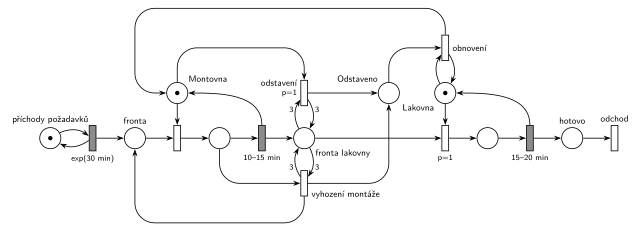

# Výrobní hala

Úloha 12/03

## Zadání

> Výrobní hala se skládá z montovny a lakovny. Obě linky mají výrobní kapacitu jedna. Do haly přichází požadavky na výrobu jednoho produktu v intervalech exponenciálně se středem 30 minut. Každý požadavek musí projít nejprve montovnou a pak lakovnou. Montování produktu trvá rovnoměrně 10–15 minut. Montovaný meziprodukt vstupuje do fronty lakovny. Lakování trvá rovnoměrně 15–20 minut. Pokud dosáhne délka fronty k lakování počtu 3 čekající meziprodukty, pak se montážní linka odstaví, případná rozpracovaná výroba se vyhodí a požadavek se vrací do fronty. Montovna se opět uvede do provozu až potom, co se zcela vyprázdní fronta Lakovny.

Podobné úlohy: [Centrum MM1 s rychlým režimem](<../../09 - Obsluha zákazníků/04 - Centrum MM1 s rychlým režimem/04 - Centrum MM1 s rychlým režimem.md>), [Klientské centrum](<../../09 - Obsluha zákazníků/06 - Klientské centrum/06 - Klientské centrum.md>), [Porucha vrací transakci do fronty](<../../03 - Poruchy/02 - Porucha vrací transakci do fronty/02 - Porucha vrací transakci do fronty.md>).

## Nápověda

<details>
<summary>Zobrazit nápovědu</summary>
<br>

- Požadavky přicházejí z *příchodů požadavků* ve smyčce s `exp(30 min)` do *fronty*.
- **Montovna a lakovna** jsou dvě zařízení (místa s jednou značkou) za sebou: obsazení, `10–15 min`, resp. `15–20 min`, a uvolnění sloučené s časovaným přechodem. Smontovaný meziprodukt jde do *fronty lakovny*, nalakovaný do *hotovo* a odchází přechodem *odchod*.
- **„Dosáhne délky 3“** = test hranami s váhou 3 do přechodu a zpět. Z *fronty lakovny* se nic neodebere. Lakovaný meziprodukt je v jiném místě, takže se do délky fronty nepočítá („3 čekající“).
- **Odstavení** vezme značku *Montovny* a přesune ji do *Odstaveno*. Tím je montovna mimo provoz a přechod se nemůže provést znovu. Priorita `p=1` zajistí, že odstavení vyhraje nad obsazením montovny dalším požadavkem.
- **Rozpracovaná výroba v tu chvíli ve skutečnosti nikdy není.** Fronta lakovny roste jen dokončením montáže a v témž okamžiku se montovna uvolní. Odstavení s `p=1` ji tedy zabere dřív, než ji obsadí další požadavek. Přechod *vyhození montáže* je v síti proto, že ho zadání výslovně požaduje (a hodnotitel ho bude hledat). Vezme rozpracovaný požadavek (odpočet montáže zanikne), vrátí ho do *fronty* a značku montovny pošle rovnou do *Odstaveno*. Je to stejný vzor jako přerušení obsluhy poruchou. V simulaci se neprovede ani jednou.
- **Obnovení** má `p=0` a testuje volnou *Lakovnu*. Obsazení lakovny má `p=1`, takže dokud je ve *frontě lakovny* něco, vyhraje obsazení. Obnovení se tedy provede, až je fronta prázdná *a* lakovna volná, a vrátí značku z *Odstaveno* do *Montovny*. Montovna se tak rozjede až po nalakování posledního meziproduktu, nejvýš o jedno lakování (15–20 min) později než v okamžiku, kdy se fronta vyprázdní. Přesný test prázdné fronty bez inhibiční hrany by potřeboval doplňkové místo (počet volných míst ve frontě, nejvýš 3), což je zbytečně složité.
- Požadavky během odstavení dál přicházejí a čekají ve *frontě*.

</details>

## Petriho síť

<details>
<summary>Zobrazit Petriho síť</summary>
<br>



</details>

## Časté chyby

<details>
<summary>Zobrazit časté chyby</summary>
<br>

- Test fronty jen vstupní hranou s váhou 3 (bez hrany zpět): tři meziprodukty z fronty zmizí.
- Váha 4 („přesáhne 3“) místo 3.
- Odstavení, které nebere žádnou značku (jen testuje frontu). Okamžitý přechod by se pak při plné frontě prováděl pořád dokola.
- Obnovení bez podmínky prázdné fronty, nebo podmínka přes prioritu s chybějícím `p=1` u obsazení lakovny. Pak se montovna rozjede hned při první příležitosti.
- Vyhozený požadavek, který zmizí ze systému. Zadání říká, že se vrací do fronty.
- Ztracená značka montovny: vyhození, které vrátí jen požadavek, nebo obnovení, které značku nevrátí.

</details>

## SIMLIB

<details>
<summary>Zobrazit SIMLIB kód</summary>
<br>

Model je izomorfní k Petriho síti výše: každé místo, přechod a značka mají svůj protějšek v kódu.

```cpp
// Výrobní hala – model v SIMLIB/C++
#define I_REALLY_KNOW_HOW_TO_USE_WAITUNTIL   // SIMLIB zpřístupní WaitUntil jen s tímto makrem
#include "simlib.h"

Facility Montovna("Montovna");        // místo „Montovna“ (1 značka); fronta zařízení = „Fronta“
Facility Lakovna("Lakovna");          // místo „Lakovna“; fronta zařízení = „Fronta lakovny“
long odstaveni = 0, vyhozeni = 0;
Histogram Doba("Doba požadavku v hale [min]", 0, 30, 20);

class Pozadavek : public Process {    // transakce = požadavek na výrobu
 public:
  bool vyhozen = false;               // přechod „vyhození montáže“ zrušil montáž
  void Behavior() {
    double prichod = Time;
    for (;;) {
      Seize(Montovna);                // obsazení montovny
      double zacatek = Time;
      if (!vyhozen)
        Wait(Uniform(10, 15));        // 10–15 min; vyhození odpočet zruší (Activate)
      if (!vyhozen) break;
      vyhozen = false;                // „vyhození montáže“: značka montovny jde odstavení,
      if (Time > zacatek) vyhozeni++; // požadavek zpět do „Fronty“
      Release(Montovna);
    }
    Release(Montovna);                // 10–15 min vrací značku montovny
    Seize(Lakovna);                   // „Fronta lakovny“ + obsazení lakovny (p=1)
    Wait(Uniform(15, 20));            // 15–20 min ...
    Release(Lakovna);                 // ... vrací značku lakovny
    Doba(Time - prichod);
  }                                   // „hotovo“ → přechod „odchod“
};

class Rizeni : public Process {       // odstavení a obnovení montovny
 public:
  Rizeni() : Process(1) {}            // priorita 1: ve frontě montovny předběhne požadavky
  void Behavior() {
    for (;;) {
      WaitUntil(Lakovna.QueueLen() >= 3);  // test „Fronty lakovny“ hranami s váhou 3
      if (Montovna.Busy()) {          // montovna je obsazená: „vyhození montáže“
        Pozadavek *p = static_cast<Pozadavek *>(Montovna.In());
        p->vyhozen = true;
        p->Activate();                // odpočet montáže zanikne
      }
      Seize(Montovna);                // „odstavení“: Montovna → „Odstaveno“
      odstaveni++;
      WaitUntil(!Lakovna.Busy() && Lakovna.QueueLen() == 0);  // „obnovení“ (p=0): test volné Lakovny
      Release(Montovna);              // „Odstaveno“ → Montovna
    }
  }
};

class Generator : public Event {      // místo „příchody požadavků“ ve smyčce s exp(30 min)
  void Behavior() {
    (new Pozadavek)->Activate();      // nová značka ve „Frontě“
    Activate(Time + Exponential(30));
  }
};

int main() {
  Init(0, 10000 * 60);                // modelový čas v minutách: 10 000 hodin
  (new Generator)->Activate();
  (new Rizeni)->Activate();
  Run();
  Montovna.Output();
  Lakovna.Output();
  Doba.Output();
  Print("Odstavení: %ld (jednou za %.0f h), vyhozených rozpracovaných montáží: %ld\n",
        odstaveni, 10000.0 / odstaveni, vyhozeni);
}
```

| Petriho síť | SIMLIB |
|---|---|
| *příchody požadavků* ⇄ `exp(30 min)` | událost `Generator`, která se znovu plánuje za `Exponential(30)` |
| značka (požadavek) | proces `Pozadavek` |
| *fronta* + obsazení *Montovny* | `Seize(Montovna)` (fronta je vnitřní fronta zařízení) |
| `10–15 min` se sloučeným uvolněním | `Wait(Uniform(10, 15)); … Release(Montovna);` |
| *fronta lakovny* + obsazení *Lakovny* (`p=1`) | `Seize(Lakovna)` |
| `15–20 min` se sloučeným uvolněním | `Wait(Uniform(15, 20)); Release(Lakovna);` |
| *odstavení* `p=1` (test váhou 3) → *Odstaveno* | proces `Rizeni` s prioritou 1: `WaitUntil(Lakovna.QueueLen() >= 3); Seize(Montovna);` |
| *vyhození montáže* | `p->vyhozen = true; p->Activate();` a požadavek se vrátí do fronty (`Release`, znovu `Seize`) |
| *obnovení* (test volné *Lakovny*) | `WaitUntil(!Lakovna.Busy() && Lakovna.QueueLen() == 0); Release(Montovna);` |
| *hotovo* → *odchod* | konec metody `Behavior()` požadavku |

**Kontrola simulací.** Petriho síť: *Montovna* + montáž + *Odstaveno* = 1, *Lakovna* + lakování = 1, *fronta lakovny* nikdy nepřesáhne 3 a všechny přechody kromě *vyhození montáže* se provádějí (`make check`). Odstavení nastává zhruba jednou za 50 hodin a pokaždé po něm následuje obnovení. *Vyhození montáže* se podle očekávání neprovede. SIMLIB model: za 10 000 h nastalo odstavení 213× (jednou za 47 h), fronta lakovny měla nejvýš 3 meziprodukty a lakovna byla vytížena na 58 % (teoreticky 17,5 / 30 = 58 %). V SIMLIB předá `Release` montovnu dalšímu požadavku hned, takže řízení ji při odstavení najde obsazenou a „vyhodí“ montáž, která ještě nezačala (0 min práce); to odpovídá tomu, že v síti odstavení s `p=1` předběhne obsazení montovny. Rozpracovaná montáž (s nenulovou prací) se nevyhodila ani jednou (`make simlib`).

</details>

## Původ a zdroje

<details>
<summary>Zobrazit původ a zdroje</summary>
<br>

**Původ:** půlsemestrálky 2014–19 (přehled zadání), úloha Z24. Rok, varianta ani body nejsou známé.

**Původní znění:**

> Výrobní hala se skládá z montovny a lakovny. Obě linky mají výrobní kapacitu jedna. Do haly přichází požadavky na výrobu jednoho produktu v intervalech daných exponenciálním rozložením se středem 30 minut. Každý požadavek musí projít nejprve montovnou a pak lakovnou. Montování produktu trvá 10-15 minut. Montovaný meziprodukt vstupuje do fronty lakovny. Lakování trvá 15-20 minut. Pokud dosáhne délka fronty k lakování počtu 3 čekající meziprodukty, pak se montážní linka odstaví, případná rozpracovaná výroba se vyhodí a požadavek se vrací do fronty. Montovna se opět uvede do provozu až potom, co se zcela vyprázdní fronta Lakovny.
>
> *Zadaný systém modelujte formou Petriho sítě s vyznačením všech potřebných parametrů.*

**Zdroje:**

- `Fitcheats/Půlsemestrálky/Zadání z minulých let/Přehled zadání 2014-19.pdf`, str. 6 (zadání)
- `Fitcheats/Půlsemestrálky/Democvičení 2020-21 - Z4 zadání a řešení.pdf`, str. 7 (řešení z democvičení)
- `Fitcheats/Půlsemestrálky/Zadání z minulých let/2024-25 - Varianta A (fotky).pdf`, str. 9–10 (zadání a řešení kreslené na konzultaci, fotky projektoru)

**Existující řešení:**

- **Democvičení (str. 7):** stejná struktura jako síť výše. Montovna a lakovna jako zařízení, obsazení lakovny má zeleně `p=1`. Modře dva přechody s testem *FL* vahou 3: jeden bere volnou montovnu, druhý rozpracovaný požadavek, který vrací do fronty. Oba dávají značku do místa „OP“ (odstaveno). Zeleně obnovení: „OP“ + test volné lakovny → montovna. Obnovení je tam se stejnou podmínkou (volná lakovna) jako tady. Rozdíl: odstavovací přechody nemají prioritu (náhodný souboj s obsazením montovny, výsledek je ale stejný). Lakování má napsané zřejmě „20-25m“ místo 15–20 min.
- **Konzultace 2024/25 (fotky, str. 10):** obsazení lakovny „pr1“. Odstavení testuje frontu lakovny vahou 3 a bere značku z řídicího místa. Přes další místo pak spustí přechod, který bere rozpracovaný požadavek a vrací ho do fronty. Případ volné montovny řešen není: montovna se „odstaví“ až tím, že další obsazený požadavek je hned vrácen. Přechod obnovení vpravo testuje volnou lakovnu a vrací značky montovně a řídicímu místu. Na fotce ale není vidět, že by bral nějakou značku stavu odstavení. Tak, jak je nakreslený, by se prováděl stále dokola. Kresba je přetahaná, konce některých hran nejsou jisté.

</details>

## Reference

- [Jak síť funguje](<../../../basics/Jak síť funguje.md>)
- [Notace a vzory](<../../../basics/Notace a vzory.md>)

<!-- -->

- [Studijní plán](<../../Studijní plán.md>)
- [Seznam úloh](<../../Seznam úloh.md>)
