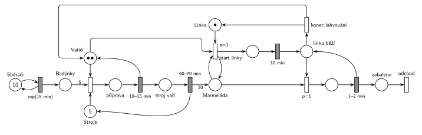

# Jahodová farma

## Zadání

> Na jahodové farmě pracuje 10 sběračů jahod a dva vařiči marmelády. Dále je v systému 5 strojů na vaření marmelády a jedna balící linka. Sběr jedné bedýnky a transport do varny sběrači zabere exponenciálně se středem 15 minut. Vařič zahajuje proces vaření na stroji, když je k dispozici 5 potřebných bedýnek jahod (tj. 1 vaření = 5 bedýnek). Příprava vaření zabere rovnoměrně 10–15 minut. Pak stroj bez potřeby obsluhy samostatně vaří rovnoměrně 60–70 minut. Výsledkem vaření je 20 jednotek marmelády, kterou je třeba prioritně zabalit do sklenic. Pokud je nějaká uvařená marmeláda, pak jeden z vařičů nastartuje balící linku (zabere přesně 10 minut) a lahvuje marmeládu, dokud existuje z libovolné varny nějaká nezabalená vyprodukovaná marmeláda. Lahvování jedné jednotky marmelády trvá rovnoměrně 1–2 minuty.

Podobné úlohy: [Sběrači jahod](<../02 - Sběrači jahod/02 - Sběrači jahod.md>), [Moštárna](<../06 - Moštárna/06 - Moštárna.md>).

## Nápověda

<details>
<summary>Zobrazit nápovědu</summary>
<br>

- **Sběrači** jsou stejně jako v úloze [Sběrači jahod](<../02 - Sběrači jahod/02 - Sběrači jahod.md>) místo s 10 značkami ve smyčce s `exp(15 min)`. Každá značka má vlastní odpočet, takže je to 10 nezávislých sběračů. Každé provedení přinese bedýnku do místa *Bedýnky*.
- **Zahájení vaření** potřebuje vařiče, stroj a 5 bedýnek (hrana s váhou 5). Během *přípravy* jsou obsazení vařič i stroj. Časovaný přechod `10–15 min` vrátí vařiče, stroj zůstává obsazený a sám vaří `60–70 min` (*stroj vaří*). Teprve pak se vrátí do *Strojů* a vznikne 20 jednotek *Marmelády* (hrana s váhou 20).
- **Vařiči** jsou sklad se dvěma značkami. Každý vařič dělá jen jednu věc najednou: buď připravuje vaření, nebo obsluhuje linku.
- **„Prioritně zabalit“:** *start linky* má `p=1`, zahájení vaření `p=0`. Když se vařič uvolní a je uvařená marmeláda, jde přednostně k lince. Probíhající přípravu nepřerušuje, zadání o přerušení nic neříká.
- **Start linky** testuje, že je nějaká *Marmeláda* (hrana tam a zpět), a bere vařiče a *Linku* (jedna značka, linka je jen jedna). Rozjezd trvá `10 min`, pak je vařič s linkou ve stavu *linka běží*.
- **Lahvování** je obsluha s „linkou běží“ jako zařízením: plnění (`p=1`) vezme jednotku marmelády, `1–2 min` vrátí značku *linka běží* a jednotka (sklenice) jde do *zabaleno* a odchází ze systému přechodem *odchod*. Marmeláda z jakékoli varny jde do stejného místa, takže se lahvuje vše („z libovolné varny“).
- **Konec lahvování** (`p=0`) se provede, až plnění nemůže, tj. když marmeláda došla. Vrátí vařiče i *Linku*. Při další marmeládě se linka znovu startuje 10 minut.
- **Zadaná čísla nejsou vyvážená.** Sběrači přinesou 40 bedýnek za hodinu, 5 strojů jich zpracuje nejvýš asi 19 (stroj je obsazený asi 77,5 min na 5 bedýnek). Stroje uvaří až asi 77 jednotek za hodinu, linka zabalí nejvýš 40. Bedýnky i marmeláda se proto hromadí bez omezení a linka po prvním startu už nikdy nedoběhne. Síť je přesto správně, jen se v takovém provozu některé části (konec lahvování) neuplatní.

</details>

## Petriho síť

<details>
<summary>Zobrazit Petriho síť</summary>
<br>



</details>

## Časté chyby

<details>
<summary>Zobrazit časté chyby</summary>
<br>

- Vařič obsazený po celou dobu vaření (vrací se až s koncem `60–70 min`). Stroj vaří „bez potřeby obsluhy“, vařič se uvolní po přípravě.
- Chybějící hrany s vahou 5 (bedýnky) a 20 (marmeláda).
- Lahvování jako jeden přechod s hranou s váhou 20. Marmeláda z různých varen se míchá a lahvuje se po jednotkách, dokud nějaká je.
- Start linky před každou jednotkou. Rozjezd 10 min je jen jednou za běh linky, pak se lahvuje dokola.
- Konec lahvování bez nižší priority než plnění. Vařič by pak mohl linku opustit, i když marmeláda zbývá.
- Chybějící místo *Linka*: dva vařiči by mohli lahvovat zároveň, ale linka je jen jedna.

</details>

## SIMLIB

<details>
<summary>Zobrazit SIMLIB kód</summary>
<br>

Model je izomorfní k Petriho síti výše: každé místo, přechod a značka mají svůj protějšek v kódu. Bedýnky a jednotky marmelády jsou jen počty značek (`int`), protože je síť bere po celých skupinách a nic o nich nesleduje.

```cpp
// Jahodová farma – model v SIMLIB/C++
#define I_REALLY_KNOW_HOW_TO_USE_WAITUNTIL   // SIMLIB zpřístupní WaitUntil jen s tímto makrem
#include "simlib.h"

Store Stroje("Stroje na vaření", 5);  // místo „Stroje“ (5 značek)
Facility Linka("Balicí linka");       // místo „Linka“ (1 značka)
int bedynky = 0;                      // místo „Bedýnky“
int marmelada = 0;                    // místo „Marmeláda“ (jednotky)
long varek = 0, startu = 0, zabaleno = 0;

class Sberac : public Process {       // jedna z 10 značek místa „Sběrači“
  void Behavior() {
    for (;;) {
      Wait(Exponential(15));          // exp(15 min): každá značka má vlastní odpočet
      bedynky++;                      // bedýnka do „Bedýnek“
    }
  }
};

class Vareni : public Process {       // značka v místě „stroj vaří“
  void Behavior() {
    Wait(Uniform(60, 70));            // 60–70 min ...
    Leave(Stroje);                    // ... vrací stroj
    marmelada += 20;                  // hrana s váhou 20 do „Marmelády“
  }
};

class Varic : public Process {        // jedna ze 2 značek místa „Vařiči“
  bool lze_startovat() { return marmelada > 0 && !Linka.Busy(); }
  void Behavior() {
    for (;;) {
      WaitUntil(lze_startovat() || (bedynky >= 5 && Stroje.Free() > 0));
      if (lze_startovat()) {          // „start linky“ (p=1): test Marmelády + Linka
        Seize(Linka);
        startu++;
        Wait(10);                     // rozjezd 10 min → „linka běží“
        while (marmelada > 0) {       // „plnění“ (p=1): vezme jednotku marmelády
          marmelada--;
          Wait(Uniform(1, 2));        // lahvování 1–2 min → „zabaleno“ → „odchod“
          zabaleno++;
        }
        Release(Linka);               // „konec lahvování“ (p=0): vrací Linku i vařiče
      } else {                        // „zahájení“ (p=0): 5 bedýnek + vařič + stroj
        bedynky -= 5;
        Enter(Stroje);
        varek++;
        Wait(Uniform(10, 15));        // „příprava“ 10–15 min, pak vařič volný
        (new Vareni)->Activate();     // stroj vaří sám
      }
    }
  }
};

int main() {
  Init(0, 1000 * 60);                 // modelový čas v minutách: 1000 hodin
  for (int i = 0; i < 10; i++) (new Sberac)->Activate();
  for (int i = 0; i < 2; i++) (new Varic)->Activate();
  Run();
  Stroje.Output();
  Linka.Output();
  Print("Várek: %ld (%.1f za hodinu), startů linky: %ld, zabaleno: %ld (%.1f za hodinu)\n",
        varek, varek / 1000.0, startu, zabaleno, zabaleno / 1000.0);
  Print("Na konci čeká %d bedýnek a %d jednotek marmelády (systém je přetížený)\n",
        bedynky, marmelada);
}
```

| Petriho síť | SIMLIB |
|---|---|
| *Sběrači* (10 značek) ⇄ `exp(15 min)` → *Bedýnky* | 10 procesů `Sberac`: `Wait(Exponential(15)); bedynky++;` |
| *Bedýnky*, *Marmeláda* | `int bedynky`, `int marmelada` |
| *Vařiči* (2 značky) | 2 procesy `Varic`, které čekají ve `WaitUntil` na první proveditelný přechod |
| *Stroje* (5 značek) | `Store Stroje(5)`, `Enter` / `Leave` |
| zahájení: 5 bedýnek + vařič + stroj → *příprava* → `10–15 min` | `bedynky -= 5; Enter(Stroje); Wait(Uniform(10, 15));` |
| *stroj vaří* → `60–70 min` (vrací stroj, váha 20) | proces `Vareni`: `Wait(Uniform(60, 70)); Leave(Stroje); marmelada += 20;` |
| *start linky* `p=1` (test *Marmelády*, *Linka*) → `10 min` | `if (lze_startovat())` má přednost před vařením; `Seize(Linka); Wait(10);` |
| plnění `p=1` → `1–2 min` → *zabaleno* → *odchod* | cyklus `while (marmelada > 0) { marmelada--; Wait(Uniform(1, 2)); }` |
| *konec lahvování* (`p=0`) | konec cyklu: `Release(Linka)`, vařič se vrací do `WaitUntil` |

**Kontrola simulací.** Petriho síť: platí *Vařiči* + vařiči v přípravě, při startu a u linky = 2, *Stroje* + stroje v přípravě a při vaření = 5 a *Linka* + obsazená linka = 1 (`make check`). Se zadanými čísly je systém přetížený: *Bedýnky* a *Marmeláda* rostou bez omezení (v síti povoleno) a konec lahvování se neprovede. Se sběrem zpomaleným na `exp(90 min)` se linka střídavě startuje a zastavuje (konec lahvování asi každou hodinu a půl) a všechny invarianty platí. SIMLIB model ukazuje totéž přetížení: za 1000 h bylo 3805 várek (3,8 za hodinu, teoreticky 5 / 77,5 min ≈ 3,9), stroje byly obsazené v průměru 4,9 z 5, linka se nastartovala jen jednou a zabalila 40,0 jednotky za hodinu (teoreticky 60 / 1,5 = 40). Na konci čekalo 20 828 bedýnek a 36 020 jednotek marmelády (`make simlib`).

</details>

## Původ a zdroje

<details>
<summary>Zobrazit původ a zdroje</summary>
<br>

**Původ:** půlsemestrálky 2014–19 (přehled zadání), úloha Z23. Rok, varianta ani body nejsou známé.

**Původní znění:**

> Na jahodové farmě pracuje 10 sběračů jahod a dva vařiči marmelády. Dále je v systému 5 strojů na vaření marmelády a jedna balící linka. Sběr jedné bedýnky a transport do varny sběrači zabere dobu exp(15min). Vařič zahajuje proces vaření na stroji, když je k dispozici 5 potřebných bedýnek jahod (tj. 1 vaření = 5 bedýnek). Příprava vaření zabere 10-15 minut. Pak stroj bez potřeby obsluhy samostatně vaří 60-70 minut. Výsledkem vaření je 20 jednotek marmelády, kterou je třeba prioritně zabalit do sklenic. Pokud je nějaká uvařená marmeláda, pak jeden z vařičů nastartuje balící linku (zabere 10 minut) a lahvuje marmeládu, dokud existuje z libovolné varny nějaká nezabalená vyprodukovaná marmeláda. Lahvování jedné jednotky marmelády trvá 1-2 minuty.
>
> *Zadaný systém modelujte formou Petriho sítě s vyznačením všech potřebných parametrů.*

**Zdroje:**

- `Fitcheats/Půlsemestrálky/Zadání z minulých let/Přehled zadání 2014-19.pdf`, str. 5–6 (zadání, bez řešení)

**Existující řešení:**

- K této úloze v materiálech žádné řešení není. Nejbližší je moštárna (Z16, [Moštárna](<../06 - Moštárna/06 - Moštárna.md>)), řešená na democvičení (`Fitcheats/Půlsemestrálky/Democvičení 2020-21 - Z4 zadání a řešení.pdf`, str. 4): sběrači „5“ → bedýnky → lisy obsluhované moštaři → váha „20“ do nádoby. Lahvování začne přechodem `p=1` (linka + moštař + mošt), po každé lahvi pokračuje dalším `p=1`, dokud je nádoba neprázdná, jinak přechod bez priority vrátí linku i moštaře. To je stejný vzor jako lahvování výše, jen bez 10minutového startu linky.

</details>

## Reference

- [Jak síť funguje](<../../../basics/Jak síť funguje.md>)
- [Notace a vzory](<../../../basics/Notace a vzory.md>)

<!-- -->

- [Studijní plán](<../../Studijní plán.md>)
- [Seznam úloh](<../../Seznam úloh.md>)
