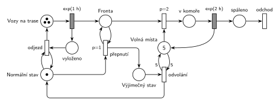

# Spalovna se třemi vozy

## Zadání

> V provozu městské spalovny pracují tři svozové vozy a jedna spalovací komora. Svozové vozy přijíždí v intervalech exponenciálně se středem 1 hodina s jednotkovým balíkem odpadu, balík vyloží do fronty ke spalovací komoře a za normálních okolností odjíždí na další sběrnou trasu. Kapacita spalovací komory je pět balíků. Spalování jednoho balíku trvá exponenciálně se středem 2 hodiny. Pokud se naplní kapacita komory a stále je její fronta neprázdná, pak se systém přepne do výjimečného stavu, kdy svozové vozy po vyložení balíku čekají na místě do jeho odvolání. Výjimečný stav se odvolá až po tom, co se veškerá spalovací práce v komoře a ve frontě dokončí.

Podobné úlohy: [Spalovna](<../07 - Spalovna/07 - Spalovna.md>), [Sběrači jahod](<../02 - Sběrači jahod/02 - Sběrači jahod.md>), [Výrobní hala](<../03 - Výrobní hala/03 - Výrobní hala.md>).

## Interpretace

<details>
<summary>Zobrazit interpretaci (nápověda)</summary>
<br>

- **Vozy** jsou místo se 3 značkami a časovaný přechod `exp(1 h)`. Každá značka má vlastní odpočet (slajd 138), takže jsou to tři nezávislé vozy. „V intervalech exponenciálně se středem 1 hodina“ je doba jedné sběrné trasy každého vozu.
- **Příjezd = vyložení:** časovaný přechod rozdělí transakci na dvě značky. Balík jde do *Fronty*, vůz do místa *vyloženo*. Odtud odjíždí přechodem *odjezd*, který testuje (hrana tam a zpět) *Normální stav*, zpět do *Vozů na trase*. Ve výjimečném stavu značka *Normální stav* chybí, a vozy proto čekají ve *vyloženo*.
- **Komora** je sklad s 5 místy (*Volná místa*). Vložení (`p=2`) vezme balík z *Fronty* a volné místo. Každý balík v komoře hoří samostatně `exp(2 h)` (každá značka má vlastní odpočet), pak vrátí volné místo a jako *spáleno* opouští systém přechodem *odchod*.
- **Přepnutí** se provede, když je ve *Frontě* balík (test) a ten nejde vložit do komory. Vezme *Normální stav* a dá *Výjimečný stav*. Podmínku „komora je plná“ zajišťuje priorita: vložení má `p=2`, takže přepnutí (`p=1`) přijde na řadu, jen když nejsou volná místa.
- **Proč `p=1` u přepnutí:** v okamžiku příjezdu do plné komory jsou proveditelné přepnutí i odjezd právě přijetého vozu. Vůz, jehož balík výjimečný stav vyvolal, má podle zadání také čekat, proto přepnutí vyhraje.
- **Odvolání** testuje všech 5 volných míst (hrany s váhou 5 tam i zpět), tj. komora je prázdná. Prázdnou frontu zajišťuje opět priorita: dokud je ve *Frontě* balík a komora má volné místo, vyhraje vložení (`p=2`). Po odvolání se vrátí *Normální stav* a všechny čekající vozy hned odjedou.
- Fronta je omezená sama: ve výjimečném stavu vozy postupně uvíznou ve *vyloženo*, takže ve frontě mohou být nejvýš 3 balíky.

</details>

## Petriho síť

<details>
<summary>Zobrazit Petriho síť</summary>
<br>



</details>

## Časté chyby

<details>
<summary>Zobrazit časté chyby</summary>
<br>

- Generátor s jedním vozem (`exp(1 h)` ve smyčce s jednou značkou). Zadání má tři vozy, které mohou čekat. Vozy musí být značky, které se vrací.
- Komora jako jedna linka, nebo spalování všech 5 balíků najednou jako jedna dávka. Každý balík hoří samostatně.
- Přepnutí bez podmínky plné komory (jen test fronty): přepnulo by se při každém příjezdu.
- Odvolání bez testu všech 5 volných míst, nebo jen s jedním: výjimečný stav by skončil dřív, než komora dohoří.
- Test „komora prázdná“ odebráním 5 značek bez hrany zpět: komora přijde o kapacitu.
- Výjimečný stav, který zastaví vozy už na trase. Podle zadání vozy normálně dojedou, vyloží balík a teprve potom čekají.

</details>

## SIMLIB

<details>
<summary>Zobrazit SIMLIB kód</summary>
<br>

Model je izomorfní k Petriho síti výše: každé místo, přechod a značka mají svůj protějšek v kódu.

```cpp
// Spalovna se třemi vozy – model v SIMLIB/C++
#define I_REALLY_KNOW_HOW_TO_USE_WAITUNTIL   // SIMLIB zpřístupní WaitUntil jen s tímto makrem
#include "simlib.h"

Store Komora("Spalovací komora", 5);  // místo „Volná místa“ (5 značek); fronta skladu = „Fronta“
bool normalni = true;                 // místa „Normální stav“ (true) / „Výjimečný stav“ (false)
long prepnuti = 0;
double zacatek_vyjimky, vyjimka = 0;  // doba strávená ve výjimečném stavu
Histogram Doba("Doba balíku ve spalovně [h]", 0, 1, 15);

class Balik : public Process {        // transakce = balík odpadu
  void Behavior() {
    double prichod = Time;            // balík ve „Frontě“
    Enter(Komora);                    // vložení (p=2): bere volné místo
    Wait(Exponential(120));           // exp(2 h) ...
    Leave(Komora);                    // ... vrací volné místo
    Doba((Time - prichod) / 60);
  }                                   // „spáleno“ → přechod „odchod“
};

class Vuz : public Process {          // jedna ze 3 značek místa „Vozy na trase“
  void Behavior() {
    for (;;) {
      Wait(Exponential(60));          // příjezd exp(1 h): každá značka má vlastní odpočet
      (new Balik)->Activate();        // balík do „Fronty“, vůz do „vyloženo“
      if (normalni && Komora.Full()) {    // „přepnutí“ (p=1): balík ve frontě a komora plná;
        normalni = false;                 // má přednost před odjezdem tohoto vozu
        prepnuti++;
        zacatek_vyjimky = Time;
      }
      WaitUntil(normalni);            // „odjezd“ testuje „Normální stav“
    }
  }
};

class Odvolani : public Process {     // přechod „odvolání“
  void Behavior() {
    for (;;) {
      WaitUntil(!normalni && Komora.Empty() && Komora.QueueLen() == 0);  // test 5 volných míst
      normalni = true;                // „Výjimečný stav“ → „Normální stav“
      vyjimka += Time - zacatek_vyjimky;
    }
  }
};

int main() {
  Init(0, 10000 * 60);                // modelový čas v minutách: 10 000 hodin
  for (int i = 0; i < 3; i++) (new Vuz)->Activate();
  (new Odvolani)->Activate();
  Run();
  Komora.Output();
  Doba.Output();
  Print("Výjimečných stavů: %ld (jeden za %.1f h), ve výjimečném stavu %.0f %% času\n",
        prepnuti, 10000.0 / prepnuti, 100 * vyjimka / (10000 * 60));
}
```

| Petriho síť | SIMLIB |
|---|---|
| *Vozy na trase* (3 značky) → `exp(1 h)` | 3 procesy `Vuz`, každý v cyklu `Wait(Exponential(60))` |
| příjezd: balík do *Fronty*, vůz do *vyloženo* | `(new Balik)->Activate();` a vůz pokračuje ve svém `Behavior()` |
| *odjezd* (test *Normální stav*) → *Vozy na trase* | `WaitUntil(normalni);` a další obrat cyklu |
| *Normální stav* / *Výjimečný stav* | `bool normalni` |
| *přepnutí* `p=1` (test *Fronty*, plná komora) | `if (normalni && Komora.Full()) normalni = false;` hned po vyložení, před odjezdem |
| *Volná místa* (5 značek), vložení `p=2` | `Store Komora(5)`, `Enter(Komora)`; fronta skladu je *Fronta* |
| `exp(2 h)` vrací volné místo | `Wait(Exponential(120)); Leave(Komora);` |
| *odvolání* (test 5 volných míst) | proces `Odvolani`: `WaitUntil(!normalni && Komora.Empty() && Komora.QueueLen() == 0)` |
| *spáleno* → *odchod* | konec metody `Behavior()` balíku |

**Kontrola simulací.** Petriho síť: platí *Vozy na trase* + *vyloženo* = 3, volná místa + balíky v komoře = 5 a *Normální* + *Výjimečný stav* = 1, fronta nikdy nemá víc než 3 balíky a všechny přechody se provádějí (`make check`). Vozy přivezou průměrně 3 balíky za hodinu a komora spálí nejvýš 2,5, takže výjimečný stav nastává často (asi každých 9 hodin). SIMLIB model: za 10 000 h nastal výjimečný stav 1098× (jednou za 9,1 h) a trval 64 % času, fronta měla nejvýš 3 balíky a v komoře hořelo průměrně 2,6 balíku (`make simlib`).

</details>

## Původ a zdroje

<details>
<summary>Zobrazit původ a zdroje</summary>
<br>

**Původ:** půlsemestrálky 2014–19 (přehled zadání), úloha Z20. Rok, varianta ani body nejsou známé.

**Původní znění:**

> V provozu městské spalovny pracují tři svozové vozy a jedna spalovací komora. Svozové vozy přijíždí v intervalech exp(1h) s jednotkovým balíkem odpadu, balík vyloží do fronty ke spalovací komoře a za normálních okolností odjíždí na další sběrnou trasu. Kapacita spalovací komory je pět balíků. Doba spalování jednoho balíku se řídí exp(2h). Pokud se naplní kapacita komory a stále je její fronta neprázdná, pak se systém přepne do výjimečného stavu, kdy svozové vozy po vyložení balíku čekají na místě do jeho odvolání. Výjimečný stav se odvolá až po tom, co se veškerá spalovací práce v komoře a ve frontě dokončí.
>
> *Zadaný systém modelujte formou Petriho sítě s vyznačením všech potřebných parametrů.*

**Zdroje:**

- `Fitcheats/Půlsemestrálky/Zadání z minulých let/Přehled zadání 2014-19.pdf`, str. 5 (zadání)
- `Fitcheats/Půlsemestrálky/Democvičení 2020-21 - Z4 zadání a řešení.pdf`, str. 6 (řešení z democvičení)

**Existující řešení:**

- **Democvičení (str. 6):** vozy „3“ → `exp(1h)` → „Fronta“ → vložení `p=1` (bere místo z „Volné“ s 5 značkami) → místo s balíky v komoře → `exp(2h)` → zpět „Volné“. Režim: místo „Nor“ (značka) a „Výjim.“. Přepnutí testuje frontu a bere „Nor“, odvolání testuje „Volné“ hranami s váhou 5 a vrací „Nor“. Podmínky „komora plná“ a „fronta prázdná“ hlídá stejně jako výše priorita vložení. Rozdíly:
  - Vůz je ve *Frontě* spolu se svým balíkem a uvolní se (do místa, odkud odjíždí přes test „Nor“) až při vložení balíku do komory. Chování je stejné: v normálním stavu se balík vloží hned, jinak nastane výjimečný stav a vůz čeká tak jako tak. Síť výše odděluje balík a vůz hned při vyložení, což víc odpovídá textu.
  - Spálený balík zaniká v přechodu `exp(2h)`, výstupní přechod chybí (tehdy se nevyžadoval).

</details>
