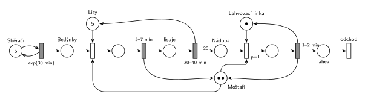

# Moštárna

## Zadání

> Dílna na produkci jablečného moštu (moštárna) leží vedle jablečného sadu. Moštárna obsahuje 5 poloautomatických lisů, sběrnou nádobu na mošt a jednu lahvovací linku. Ve firmě pracují dva moštaři a pět sběračů jablek. Sběrač v intervalech exponenciálně se středem 30 minut přináší do moštárny jednu bedýnku jablek. Každý moštař pracuje nezávisle a provádí dvě činnosti: 1) plnění lisů jablky, 2) lahvování. Lis pracuje dávkově s kapacitou danou obsahem jedné bedýnky jablek. Plnění lisu moštařem zabere rovnoměrně 5–7 minut. Po naplnění lisu dále lis pracuje samostatně. Lisování zabere rovnoměrně 30–40 minut a výsledkem je mošt o objemu na 20 lahví. Lisovaný mošt ze všech lisů jde do centrální záchytné nádoby (kapacitu neuvažujeme). Pokud je v záchytné nádobě nějaký mošt, pak moštař přednostně provádí lahvování dokud je nádoba neprázdná. Naplnění jedné lahve moštařem na lahvovací lince zabere rovnoměrně 1–2 minuty.

Podobné úlohy: [Jahodová farma](<../04 - Jahodová farma/04 - Jahodová farma.md>) (stejné schéma: sběrači, stroje, balicí linka), [Sběrači jahod](<../02 - Sběrači jahod/02 - Sběrači jahod.md>).

## Nápověda

<details>
<summary>Zobrazit nápovědu</summary>
<br>

- **Pět sběračů** je pět značek v místě *Sběrači*. Časovaný přechod `exp(30 min)` má pro každou značku vlastní odpočet (slajd 138), takže každý sběrač nosí bedýnky nezávisle. Bedýnky čekají v místě *Bedýnky*.
- **Lisy** (5 značek) a **Moštaři** (2 značky) jsou sklady.
- **Plnění lisu** potřebuje bedýnku, volný lis a moštaře. Po `5–7 min` se moštař vrátí a lis pracuje dál sám (*lisuje*) `30–40 min`; pak se vrátí lis a do *Nádoby* přibude 20 značek (hrana s váhou 20, 1 značka = mošt na 1 láhev).
- **Lahvování** potřebuje mošt, moštaře a *Lahvovací linku*. Má `p=1`, tedy přednost před plněním lisu („přednostně“). Po každé lahvi (`1–2 min`) se moštař i linka vrátí, a pokud je nádoba neprázdná, `p=1` je hned znovu obsadí. „Dokud je nádoba neprázdná“ tak platí bez dalšího prvku. Smyčka, která drží moštaře na lince (`p=1` další láhev, `p=0` konec), se chová stejně.
- Linka je jen jedna, takže lahvuje vždy nejvýš jeden moštař; druhý mezitím plní lisy.
- **Transakce:** bedýnka se v lisu změní na 20 dávek moštu, každá dávka opouští systém jako naplněná *láhev* přechodem *odchod*.
- **Systém je přetížený:** bedýnek přichází 10 za hodinu, 5 lisů jich zvládne asi 7,3 (lis je obsazený plněním a lisováním asi 41 min) a jedna linka nalahvuje asi 40 lahví za hodinu z možných 146. Fronta bedýnek i nádoba rostou bez omezení; nádobu zadání výslovně neomezuje.

</details>

## Petriho síť

<details>
<summary>Zobrazit Petriho síť</summary>
<br>



</details>

## Časté chyby

<details>
<summary>Zobrazit časté chyby</summary>
<br>

- Jeden sběrač místo pěti (jedna značka v generátoru).
- Moštař obsazený po celou dobu lisování. Zadání říká, že lis po naplnění pracuje samostatně.
- Lis vrácený už po naplnění, ne až po lisování.
- Lahvování bez priority, nebo dvě lahvovací linky (každý moštař „pracuje nezávisle“, ale linka je jedna).
- Hrana do nádoby bez váhy 20: jedna bedýnka by dala jen jednu láhev.

</details>

## SIMLIB

<details>
<summary>Zobrazit SIMLIB kód</summary>
<br>

Model je izomorfní k Petriho síti výše: každé místo, přechod a značka mají svůj protějšek v kódu. Bedýnky a dávky moštu jsou jen počty značek (`int`).

```cpp
// Moštárna – model v SIMLIB/C++
#define I_REALLY_KNOW_HOW_TO_USE_WAITUNTIL   // SIMLIB zpřístupní WaitUntil jen s tímto makrem
#include "simlib.h"

Store Lisy("Lisy", 5);                // místo „Lisy“ (5 značek)
Facility Linka("Lahvovací linka");    // místo „Lahvovací linka“ (1 značka)
int bedynky = 0;                      // místo „Bedýnky“
int nadoba = 0;                       // místo „Nádoba“ (dávky moštu na 1 láhev)
long lisovani = 0, lahvi = 0;

class Sberac : public Process {       // jedna z 5 značek místa „Sběrači“
  void Behavior() {
    for (;;) {
      Wait(Exponential(30));          // exp(30 min): každá značka má vlastní odpočet
      bedynky++;                      // bedýnka do „Bedýnek“
    }
  }
};

class Lisovani : public Process {     // značka v místě „lisuje“
  void Behavior() {
    Wait(Uniform(30, 40));            // 30–40 min ...
    Leave(Lisy);                      // ... vrací lis
    nadoba += 20;                     // hrana s váhou 20 do „Nádoby“
  }
};

class Mostar : public Process {       // jedna ze 2 značek místa „Moštaři“
  bool lze_lahvovat() { return nadoba > 0 && !Linka.Busy(); }
  void Behavior() {
    for (;;) {
      WaitUntil(lze_lahvovat() || (bedynky > 0 && Lisy.Free() > 0));
      if (lze_lahvovat()) {           // lahvování (p=1): Nádoba + moštař + linka
        Seize(Linka);
        nadoba--;
        Wait(Uniform(1, 2));          // 1–2 min vrací moštaře i linku
        Release(Linka);
        lahvi++;                      // „láhev“ → přechod „odchod“
      } else {                        // plnění lisu (p=0): bedýnka + lis + moštař
        bedynky--;
        Enter(Lisy);
        Wait(Uniform(5, 7));          // 5–7 min vrací moštaře, lis lisuje sám
        (new Lisovani)->Activate();
        lisovani++;
      }
    }
  }
};

int main() {
  Init(0, 1000 * 60);                 // modelový čas v minutách: 1000 hodin
  for (int i = 0; i < 5; i++) (new Sberac)->Activate();
  for (int i = 0; i < 2; i++) (new Mostar)->Activate();
  Run();
  Lisy.Output();
  Linka.Output();
  Print("Lisování: %ld (%.1f za hodinu), lahví: %ld (%.1f za hodinu)\n",
        lisovani, lisovani / 1000.0, lahvi, lahvi / 1000.0);
  Print("Na konci čeká %d bedýnek a %d dávek moštu (systém je přetížený)\n", bedynky, nadoba);
}
```

| Petriho síť | SIMLIB |
|---|---|
| *Sběrači* (5 značek) ⇄ `exp(30 min)` → *Bedýnky* | 5 procesů `Sberac`: `Wait(Exponential(30)); bedynky++;` |
| *Bedýnky*, *Nádoba* | `int bedynky`, `int nadoba` |
| *Moštaři* (2 značky) | 2 procesy `Mostar`, které čekají ve `WaitUntil` na první proveditelný přechod |
| *Lisy* (5 značek) | `Store Lisy(5)`, `Enter` / `Leave` |
| plnění: bedýnka + lis + moštař → `5–7 min` (vrací moštaře) | `bedynky--; Enter(Lisy); Wait(Uniform(5, 7));` |
| *lisuje* → `30–40 min` (vrací lis, váha 20) | proces `Lisovani`: `Wait(Uniform(30, 40)); Leave(Lisy); nadoba += 20;` |
| lahvování `p=1`: *Nádoba* + moštař + *Lahvovací linka* | `if (lze_lahvovat())` má přednost; `Seize(Linka); nadoba--;` |
| `1–2 min` vrací moštaře i linku → *láhev* → *odchod* | `Wait(Uniform(1, 2)); Release(Linka);` a moštař se vrací do `WaitUntil` |

**Kontrola simulací.** Petriho síť: lisů je vždy celkem 5, moštařů 2, linka je nejvýš jedna obsazená a všechny přechody se provádějí (`make check`). Za 310 h vzniklo asi 12 400 lahví (40 za hodinu), bedýnek čekalo na konci přes 900 a v nádobě přes 30 000 dávek, jak plyne z přetížení (bedýnky a nádoba smějí růst bez omezení). SIMLIB model ukazuje totéž přetížení: za 1000 h bylo 7081 lisování (7,1 za hodinu, teoreticky nejvýš asi 7,3), linka byla vytížena na 100 % a naplnila 40,0 lahve za hodinu (teoreticky 60 / 1,5 = 40). Na konci čekalo 2910 bedýnek a 101 591 dávek moštu (`make simlib`).

</details>

## Původ a zdroje

<details>
<summary>Zobrazit původ a zdroje</summary>
<br>

**Původ:** půlsemestrálky 2014–19 (přehled zadání), úloha Z16.

**Původní znění:**

> Dílna na produkci jablečného moštu (moštárna) leží vedle jablečného sadu. Moštárna obsahuje 5 poloautomatických lisů, sběrnou nádobu na mošt a jednu lahvovací linku. Ve firmě pracují dva moštaři a pět sběračů jablek. Sběrač v intervalech daný exponenciálním rozložením se středem 30 minut přináší do moštárny jednu bedýnku jablek. Každý moštař pracuje nezávisle a provádí dvě činnosti: 1) plnění lisů jablky, 2) lahvování. Lis pracuje dávkově s kapacitou danou obsahem jedné bedýnky jablek. Plnění lisu moštařem zabere 5-7 minut. Po naplnění lisu dále lis pracuje samostatně. Lisování zabere 30-40 minut a výsledkem je mošt o objemu na 20 lahví. Lisovaný mošt ze všech lisů jde do centrální záchytné nádoby (kapacitu neuvažujeme). Pokud je v záchytné nádobě nějaký mošt, pak moštař přednostně provádí lahvování dokud je nádoba neprázdná. Naplnění jedné lahve moštařem na lahvovací lince zabere 1-2 minuty.
>
> *Zadaný systém modelujte formou Petriho sítě s vyznačením všech potřebných parametrů.*

**Zdroje:**

- `Fitcheats/Půlsemestrálky/Zadání z minulých let/Přehled zadání 2014-19.pdf`, str. 4 (zadání)
- `Fitcheats/Půlsemestrálky/Democvičení 2020-21 - Z4 zadání a řešení.pdf`, str. 4 (zadání a řešení z democvičení)
- `Fitcheats/Půlsemestrálky/FIT - Příprava 2021-22.pdf`, str. 19 (studentské řešení, bez hlasů)

**Existující řešení:**

- **Democvičení 2020/21 (str. 4):** sběrači (5) ⇄ `exp(30m)` → „Fbed“ → obsazení „5 Lis“ a „2 Moštař“ → `5-7m` (vrací moštaře) → `30-40m` (vrací lis) → hrana `20` do „Nádoba“. Lahvování: „Lah“ (linka) + moštař + nádoba → `p=1` → láhev `1-2m` → `p=1` další láhev, dokud je mošt, jinak přechod, který vrátí linku a moštaře. Struktura je stejná jako tady, jen s explicitní smyčkou lahvování (chová se stejně jako opakované `p=1` tady). Láhve nikam neodcházejí (výstupní přechod se tehdy nevyžadoval).
- **Příprava 2021/22 (str. 19):** stejné schéma, ale:
  - v místě *sběrači* je jen jedna značka; pět sběračů musí být pět značek;
  - zahájení lahvování nemá prioritu, takže „přednostně“ není zajištěno (`P=1` má jen pokračování smyčky);
  - chybí výstupní přechod.

</details>
