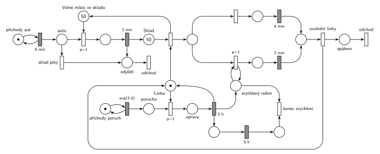

# Spalovna

## Zadání

> Do městské spalovny vozí odpad auta s kapacitou 1 kubík odpadu. Dovážka odpadu do spalovny probíhá rychlostí 10 kubíků odpadu za hodinu. Kapacita vstupního skladu přivezeného odpadu je 100 kubíků (sklad na počátku obsahuje 50 kubíků odpadu). Pokud není volná kapacita vstupního skladu, pak auto odjíždí nevyloženo. Vyložení auta trvá přesně 2 minuty. Linka s pracovní kapacitou 1 kubík odpadu spaluje odpad rychlostí 15 kubíků za hodinu. V intervalech exponenciálně se středem 3 dny dochází na lince k poruše (porucha nepřeruší právě prováděné spalování jednotkového kubíku), jejíž oprava zabere přesně 5 hodin. Po opravě se obnoví provoz linky a linka následujících přesně 5 hodin zvýší rychlost spalování na 30 kubíků za hodinu.
>
> *Zadaný systém modelujte formou Petriho sítě s vyznačením všech potřebných parametrů.*

Věta „V modelu jednoznačně ukažte (přechodem) moment, kdy transakce opouští systém“ přibyla až v roce 2022/23. Výstupní přechody jsou v síti přesto, dnes se vyžadují.

Podobné úlohy: [Spalovna se třemi vozy](<../05 - Spalovna se třemi vozy/05 - Spalovna se třemi vozy.md>), [Porucha zničí obsluhu nebo počká](<../../03 - Poruchy/06 - Porucha zničí obsluhu nebo počká/06 - Porucha zničí obsluhu nebo počká.md>), [MD1 – střídání 2 a 3](<../../06 - Doba obsluhy podle stavu/02 - MD1 – střídání 2 a 3/02 - MD1 – střídání 2 a 3.md>).

## Interpretace

<details>
<summary>Zobrazit interpretaci (nápověda)</summary>
<br>

- **Rychlosti jako časy:** 10 kubíků/h = auto každých `6 min` (konstantně, zadání dává rychlost, ne rozložení) z *příchodů aut*, 15 kubíků/h = `4 min` na kubík, 30 kubíků/h = `2 min`.
- **Kapacita skladu** je doplňkové místo *Volné místo ve skladu* (100 − 50 = 50 značek) vedle *Skladu* (50 značek). Auto si při vjezdu vezme volné místo (`p=1`), jinak odjíždí nevyložené (*sklad plný*, `p=0`). Místo se zabere už na začátku vykládání, takže sklad nepřeteče ani s auty, která se právě vykládají. Vyložení trvá `2 min` a dá kubík do *Skladu*. Volné místo se vrátí, když si kubík vezme linka.
- **Transakce jsou auto a kubík odpadu.** Auto po vyložení (nebo nevyložené) jde do *odjíždí* a odchází přechodem *odchod*, kubík odchází po spálení (*spáleno* → *odchod*).
- **Linka** je zařízení s jednou značkou. Rychlost se zvolí při zahájení kubíku: ve zrychleném režimu se provede `p=1` větev `2 min`, jinak `4 min`. Kubík, který se začal pálit, se dopálí původní rychlostí.
- **Uvolnění linky** je tady samostatný okamžitý přechod, protože se do něj sbíhají obě větve. Vracet *Linku* přímo z obou časovaných přechodů je také správně, jen by se v obrázku křížily hrany.
- **Porucha nepřeruší spalování:** poruchy přicházejí z *příchodů poruch* ve smyčce s `exp(3 d)`. Porucha čeká, až je linka volná, a pak ji obsadí s `p=1`, tedy dřív, než se začne pálit další kubík. Oprava `5 h` vrátí linku a zapne *zrychlený režim* a jeho odpočet `5 h`, po kterém *konec zrychlení* značku režimu vezme. Stav a odpočet jsou oddělené: stav testuje smyčka při každém zahájení, a kdyby byl vstupem časovaného `5 h`, odpočet by se pokaždé spustil znovu (slajd 139).
- Generátor poruch běží nezávisle, takže porucha může přijít i během opravy; pak hned po opravě následuje další.

</details>

## Petriho síť

<details>
<summary>Zobrazit Petriho síť</summary>
<br>



</details>

## Časté chyby

<details>
<summary>Zobrazit časté chyby</summary>
<br>

- Rychlost zapsaná jako parametr přechodu („10/h“) místo času mezi událostmi (`6 min`).
- Sklad jako místo s „kapacitou 100“. Kapacity míst se nepoužívají; místo nich doplňkové místo s volnými místy.
- Kontrola volného místa až po vyložení: auto by vykládalo do plného skladu.
- Porucha, která přeruší právě pálený kubík (zadání to výslovně vylučuje), nebo porucha bez priority, která čeká, až bude sklad prázdný.
- Zrychlený režim, který se po 5 h nevypne, nebo odpočet 5 h na místě testovaném smyčkou.

</details>

## SIMLIB

<details>
<summary>Zobrazit SIMLIB kód</summary>
<br>

Model je izomorfní k Petriho síti výše: každé místo, přechod a značka mají svůj protějšek v kódu.

```cpp
// Spalovna – model v SIMLIB/C++
#include "simlib.h"

Store Sklad("Vstupní sklad", 100);    // místa „Sklad“ + „Volné místo ve skladu“ (100 značek)
Facility Linka("Linka");              // místo „Linka“ (1 značka); fronta zařízení = kubíky ve „Skladu“
int zrychleni = 0;                    // místo „zrychlený režim“
long aut = 0, nevylozenych = 0, spaleno = 0, poruch = 0;

class Kubik : public Process {        // transakce = kubík odpadu ve „Skladu“
  void Behavior() {
    Seize(Linka);                     // zahájení: kubík + Linka ...
    Leave(Sklad);                     // ... a vrací „Volné místo ve skladu“
    if (zrychleni > 0)                // rychlá větev (p=1) testuje „zrychlený režim“
      Wait(2);                        // 2 min (30 kubíků/h)
    else
      Wait(4);                        // 4 min (15 kubíků/h)
    Release(Linka);                   // „uvolnění linky“
    spaleno++;                        // „spáleno“ → přechod „odchod“
  }
};

class Auto : public Process {         // transakce = auto s 1 kubíkem
  void Behavior() {
    aut++;
    if (Sklad.Free() > 0) {           // vjezd (p=1): bere volné místo ve skladu
      Enter(Sklad);
      Wait(2);                        // vyložení 2 min
      (new Kubik)->Activate();        // kubík do „Skladu“
    } else
      nevylozenych++;                 // „sklad plný“ (p=0): odjíždí nevyložené
  }                                   // „odjíždí“ → přechod „odchod“
};

class Zrychleni : public Process {    // místo před odpočtem 5 h zrychlení
  void Behavior() {
    Wait(5 * 60);                     // 5 h
    zrychleni--;                      // „konec zrychlení“ bere značku „zrychlený režim“
  }
};

class Porucha : public Process {      // značka v místě „porucha“
 public:
  Porucha() : Process(1) {}           // p=1: předběhne další kubík ve frontě linky
  void Behavior() {
    poruch++;
    Seize(Linka);                     // „oprava“ počká na dopálení kubíku
    Wait(5 * 60);                     // oprava 5 h ...
    Release(Linka);                   // ... vrací Linku,
    zrychleni++;                      // zapne „zrychlený režim“
    (new Zrychleni)->Activate();      // a jeho odpočet 5 h
  }
};

class PrichodyAut : public Event {    // místo „příchody aut“ ve smyčce s 6 min
  void Behavior() {
    (new Auto)->Activate();
    Activate(Time + 6);
  }
};

class PrichodyPoruch : public Event { // místo „příchody poruch“ ve smyčce s exp(3 d)
  void Behavior() {
    (new Porucha)->Activate();
    Activate(Time + Exponential(3 * 24 * 60));
  }
};

class Pocatek : public Process {      // počáteční značení: ve skladu je 50 kubíků
  void Behavior() {
    Enter(Sklad, 50);
    for (int i = 0; i < 50; i++) (new Kubik)->Activate();
  }
};

int main() {
  Init(0, 1000 * 24 * 60);            // modelový čas v minutách: 1000 dní
  (new Pocatek)->Activate();
  (new PrichodyAut)->Activate();
  (new PrichodyPoruch)->Activate(Exponential(3 * 24 * 60));
  Run();
  Sklad.Output();
  Linka.Output();
  Print("Aut: %ld, z toho nevyložených: %ld; poruch: %ld; spálených kubíků: %ld\n",
        aut, nevylozenych, poruch, spaleno);
}
```

| Petriho síť | SIMLIB |
|---|---|
| *příchody aut* ⇄ `6 min` | událost `PrichodyAut`, která se znovu plánuje za 6 min |
| auto, kubík (transakce) | procesy `Auto` a `Kubik` |
| *Sklad* + *Volné místo ve skladu* (100) | `Store Sklad(100)`; počátečních 50 kubíků zabere proces `Pocatek` |
| vjezd `p=1` / *sklad plný* `p=0` | `if (Sklad.Free() > 0) Enter(Sklad); else nevylozenych++;` |
| vyložení `2 min` → kubík do *Skladu* | `Wait(2); (new Kubik)->Activate();` |
| zahájení (vrací volné místo) | `Seize(Linka); Leave(Sklad);` (čekající kubíky jsou ve frontě linky) |
| větev `2 min` (`p=1`, test *zrychlený režim*) / `4 min` | `if (zrychleni > 0) Wait(2); else Wait(4);` |
| *uvolnění linky* → *spáleno* → *odchod* | `Release(Linka);` a konec `Behavior()` kubíku |
| *příchody poruch* ⇄ `exp(3 d)` → *porucha* | událost `PrichodyPoruch`, proces `Porucha` |
| oprava `p=1` (počká na dopálení kubíku) | `Porucha` s prioritou procesu 1: `Seize(Linka)` bez přerušení obsluhy |
| `5 h` vrací *Linku*, zapne *zrychlený režim* | `Wait(5 * 60); Release(Linka); zrychleni++;` |
| odpočet `5 h` → *konec zrychlení* | proces `Zrychleni`: `Wait(5 * 60); zrychleni--;` |

**Kontrola simulací.** Petriho síť: *Linka* + zpracovávaný kubík + oprava = 1, *Sklad* + *Volné místo* + vykládané = 100 a všechny přechody se provádějí (`make check`). Spalování (15/h) je rychlejší než dovážka (10/h), takže sklad se běžně vyprázdní a během jedné opravy přibude jen 50 kubíků. Plný sklad nastane jen tehdy, když porucha přijde během opravy (10 h bez spalování); proto běží simulace déle (300 000 událostí, asi 416 dní). Ze zhruba 100 000 aut odjela nevyložená jen 1 až 58 (podle běhu). SIMLIB model: za 1000 dní přijelo 240 001 aut a nevyložených odjelo 105, poruch bylo 334 (teoreticky 1000 / 3 ≈ 333), sklad se zaplnil nejvýš na 100 kubíků (v průměru 3,4) a linka byla vytížena na 69 % (`make simlib`).

</details>

## Původ a zdroje

<details>
<summary>Zobrazit původ a zdroje</summary>
<br>

**Původ:** půlsemestrálky 2014–19 (přehled zadání), úloha Z15.

**Původní znění:**

> Do městské spalovny vozí odpad auta s kapacitou 1 kubík odpadu. Dovážka odpadu do spalovny probíhá rychlostí 10 kubíků odpadu za hodinu. Kapacita vstupního skladu přivezeného odpadu je 100 kubíků (sklad na počátku obsahuje 50 kubíků odpadu). Pokud není volná kapacita vstupního skladu, pak auto odjíždí nevyloženo. Vyložení auta trvá 2 minuty. Linka s pracovní kapacitou 1 kubík odpadu spaluje odpad rychlostí 15 kubíků za hodinu. V intervalech daných exponenciálním rozložením se středem 3 dny dochází na lince k poruše (porucha nepřeruší právě prováděné spalování jednotkového kubíku), jejíž oprava zabere 5 hodin. Po opravě se obnoví provoz linky a linka následujících 5 hodin zvýší rychlost spalování na 30 kubíků za hodinu.
>
> *Zadaný systém modelujte formou Petriho sítě s vyznačením všech potřebných parametrů.*

**Zdroje:**

- `Fitcheats/Půlsemestrálky/Zadání z minulých let/Přehled zadání 2014-19.pdf`, str. 4 (zadání)
- `Fitcheats/Půlsemestrálky/FIT - Příprava 2021-22.pdf`, str. 18 (studentské řešení, bez hlasů)

**Existující řešení:**

- **Příprava 2021/22 (str. 18):** auta `6m`, vyložení `2m`, *sklad* (50), přechod „odjezd“ se stavem „Plný“, linka s větvemi `4m` a `2m` přepínanými místy „norm“ a „rychle“, porucha `exp(3d)` „je nehoda“, oprava `5h`, zrychlení `5h`. Rychlosti přepočítané na časy jsou správně. Výhrady:
  - plnost skladu se zjišťuje dvojicí hran s váhou 100 na místě *sklad*; auta, která se právě vykládají, se do obsazenosti nepočítají, takže sklad může přetéct. Jak se stav „Plný“ vrací zpět, z obrázku jednoznačně nevyčtu;
  - chybí výstupní přechody;
  - síť je velmi nepřehledná (mnoho křížících se hran), nikdo pro ni nehlasoval.

</details>
