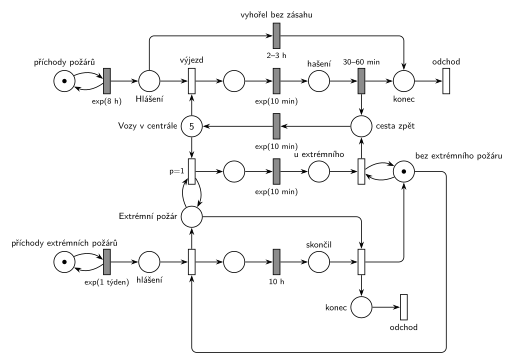

# Hasiči

## Zadání

> V regionu dochází ke vzniku požárů v intervalech exponenciálně se středem 8 hodin. Centrála hasičů dostává hlášení o novém požáru okamžitě po jeho vzniku. Nehašený požár trvá rovnoměrně 2–3 hodiny, tj. po uplynutí této doby žádost o pomoc hasičů zaniká. Hasičská centrála má 5 hasičských vozů. K běžnému požáru je třeba výjezd jednoho vozu. Cesta vozu ke každému požáru trvá exponenciálně se středem 10 minut (symetricky cesta zpátky). Hašení požáru trvá rovnoměrně 30–60 minut. V intervalech exponenciálně se středem 1 týden dochází k požáru extrémního rozsahu, která vyžaduje výjezd všech dostupných požárních vozů (všechny vozy dostupné v centrále, všechny vozy po návratu z běžného požáru). Extrémní požár po přesně 10 hodinách skončí, tj. pak se vozy vrací.

Podobné úlohy: [Nemocniční ambulance](<../../09 - Obsluha zákazníků/18 - Nemocniční ambulance/18 - Nemocniční ambulance.md>), [Netrpělivé požadavky](<../../02 - Netrpělivost a omezená fronta/01 - Netrpělivé požadavky/01 - Netrpělivé požadavky.md>), [Psí salon](<../../09 - Obsluha zákazníků/03 - Psí salon/03 - Psí salon.md>).

## Nápověda

<details>
<summary>Zobrazit nápovědu</summary>
<br>

- **Transakce je požár** (hlášení), **vůz je zdroj**: *Vozy v centrále* je místo s 5 značkami. Požáry přicházejí z *příchodů požárů* ve smyčce s `exp(8 h)` do *Hlášení*. *Výjezd* spojí hlášení s vozem, cesta k požáru trvá `exp(10 min)`, *hašení* `30–60 min`. Po hašení požár přes *konec* odchází ze systému a vůz jede *cestou zpět* `exp(10 min)` do centrály.
- **Nehašený požár 2–3 h** je časovaný přechod *vyhořel bez zásahu* přímo na místě *Hlášení*: každé hlášení má vlastní odpočet (slajd 138), a když pro něj mezitím vyjede vůz, odpočet zanikne. Vyhořelý požár jde také do *konec*. Abstrakce: požár, ke kterému už vůz jede, nevyhoří (cesta trvá v průměru 10 min, tedy mnohem méně než 2–3 h).
- **Extrémní požár** má vlastní generátor `exp(1 týden)`. Vyhlášení vytvoří dvě značky: stav *Extrémní požár* a odpočet `10 h`. Musí být oddělené: výjezd testuje stav smyčkou (vezme a vrátí značku), a kdyby stejné místo bylo vstupem časovaného přechodu `10 h`, každý výjezd by jeho odpočet zrušil a spustil znovu (slajd 139).
- **Výjezd všech dostupných vozů:** smyčka `p=1` bere vozy z centrály, dokud nějaký je a extrémní požár trvá. Má přednost před běžným výjezdem (`p=0`). Vůz, který se vrátí z běžného požáru, je v centrále a smyčka ho hned pošle dál. Přesně to je „všechny vozy po návratu z běžného požáru“. Cesta k extrémnímu požáru trvá také `exp(10 min)`.
- **Konec po 10 h:** přechod po místě *skončil* odebere stav *Extrémní požár*, vrátí značku *bez extrémního požáru* a extrémní požár přes *konec* odchází ze systému. Vozy *u extrémního* se vracejí přechodem s testem na *bez extrémního požáru* do *cesty zpět*. Ten pošle zpět i vůz, který dojede až po skončení.
- Místo *bez extrémního požáru* zároveň brání tomu, aby se dva extrémní požáry překrývaly: další hlášení počká na konec prvního. To je zjednodušení, ale vzácné (10 h z týdne).
- Běžné požáry během extrémního čekají v *Hlášení* a většinou vyhoří (všechny vozy jsou pryč).

</details>

## Petriho síť

<details>
<summary>Zobrazit Petriho síť</summary>
<br>



</details>

## Časté chyby

<details>
<summary>Zobrazit časté chyby</summary>
<br>

- Čekání na všech 5 vozů hranou s váhou 5 (před odpočtem 10 h nebo před návratem). „Všechny dostupné“ není „přesně pět“; na „všechny“ je potřeba smyčka s prioritou.
- Odpočet `10 h` na stejném místě, které testuje smyčka výjezdu: každý výjezd odpočet zruší a spustí znovu.
- Výjezd k extrémnímu požáru bez `p=1`: vůz vrácený z běžného požáru by mohl odjet k dalšímu běžnému.
- Zapomenutá cesta zpět (vůz se po hašení objeví v centrále hned).
- Vyhoření jako časovaný přechod až po výjezdu: pak by omezovalo hašení, ne čekání na vůz.

</details>

## SIMLIB

<details>
<summary>Zobrazit SIMLIB kód</summary>
<br>

Model je izomorfní k Petriho síti výše: každé místo, přechod a značka mají svůj protějšek v kódu. Vyhoření je časový limit čekání podle vzoru `model2-timeout.cc`.

```cpp
// Hasiči – model v SIMLIB/C++
#define I_REALLY_KNOW_HOW_TO_USE_WAITUNTIL   // SIMLIB zpřístupní WaitUntil jen s tímto makrem
#include "simlib.h"

Store Vozy("Vozy v centrále", 5);     // místo „Vozy v centrále“ (5 značek)
bool klid = true;                     // místa „bez extrémního požáru“ / „Extrémní požár“
long pozaru = 0, vyhorelo = 0, extremnich = 0, vyjezdu_ext = 0;

class CestaZpet : public Process {    // značka vozu v místě „cesta zpět“
  void Behavior() {
    Wait(Exponential(10));            // exp(10 min) ...
    Leave(Vozy);                      // ... vrací vůz do centrály
  }
};

class Vyhoreni : public Event {       // časovaný přechod „vyhořel bez zásahu“ na „Hlášení“
  Process *pozar;
 public:
  Vyhoreni(double t, Process *p) : pozar(p) { Activate(Time + t); }
  void Behavior() {
    delete pozar;                     // požár zanikne → „konec“ → „odchod“
    vyhorelo++;
  }
};

class Pozar : public Process {        // transakce = běžný požár (hlášení)
  void Behavior() {
    pozaru++;
    Event *vyhoreni = new Vyhoreni(Uniform(120, 180), this);  // 2–3 h
    Enter(Vozy);                      // „výjezd“ (p=0): hlášení + vůz
    delete vyhoreni;                  // vůz vyjel: odpočet 2–3 h zanikne
    Wait(Exponential(10));            // cesta k požáru exp(10 min)
    Wait(Uniform(30, 60));            // hašení 30–60 min
    (new CestaZpet)->Activate();      // vůz → „cesta zpět“
  }                                   // požár → „konec“ → „odchod“
};

class VuzUExtremniho : public Process {  // značka vozu v místech „jede“ a „u extrémního“
  void Behavior() {
    Wait(Exponential(10));            // cesta k extrémnímu požáru exp(10 min)
    WaitUntil(klid);                  // návrat testuje „bez extrémního požáru“
    (new CestaZpet)->Activate();      // vůz → „cesta zpět“
  }
};

class VyjezdExt : public Process {    // přechod „výjezd“ k extrémnímu požáru (p=1)
 public:
  VyjezdExt() : Process(1) {}         // priorita 1: ve frontě na vozy předběhne běžná hlášení
  void Behavior() {
    for (;;) {
      Enter(Vozy);                    // vezme každý dostupný vůz, i vrácený z běžného požáru
      vyjezdu_ext++;
      (new VuzUExtremniho)->Activate();
    }
  }
};

class Extremni : public Process {     // transakce = extrémní požár
  void Behavior() {
    WaitUntil(klid);                  // vyhlášení bere „bez extrémního požáru“
    klid = false;                     // → „Extrémní požár“
    extremnich++;
    Process *vyjezd = new VyjezdExt;  // smyčka p=1 testuje „Extrémní požár“
    vyjezd->Activate();
    Wait(10 * 60);                    // trvání 10 h → „skončil“
    delete vyjezd;                    // konec: smyčka už nic nebere
    klid = true;                      // → „bez extrémního požáru“
  }                                   // „konec“ → „odchod“
};

class PrichodyPozaru : public Event { // místo „příchody požárů“ ve smyčce s exp(8 h)
  void Behavior() {
    (new Pozar)->Activate();
    Activate(Time + Exponential(8 * 60));
  }
};

class PrichodyExtremnich : public Event {  // „příchody extrémních požárů“, exp(1 týden)
  void Behavior() {
    (new Extremni)->Activate();
    Activate(Time + Exponential(7 * 24 * 60));
  }
};

int main() {
  Init(0, 1000 * 7 * 24 * 60);        // modelový čas v minutách: 1000 týdnů
  (new PrichodyPozaru)->Activate(Exponential(8 * 60));
  (new PrichodyExtremnich)->Activate(Exponential(7 * 24 * 60));
  Run();
  Vozy.Output();
  Print("Běžných požárů: %ld, z toho vyhořelo bez zásahu: %ld (%.1f %%)\n",
        pozaru, vyhorelo, 100.0 * vyhorelo / pozaru);
  Print("Extrémních požárů: %ld, průměrně vyjelo %.2f vozu\n",
        extremnich, (double) vyjezdu_ext / extremnich);
}
```

| Petriho síť | SIMLIB |
|---|---|
| *příchody požárů* ⇄ `exp(8 h)` | událost `PrichodyPozaru` |
| požár v *Hlášení* (transakce) | proces `Pozar` |
| *Vozy v centrále* (5 značek), *výjezd* | `Store Vozy(5)`, `Enter(Vozy)` |
| *vyhořel bez zásahu* `2–3 h` na *Hlášení* | událost `Vyhoreni`: `delete pozar`; po výjezdu ji požár zruší (`delete vyhoreni`) |
| `exp(10 min)` k požáru, *hašení* `30–60 min` | `Wait(Exponential(10)); Wait(Uniform(30, 60));` |
| *cesta zpět* → `exp(10 min)` → *Vozy v centrále* | proces `CestaZpet`: `Wait(Exponential(10)); Leave(Vozy);` |
| *příchody extrémních požárů* ⇄ `exp(1 týden)` | událost `PrichodyExtremnich`, proces `Extremni` |
| *bez extrémního požáru* / *Extrémní požár* | `bool klid` |
| vyhlášení → odpočet `10 h` → *skončil* → konec | `WaitUntil(klid); klid = false; … Wait(10 * 60); … klid = true;` |
| smyčka výjezdu `p=1` (test *Extrémní požár*) | proces `VyjezdExt` s prioritou 1 opakuje `Enter(Vozy)`; při konci se zruší (`delete vyjezd`) |
| `exp(10 min)` → *u extrémního* → návrat (test *bez extrémního požáru*) | proces `VuzUExtremniho`: `Wait(Exponential(10)); WaitUntil(klid);` |
| *konec* → *odchod* (oba druhy požárů) | konec metody `Behavior()` požáru |

**Kontrola simulací.** Petriho síť: vozů je vždy celkem 5, *Extrémní požár* + *bez extrémního požáru* = 1 a všechny přechody se provádějí (`make check`). Za 215 týdnů proběhlo 237 extrémních požárů, při každém vyjelo v průměru 4,7 vozu (zbytek byl ještě u běžného požáru a vyjel po návratu). Asi 5 % běžných požárů vyhoří, skoro všechny během extrémního. SIMLIB model: za 1000 týdnů vzniklo 20 854 běžných požárů (teoreticky 21 000) a 984 z nich (4,7 %) vyhořelo bez zásahu; extrémních požárů bylo 1027 a k jednomu vyjelo v průměru 4,98 vozu včetně těch, které dojely až po návratu z běžného požáru. Rozdíl proti 4,7 v síti je v souběhu: když hlášení dalšího extrémního požáru čeká na konec předchozího, v síti se po jeho konci náhodně vybere mezi vyhlášením dalšího (vezme *bez extrémního požáru*) a návratem vozů (oba `p=0`); vozy, které nestihly odjet, zůstanou u nového požáru, aniž by se započítal nový výjezd. V SIMLIB čekají vozy ve `WaitUntil` déle než nové hlášení, a tak se nejdřív vrátí a pak vyjedou znovu (`make simlib`).

</details>

## Původ a zdroje

<details>
<summary>Zobrazit původ a zdroje</summary>
<br>

**Původ:** půlsemestrálky 2014–19 (přehled zadání), úloha Z13.

**Původní znění:**

> V regionu dochází ke vzniku požárů v intervalech daných exponenciálním rozložením se středem 8 hodin. Centrála hasičů dostává hlášení o novém požáru okamžitě po jeho vzniku. Nehašený požár trvá 2-3 hodiny, tj. po uplynutí této doby žádost o pomoc hasičů zaniká. Hasičská centrála má 5 hasičských vozů. K běžnému požáru je třeba výjezd jednoho vozu. Doba cesty vozu ke každému požáru se řídí exp 10 minut (symetricky cesta zpátky). Hašení požáru trvá 30-60 minut. V intervalech daných exp rozložením se středem 1 týden dochází k požáru extrémního rozsahu, která vyžaduje výjezd všech dostupných požárních vozů (všechny vozy dostupné v centrále, všechny vozy po návratu z běžného požáru). Extrémní požár po 10 hodinách skončí, tj. pak se vozy vrací.
>
> *Zadaný systém modelujte formou Petriho sítě s vyznačením všech potřebných parametrů.*

**Zdroje:**

- `Fitcheats/Půlsemestrálky/Zadání z minulých let/Přehled zadání 2014-19.pdf`, str. 3 (zadání)
- `Fitcheats/Půlsemestrálky/FIT - Příprava 2021-22.pdf`, str. 16 (studentské řešení s hlasováním)
- `Fitcheats/Příprava na zkoušku/luppo - Tabule.png` (řešení na tabuli, vpravo dole)

**Existující řešení:**

- **Příprava 2021/22 (str. 16):** stejné procesy: generátor `exp(8h)` → „nahlášen“, `2-3h` „nenahlášen“, vozy (5), `exp(10m)`, `30-60m`, `exp(10)` zpět; extrémní požár `exp(1t)`, výjezd `P=1` ve smyčce, `10h`. Chyby:
  - mezi okamžitým výjezdem a `exp(10m)` chybí místo (komentář pod řešením: „mezi prechody od hasicu a exp(10m) ma byt stav“);
  - návrat z extrémního požáru je jeden přechod s váhou 5, takže čeká, až u požáru bude všech 5 vozů. Pokud je některý ještě u běžného požáru, extrémní požár trvá déle než 10 h. Argument v komentáři („450min = 7.5h < 10h“) to neřeší: časy jsou exponenciální, tedy neomezené;
  - všech 5 vozů jede zpět jedním přechodem `exp(10m)`, ne každý zvlášť;
  - chybí výstupní přechody.
- **Tabule (luppo):** hlášení → `2-3h` „Vyhořelo“ / výjezd s *Vozů 5* → `exp(10)` → `30-60min` → vůz rovnou zpět do centrály (chybí cesta zpět). Extrémní požár: `exp(1t)` → „Hoří Token“, výjezd `P=2` ve smyčce → `exp(10)`. Odpočet `10h` má podle všeho na vstupu hranu s váhou 5, takže začne až po příjezdu všech pěti vozů; extrémní požár pak netrvá 10 h od vzniku.

</details>
