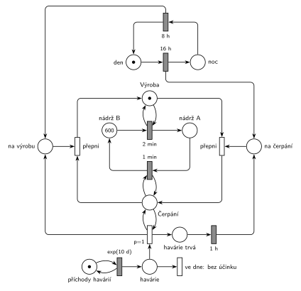

# Přečerpávací elektrárna II

## Zadání

> Systém vodní přečerpávací elektrárny je tvořen dvěma nádržemi A a B, obě s kapacitou 600 jednotek vody. Režim systému se dělí na: 1) denní etapu výroby (přesně 16 hodin), kdy se voda spouští z elektrárny B do A rychlostí 1 jednotka vody za 2 minuty do vyčerpání zásob a na 2) noční etapu spotřeby, kdy se voda z A čerpá do B rychlostí 1 jednotka za 1 minutu. V intervalech exponenciálně se středem 10 dní dochází v elektrizační soustavě k havárii vyžadující zvýšenou spotřebu elektřiny. Havárie trvá přesně 1 hodinu. Pokud k havárii dojde v noční etapě, pak se na dobu havárie práce elektrárny přepne do denního (výrobního) režimu. Po dokončení havárie pokračuje systém v práci dle aktuální denní doby. V počátečním stavu začíná denní etapa a stav v nádržích je A: 0, B: 600.

Podobné úlohy: [Přečerpávací elektrárna](<../11 - Přečerpávací elektrárna/11 - Přečerpávací elektrárna.md>) (Z3, stejný systém s jinou havárií), [Zahradnictví a bouřka](<../01 - Zahradnictví a bouřka/01 - Zahradnictví a bouřka.md>) (stav odděleně od časovačů), [Uhelný mlýn](<../12 - Uhelný mlýn/12 - Uhelný mlýn.md>).

## Nápověda

<details>
<summary>Zobrazit nápovědu</summary>
<br>

- **Voda** jsou značky v nádržích *B* (600) a *A* (0). Přesun jedné jednotky je časovaný přechod: `2 min` z B do A (výroba), `1 min` z A do B (čerpání). „Do vyčerpání zásob“ zajistí samo vstupní místo: prázdná nádrž přechod zastaví.
- **Kapacita 600** se nemusí hlídat: voda se jen přelévá, takže A + B = 600 a žádná nádrž víc než 600 mít nemůže.
- **Režim** je místo *Výroba* nebo *Čerpání* (vždy jedna značka). Přesuny vody ho testují hranou tam a zpět. Když režim zmizí, rozběhnutý přesun jednotky zanikne.
- **Denní doba** je samostatný cyklus *den* → `16 h` → *noc* → `8 h`, začíná se dnem. Režim se přepíná signálem (*na čerpání*, *na výrobu*) a přechodem *přepni*. Časovače `16 h` a `8 h` jsou v jiných místech než testovaný režim, takže je testování nepřerušuje (stejně jako bouřka v úloze [Zahradnictví a bouřka](<../01 - Zahradnictví a bouřka/01 - Zahradnictví a bouřka.md>)).
- **Havárie** přicházejí z *příchodů havárií* ve smyčce s `exp(10 d)` do místa *havárie*.
- **Havárie v noci** (`p=1`, otestuje, že je režim *Čerpání*): pošle signál *na výrobu* a spustí odpočet `1 h` (*havárie trvá*). Po hodině pošle signál *na čerpání*: systém pokračuje „dle aktuální denní doby“, tedy čerpá.
- **Den během havárie:** když v průběhu noční havárie skončí noc, signál *na výrobu* od `8 h` počká (přechod potřebuje *Čerpání*, a to teď není). Po konci havárie se režim přepne na čerpání a hned zase na výrobu, takže ráno platí den. Opačný případ (začátek noci během havárie) nastat nemůže: noční havárie skončí nejpozději hodinu po svém začátku.
- **Havárie ve dne** (p=0, režim *Čerpání* není) nemá účinek, elektrárna už vyrábí. Doslovně podle zadání se režim mění jen při havárii „v noční etapě“. Když denní havárie přesáhne do noci, noc začne normálně čerpáním.
- Transakce, která by opouštěla systém, tu není (voda koluje mezi nádržemi), proto síť nemá výstupní přechod. Zadání z let 2014–19 ho ani nevyžaduje.

</details>

## Petriho síť

<details>
<summary>Zobrazit Petriho síť</summary>
<br>



</details>

## Časté chyby

<details>
<summary>Zobrazit časté chyby</summary>
<br>

- Přesuny vody testují přímo místo s odpočtem `16 h` / `8 h`. Každý přesun značku vezme a vrátí a odpočet denní doby by se spouštěl znovu, takže by den nikdy neskončil.
- Havárie v noci vezme značku noci i s jejím časovačem. Po hodině se pak noc počítá znovu od začátku a denní doba se posune.
- Po havárii vždy návrat do čerpání, i když mezitím začal den. Zadání chce „dle aktuální denní doby“.
- Hlídání kapacity 600 doplňkovými místy. Neuškodí, ale je zbytečné, protože A + B = 600.
- „Do vyčerpání zásob“ řešené prioritou nebo inhibiční hranou. Je to zbytečné: prázdné vstupní místo přechod zastaví samo.

</details>

## SIMLIB

<details>
<summary>Zobrazit SIMLIB kód</summary>
<br>

Model je izomorfní k Petriho síti výše: každé místo, přechod a značka mají svůj protějšek v kódu. Systém je uzavřený a nemá transakce; procesy odpovídají přechodům, které se opakují (přesuny vody, přepínání, denní doba), a značky v nádržích a signálech jsou počty (`int`).

```cpp
// Přečerpávací elektrárna II – model v SIMLIB/C++
#define I_REALLY_KNOW_HOW_TO_USE_WAITUNTIL   // SIMLIB zpřístupní WaitUntil jen s tímto makrem
#include "simlib.h"

int A = 0, B = 600;                   // místa „nádrž A“, „nádrž B“ (jednotky vody)
bool vyroba = true;                   // místa „Výroba“ (true) / „Čerpání“ (false)
long zmen = 0;                        // počet přepnutí režimu (zruší rozběhnutý přesun)
int na_cerpani = 0, na_vyrobu = 0;    // místa „na čerpání“, „na výrobu“ (signály)
long spusteno = 0, nacerpano = 0, havarii = 0, nocnich = 0;
Histogram VodaA("Voda v nádrži A na konci noci [jednotky]", 0, 20, 10);

class Spousteni : public Process {    // přechod 2 min: nádrž B → nádrž A, test „Výroba“
  void Behavior() {
    for (;;) {
      WaitUntil(vyroba && B > 0);
      long z = zmen;
      Wait(2);
      if (z != zmen) continue;        // režim se mezitím změnil: odpočet zanikl
      B--; A++; spusteno++;
    }
  }
};

class Cerpani : public Process {      // přechod 1 min: nádrž A → nádrž B, test „Čerpání“
  void Behavior() {
    for (;;) {
      WaitUntil(!vyroba && A > 0);
      long z = zmen;
      Wait(1);
      if (z != zmen) continue;
      A--; B++; nacerpano++;
    }
  }
};

class PrepniC : public Process {      // „přepni“: na čerpání + Výroba → Čerpání
  void Behavior() {
    for (;;) {
      WaitUntil(na_cerpani > 0 && vyroba);
      na_cerpani--; vyroba = false; zmen++;
    }
  }
};

class PrepniV : public Process {      // „přepni“: na výrobu + Čerpání → Výroba
  void Behavior() {
    for (;;) {
      WaitUntil(na_vyrobu > 0 && !vyroba);
      na_vyrobu--; vyroba = true; zmen++;
    }
  }
};

class DenniDoba : public Process {    // cyklus den → 16 h → noc → 8 h
  void Behavior() {
    for (;;) {
      Wait(16 * 60);                  // den 16 h
      na_cerpani++;                   // signál „na čerpání“
      Wait(8 * 60);                   // noc 8 h
      VodaA(A);
      na_vyrobu++;                    // signál „na výrobu“
    }
  }
};

class Havarie : public Process {      // značka v místě „havárie“
  void Behavior() {
    havarii++;
    if (!vyroba) {                    // „v noci“ (p=1): test „Čerpání“
      nocnich++;
      na_vyrobu++;                    // signál „na výrobu“
      Wait(60);                       // „havárie trvá“ → 1 h
      na_cerpani++;                   // signál „na čerpání“
    }                                 // jinak „ve dne: bez účinku“ (p=0)
  }
};

class PrichodyHavarii : public Event {  // místo „příchody havárií“ ve smyčce s exp(10 d)
  void Behavior() {
    (new Havarie)->Activate();
    Activate(Time + Exponential(10 * 24 * 60));
  }
};

int main() {
  Init(0, 1000 * 24 * 60);            // modelový čas v minutách: 1000 dní, začíná den
  (new Spousteni)->Activate();
  (new Cerpani)->Activate();
  (new PrepniC)->Activate();
  (new PrepniV)->Activate();
  (new DenniDoba)->Activate();
  (new PrichodyHavarii)->Activate(Exponential(10 * 24 * 60));
  Run();
  VodaA.Output();
  Print("Spuštěno z B do A: %ld jednotek, načerpáno z A do B: %ld jednotek\n", spusteno, nacerpano);
  Print("Havárií: %ld, z toho v noci: %ld; na konci A = %d, B = %d (A + B = %d)\n",
        havarii, nocnich, A, B, A + B);
}
```

| Petriho síť | SIMLIB |
|---|---|
| *nádrž A*, *nádrž B* (600) | `int A = 0, B = 600` |
| *Výroba* / *Čerpání* | `bool vyroba` |
| `2 min`: *nádrž B* → *nádrž A* (test *Výroba*) | proces `Spousteni`: `WaitUntil(vyroba && B > 0); Wait(2); B--; A++;` |
| `1 min`: *nádrž A* → *nádrž B* (test *Čerpání*) | proces `Cerpani`: `WaitUntil(!vyroba && A > 0); Wait(1); A--; B++;` |
| odpočet přesunu zanikne při změně režimu | počítadlo `zmen`: když se během `Wait` změnilo, jednotka se nepřesune |
| signály *na čerpání* / *na výrobu* | `int na_cerpani, na_vyrobu` |
| *přepni* (signál + režim → druhý režim) | procesy `PrepniC`, `PrepniV` s `WaitUntil` |
| *den* → `16 h` → *noc* → `8 h` | proces `DenniDoba`: `Wait(16 * 60); na_cerpani++; Wait(8 * 60); na_vyrobu++;` |
| *příchody havárií* ⇄ `exp(10 d)` → *havárie* | událost `PrichodyHavarii`, proces `Havarie` |
| *v noci* `p=1` (test *Čerpání*) → *havárie trvá* → `1 h` | `if (!vyroba) { na_vyrobu++; Wait(60); na_cerpani++; }` |
| *ve dne: bez účinku* (`p=0`) | větev `else` (nic se neděje) |

**Kontrola simulací.** Petriho síť: A + B = 600, *Výroba* + *Čerpání* = 1, *den* + *noc* = 1, signály a *havárie trvá* mají nejvýš jednu značku a všechny přechody se provádějí; síť nemá výstupní přechod, je uzavřená (`make check`). Za asi 314 simulovaných dní přišlo 22–36 havárií, z toho 9–10 v noci (noc je třetina dne). Počet přepnutí na čerpání = počet nocí + počet nočních havárií. SIMLIB model: za 1000 dní přišlo 103 havárií, z toho 38 v noci (teoreticky 100 a třetina z nich); A + B zůstalo 600. Den i noc přesunou nejvýš 480 jednotek; poslední jednotka dne se nestihne (její odpočet končí současně se dnem a přepnutí ho zruší). Noční havárie (60 jednotek nenačerpaných a 30 vyrobených navíc) nechá v A vodu, kterou noc už nevyčerpá. Po několika nočních haváriích proto ve dne dojde voda v B a na konci noci zůstává v A asi 121 jednotek: v SIMLIB obvykle 120–140 (histogram `VodaA`, 91 % nocí), v síti po 200 dnech také 121 (`make simlib`).

</details>

## Původ a zdroje

<details>
<summary>Zobrazit původ a zdroje</summary>
<br>

**Původ:** půlsemestrálky 2014–19 (přehled zadání), úloha Z11.

**Původní znění:**

> Systém vodní přečerpávací elektrárny je tvořen dvěma nádržemi A a B, obě s kapacitou 600 jednotek vody. Režim systému se dělí na: 1) denní etapu výroby (16 hodin), kdy se voda spouští z elektrárny B do A rychlostí 1 jednotka vody za 2 minuty do vyčerpání zásob a na 2) noční etapu spotřeby, kdy se voda z A čerpá do B rychlostí 1 jednotka za 1 minutu. V intervalech daných exp(10 dní) dochází v elektrizační soustavě k havárii vyžadující zvýšenou spotřebu elektřiny. Havárie trvá 1 hodinu. Pokud k havárii dojde v noční etapě, pak se na dobu havárie práce elektrárny přepne do denního (výrobního) režimu. Po dokončení havárie pokračuje systém v práci dle aktuální denní doby. V počátečním stavu začíná denní etapa a stav v nádržích je A: 0, B: 600.
>
> Zadaný systém modelujte formou Petriho sítě s vyznačením všech potřebných parametrů.

**Zdroje:**

- `Fitcheats/Půlsemestrálky/Zadání z minulých let/Přehled zadání 2014-19.pdf`, str. 3 (zadání)
- `Fitcheats/Příprava na zkoušku/luppo - Tabule.png` (studentské řešení na tabuli; jiné řešení v materiálech není)

**Existující řešení:**

- **Tabule luppo:** stejná myšlenka. Cyklus *den* → `16h` → *noc* → `8h` posílá signály, které přepínají značky *Den token* / *Noc token*, a přesuny vody `2min` a `1min` je testují. *Porucha* `exp(10)` → přechod `P=2`, který vezme *Noc token*, → `1hod`, a zeleně přidaná cesta s `p=2` spouští vodu z B během havárie. Druhý přechod z místa havárie odvádí denní havárie. Které hrany přesně vracejí *Noc token* po hodině, z fotky nejde spolehlivě přečíst.
- Hrubého řešení v materiálech není.

</details>
