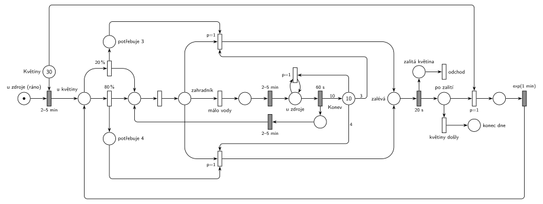

# 12-10 Zahradník na FIT

## Zadání

> Zahradník na FIT má každý den zalít 30 květin v květináčích. Květiny obchází s konvicí o kapacitě 10 jednotek vody. Květina s pravděpodobností 20% vyžaduje 3 jednotky vody, jinak 4 jednotky vody. Zahradník napustí konvici do plné kapacity za přesně 60 sekund. Cesta mezi zdrojem vody a libovolným květináčem nechť trvá rovnoměrně 2–5 minut. Cesta mezi květináči nechť trvá exponenciálně se středem 1 minuta. Pokud u květináče zahradník zjistí, že daná květina vyžaduje více vody než má aktuálně v konvici, pak se vrací vodu (cesta ke zdroji a zpět) v konvici doplnit. Zalití květiny trvá vždy přesně 20 sekund. Zahradník je na počátku u zdroje vody a má naplněnou konvici. Modelujte jeden den práce zahradníka.

Podobné úlohy: [Zahradnictví a bouřka](<../01 - Zahradnictví a bouřka/01 - Zahradnictví a bouřka.md>) (obchůzka zahradníka po záhoncích), [Bagrista a nákladní auta](<../../11 - Doprava a dávky/10 - Bagrista a nákladní auta/10 - Bagrista a nákladní auta.md>) (jednotky materiálu jako značky s váhou hran).

## Nápověda

<details>
<summary>Zobrazit nápovědu</summary>
<br>

- **Začátek dne:** zahradník je u zdroje s plnou konví (*u zdroje (ráno)*, *Konev* s 10 značkami). Cesta k první květině `2–5 min` bere jednu značku z *Květin* (30).
- **Voda** jsou značky v místě *Konev*. Zalití odebere 3 nebo 4 značky hranou s váhou.
- **Potřeba květiny** se určí u květiny (`20 %` nahoru / `80 %` rovně) a **zůstane u ní** jako značka v *potřebuje 3* nebo *potřebuje 4*. Zahradník mezitím může odejít pro vodu. Po návratu se znovu jen porovná s konví, nelosuje se znovu: stejná květina potřebuje pořád stejně vody.
- Zahradník po určení potřeby i po návratu od zdroje přijde do místa bez názvu a okamžitý přechod ho hned předá do místa *zahradník*, kde se rozhoduje. Je to jen kvůli kreslení (místo *zahradník* by jinak mělo šest hran).
- **„Vyžaduje více vody, než má v konvi“:** přechody zalití mají `p=1` a hranu s váhou 3 nebo 4 z *Konve*. Jsou proveditelné, jen když je vody dost. Jinak se provede *málo vody* (p=0) a zahradník jde ke zdroji.
- **Napuštění do plné kapacity:** v síti nejde přímo „doplnit do 10“, protože místo neví, kolik mu chybí. U zdroje se proto nejdřív smyčkou `p=1` vylije zbytek vody (okamžitý přechod, opakuje se, dokud je v konvi něco) a pak `60 s` napustí 10 jednotek. Výsledek je stejný jako dolití: konev má po návratu 10 jednotek. Vylití proběhne v okamžiku příchodu ke zdroji, takže odpočet `60 s` tím nic nepřeruší (běží až potom).
- **Cesty:** od zdroje ke květině i zpět `2–5 min`, mezi květinami `exp(1 min)`. Cesta pro vodu je „ke zdroji a zpět“ ke stejné květině.
- **Po zalití** (`20 s`) jde zahradník k další květině (`p=1`, bere značku z *Květin*).
- **Jeden den** = zalít 30 květin. Když květiny dojdou (*květiny došly*, p=0), značka zahradníka skončí v *konec dne* a síť se zastaví. Že se síť zastaví, je tu tedy správně, ne chyba.
- **Výstup ze systému:** zahradník systém neopouští. Transakcí je tu květina: zalitá květina odchází přechodem *odchod* (stejně jako okopaný záhonek v úloze [Zahradnictví a bouřka](<../01 - Zahradnictví a bouřka/01 - Zahradnictví a bouřka.md>)).
- Síť se nedá nakreslit bez křížení: obě zalití se sbíhají do *zalévá* a cesta pro vodu vede mezi nimi.

</details>

## Petriho síť

<details>
<summary>Zobrazit Petriho síť</summary>
<br>



</details>

## Časté chyby

<details>
<summary>Zobrazit časté chyby</summary>
<br>

- Po návratu od zdroje znovu losovat 20 %/80 %. Potřeba patří květině, musí se pamatovat (místa *potřebuje 3/4*).
- Napuštění hranou s váhou 10 do konve, ve které ještě něco zbylo: konev pak má víc než 10 jednotek. Je potřeba buď vylít zbytek, nebo doplňkové místo s prázdnými jednotkami.
- Test „je dost vody“ jen jednou hranou bez priority. Zalití i cesta pro vodu jsou pak proveditelné zároveň a vybírá se náhodně.
- Zapomenuté `20 s` zalití nebo stejná cesta `2–5 min` i mezi květinami (mezi květinami je `exp(1 min)`).
- Konec dne bez priority: *květiny došly* by mohl předběhnout cestu k další květině.

</details>

## SIMLIB

<details>
<summary>Zobrazit SIMLIB kód</summary>
<br>

Model je izomorfní k Petriho síti výše: každé místo, přechod a značka mají svůj protějšek v kódu.

```cpp
// Zahradník na FIT – model v SIMLIB/C++
#include "simlib.h"

int konev;                             // místo Konev (jednotky vody)
int kvetiny;                           // místo Květiny
int cest;                              // počet cest pro vodu za den
Stat DelkaDne("Délka dne [min]");
Stat Cesty("Cesty pro vodu za den");
Stat Zalito("Zalité květiny za den");

class Zahradnik : public Process {     // značka zahradníka
  void Behavior() {
    int zalito = 0;
    kvetiny--;                         // u zdroje (ráno): bere první květinu
    Wait(Uniform(2, 5));               // cesta ke květině 2–5 min
    for (;;) {                         // u květiny
      int potreba = Random() < 0.2 ? 3 : 4;  // 20 % potřebuje 3, 80 % potřebuje 4
      while (konev < potreba) {        // málo vody (p=0)
        cest++;
        Wait(Uniform(2, 5));           // cesta ke zdroji 2–5 min
        konev = 0;                     // vylití zbytku (smyčka p=1)
        Wait(1);                       // napuštění 60 s ...
        konev = 10;                    // ... 10 jednotek
        Wait(Uniform(2, 5));           // cesta zpět ke květině 2–5 min
      }
      konev -= potreba;                // zalití (p=1), hrana s váhou 3 nebo 4
      Wait(20.0 / 60);                 // zalévá 20 s
      zalito++;                        // zalitá květina -> odchod
      if (kvetiny == 0) break;         // květiny došly (p=0) -> konec dne
      kvetiny--;                       // k další květině (p=1)
      Wait(Exponential(1));            // přejezd exp(1 min)
    }
    DelkaDne(Time);
    Cesty(cest);
    Zalito(zalito);
  }
};

int main() {
  for (int den = 0; den < 1000; den++) {  // 1000 nezávislých dnů
    Init(0, 24 * 60);                  // modelový čas v minutách
    konev = 10; kvetiny = 30; cest = 0;
    (new Zahradnik)->Activate();
    Run();
  }
  DelkaDne.Output();
  Cesty.Output();
  Zalito.Output();
}
```

| Petriho síť | SIMLIB |
|---|---|
| *u zdroje (ráno)* → `2–5 min` (bere květinu) → *u květiny* | `kvetiny--; Wait(Uniform(2, 5));` |
| `20 %` / `80 %` → *potřebuje 3* / *potřebuje 4* | `int potreba = Random() < 0.2 ? 3 : 4;` (pamatuje si ji proměnná) |
| *málo vody* (p=0) → `2–5 min` → *u zdroje* | `while (konev < potreba)` … `Wait(Uniform(2, 5));` |
| vylití zbytku (`p=1`, smyčka) | `konev = 0;` |
| `60 s` → 10 × *Konev* → `2–5 min` → *zahradník* | `Wait(1); konev = 10; Wait(Uniform(2, 5));` |
| zalití `p=1` (váha 3 / 4) → *zalévá* → `20 s` | `konev -= potreba; Wait(20.0 / 60);` |
| *zalitá květina* → *odchod* | `zalito++` |
| *k další květině* (`p=1`) → `exp(1 min)` | `kvetiny--; Wait(Exponential(1));` |
| *květiny došly* (p=0) → *konec dne* | `if (kvetiny == 0) break;` (konec `Behavior()`) |

**Kontrola simulací.** Petriho síť: zahradník je vždy právě v jednom stavu a konev nikdy nemá víc než 10 jednotek. Den skončil po 146–165 minutách, zalito bylo vždy všech 30 květin a zahradník šel pro vodu 13–14krát (květiny spotřebují asi 114 jednotek, konev jich unese 10) (`make check`). SIMLIB model: v 1000 simulovaných dnech trval den v průměru 151,4 min (127–179 min), zahradník šel pro vodu v průměru 13,6krát (12–14) a pokaždé zalil všech 30 květin. Odhad: 3,5 min první cesta + 29 × 1 min přejezdy + 30 × 20 s zalévání + 13,6 × (3,5 + 1 + 3,5) min cesty pro vodu ≈ 151 min (`make simlib`).

</details>

## Původ a zdroje

<details>
<summary>Zobrazit původ a zdroje</summary>
<br>

**Původ:** půlsemestrálky 2014–19 (přehled zadání), úloha Z8.

**Původní znění:**

> Zahradník na FIT má každý den zalít 30 květin v květináčích. Květiny obchází s konvicí o kapacitě 10 jednotek vody. Květina s pravděpodobností 20% vyžaduje 3 jednotky vody, jinak 4 jednotky vody. Zahradník napustí konvici do plné kapacity za 60 sekund. Cesta mezi zdrojem vody a libovolným květináčem nechť je 2-5 minut. Cesta mezi květináči nechť je dána exp. rozložením se středem 1 minuta. Pokud u květináče zahradník zjistí, že daná květina vyžaduje více vody než má aktuálně v konvici, pak se vrací vodu (cesta ke zdroji a zpět) v konvici doplnit. Zalití květiny trvá vždy 20 sekund. Zahradník je na počátku u zdroje vody a má naplněnou konvici. Modelujte jeden den práce zahradníka.
>
> Zadaný systém modelujte formou Petriho sítě s vyznačením všech potřebných parametrů.

**Zdroje:**

- `Fitcheats/Půlsemestrálky/Zadání z minulých let/Přehled zadání 2014-19.pdf`, str. 2 (zadání)
- `Fitcheats/Půlsemestrálky/FIT - Příprava 2021-22.pdf`, str. 12 (studentské řešení, 0 pro / 2 proti, s diskusí)
- `Fitcheats/Příprava na zkoušku/luppo - Tabule.png` (studentské řešení na tabuli)

**Existující řešení:**

- **Příprava 2021/22 (str. 12, 0 pro / 2 proti):** obrácené značení (šrafovaně okamžité, prázdně časované přechody). *zahradník* → `2-5m` → místo, kde se losuje `20%`/`80%`. Zalití bere 3/4 z *Konev* (10) a přesouvá je do místa *zalito*. Cesta pro vodu `2-5m` vede z míst po losování. Je to časovaný přechod, takže zalití (okamžitý přechod) má přednost i bez priority. U zdroje (*dopouštění*) se značky ze *zalito* vrátí do *Konev* a pak `60s`. To je správné doplnění „do plné kapacity“ pomocí doplňkového místa. Chyby: po napuštění jde zahradník přes `2-5m` znovu na losování `20%`/`80%`, takže se potřeba květiny losuje znovu. Úplně chybí zalití `20 s`.
- **Studentská tabule:** podobná síť (*Start* bere z *květiny* (30), *T get spotted* → `20%`/`80%`, váhy 3 a 4 z konve (10)). U *Musím naplnit* je `P1`, který podle všeho vylévá zbytek z konve, `P0` jde `2-5min` → `Naleju 60s` → `2-5` a vrací 10 jednotek. I tady se ale po návratu jde zpět na losování potřeby.

</details>

## Reference

- [Jak síť funguje](<../../../basics/Jak síť funguje.md>)
- [Notace a vzory](<../../../basics/Notace a vzory.md>)

<!-- -->

- [Studijní plán](<../../Studijní plán.md>)
- [Seznam úloh](<../../Seznam úloh.md>)
