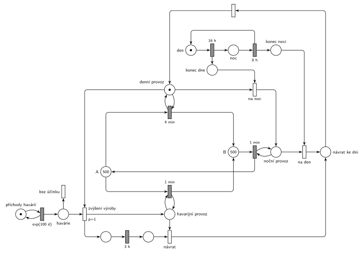

# 12-11 Přečerpávací elektrárna

## Zadání

> Přečerpávací vodní elektrárna je složena ze dvou nádrží A a B. Každá nádrž má kapacitu 1000 jednotek vody. V počátečním stavu jsou obě naplněny 500 jednotkami vody. Elektrizační soustava pracuje v běžném denním provozu přesně 16 hodin a v nočním provozu přesně 8 hodin. V běžném denním provozu se spouští voda z nádrže A do nádrže B rychlostí jednotka vody za přesně 4 minuty. V běžném nočním provozu se čerpá z B zpátky do A rychlostí jednotka vody za přesně 1 minutu až do vyprázdnění nádrže B. V intervalech exponenciálně se středem 100 dní dochází k havárii v soustavě. Pokud tato havárie nastane v běžném denním provozu, pak elektrárna zvýší produkci tím, že spouští vodu z A do B rychlostí jednotka vody za přesně 1 minutu do vyčerpání zásob, nejvýše však 3 hodiny. Potom se vrací do režimu dle denní doby.

Podobné úlohy: [Přečerpávací elektrárna II](<../09 - Přečerpávací elektrárna II/09 - Přečerpávací elektrárna II.md>) (Z11), [Uhelný mlýn](<../12 - Uhelný mlýn/12 - Uhelný mlýn.md>), [Zahradnictví a bouřka](<../01 - Zahradnictví a bouřka/01 - Zahradnictví a bouřka.md>) (stavová místa „je / není bouřka“).

## Nápověda

<details>
<summary>Zobrazit nápovědu</summary>
<br>

- **Voda** jsou značky v místech *A* a *B* (na začátku 500 a 500). Přesun jednotky je časovaný přechod mezi nimi. Voda jen obíhá, žádná transakce systém neopouští, takže síť nemá výstupní přechod.
- **Kapacita 1000** nikdy nehraje roli: *A* + *B* = 1000 pořád, takže žádná nádrž víc než 1000 mít nemůže. „Až do vyprázdnění B“ a „do vyčerpání zásob“ zajišťuje sama sémantika: přechod bez značky ve vstupním místě se neprovede.
- **Režim** je jedna značka v *denní provoz*, *noční provoz*, nebo *havarijní provoz*. Každý přesun má smyčku (testovací hranu) na „svůj“ režim: `4 min` A → B ve dne (nahoře), `1 min` B → A v noci (uprostřed), `1 min` A → B při havárii (dole).
- **Hodiny** (*den* → `16 h` → *noc* → `8 h` → *den*) běží nezávisle na režimu. Konec dne a konec noci jen vloží signál (*konec dne*, *konec noci*) a okamžité přechody *na noc* / *na den* přepnou režim. Hodiny nesmějí být přímo místy režimu: přechody `16 h` a `8 h` by se pak rušily při každém přesunu vody, který místo režimu testuje (slajd 139).
- **Havárie** je samostatný generátor `exp(100 d)` (*příchody havárií*). Ve dne (je značka *denní provoz*) přechod *zvýšení výroby* (`p=1`) vymění režim za *havarijní provoz* a spustí `3 h`. V noci nebo během jiné havárie se provede *bez účinku* (p=0) a havárie zanikne.
- **Konec havárie:** `3 h` běží na vlastním místě (ne na *havarijním provozu*, který každou minutu testuje přesun). *Návrat* vrátí denní provoz. Pokud mezitím skončil den, čeká signál *konec dne* a režim se hned přepne na noční. To je „vrací se do režimu dle denní doby“; hodiny se havárií neposouvají.
- Do denního provozu se vrací dvěma cestami (ráno z noci a po havárii). Obě vedou přes místo *návrat ke dni* a okamžitý přechod, který značku hned předá do *denní provoz*; je to jen kvůli kreslení (místo *denní provoz* by jinak mělo pět hran).
- **„Nejvýše však 3 hodiny“:** za 3 h odteče nejvýš 180 jednotek a v *A* je na začátku havárie vždy víc (nejméně asi 260 na konci prvního dne), takže zásoby nedojdou a havarijní provoz trvá vždy celé 3 h.
- Síť se nedá nakreslit bez křížení: tři přesuny mezi *A* a *B* tvoří uzavřené oblasti a přepínání režimů se týká všech tří. Stačí ale jedno křížení: hrana nočního přesunu zpět do *A* kříží hranu havarijního přesunu do *B*.

</details>

## Petriho síť

<details>
<summary>Zobrazit Petriho síť</summary>
<br>



</details>

## Časté chyby

<details>
<summary>Zobrazit časté chyby</summary>
<br>

- Přesuny vody s testovací hranou přímo na místa hodin (*den*, *noc*), ze kterých čte i `16 h` / `8 h`. Každý přesun pak odpočet hodin zruší (slajd 139).
- Havárie, která ve dne jen přidá rychlejší přesun a neodebere denní režim. Pak běží `4 min` i `1 min` současně.
- Návrat z havárie natvrdo do denního režimu, i když mezitím začala noc.
- Havárie v noci bez přechodu, který ji odstraní: značka čeká a zvýší výrobu ráno.
- Hodiny, které se během havárie zastaví (`16 h` se spustí až po návratu): den se tím prodlouží.

</details>

## SIMLIB

<details>
<summary>Zobrazit SIMLIB kód</summary>
<br>

Model je izomorfní k Petriho síti výše: každé místo, přechod a značka mají svůj protějšek v kódu.

```cpp
// Přečerpávací elektrárna – model v SIMLIB/C++
#include "simlib.h"

const double HOD = 60, DEN = 24 * HOD; // modelový čas v minutách
int A = 500, B = 500;                  // místa A a B (jednotky vody)
enum { DENNI, NOCNI, HAVARIJNI } rezim = DENNI;  // značka v jednom z míst režimu
bool konecDne = false;                 // místo konec dne (signál)
long havarieDen = 0, havarieBezUcinku = 0, prevedenoAB = 0, prevedenoBA = 0;

class Prevod;
Prevod *prevod = nullptr;              // přesun, který testuje aktuální režim

class Prevod : public Process {        // časovaný přechod ve smyčce s místem režimu
  double dt; int &z, &c; long &n;
 public:
  Prevod(double t, int &zdroj, int &cil, long &pocet) : dt(t), z(zdroj), c(cil), n(pocet) {}
  ~Prevod() { if (prevod == this) prevod = nullptr; }
  void Behavior() {
    while (z > 0) {                    // proveditelný, dokud je ve zdroji voda
      Wait(dt);
      z--; c++; n++;                   // jednotka vody ze zdroje do cíle
    }
  }
};

void Rezim(int r) {                    // přechod, který vezme značku režimu a dá jinou
  if (prevod) prevod->Cancel();        // test starého režimu zmizí -> odpočet zanikne
  rezim = decltype(rezim)(r);
  if (r == DENNI)     prevod = new Prevod(4, A, B, prevedenoAB);
  if (r == NOCNI)     prevod = new Prevod(1, B, A, prevedenoBA);
  if (r == HAVARIJNI) prevod = new Prevod(1, A, B, prevedenoAB);
  prevod->Activate();
}

void NaNoc() {                         // na noc: konec dne + denní provoz -> noční provoz
  if (konecDne && rezim == DENNI) { konecDne = false; Rezim(NOCNI); }
}

class Hodiny : public Process {        // den -> 16 h -> noc -> 8 h -> den
  void Behavior() {
    for (;;) {
      Wait(16 * HOD);
      konecDne = true; NaNoc();        // signál konec dne (při havárii počká)
      Wait(8 * HOD);
      if (rezim == NOCNI) Rezim(DENNI);  // konec noci, na den (přes návrat ke dni)
    }
  }
};

class ZvysenaVyroba : public Process { // havarijní provoz, místo pro odpočet 3 h
  void Behavior() {
    Wait(3 * HOD);                     // 3 h
    Rezim(DENNI);                      // návrat (přes návrat ke dni)
    NaNoc();                           // mezitím skončil den -> hned na noc
  }
};

class Havarie : public Event {         // místo „příchody havárií“ ve smyčce s exp(100 d)
  void Behavior() {
    if (rezim == DENNI) {              // zvýšení výroby (p=1)
      havarieDen++;
      Rezim(HAVARIJNI);
      (new ZvysenaVyroba)->Activate();
    } else {
      havarieBezUcinku++;              // bez účinku (p=0)
    }
    Activate(Time + Exponential(100 * DEN));
  }
};

int main() {
  Init(0, 10 * 365 * DEN);             // 10 let
  Rezim(DENNI);                        // počáteční značka v denní provoz
  (new Hodiny)->Activate();
  (new Havarie)->Activate(Exponential(100 * DEN));
  Run();
  Print("Havárie ve dne: %ld, bez účinku: %ld\n", havarieDen, havarieBezUcinku);
  Print("Převedeno A -> B: %.1f, B -> A: %.1f jednotek za den; A = %d, B = %d\n",
        prevedenoAB / 3650.0, prevedenoBA / 3650.0, A, B);
}
```

| Petriho síť | SIMLIB |
|---|---|
| *A* (500), *B* (500) | `int A, B` |
| *denní* / *noční* / *havarijní provoz* | `rezim` |
| přesun ve smyčce s místem režimu (`4 min`, `1 min`, `1 min`) | proces `Prevod`; při změně režimu `prevod->Cancel()` |
| *den* → `16 h` → *noc* → `8 h` → *den* | proces `Hodiny` |
| *konec dne* → *na noc* | `konecDne = true; NaNoc();` |
| *konec noci* → *na den* → *návrat ke dni* | `Rezim(DENNI)` v procesu `Hodiny` |
| *příchody havárií* ⇄ `exp(100 d)` → *havárie* | událost `Havarie` |
| *zvýšení výroby* (`p=1`) / *bez účinku* (p=0) | `if (rezim == DENNI)` … `else` |
| místo pro odpočet `3 h` → *návrat* | proces `ZvysenaVyroba`: `Wait(3 * HOD); Rezim(DENNI); NaNoc();` |

**Kontrola simulací.** Petriho síť (asi 600 dní): *A* + *B* = 1000, *den* + *noc* = 1, právě jeden režim, žádná nádrž nepřekročí 1000. Za den proteče asi 240 jednotek A → B a stejně zpět. Havárie ve dne převede 179–180 jednotek, havárie v noci zanikne bez účinku. Ověřen i scénář havárie v 15 h: havarijní provoz běží do 18 h a pak se režim rovnou přepne na noční (`make check`). SIMLIB model: za 10 let proteklo v průměru 240,0 jednotky za den A → B a 240,2 zpět; teoreticky 16 h / 4 min = 240 za den plus havárie (27 havárií ve dne po 180 jednotkách je asi 1,3 jednotky za den navíc, a stejně tolik se v noci přečerpá zpět). Havárií bylo 37 (teoreticky 3650 / 100 ≈ 36,5), z toho 27 ve dne a 10 bez účinku (teoreticky dvě třetiny ve dne). Na konci běhu (konec noci) je B prázdná: noční čerpání (až 480 jednotek) stihne vrátit vše, co přes den odteklo (`make simlib`).

</details>

## Původ a zdroje

<details>
<summary>Zobrazit původ a zdroje</summary>
<br>

**Původ:** půlsemestrálky 2014–19 (přehled zadání), úloha Z3. Přesný rok a varianta nejsou známé.

**Původní znění:**

> Přečerpávací vodní elektrárna je složena ze dvou nádrží A a B. Každá nádrž má kapacitu 1000 jednotek vody. V počátečním stavu jsou obě naplněny 500 jednotkami vody. Elektrizační soustava pracuje v běžném denním provozu 16 hodin a v nočním provozu 8 hodin. V běžném denním provozu se spouští voda z nádrže A do nádrže B rychlostí jednotka vody za 4 minuty. V běžném nočním provozu se čerpá z B zpátky do A rychlostí jednotka vody za 1 minutu až do vyprázdnění nádrže B. V intervalech daných exponenciálním rozložením se středem 100 dní dochází k havárii v soustavě. Pokud tato havárie nastane v běžném denním provozu, pak elektrárna zvýší produkci tím, že spouští vodu z A do B rychlostí jednotka vody za 1 minutu do vyčerpání zásob, nejvýše však 3 hodiny. Potom se vrací do režimu dle denní doby.
>
> *Zadaný systém modelujte formou Petriho sítě s vyznačením všech potřebných parametrů.*

**Zdroje:**

- `Fitcheats/Půlsemestrálky/Zadání z minulých let/Přehled zadání 2014-19.pdf`, str. 1 (zadání)
- `Fitcheats/Půlsemestrálky/FIT - Příprava 2021-22.pdf`, str. 7 (studentské řešení)
- `Fitcheats/Příprava na zkoušku/luppo - Tabule.png` (studentské řešení na tabuli)

**Existující řešení:**

- **Studentské řešení (Příprava 2021/22, str. 7, bez hlasů, komentář „opraveno“, ale nepřehledné):** stejná myšlenka hodin: *den* → `16h` → *noc* → `8h` se signálními místy a stavová místa *denní provoz* / *noční provoz* přepínaná okamžitými přechody. Dále *A* (500), *B* (500), přesuny `4m` a `1m`, generátor `exp(100d)` → *je havárie* a časovač `3h`, místo *A při havárii* s přesunem `1m` a `p=1`. Generátor se obnovuje až po 3 h, i když havárie nastala v noci. Jak přesně se havarijní provoz ukončí a vrátí denní provoz, se z kresby spolehlivě přečíst nedá.
- **Studentská tabule:** *A* (500), *B* (500), přesuny `4min` a `1min`, hodiny `16h` / `8h` s místy *Den* a *Noc*, `Exp(100)` → *Můžu přečerpat* a `3hod`. Leží v červeně ohraničené části tabule.
- Hrubého řešení ani řešení ze cvičení v materiálech není.

</details>

## Reference

- [Jak síť funguje](<../../../basics/Jak síť funguje.md>)
- [Notace a vzory](<../../../basics/Notace a vzory.md>)

<!-- -->

- [Studijní plán](<../../Studijní plán.md>)
- [Seznam úloh](<../../Seznam úloh.md>)
