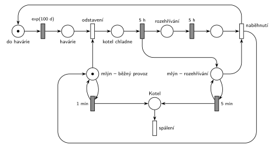

# 12-12 Uhelný mlýn

## Zadání

> Do kotle uhelné elektrárny přikládá uhlí uhelný mlýn zabezpečující přísun a zpracování paliva pro kotel. V režimu běžného provozu vhazuje mlýn do kotle dávku paliva v intervalu přesně 1 minuta. V intervalech exponenciálně se středem 100 dní dochází v elektrizační soustavě k havárii, která si vynutí okamžité odstavení elektrárny. Během odstávky mlýn nedodává kotli palivo a kotel přesně 5 hodin chládne. Po vychladnutí kotle lze elektrárnu opět zapojit. Opětovný start elektrárny zabere dalších přesně 5 hodin pomalého rozehřívání, kdy mlýn vhazuje dávku paliva v intervalech přesně 5 minut. Po dokončení rozehřívací fáze může mlýn začít zásobovat kotel dle intervalu běžného režimu. Interval mezi haváriemi se počítá od posledního naběhnutí elektrárny do běžného režimu nebo od počátku modelového času.

Podobné úlohy: [Spalovna](<../07 - Spalovna/07 - Spalovna.md>) (porucha, oprava 5 h a pak 5 h zrychlený provoz), [Automat na kávu](<../../09 - Obsluha zákazníků/07 - Automat na kávu/07 - Automat na kávu.md>) (další porucha se počítá od konce opravy), [Přečerpávací elektrárna](<../11 - Přečerpávací elektrárna/11 - Přečerpávací elektrárna.md>).

## Nápověda

<details>
<summary>Zobrazit nápovědu</summary>
<br>

- **Transakce** jsou dávky paliva: mlýn je vhazuje do *Kotle* a tam shoří (výstupní přechod *spálení*). Dobu hoření zadání neuvádí, takže je nulová.
- **Mlýn** je jedna značka, která je vždy v jednom ze tří stavů: *mlýn – běžný provoz* (smyčka `1 min` vhazuje dávku), *kotel chladne* (mlýn nedodává nic) a *mlýn – rozehřívání* (smyčka `5 min`). Dvě místa pro mlýn tedy nejsou dva mlýny, ale dva stavy téhož mlýna (to byla otázka v komentáři k jednomu ze studentských řešení). Na začátku je mlýn v běžném provozu.
- **Interval mezi haváriemi** měří samostatné místo *do havárie*. Značku do něj vrací až *naběhnutí* do běžného režimu, takže odpočet `exp(100 d)` začíná znovu od naběhnutí (a na začátku od času 0). Během odstávky a rozehřívání havárie nastat nemůže.
- **Okamžité odstavení:** okamžitý přechod *odstavení* vezme *havárii* a značku mlýna z běžného provozu a dá značku do *kotel chladne*. Odpočet `1 min` tím zanikne (slajd 139) a mlýn rozpracovanou dávku nedodá.
- **Chladnutí a rozehřívání** jsou pevné doby `5 h`. „Lze elektrárnu opět zapojit“ chápeme tak, že se zapojí hned po vychladnutí: konec chladnutí dá značku do *rozehřívání* a zároveň do *mlýn – rozehřívání*.
- **Proč je rozehřívání ve dvou místech:** smyčka `5 min` každých 5 minut odebere a vrátí značku *mlýn – rozehřívání*. Kdyby z téhož místa četl i přechod `5 h`, jeho odpočet by se podle slajdu 139 pokaždé zrušil a začal znovu. Proto běží `5 h` na vlastním místě *rozehřívání* a *naběhnutí* pak vezme obě značky.
- **Naběhnutí** vrátí značku do *mlýn – běžný provoz* a do *do havárie*.

</details>

## Petriho síť

<details>
<summary>Zobrazit Petriho síť</summary>
<br>



</details>

## Časté chyby

<details>
<summary>Zobrazit časté chyby</summary>
<br>

- Generátor havárií jako obyčejná smyčka, která běží i během odstávky. Pak se interval nepočítá od naběhnutí a havárie může přijít uprostřed rozehřívání.
- Odstavení, které nevezme značku mlýna: mlýn pak vhazuje palivo i do chladnoucího kotle.
- Přechod `5 h` rozehřívání čte stejné místo jako smyčka `5 min`. Podle slajdu 139 se jeho odpočet každých 5 minut ruší a rozehřívání nikdy neskončí.
- Chybějící počáteční značky (mlýn v běžném provozu, odpočet do havárie).
- Návrat do běžného provozu bez vrácení značky *do havárie*: další havárie už nikdy nenastane.

</details>

## SIMLIB

<details>
<summary>Zobrazit SIMLIB kód</summary>
<br>

Model je izomorfní k Petriho síti výše: každé místo, přechod a značka mají svůj protějšek v kódu.

```cpp
// Uhelný mlýn – model v SIMLIB/C++
#include "simlib.h"

const double DEN = 24 * 60;            // modelový čas v minutách
long davkyBezne = 0, davkyRozehrivani = 0, havarie = 0;

class Mlyn : public Process {          // značka mlýna ve smyčce s časovaným přechodem
  double interval;                     // 1 min (běžný provoz) nebo 5 min (rozehřívání)
  long *davky;
 public:
  Mlyn(double i, long *d) : interval(i), davky(d) {}
  void Behavior() {
    for (;;) {
      Wait(interval);                  // smyčka 1 min / 5 min
      (*davky)++;                      // dávka do Kotle, hned shoří (přechod spálení)
    }
  }
};

class Elektrarna : public Process {    // značka cyklu stavu elektrárny
  void Behavior() {
    Mlyn *mlyn = new Mlyn(1, &davkyBezne);   // počáteční značka v mlýn – běžný provoz
    mlyn->Activate();
    for (;;) {
      Wait(Exponential(100 * DEN));    // do havárie -> exp(100 d), počítá se od naběhnutí
      havarie++;
      mlyn->Cancel();                  // odstavení: vezme značku mlýna, rozpracovaná dávka zanikne
      Wait(5 * 60);                    // kotel chladne 5 h
      mlyn = new Mlyn(5, &davkyRozehrivani); // mlýn – rozehřívání
      mlyn->Activate();
      Wait(5 * 60);                    // rozehřívání 5 h (vlastní místo, smyčka 5 min ho neruší)
      mlyn->Cancel();                  // naběhnutí: vezme mlýn – rozehřívání ...
      mlyn = new Mlyn(1, &davkyBezne); // ... a vrátí mlýn – běžný provoz (a do havárie)
      mlyn->Activate();
    }
  }
};

int main() {
  Init(0, 10 * 365 * DEN);             // modelový čas v minutách: 10 let
  (new Elektrarna)->Activate();
  Run();
  Print("Havárií: %ld\n", havarie);
  Print("Dávek v běžném provozu: %ld, při rozehřívání: %ld (%.1f na jedno rozehřívání)\n",
        davkyBezne, davkyRozehrivani, havarie ? double(davkyRozehrivani) / havarie : 0.0);
}
```

| Petriho síť | SIMLIB |
|---|---|
| *do havárie* → `exp(100 d)` → *havárie* | `Wait(Exponential(100 * DEN))` v procesu `Elektrarna` |
| *odstavení* (vezme značku *mlýn – běžný provoz*) | `mlyn->Cancel()`: proces mlýna i jeho odpočet zaniknou |
| *kotel chladne* → `5 h` | `Wait(5 * 60)` |
| *mlýn – rozehřívání* ⇄ `5 min` | nový proces `Mlyn(5, …)` |
| *rozehřívání* → `5 h` | druhé `Wait(5 * 60)` v procesu `Elektrarna` (jiný proces než smyčka mlýna) |
| *naběhnutí* (vrací *mlýn – běžný provoz* a *do havárie*) | `mlyn->Cancel()`, nový `Mlyn(1, …)`, další obrat cyklu `for` |
| *mlýn – běžný provoz* ⇄ `1 min` | proces `Mlyn(1, …)` |
| *Kotel* → *spálení* | `(*davky)++` (dávka shoří hned) |

**Kontrola simulací.** Petriho síť: mlýn je vždy právě v jednom stavu (*mlýn – běžný provoz* + *kotel chladne* + *mlýn – rozehřívání* = 1) a cyklus elektrárny má jednu značku. Za asi 210 simulovaných dní nastaly ve dvou ze tří běhů 4 havárie, v jednom žádná. Při každém rozehřívání mlýn vhodí 59–60 dávek (5 h / 5 min) (`make check`). SIMLIB model: za 10 let nastalo 36 havárií; teoreticky asi 36 (3650 dní / (100 dní + 10 h)). Mlýn vhodil 5 234 382 dávek v běžném provozu, skoro přesně jednu za každou minutu běžného provozu (5 256 000 min − 36 × 600 min = 5 234 400 min; rozdíl jsou dávky rozpracované v okamžiku havárie), a při každém rozehřívání 59 dávek: šedesátá by padla přesně do okamžiku naběhnutí a v SIMLIB, stejně jako v síti, záleží jen na pořadí současných událostí (`make simlib`).

</details>

## Původ a zdroje

<details>
<summary>Zobrazit původ a zdroje</summary>
<br>

**Původ:** půlsemestrálky 2014–19 (přehled zadání), úloha Z2. Přesný rok a varianta nejsou známé.

**Původní znění:**

> Do kotle uhelné elektrárny přikládá uhlí uhelný mlýn zabezpečující přísun a zpracování paliva pro kotel. V režimu běžného provozu vhazuje mlýn do kotle dávku paliva v intervalu 1 minuta. V intervalech daných exponenciálním rozložením se středem 100 dní dochází v elektrizační soustavě k havárii, která si vynutí okamžité odstavení elektrárny. Během odstávky mlýn nedodává kotli palivo a kotel 5 hodin chládne. Po vychladnutí kotle lze elektrárnu opět zapojit. Opětovný start elektrárny zabere dalších 5 hodin pomalého rozehřívání, kdy mlýn vhazuje dávku paliva v intervalech 5 minut. Po dokončení rozehřívací fáze může mlýn začít zásobovat kotel dle intervalu běžného režimu. Interval mezi haváriemi se počítá od posledního naběhnutí elektrárny do běžného režimu nebo od počátku modelového času.
>
> *Zadaný systém modelujte formou Petriho sítě s vyznačením všech potřebných parametrů.*

**Zdroje:**

- `Fitcheats/Půlsemestrálky/Zadání z minulých let/Přehled zadání 2014-19.pdf`, str. 1 (zadání)
- `Fitcheats/Půlsemestrálky/FIT - Příprava 2021-22.pdf`, str. 5–6 (dvě studentská řešení s hlasováním)

**Existující řešení:**

- **Studentské řešení (Příprava 2021/22, str. 5, souhlasí 3, nesouhlasí 1):** místa *BĚŽNÝ PROVOZ* a *MLÍN*, přechody `exp(100d)`, `5h`, `5h`, smyčky `1min` a `5min`, několik přechodů `prio 1`. Komentář: počáteční značky mají být v *mlýn* a *běžný provoz*. Bez nich se síť vůbec nerozběhne.
- **Studentské řešení (str. 6, souhlasí 2, nesouhlasí 0, netuší 1):** skoro stejné jako síť výše. *mlýn norm.* ⇄ `1m`, generátor `exp(100d)`, `P=1` přechod sebere značku normálního mlýna, *chladne* `5h`, *start el.*, *rozehřívá se* `5h`, *mlýn po výpadku* ⇄ `5m` a závěrečný `P=1`, který vrátí normální mlýn a znovu spustí generátor havárií. Komentář se ptá, zda je v pořádku mít mlýn ve dvou místech (je, jde o dva stavy jedné značky), a navrhuje po havárii jít rovnou do *chladne*.
- Hrubého řešení ani řešení ze cvičení v materiálech není.

</details>

## Reference

- [Jak síť funguje](<../../../basics/Jak síť funguje.md>)
- [Notace a vzory](<../../../basics/Notace a vzory.md>)

<!-- -->

- [Studijní plán](<../../Studijní plán.md>)
- [Seznam úloh](<../../Seznam úloh.md>)
