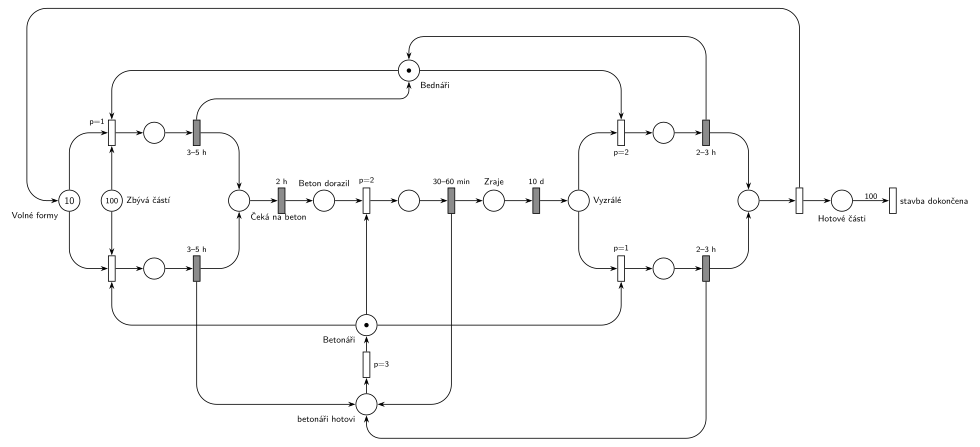

# Stavba z betonu

## Zadání

> Pro dokončení stavby budovy z betonu je třeba provést 100 elementárních betonových stavebních částí. Na stavbě pracuje jedna parta bednářů a jedna parta betonářů. Pro zbudování jedné stavební části je třeba 1) připravit licí formu pro lití betonu (dělají bednáři, trvá rovnoměrně 3–5 hodin), 2) do formy nalít beton (dělají betonáři, trvá rovnoměrně 30–60 minut), 3) beton nechat uzrát přesně 10 dní a 4) licí formu odstranit (dělají bednáři, trvá rovnoměrně 2–3 hodiny). Na stavbě je k dispozici 10 licích forem. V situaci, kdy lze někde licí formu zbudovat a jinde licí formu po vyzrání betonu odstranit, bednáři přednostně vykonávají odstraňování forem.
>
> Po dokončení přípravy licí formy se odešle požadavek na dodávku betonu. Dodávka dorazí přesně 2 hodiny po zavolání. Pokud nemají betonáři dodávku betonu pro lití do zbudované formy, pak se na jeden úkon (příprava nebo odstranění formy) přidávají k bednářům.

Podobné úlohy: [Dílna se třemi stroji](<../15 - Dílna se třemi stroji/15 - Dílna se třemi stroji.md>), [Chmelová brigáda](<../17 - Chmelová brigáda/17 - Chmelová brigáda.md>), [Banka se třemi pracovníky](<../../09 - Obsluha zákazníků/19 - Banka se třemi pracovníky/19 - Banka se třemi pracovníky.md>).

## Nápověda

<details>
<summary>Zobrazit nápovědu</summary>
<br>

- **Transakcí je licí forma.** Značka z *Volných forem* projde přípravou, čekáním na beton, litím, zráním a odstraněním a vrátí se zpět. *Zbývá částí* (100 značek) hlídá, kolik částí se ještě má začít; příprava bere jednu značku z obou míst.
- **Bednáři a betonáři** jsou dvě zařízení s 1 značkou. Uvolnění je sloučené s časovaným přechodem. Bednáři pracují v horní řadě, betonáři při lití a v dolní řadě.
- **Příprava formy** `3–5 h`: bednáři s `p=1` (horní řada), betonáři s `p=0` (dolní řada).
- **Objednávka betonu:** po přípravě forma přejde do *Čeká na beton*, časovaný přechod `2 h` je dodávka. Každá forma má vlastní odpočet (slajd 138), takže dodávky pro různé formy běží souběžně. Pak lití `30–60 min` betonáři (`p=2`) a **zrání `10 d`**, které funguje stejně jako dodávka.
- **Přednost odstraňování:** odstranění `2–3 h` bednáři má `p=2`, příprava bednáři `p=1`. Když je volná forma i vyzrálá forma, bednáři si vyberou odstranění.
- **„Betonáři se přidávají k bednářům“** čteme tak, že betonáři bez betonu udělají jeden úkon bednářů (přípravu nebo odstranění formy) jako druhá parta se stejnými dobami. Proto jsou příprava a odstranění nakreslené dvakrát: nahoře s bednáři, dole s betonáři. Priority: lití `p=2` > odstranění betonáři `p=1` > příprava betonáři `p=0`. Betonáři tedy vezmou cizí úkon, jen když nemají co lít, a i oni dávají přednost odstraňování. O stejný úkon mají přednost bednáři (`p=2` > `p=1`, `p=1` > `p=0`).
- „Na jeden úkon“ znamená, že po něm se betonáři vrátí do svého místa a znovu se rozhoduje, jestli už dorazil beton. Jiné čtení „přidávají se k bednářům“ (společná práce je rychlejší) by potřebovalo dobu, kterou zadání neuvádí.
- Betonáři se po každém úkonu vracejí přes místo *betonáři hotovi* a okamžitý přechod `p=3`, který značku hned vrátí do *Betonáři*. Je to jen kvůli kreslení (místo *Betonáři* by jinak mělo šest hran); chování je stejné jako s přímým návratem.
- **Konec:** obě odstranění se sejdou v jednom místě a okamžitý přechod vrátí formu do *Volných forem* a přidá značku do *Hotové části*. Přechod s hranou váhy 100 je okamžik, kdy je stavba hotová. Pak se síť zastaví, je to konečný proces.

</details>

## Petriho síť

<details>
<summary>Zobrazit Petriho síť</summary>
<br>



</details>

## Časté chyby

<details>
<summary>Zobrazit časté chyby</summary>
<br>

- Formy jako nekonečný zdroj: chybí místo s 10 značkami a návrat formy po odstranění.
- Přednost odstraňování bez priorit (nebo s prioritou na špatném přechodu): bednáři by mohli stavět nové formy, zatímco vyzrálé čekají.
- Dodávka betonu jako jeden společný časovač: dodávky pro různé formy se pak „řadí“ za sebou.
- Betonáři, kteří pomáhají bednářům, i když beton dorazil (chybí `p=2` na lití).
- Chybějící konec stavby po 100 částech; počítadlo *Zbývá částí* samo nic neukončí.

</details>

## SIMLIB

<details>
<summary>Zobrazit SIMLIB kód</summary>
<br>

Model je izomorfní k Petriho síti výše: každé místo, přechod a značka mají svůj protějšek v kódu.

```cpp
// Stavba z betonu – model v SIMLIB/C++
#define I_REALLY_KNOW_HOW_TO_USE_WAITUNTIL  // SIMLIB zpřístupní WaitUntil jen s tímto makrem
#include "simlib.h"

int volneFormy = 10;                   // místo Volné formy
int zbyva = 100;                       // místo Zbývá částí
int beton = 0;                         // místo Beton dorazil
int vyzrale = 0;                       // místo Vyzrálé
int hotove = 0;                        // místo Hotové části
long pripravB = 0, pripravC = 0, odstrB = 0, odstrC = 0;

bool lzePripravit() { return volneFormy > 0 && zbyva > 0; }

class Dodavka : public Process {       // Čeká na beton -> 2 h (vlastní odpočet pro každou formu)
  void Behavior() { Wait(2 * 60); beton++; }
};

class Zrani : public Process {         // Zraje -> 10 d
  void Behavior() { Wait(10 * 24 * 60); vyzrale++; }
};

void Odstranena() {                    // odstraněno -> uvolnění formy
  volneFormy++;                        // forma zpět do Volných forem
  if (++hotove == 100)                 // Hotové části, hrana s váhou 100
    Stop();                            // stavba dokončena
}

class Bednari : public Process {       // značka Bednáři
 public:
  Bednari() : Process(1) {}            // o stejný úkon mají bednáři přednost
  void Behavior() {
    for (;;) {
      WaitUntil(vyzrale > 0 || lzePripravit());
      if (vyzrale > 0) {               // odstranění p=2
        vyzrale--; odstrB++;
        Wait(Uniform(2 * 60, 3 * 60));
        Odstranena();
      } else {                         // příprava p=1 (bere formu a část)
        volneFormy--; zbyva--; pripravB++;
        Wait(Uniform(3 * 60, 5 * 60));
        (new Dodavka)->Activate();     // Čeká na beton
      }
    }
  }
};

class Betonari : public Process {      // značka Betonáři
  void Behavior() {
    for (;;) {
      Wait(0);                         // návrat (p=3): nejdřív se rozhodnou bednáři
      WaitUntil(beton > 0 || vyzrale > 0 || lzePripravit());
      if (beton > 0) {                 // lití p=2
        beton--;
        Wait(Uniform(30, 60));
        (new Zrani)->Activate();       // Zraje
      } else if (vyzrale > 0) {        // odstranění betonáři p=1
        vyzrale--; odstrC++;
        Wait(Uniform(2 * 60, 3 * 60));
        Odstranena();
      } else {                         // příprava betonáři p=0
        volneFormy--; zbyva--; pripravC++;
        Wait(Uniform(3 * 60, 5 * 60));
        (new Dodavka)->Activate();
      }
    }
  }
};

int main() {
  Init(0, 1e7);                        // modelový čas v minutách; běh skončí dokončením stavby
  (new Bednari)->Activate();
  (new Betonari)->Activate();
  Run();
  Print("Stavba trvala %.1f dne\n", Time / (24 * 60));
  Print("Přípravy: bednáři %ld, betonáři %ld; odstranění: bednáři %ld, betonáři %ld\n",
        pripravB, pripravC, odstrB, odstrC);
}
```

| Petriho síť | SIMLIB |
|---|---|
| *Volné formy* (10), *Zbývá částí* (100), *Beton dorazil*, *Vyzrálé*, *Hotové části* | proměnné `int` |
| *Bednáři*, *Betonáři* (1 značka) | procesy `Bednari`, `Betonari`; čekání na práci `WaitUntil(…)` |
| priority okamžitých přechodů jedné party | pořadí větví `if … else if … else` |
| přednost bednářů o tentýž úkon | priorita procesu `Bednari` (1) a `Wait(0)` před rozhodnutím betonářů |
| příprava `3–5 h` → *Čeká na beton* → `2 h` | `Wait(Uniform(180, 300))`, proces `Dodavka` (`Wait(120)`) |
| lití `30–60 min` → *Zraje* → `10 d` | `Wait(Uniform(30, 60))`, proces `Zrani` |
| odstranění `2–3 h` → uvolnění formy, *Hotové části* | `Wait(Uniform(120, 180)); Odstranena();` |
| *betonáři hotovi* → `p=3` → *Betonáři* | další obrat cyklu `for` |
| váha 100 → *stavba dokončena* | `if (++hotove == 100) Stop();` |

**Kontrola simulací.** Petriho síť: forem je vždy 10 (volné + všechny rozpracované), bednáři i betonáři se vždy vrátí. Stavba trvá asi 106 dní. Betonáři udělají 37–45 % příprav i odstranění, protože na beton většinu času jen čekají (`make check`). SIMLIB model: stavba trvala 106,6 dne, betonáři udělali 45 ze 100 příprav a 43 ze 100 odstranění. Odhad: každá z 10 forem projde 10 cykly a jeden cyklus trvá asi 10 dní zrání + 4 h příprava + 2 h dodávka + 45 min lití + 2,5 h odstranění ≈ 10,4 dne, tedy zhruba 104 dní plus čekání na party (`make simlib`).

</details>

## Původ a zdroje

<details>
<summary>Zobrazit původ a zdroje</summary>
<br>

**Původ:** půlsemestrální písemka 2013/14, varianta D, 6 bodů (k příkladu patřila ještě otázka z teorie za 4 body).

**Původní znění:**

> Pro dokončení stavby budovy z betonu je třeba provést 100 elementárních betonových stavebních částí. Na stavbě pracuje jedna parta bednářů a jedna parta betonářů. Pro zbudování jedné stavební části je třeba 1) připravit licí formu pro lití betonu (dělají bednáři, trvá 3-5 hodin), 2) do formy nalít beton (dělají betonáři, trvá 30-60 minut), 3) beton nechat uzrát 10 dní a 4) licí formu odstranit (dělají bednáři, trvá 2-3 hodiny). Na stavbě je k dispozici 10 licích forem. V situaci, kdy lze někde licí formu zbudovat a jinde licí formu po vyzrání betonu odstranit, bednáři přednostně vykonávají odstraňování forem.
>
> Po dokončení přípravy licí formy se odešle požadavek na dodávku betonu. Dodávka dorazí za dvě hodiny po zavolání. Pokud nemají betonáři dodávku betonu pro lití do zbudované formy, pak se na jeden úkon (příprava nebo odstranění formy) přidávají k bednářům.
>
> *Zadaný systém modelujte formou Petriho sítě s vyznačením všech potřebných parametrů.*

**Zdroje:**

- `Fitcheats/Půlsemestrálky/Zadání z minulých let/2013-14.pdf`, str. 2 (zadání) a str. 3 (hlavička varianty D s bodováním)
- `Fitcheats/Skripta/FIT - Studentská skripta 2015-16.pdf`, str. 51 (zadání zapsané po paměti, bez řešení)

**Existující řešení:**

- **Studentská skripta (str. 51):** jen zadání zapsané po paměti, řešení chybí. Je v něm „Pokud betonáři nemají dodávku betonu, přidávají se na jeden úkol k bednářům“, tedy stejný smysl jako v originálu.
- Jiné řešení v materiálech není.

</details>

## Reference

- [Jak síť funguje](<../../../basics/Jak síť funguje.md>)
- [Notace a vzory](<../../../basics/Notace a vzory.md>)

<!-- -->

- [Studijní plán](<../../Studijní plán.md>)
- [Seznam úloh](<../../Seznam úloh.md>)
