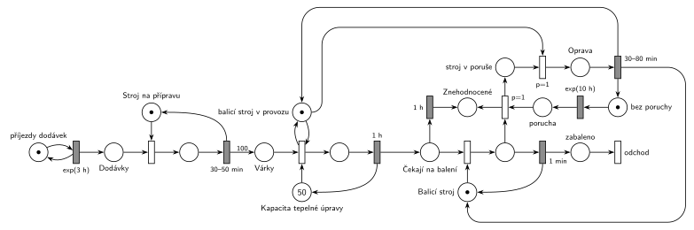

# Výroba hrášku (12/14)

## Zadání

> Automatizovaná výrobní linka na výrobu konzervovaného hrášku má charakter pásové výroby a je složena ze třech výrobních operací: příprava, tepelná úprava a balení. K lince přijíždí v intervalech exponenciálně se středem 3 hodiny dodávka sklizeného hrášku. Stroj na přípravu hrášku dodávku zpracovává rovnoměrně 30–50 minut a výsledkem operace je 100 přepravních várek polotovaru. Přepravní várky dále postupují linkou samostatně. Následuje zpracování polotovaru na stroji pro tepelnou úpravu polotovaru, který má kapacitu 50 přepravních várek. Tepelné zpracování přepravní várky trvá přesně 1 hodinu. Posledním v řetězci je stroj na balení s kapacitou 1 přepravní várka. Balení jedné várky trvá přesně 1 minutu.
>
> V intervalech exponenciálně se středem 10 hodin dochází na balícím stroji k poruše, která se projeví během jeho balící činnosti. Odstranění poruchy trvá rovnoměrně 30–80 minut. Během poruchy nevstupují nové přepravní várky do operace tepelné úpravy. Aktuální várka v balícím stroji je znehodnocena. Přepravní várky čekající na balení mají trvanlivost přesně 1 hodinu. Po uplynutí doby trvanlivosti jsou znehodnoceny. Během poruchy balícího stroje pokračuje rozpracovaná operace tepelné úpravy. V modelu evidujte jedním místem počet znehodnocených přepravních várek.

Podobné úlohy: [Porucha zruší obsluhu](<../../03 - Poruchy/01 - Porucha zruší obsluhu/01 - Porucha zruší obsluhu.md>), [Porucha s opravou, transakce odchází](<../../03 - Poruchy/04 - Porucha s opravou, transakce odchází/04 - Porucha s opravou, transakce odchází.md>), [Kopírovací centrum s poruchami](<../../09 - Obsluha zákazníků/11 - Kopírovací centrum s poruchami/11 - Kopírovací centrum s poruchami.md>), [Netrpělivé požadavky](<../../02 - Netrpělivost a omezená fronta/01 - Netrpělivé požadavky/01 - Netrpělivé požadavky.md>), [Logistická centrála](<../18 - Logistická centrála/18 - Logistická centrála.md>).

## Nápověda

<details>
<summary>Zobrazit nápovědu</summary>
<br>

- **Příjezdy dodávek** modeluje místo s jednou značkou ve smyčce s `exp(3 h)`. Dodávky čekají v místě *Dodávky* na *Stroj na přípravu* (zařízení s 1 značkou).
- **Dodávka → 100 várek:** dodávka je transakce jen do konce přípravy. Časovaný přechod `30–50 min` vrací značku stroje a má výstupní hranu s váhou 100 do *Várky*, dál putují várky samostatně.
- **Tepelná úprava s kapacitou 50** je sklad s 50 značkami (*Kapacita tepelné úpravy*). Časovaný přechod `1 h` neomezuje počet současně čekajících (slajd 138), takže v úpravě může být až 50 várek naráz, každá s vlastním odpočtem, a na konci vrací značku kapacity.
- **Balicí stroj** je zařízení s 1 značkou, balení `1 min` vrací stroj a zabalená várka odchází přechodem *odchod*.
- **Trvanlivost 1 h** je časovaný přechod přímo na místě *Čekají na balení* (jako netrpělivost): každá čekající várka má vlastní odpočet, a když ji mezitím obsadí balicí stroj, odpočet zanikne. Prošlá várka jde do *Znehodnocené*.
- **„Porucha, která se projeví během balící činnosti“:** porucha vznikne po `exp(10 h)` (z místa *bez poruchy*) a čeká v místě *porucha*, dokud stroj nebalí. Okamžitý přechod `p=1` pak vezme právě balenou várku (odpočet `1 min` zanikne, slajd 139) a pošle ji mezi *Znehodnocené*, stroj přejde do *stroj v poruše*. Proces poruch je cyklus: další porucha se plánuje až po opravě, takže se poruchy nehromadí.
  - Jiné čtení: porucha, která přijde, když stroj nebalí, nemá účinek (zánik s `p=0` jako v úloze [Porucha vrací transakci do fronty](<../../03 - Poruchy/02 - Porucha vrací transakci do fronty/02 - Porucha vrací transakci do fronty.md>)). Balicí stroj je ale většinu času v činnosti, takže se obě čtení liší málo.
- **„Během poruchy nevstupují várky do tepelné úpravy“:** místo *balicí stroj v provozu* (1 značka) je testováno dvojicí hran na obsazení tepelné úpravy. Ve stejném okamžiku jako projev poruchy ji vezme okamžitý přechod `p=1` (odstavení, má přednost před obsazením úpravy s `p=0`) a stroj jde do *Opravy*. Konec opravy `30–80 min` vrátí značku *v provozu*, *Balicí stroj* i *bez poruchy*. Rozpracovaná tepelná úprava běží dál, protože časovaný přechod `1 h` na místě *v provozu* nezávisí.
- Projev poruchy a odstavení jsou dva okamžité přechody jen kvůli kreslení (jeden přechod by měl pět hran). Proběhnou v tomtéž okamžiku, takže se síť chová stejně jako s jedním přechodem.
- **Čítač znehodnocených** je jedno místo bez výstupu (počet značek = počet znehodnocených várek); vedou do něj trvanlivost i projev poruchy. Ze systému odcházejí jen zabalené várky.

</details>

## Petriho síť

<details>
<summary>Zobrazit Petriho síť</summary>
<br>



</details>

## Časté chyby

<details>
<summary>Zobrazit časté chyby</summary>
<br>

- Kapacita tepelné úpravy jako kapacita místa místo skladu s 50 značkami (Hrubý se kapacitám míst vyhýbá).
- Trvanlivost jako jeden časovač pro celou frontu místo časovaného přechodu přímo na místě *Čekají na balení*.
- Porucha, která odebere várku, ale nezablokuje vstup do tepelné úpravy, nebo naopak přeruší i rozpracovanou tepelnou úpravu.
- Oprava bez vrácení značky *Balicímu stroji* nebo místu *v provozu*: linka se zastaví navždy.
- Znehodnocené várky poslané rovnou na výstupní přechod: pak se nedají spočítat, a zadání chce jejich počet evidovat.

</details>

## SIMLIB

<details>
<summary>Zobrazit SIMLIB kód</summary>
<br>

Model je izomorfní k Petriho síti výše: každé místo, přechod a značka mají svůj protějšek v kódu.

```cpp
// Výroba hrášku – model v SIMLIB/C++
#define I_REALLY_KNOW_HOW_TO_USE_WAITUNTIL  // SIMLIB zpřístupní WaitUntil jen s tímto makrem
#include "simlib.h"

Facility StrojP("Stroj na přípravu");  // místo Stroj na přípravu (1 značka)
Facility Varky("Várky");               // místo Várky: fronta před úpravou (pořadí FIFO)
Store Uprava("Tepelná úprava", 50);    // místo Kapacita tepelné úpravy (50 značek)
Facility Balic("Balicí stroj");        // místo Balicí stroj (1 značka)
bool vProvozu = true;                  // místo balicí stroj v provozu
long znehodnocene = 0, zabaleno = 0;   // místo Znehodnocené, přechod odchod

class Trvanlivost : public Event {     // časovaný přechod 1 h na místě Čekají na balení
  Process *varka;
 public:
  Trvanlivost(Process *v) : varka(v) { Activate(Time + 60); }
  void Behavior() {
    delete varka;                      // várka opustí frontu balicího stroje ...
    znehodnocene++;                    // ... a přibude ve Znehodnocené
  }
};

class Varka : public Process {         // značka várky
  void Behavior() {
    Seize(Varky);                      // várka na řadě v místě Várky
    WaitUntil(vProvozu && Uprava.Free() > 0);  // obsazení úpravy testuje v provozu
    Enter(Uprava, 1);
    Release(Varky);
    Wait(60);                          // tepelná úprava 1 h ...
    Leave(Uprava, 1);                  // ... vrací značku kapacity
    Event *t = new Trvanlivost(this);  // Čekají na balení: odpočet trvanlivosti
    Seize(Balic);                      // obsazení balicího stroje
    delete t;                          // odpočet trvanlivosti zanikne
    Wait(1);                           // balení 1 min (porucha může várku zrušit)
    Release(Balic);
    zabaleno++;                        // zabaleno -> odchod
  }
};

class Dodavka : public Process {       // značka dodávky
  void Behavior() {
    Seize(StrojP);                     // Dodávky + obsazení stroje na přípravu
    Wait(Uniform(30, 50));             // příprava 30–50 min ...
    Release(StrojP);                   // ... vrací stroj
    for (int i = 0; i < 100; i++)      // hrana s váhou 100 do Várky
      (new Varka)->Activate();
  }
};

class Poruchy : public Process {       // značka cyklu poruch
  void Behavior() {
    for (;;) {
      Wait(Exponential(10 * 60));      // bez poruchy -> exp(10 h) -> porucha
      WaitUntil(Balic.Busy());         // porucha čeká, až stroj balí
      Process *v = (Process *)Balic.In();
      Seize(Balic, 1);                 // projev (p=1): vyšší priorita obsluhy převezme stroj
      delete v;                        // balená várka zanikne (odpočet 1 min také) ...
      znehodnocene++;                  // ... a přibude ve Znehodnocené
      vProvozu = false;                // odstavení: várky nevstupují do úpravy
      Wait(Uniform(30, 80));           // Oprava 30–80 min
      vProvozu = true;                 // vrací v provozu, ...
      Release(Balic);                  // ... Balicí stroj a bez poruchy (další obrat cyklu)
    }
  }
};

class Generator : public Event {       // místo „příjezdy dodávek“ ve smyčce s exp(3 h)
  void Behavior() {
    (new Dodavka)->Activate();
    Activate(Time + Exponential(3 * 60));
  }
};

int main() {
  Init(0, 60 * 24 * 365);              // modelový čas v minutách: jeden rok
  (new Generator)->Activate();
  (new Poruchy)->Activate();
  Run();
  StrojP.Output();
  Uprava.Output();
  Balic.Output();
  Print("Zabaleno: %ld várek, znehodnoceno: %ld várek (%.1f %%)\n", zabaleno, znehodnocene,
        100.0 * znehodnocene / (zabaleno + znehodnocene));
}
```

| Petriho síť | SIMLIB |
|---|---|
| *příjezdy dodávek* ⇄ `exp(3 h)` | událost `Generator`, `Exponential(3 * 60)` |
| *Dodávky* + *Stroj na přípravu*, `30–50 min` | `Seize(StrojP); Wait(Uniform(30, 50)); Release(StrojP);` |
| hrana s váhou 100 do *Várky* | 100 nových procesů `Varka` |
| *Várky* + obsazení úpravy (test *balicí stroj v provozu*) | `Seize(Varky); WaitUntil(vProvozu && Uprava.Free() > 0); Enter(Uprava, 1); Release(Varky);` |
| *Kapacita tepelné úpravy* (50), `1 h` | `Store Uprava(50)`, `Wait(60); Leave(Uprava, 1);` |
| *Čekají na balení* → `1 h` → *Znehodnocené* | událost `Trvanlivost`, zrušená po `Seize(Balic)` |
| *Balicí stroj*, `1 min` → *zabaleno* → *odchod* | `Seize(Balic); Wait(1); Release(Balic);`, konec `Behavior()` |
| *bez poruchy* → `exp(10 h)` → *porucha* | proces `Poruchy`, `Wait(Exponential(10 * 60))` |
| projev `p=1` (bere balenou várku) | `WaitUntil(Balic.Busy()); Seize(Balic, 1); delete v;` |
| odstavení `p=1` (bere *v provozu*) → *Oprava* | `vProvozu = false; Wait(Uniform(30, 80));` |
| konec opravy (vrací *v provozu*, stroj, *bez poruchy*) | `vProvozu = true; Release(Balic);` |
| *Znehodnocené* | `long znehodnocene` |

Fronta *Várky* je zařízení jen proto, aby na podmínku `WaitUntil` čekala vždy jen první várka (stovky čekajících procesů by simulaci výrazně zpomalily) a várky vstupovaly v pořadí příchodu. Projev poruchy používá přerušení obsluhy: `Seize` s vyšší prioritou obsluhy odsune balenou várku do fronty přerušených a `delete` ji odtud odstraní.

**Kontrola simulací.** Petriho síť: platí *Kapacita* + v úpravě = 50, *Balicí stroj* + balená várka + *stroj v poruše* + *Oprava* = 1, *v provozu* + *Oprava* = 1 a *bez poruchy* + *porucha* + *stroj v poruše* + *Oprava* = 1; *stroj v poruše* zůstává po okamžitých přechodech vždy prázdné a čekajících na balení je nejvýš 50. Znehodnotí se asi 9 % várek, většinou při opravách. Fronta várek před úpravou je stabilní (zátěž asi 0,7), ale dodávka přidá 100 várek naráz, takže občas přesáhne 500 (`make check`). SIMLIB model: za jeden rok se zabalilo 260 084 várek a znehodnotilo 26 483 (9,2 %). V tepelné úpravě bylo v průměru 32,7 várky; teoreticky 33,3 (100 várek za 180 min × 60 min). Stroj na přípravu byl vytížen na 22 % (teoreticky 40 min / 180 min = 22 %) a ve frontě na balení čekalo nejvýš 50 várek, déle než hodinu žádná (`make simlib`).

</details>

## Původ a zdroje

<details>
<summary>Zobrazit původ a zdroje</summary>
<br>

**Původ:** půlsemestrální písemka 2013/14, varianta B, 6 bodů (k příkladu patřila ještě otázka z teorie za 4 body).

**Původní znění:**

> Automatizovaná výrobní linka na výrobu konzervovaného hrášku má charakter pásové výroby a je složena ze třech výrobních operací: příprava, tepelná úprava a balení. K lince přijíždí v intervalech daných exponenciálním rozložením se středem 3 hodiny dodávka sklizeného hrášku. Stroj na přípravu hrášku dodávku zpracovává 30-50 minut a výsledkem operace je 100 přepravních várek polotovaru. Přepravní várky dále postupují linkou samostatně. Následuje zpracování polotovaru na stroji pro tepelnou úpravu polotovaru, který má kapacitu 50 přepravních várek. Tepelné zpracování přepravní várky trvá 1 hodinu. Posledním v řetězci je stroj na balení s kapacitou 1 přepravní várka. Balení jedné várky trvá 1 minutu.
>
> V intervalech daných exponenciálním rozložením se středem 10 hodin dochází na balícím stroji k poruše, která se projeví během jeho balící činnosti. Odstranění poruchy trvá 30-80 minut. Během poruchy nevstupují nové přepravní várky do operace tepelné úpravy. Aktuální várka v balícím stroji je znehodnocena. Přepravní várky čekající na balení mají trvanlivost 1 hodinu. Po uplynutí doby trvanlivosti jsou znehodnoceny. Během poruchy balícího stroje pokračuje rozpracovaná operace tepelné úpravy. V modelu evidujte jedním místem počet znehodnocených přepravních várek.
>
> *Zadaný systém modelujte formou Petriho sítě s vyznačením všech potřebných parametrů.*

**Zdroje:**

- `Fitcheats/Půlsemestrálky/Zadání z minulých let/2013-14.pdf`, str. 1 (zadání) a str. 3 (hlavička písemky s bodováním)
- `Fitcheats/Skripta/FIT - Studentská skripta 2015-16.pdf`, str. 50 (zadání zapsané po paměti, bez řešení)

**Existující řešení:**

- **Studentská skripta (str. 50):** jen zadání zapsané po paměti („Je to z hlavy, tak mě kdyžtak opravte“), řešení chybí. Obsahově odpovídá originálu, závazný je ale text z `2013-14.pdf`.
- Jiné řešení v materiálech není.

</details>

## Reference

- [Jak síť funguje](<../../../basics/Jak síť funguje.md>)
- [Notace a vzory](<../../../basics/Notace a vzory.md>)

<!-- -->

- [Studijní plán](<../../Studijní plán.md>)
- [Seznam úloh](<../../Seznam úloh.md>)
