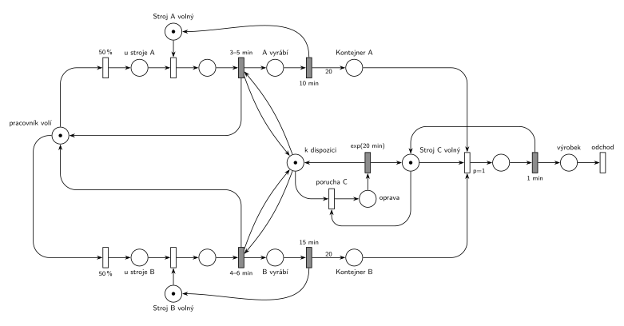

# Dílna se třemi stroji

## Zadání

> V dílně jsou tři stroje - A, B a C. Stroje A a B obsluhuje jeden pracovník, stroj C pracuje samostatně. Ke strojům A a B přistupuje pracovník s rovnoměrnou pravděpodobností. Obsluha stroje spočívá v přípravě výrobní operace, která zabere rovnoměrně 3–5 minut u stroje A a rovnoměrně 4–6 minut u stroje B. Po přípravě operace stroje už operaci dokončí samy v době přesně 10 minut u stroje A a přesně 15 minut u stroje B. Výsledkem výrobní operace na A a B je 20 kusů mezivýrobku, které jsou umístěny ve výstupním kontejneru stroje s neomezenou kapacitou. Stroj C v každém cyklu bere současně mezivýrobek z A a B z výstupních kontejnerů operací. Pokud nemá tyto mezivýrobky, dojde u něj k poruše, která vyžaduje okamžitou opravu pracovníkem. Obsluha opravy trvá exponenciálně se středem 20 minut. Pracovník obnoví po návratu z opravy poruchy svou předchozí činnost od jejího počátku. Výrobní cyklus stroje C trvá vždy přesně 1 minutu.

Podobné úlohy: [Porucha vrací transakci do fronty](<../../03 - Poruchy/02 - Porucha vrací transakci do fronty/02 - Porucha vrací transakci do fronty.md>) (přerušená činnost začíná znovu), [Stavba z betonu](<../13 - Stavba z betonu/13 - Stavba z betonu.md>), [Uhelný mlýn](<../12 - Uhelný mlýn/12 - Uhelný mlýn.md>).

## Nápověda

<details>
<summary>Zobrazit nápovědu</summary>
<br>

- **Pracovník** je jedna značka v místě *pracovník volí*. Okamžité přechody `50 %` / `50 %` ho pošlou ke stroji A (horní řada) nebo B (dolní řada).
- **Obsazení stroje:** okamžitý přechod vezme značku *u stroje X* a *Stroj X volný*. Je-li stroj právě v činnosti (10 nebo 15 min), pracovník u něj počká.
- **Příprava** je časovaný přechod `3–5 min` (A) / `4–6 min` (B), který testuje místo *k dispozici*. Po přípravě se pracovník vrací k volbě a stroj pracuje sám (`10 min` / `15 min`); pak se uvolní a do kontejneru přidá 20 kusů (hrana s váhou 20).
- **Stroj C** je zařízení s 1 značkou. Cyklus `1 min` začne přechodem `p=1`, který bere současně kus z kontejneru A i B. Když některý kontejner je prázdný, provede se místo něj *porucha C* (p=0). Po cyklu odchází výrobek ze systému (*výrobek* → *odchod*).
- **Okamžitá oprava a „předchozí činnost od počátku“:** místo *k dispozici* (1 značka) testují dvojicí hran obě přípravy. Porucha si tuto značku vezme (spolu se *Strojem C volný*), takže probíhající příprava ztratí jeden vstup a její odpočet zanikne (slajd 139). Značka pracovníka přitom zůstává u stroje (v místě mezi obsazením a přípravou) a pamatuje si, kde pracovník byl. Po opravě `exp(20 min)` se vrátí *k dispozici* i *Stroj C volný* a příprava začne znovu od začátku. Stejně se „přeruší“ i čekání u obsazeného stroje: příprava po uvolnění stroje nezačne, dokud pracovník opravuje.
- **Pozor, s danými čísly se systém zasekne:** na začátku jsou kontejnery prázdné, takže C má okamžitě poruchu. Po opravě jsou pořád prázdné a porucha přijde znovu hned, takže pracovník jen opravuje a nic se nevyrobí. I s počáteční zásobou je to jen odklad: C spotřebuje 60 kusů z každého kontejneru za hodinu, pracovník je stroji A a B nestihne doplňovat, poruchy se množí a nakonec se síť zacyklí v opravách stejně. To je vlastnost zadání, ne modelu; u písemky stačí síť správně nakreslit.
- Síť se nedá nakreslit úplně bez křížení: u stroje C bere obsazení oba kontejnery (shora a zespodu) a vrácení *Stroje C* musí přes jednu z těchto hran. Jinde se hrany nekříží.

</details>

## Petriho síť

<details>
<summary>Zobrazit Petriho síť</summary>
<br>



</details>

## Časté chyby

<details>
<summary>Zobrazit časté chyby</summary>
<br>

- Výstup stroje A/B s váhou 1 místo 20 kusů.
- Stroj C, který bere kus z A a z B dvěma oddělenými přechody; zadání chce oba „současně“, tedy jeden přechod se dvěma vstupy.
- Porucha C bez priority vůči normálnímu cyklu, takže může nastat, i když mezivýrobky jsou.
- Oprava, která pracovníka „vezme“, ale nezruší jeho rozpracovanou přípravu (ta by pak během opravy doběhla).
- Pracovník, který se po opravě vrací k náhodné volbě stroje; zadání chce předchozí činnost od začátku.

</details>

## SIMLIB

<details>
<summary>Zobrazit SIMLIB kód</summary>
<br>

Model je izomorfní k Petriho síti výše: každé místo, přechod a značka mají svůj protějšek v kódu.

```cpp
// Dílna se třemi stroji – model v SIMLIB/C++
#define I_REALLY_KNOW_HOW_TO_USE_WAITUNTIL  // SIMLIB zpřístupní WaitUntil jen s tímto makrem
#include "simlib.h"

const int ZASOBA = 0;                  // počáteční obsah kontejnerů (zadání: prázdné)
Store StrojA("Stroj A", 1);            // místa Stroj A volný / Stroj B volný (1 značka);
Store StrojB("Stroj B", 1);            // Store, protože stroj uvolní jiný proces než pracovník
int kontA = ZASOBA, kontB = ZASOBA;    // místa Kontejner A, Kontejner B
bool kDispozici = true;                // místo k dispozici
long poruch = 0, vyrobku = 0, priprav = 0;

class Vyroba : public Process {        // stroj dokončí operaci sám
  Store &stroj; double doba; int &kontejner;
 public:
  Vyroba(Store &s, double d, int &k) : stroj(s), doba(d), kontejner(k) {}
  void Behavior() {
    Wait(doba);                        // A vyrábí 10 min / B vyrábí 15 min
    kontejner += 20;                   // hrana s váhou 20
    Leave(stroj, 1);                   // stroj je zase volný
  }
};

class Pracovnik : public Process {     // značka pracovníka
 public:
  bool pripravuje = false;             // běží odpočet přípravy
  void Behavior() {
    for (;;) {                         // pracovník volí
      bool a = Random() < 0.5;         // 50 % / 50 %
      Store &stroj = a ? StrojA : StrojB;
      Enter(stroj, 1);                 // u stroje X, obsazení stroje
      do {
        WaitUntil(kDispozici);         // příprava testuje k dispozici
        pripravuje = true;
        Wait(a ? Uniform(3, 5) : Uniform(4, 6));  // příprava 3–5 / 4–6 min
      } while (!pripravuje);           // porucha ji zrušila: znovu od začátku
      pripravuje = false;
      priprav++;
      (new Vyroba(stroj, a ? 10 : 15, a ? kontA : kontB))->Activate();
    }                                  // pracovník se vrací k volbě
  }
};
Pracovnik *prac;

class StrojC : public Process {        // značka Stroj C volný
  void Behavior() {
    for (;;) {
      if (kontA > 0 && kontB > 0) {    // p=1: bere kus z A i z B současně
        kontA--; kontB--;
        Wait(1);                       // cyklus 1 min
        vyrobku++;                     // výrobek -> odchod
      } else {                         // p=0: porucha C
        poruch++;
        kDispozici = false;            // vezme k dispozici
        if (prac->pripravuje) {        // odpočet přípravy zanikne
          prac->pripravuje = false;
          prac->Activate();
        }
        Wait(Exponential(20));         // oprava exp(20 min)
        kDispozici = true;             // vrací k dispozici (a Stroj C volný)
      }
    }
  }
};

int main() {
  Init(0, 8 * 60);                     // modelový čas v minutách: jedna směna
  prac = new Pracovnik;
  prac->Activate();
  (new StrojC)->Activate();
  Run();
  Print("Poruch C: %ld, dokončených příprav: %ld, výrobků: %ld\n", poruch, priprav, vyrobku);
}
```

| Petriho síť | SIMLIB |
|---|---|
| *pracovník volí* → `50 %` / `50 %` | proces `Pracovnik`, `Random() < 0.5` |
| *u stroje X* + *Stroj X volný* → obsazení | `Enter(stroj, 1)` (`Store` s kapacitou 1) |
| příprava `3–5 min` / `4–6 min` s testem *k dispozici* | `WaitUntil(kDispozici)` a `Wait(Uniform(…))` v cyklu `do … while` |
| *X vyrábí* → `10 min` / `15 min` → *Stroj X volný* + 20 × *Kontejner X* | proces `Vyroba`: `Wait(doba); kontejner += 20; Leave(stroj, 1);` |
| *Stroj C volný*, `p=1` (kus z A i B) → `1 min` → *výrobek* → *odchod* | proces `StrojC`, větev `if (kontA > 0 && kontB > 0)` |
| *porucha C* (`p=0`, bere *k dispozici*) → oprava → `exp(20 min)` | větev `else`: `kDispozici = false; … Wait(Exponential(20)); kDispozici = true;` |
| zánik odpočtu přípravy | `prac->pripravuje = false; prac->Activate();` (čekání skončí hned) |

**Kontrola simulací.** Petriho síť: pracovník je vždy na jednom místě (*pracovník volí* / *u stroje A* / *u stroje B* / u obsazeného stroje), *k dispozici* + oprava = 1, stroje A, B i C se vždy vrátí. S danými čísly se opravdu jen opravuje (viz Nápověda); se zásobou 200 kusů v obou kontejnerech se nejdřív vyrábí, přípravy se přerušují a opakují a po vyčerpání zásoby se síť zacyklí v opravách (`make check`). SIMLIB model: za jednu směnu (8 h) nastalo 25 poruch, žádná příprava se nedokončila a nevznikl žádný výrobek; poruchy jdou těsně za sebou, takže jich je zhruba 480 min / 20 min = 24. Se zásobou 200 kusů (`ZASOBA = 200`) vzniklo 420 výrobků, pracovník dokončil 30 příprav a nastalo 6 poruch (`make simlib`).

</details>

## Původ a zdroje

<details>
<summary>Zobrazit původ a zdroje</summary>
<br>

**Původ:** půlsemestrální písemka 2011/12, příklad 4 (bodování v zadání není).

**Původní znění:**

> V dílně jsou tři stroje - A, B a C. Stroje A a B obsluhuje jeden pracovník, stroj C pracuje samostatně. Ke strojům A a B přistupuje pracovník s rovnoměrnou pravděpodobností. Obsluha stroje spočívá v přípravě výrobní operace, která zabere 3-5 min u stroje A a 4-6 min u stroje B. Po přípravě operace stroje už operaci dokončí samy v době 10 min u stroje A a 15 min u stroje B. Výsledkem výrobní operace na A a B je 20 kusů mezivýrobku, které jsou umístěny ve výstupním kontejneru stroje s neomezenou kapacitou. Stroj C v každém cyklu bere současně mezivýrobek z A a B z výstupních kontejnerů operací. Pokud nemá tyto mezivýrobky, dojde u něj k poruše, která vyžaduje okamžitou opravu pracovníkem. Obsluha opravy zabere exp(20 min). Pracovník obnoví po návratu z opravy poruchy svou předchozí činnost od jejího počátku. Výrobní cyklus stroje C trvá vždy 1 minutu.
>
> Modelujte zadaný systém ve formě Petriho sítě s vyznačením všech potřebných parametrů.

**Zdroje:**

- `Fitcheats/Půlsemestrálky/Zadání z minulých let/2011-12.pdf`, str. 1 (zadání, příklad 4)

**Existující řešení:**

- K zadáním z roku 2011/12 v materiálech žádné řešení není.

</details>

## Reference

- [Jak síť funguje](<../../../basics/Jak síť funguje.md>)
- [Notace a vzory](<../../../basics/Notace a vzory.md>)

<!-- -->

- [Studijní plán](<../../Studijní plán.md>)
- [Seznam úloh](<../../Seznam úloh.md>)
