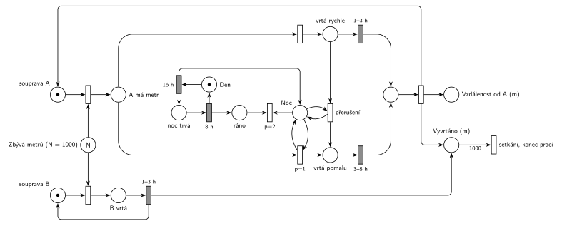

# Tunel

## Zadání

> Mezi místy A a B je třeba vykopat 1000 metrů dlouhý tunel. Z každé strany kope jiná vrtná souprava (souprava A/B). Souprava B vždy vrtá úsek jednoho metru rovnoměrně 1–3 hodiny. Souprava A je extrémně hlučná a proto musí v nočních hodinách vrtat pomalu (rovnoměrně 3–5 hodin na metr) a v denních hodinach smí pracovat běžnou rychlostí rovnoměrně 1–3 hodiny na metr. Pokud v libovolném okamžiku vrtání běžnou rychlostí u soupravy A denní doba přejde z denních do nočních hodin, vrtání se přeruší a dále se rozpracovaný metrový úsek od počátku znovu opakuje v pomalém módu. Vrtné soupravy postupují proti sobě, přesto se však nesmí srazit. Práce se ukončí v okamžiku, kdy se soupravy potkají. Vyznačte v Petriho síti místo, které bude obsahovat informaci o počtu metrů od startovního místa A, kde dojde k setkání obou souprav. Noční doba trvá přesně 8 hodin. Zvolte si vhodně počáteční čas.
>
> Modelujte zadaný systém ve formě Petriho sítě s vyznačením všech potřebných parametrů.

Věta „V modelu jednoznačně ukažte (přechodem) moment, kdy transakce opouští systém“ přibyla až v roce 2022/23. Výstupní přechod je v síti přesto, dnes se vyžaduje.

Podobné úlohy: [Porucha vrací transakci do fronty](<../../03 - Poruchy/02 - Porucha vrací transakci do fronty/02 - Porucha vrací transakci do fronty.md>) (přerušená práce začíná znovu), [Stavba z betonu](<../13 - Stavba z betonu/13 - Stavba z betonu.md>) (konečná práce, konec po N částech), [Dílna se třemi stroji](<../15 - Dílna se třemi stroji/15 - Dílna se třemi stroji.md>).

## Interpretace

<details>
<summary>Zobrazit interpretaci (nápověda)</summary>
<br>

- **Tunel jako sklad metrů:** místo *Zbývá metrů* má N = 1000 značek. Souprava si metr **zabere na začátku** vrtání (okamžitý přechod bere značku soupravy a jeden metr). Poslední metr tak vezme jen jedna souprava a soupravy se nesrazí.
- **Souprava B** je jedna značka v cyklu: zabere metr, vrtá `1–3 h` a vrátí se do *souprava B*; každý její metr přidá značku do *Vyvrtáno (m)*.
- **Den a noc** jsou cyklus `16 h` / `8 h` (noc trvá 8 h, den tedy 16 h). Počáteční čas: začátek dne, značka je v místě *Den*.
- **Noc jako stav a noc jako odpočet:** vrtání v noci testuje místo *Noc* (hrana tam a zpět). Testovací hrana značku na okamžik vezme a vrátí, a kdyby byla *Noc* zároveň vstupem časovaného přechodu `8 h`, každý nově zahájený metr by odpočet noci zrušil a spustil znovu (slajdy 137–139) – noc by se protahovala. Proto `16 h` vloží značku do dvou míst: odpočet běží na samostatném místě *noc trvá* a stav drží *Noc*. Po `8 h` se vrátí *Den* a značka *ráno*, se kterou okamžitý přechod `p=2` stav *Noc* odebere.
- **Režim soupravy A:** z místa *A má metr* vedou dva okamžité přechody. Pomalé vrtání (`3–5 h`, dolní řada) má `p=1` a testuje místo *Noc*, rychlé (`1–3 h`, horní řada) je bez podmínky (p=0). V noci tedy vyhraje pomalé, ve dne je pomalé neproveditelné a provede se rychlé. Je to vzor „podmínka přes prioritu“ (if–else).
- **Přerušení při soumraku:** okamžitý přechod *přerušení* bere značku z *vrtá rychle* a testuje *Noc*. Jakmile začne noc, provede se, odpočet `1–3 h` zanikne (slajd 139) a souprava přejde do *vrtá pomalu*, kde začne týž metr od začátku s novým odpočtem `3–5 h`. Zabraný metr se přitom nevrací. Přechod vede rovnou do *vrtá pomalu*: vrácení do *A má metr* by dalo totéž, protože v noci tam vždy vyhraje pomalé vrtání.
- Pomalé vrtání, které začalo v noci, doběhne pomalu i po rozednění; zadání přerušuje jen přechod ze dne do noci.
- **Vzdálenost od A:** dokončený metr soupravy A (z obou řad) zapíše okamžitý přechod: přidá značku do *Vzdálenost od A (m)* a do *Vyvrtáno (m)* a vrátí soupravu A. Po setkání je ve *Vzdálenosti od A* počet metrů od A, kde se soupravy potkaly.
- **Konec prací:** výstupní přechod s váhou 1000 z *Vyvrtáno (m)* je okamžik setkání. Den a noc se pak střídají dál, soupravy už nemají co vrtat.

</details>

## Petriho síť

<details>
<summary>Zobrazit Petriho síť</summary>
<br>



</details>

## Časté chyby

<details>
<summary>Zobrazit časté chyby</summary>
<br>

- Metr zabíraný až na konci vrtání: obě soupravy pak můžou vrtat poslední metr současně a „srazí se“.
- Přerušení bez testu noci (nebo bez priority), takže se rychlé vrtání přeruší hned, nebo vůbec.
- Přerušený metr poslaný do pomalého vrtání s pokračujícím odpočtem; zadání chce úsek „od počátku znovu“, tedy nový odpočet `3–5 h`.
- Místo pro vzdálenost setkání, které počítá metry obou souprav dohromady (to je vždy 1000).
- Den a noc jako dva nezávislé generátory místo jednoho cyklu; pak se mohou překrývat.

</details>

## SIMLIB

<details>
<summary>Zobrazit SIMLIB kód</summary>
<br>

Model je izomorfní k Petriho síti výše: každé místo, přechod a značka mají svůj protějšek v kódu.

```cpp
// Tunel – model v SIMLIB/C++
#include "simlib.h"

const int N = 1000;
int zbyva = N;                         // místo Zbývá metrů
int odA = 0;                           // místo Vzdálenost od A (m)
int vyvrtano = 0;                      // místo Vyvrtáno (m)
bool noc = false;                      // místo Noc (stav, testují ho přechody soupravy A)
long preruseni = 0;
double setkani = -1;                   // čas přechodu „setkání, konec prací“

void Zapis() {                         // dokončený metr -> Vyvrtáno (m)
  if (++vyvrtano == N) {               // hrana s váhou 1000: setkání, konec prací
    setkani = Time;
    Stop();
  }
}

class SoupravaA : public Process {     // značka soupravy A
 public:
  bool rychle = false;                 // značka v místě vrtá rychle
  void Behavior() {
    while (zbyva > 0) {                // přechod zabere: souprava A + jeden metr
      zbyva--;                         // -> A má metr
      bool hotovo = false;
      if (!noc) {                      // p=1 pomalu je neproveditelné, provede se rychle
        rychle = true;
        Wait(Uniform(1, 3));           // vrtá rychle 1–3 h (soumrak může čekání ukončit)
        hotovo = rychle;               // false = přerušeno
        rychle = false;
      }
      if (!hotovo)                     // v noci (p=1), nebo po přerušení
        Wait(Uniform(3, 5));           // vrtá pomalu 3–5 h, metr od začátku
      odA++;                           // zápis: Vzdálenost od A (m)
      Zapis();                         // ... a Vyvrtáno (m), souprava A je zase volná
    }
  }
};
SoupravaA *A;

class SoupravaB : public Process {     // značka soupravy B
  void Behavior() {
    while (zbyva > 0) {                // zabere metr
      zbyva--;
      Wait(Uniform(1, 3));             // B vrtá 1–3 h
      Zapis();
    }
  }
};

class DenNoc : public Process {        // cyklus Den -> 16 h -> noc trvá -> 8 h -> Den
  void Behavior() {
    for (;;) {
      Wait(16);                        // Den, 16 h
      noc = true;                      // značky do noc trvá a do Noc
      if (A->rychle) {                 // přechod přerušení (bere vrtá rychle, testuje Noc)
        A->rychle = false;
        preruseni++;
        A->Activate();                 // odpočet 1–3 h zanikne, A pokračuje hned (pomalu)
      }
      Wait(8);                         // noc trvá, 8 h
      noc = false;                     // ráno: konec noci (p=2) vezme Noc
    }
  }
};

int main() {
  Init(0, 1e6);                        // modelový čas v hodinách; běh skončí setkáním (Stop)
  A = new SoupravaA;
  A->Activate();
  (new SoupravaB)->Activate();
  (new DenNoc)->Activate();            // začínáme ráno
  Run();
  Print("Setkání po %.1f dnech, %d m od A, přerušení: %ld\n", setkani / 24, odA, preruseni);
}
```

| Petriho síť | SIMLIB |
|---|---|
| *Zbývá metrů* (N = 1000) | `int zbyva`, přechody *zabere* = `zbyva--` na začátku metru |
| *A má metr* → `p=1` pomalu (test *Noc*) / rychle | `if (!noc)` … `if (!hotovo) Wait(Uniform(3, 5))` |
| *vrtá rychle* → `1–3 h` | `rychle = true; Wait(Uniform(1, 3));` |
| *přerušení* (bere *vrtá rychle*, testuje *Noc*) → *vrtá pomalu* | v `DenNoc`: `A->rychle = false; A->Activate();` |
| *Den* → `16 h` → *noc trvá* + *Noc* → `8 h` → *Den* + *ráno* → konec noci | proces `DenNoc`: `Wait(16); noc = true; Wait(8); noc = false;` |
| zápis metru A: *Vzdálenost od A (m)*, *Vyvrtáno (m)*, souprava A zpět | `odA++; Zapis();` a další obrat cyklu `while` |
| souprava B: zabere → *B vrtá* → `1–3 h` | proces `SoupravaB` |
| *Vyvrtáno (m)* → váha 1000 → *setkání, konec prací* | `if (++vyvrtano == N) Stop();` |

Odpočet „noc trvá“ a stav *Noc* jsou v kódu přirozeně oddělené: `Wait(8)` běží v procesu `DenNoc` a test `if (!noc)` v soupravě A ho nijak neovlivní.

**Kontrola simulací.** Petriho síť: platí *Den* + *noc trvá* = 1, *Den* + *Noc* + *ráno* = 1 a každá souprava je vždy v jednom stavu. Soupravy se setkají asi po 48 dnech zhruba 430 m od A (A urazí za den asi 9 m, B asi 12 m). Přerušení nastane skoro každý večer (`make check`). SIMLIB model: soupravy se v jednom běhu setkaly po 47,5 dne 421 m od A a vrtání se přerušilo 47krát. Odhad: souprava A urazí za den asi 9 m (16 h po 2 h na metr a 8 h po 4 h), B 12 m, takže 1000 m / 21 m za den ≈ 48 dní a 9/21 z 1000 m ≈ 430 m od A (`make simlib`).

</details>

## Původ a zdroje

<details>
<summary>Zobrazit původ a zdroje</summary>
<br>

**Původ:** půlsemestrální písemka 2011/12, příklad 1 (bodování v zadání není).

**Původní znění:**

> Mezi místy A a B je třeba vykopat 1000 metrů dlouhý tunel. Z každé strany kope jiná vrtná souprava (souprava A/B). Souprava B vždy vrtá úsek jednoho metru dobu 1-3 hodiny. Souprava A je extrémně hlučná a proto musí v nočních hodinách vrtat pomalu (3-5 hodin na metr) a v denních hodinach smí pracovat běžnou rychlostí 1-3 hodiny na metr. Pokud v libovolném okamžiku vrtání běžnou rychlostí u soupravy A denní doba přejde z denních do nočních hodin, vrtání se přeruší a dále se rozpracovaný metrový úsek od počátku znovu opakuje v pomalém módu. Vrtné soupravy postupují proti sobě, přesto se však nesmí srazit. Práce se ukončí v okamžiku, kdy se soupravy potkají. Vyznačte v Petriho síti místo, které bude obsahovat informaci o počtu metrů od startovního místa A, kde dojde k setkání obou souprav. Noční doba trvá 8 hodin. Zvolte si vhodně počáteční čas.
>
> Modelujte zadaný systém ve formě Petriho sítě s vyznačením všech potřebných parametrů.

**Zdroje:**

- `Fitcheats/Půlsemestrálky/Zadání z minulých let/2011-12.pdf`, str. 1 (zadání, příklad 1)

**Existující řešení:**

- K zadáním z roku 2011/12 v materiálech žádné řešení není.

</details>
