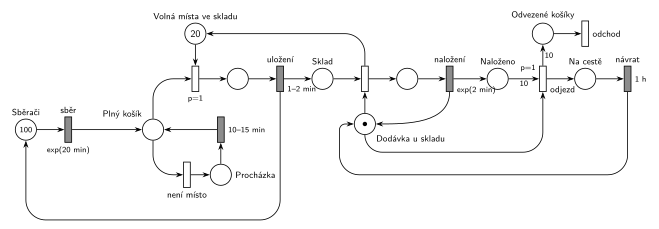

# 12-17 Chmelová brigáda

## Zadání

> Na chmelové brigádě je 100 sběračů chmele. Sběr chmele do košíku trvá exponenciálně se středem 20 minut. Po naplnění košíku jde sběrač košík uložit do skladu s kapacitou 20 košíků. Pokud ve skladu není aktuálně volné místo pro uložení košíku, sběrač se vydá s košíkem na procházku, která trvá rovnoměrně 10–15 minut. Po návratu opět zkoumá volnou kapacitu skladu (počet procházek je neomezený). V případě volné kapacity skladu zabere uložení košíku do skladu rovnoměrně 1–2 minuty. Po uložení plného košíku s nasbíraným chmelem obdrží sběrač volný košík a vrací se ke sběru. Počty košíků v systému nesledujeme a zanedbáváme i doby přesunu sběrače mezi polem a skladištěm (tzn. není tam sklad volných košíků). V systému pracuje jedna přepravní dodávka s kapacitou 10 košíků. Naložení každého jednotlivého košíku do dodávky trvá exponenciálně se středem 2 minuty. Okamžikem započetí nakládání košíku dodávkou se uvolňuje jedna pozice ve skladu. Po plném naložení dodávka odjíždí a vrací se prázdná přesně za 1 hodinu.
>
> Poznámka: Kapacitu skladu plných košíků lze modelovat místem v Petriho síti se zadanou kapacitou.

Podobné úlohy: [Sběrači jahod](<../02 - Sběrači jahod/02 - Sběrači jahod.md>), [Jahodová farma](<../04 - Jahodová farma/04 - Jahodová farma.md>), [Výletní loď](<../../11 - Doprava a dávky/04 - Výletní loď/04 - Výletní loď.md>) (čítač do plna), [Logistická centrála](<../18 - Logistická centrála/18 - Logistická centrála.md>) (stejný rok).

## Nápověda

<details>
<summary>Zobrazit nápovědu</summary>
<br>

- **Sběrači** jsou uzavřený cyklus: místo se 100 značkami a `exp(20 min)`. Každá značka má vlastní odpočet (slajd 138), takže všech 100 sběračů sbírá souběžně. Sběrači systém neopouštějí.
- **Kapacita skladu bez kapacity místa:** poznámka v zadání dovoluje místo s kapacitou 20, ale v notaci kurzu se kapacity míst nepoužívají. Místo nich je doplňkové místo *Volná místa ve skladu* s 20 značkami.
- **Volné místo, nebo procházka:** obsazení místa ve skladu má `p=1`, procházka (*není místo*) `p=0`. Procházka se tedy provede, jen když žádné volné místo není. Po `10–15 min` se sběrač vrátí do *Plný košík* a zkouší to znovu.
- Místo ve skladu se zabere **na začátku ukládání** (`1–2 min`) a uvolní se **na začátku nakládání** do dodávky, jak říká zadání. Košík ve skladu je značka v *Sklad*, sběrač se po uložení vrací do *Sběrači*. Platí tedy *Volná místa* + ukládané + *Sklad* = 20.
- **Dodávka** je zařízení s jednou značkou (*Dodávka u skladu*). Začátek nakládání je okamžitý přechod, který vezme košík ze *Skladu* a značku dodávky a vrátí volné místo. Nakládá se po jednom košíku, `exp(2 min)`, pak se značka dodávky vrací. Čítač *Naloženo* a přechod *odjezd* s váhou 10 a `p=1` jsou stejný vzor jako u výletní lodi: po 10. košíku odjezd předběhne další nakládání (oba potřebují značku dodávky).
- Po `1 h` se prázdná dodávka vrací do *Dodávka u skladu*. **Odvezené košíky** (hrana s váhou 10) opouštějí systém (výstupní přechod *odchod*).
- Systém je silně přetížený: sběrači naplní asi 5 košíků za minutu, dodávka odveze 10 košíků zhruba za 80 minut. Sklad je skoro pořád plný a většina sběračů chodí na procházky. Síť je správně, zadání tak prostě vychází.

</details>

## Petriho síť

<details>
<summary>Zobrazit Petriho síť</summary>
<br>



</details>

## Časté chyby

<details>
<summary>Zobrazit časté chyby</summary>
<br>

- Procházka bez nižší priority: sběrač by mohl jít na procházku, i když je ve skladu místo.
- Uvolnění místa ve skladu až po naložení košíku. Zadání ho uvolňuje okamžikem začátku nakládání.
- Dodávka s 10 značkami místo jedné: časovaný přechod pak nakládá všechny košíky souběžně.
- Odjezd bez `p=1`: po 10. košíku by mohlo začít nakládání 11.
- Hrana přechod → přechod nebo místo → místo (mezi ně vždy patří místo, resp. přechod).
- Místo s kapacitou 20 místo doplňkového místa (v notaci kurzu se nepoužívá).

</details>

## SIMLIB

<details>
<summary>Zobrazit SIMLIB kód</summary>
<br>

Model je izomorfní k Petriho síti výše: každé místo, přechod a značka mají svůj protějšek v kódu.

```cpp
// Chmelová brigáda – model v SIMLIB/C++
#define I_REALLY_KNOW_HOW_TO_USE_WAITUNTIL  // SIMLIB zpřístupní WaitUntil jen s tímto makrem
#include "simlib.h"

Store Sklad("Místa ve skladu", 20);   // Free() = místo Volná místa ve skladu (20 značek)
int veSkladu = 0;                      // místo Sklad (uložené košíky)
long prochazky = 0, odvezeno = 0;

class Sberac : public Process {        // značka v místě Sběrači (uzavřený cyklus)
  void Behavior() {
    for (;;) {
      Wait(Exponential(20));           // sběr exp(20 min) -> Plný košík
      while (Sklad.Full()) {           // p=0 „není místo“: žádné volné místo
        prochazky++;
        Wait(Uniform(10, 15));         // Procházka 10–15 min, pak znovu Plný košík
      }
      Enter(Sklad, 1);                 // p=1: zabere volné místo (volné je, neblokuje)
      Wait(Uniform(1, 2));             // uložení 1–2 min
      veSkladu++;                      // košík do místa Sklad, sběrač zpět ke sběru
    }
  }
};

class Dodavka : public Process {       // značka v místě Dodávka u skladu
  void Behavior() {
    for (;;) {
      int nalozeno = 0;                // místo Naloženo
      while (nalozeno < 10) {          // odjezd (p=1, váha 10) předběhne další nakládání
        WaitUntil(veSkladu > 0);       // začátek nakládání: košík ze Skladu ...
        veSkladu--;
        Leave(Sklad, 1);               // ... a hned vrací volné místo
        Wait(Exponential(2));          // naložení exp(2 min)
        nalozeno++;
      }
      odvezeno += 10;                  // Odvezené košíky -> odchod
      Wait(60);                        // Na cestě, návrat za 1 h
    }
  }
};

int main() {
  Init(0, 60 * 24 * 30);               // modelový čas v minutách: 30 dní
  for (int i = 0; i < 100; i++)        // 100 značek v místě Sběrači
    (new Sberac)->Activate();
  (new Dodavka)->Activate();
  Run();
  Sklad.Output();
  Print("Odvezeno košíků: %ld, procházek: %ld\n", odvezeno, prochazky);
}
```

| Petriho síť | SIMLIB |
|---|---|
| *Sběrači* (100) → `exp(20 min)` → *Plný košík* | 100 procesů `Sberac`, `Wait(Exponential(20))` |
| *Volná místa ve skladu* (20) | `Store Sklad` s kapacitou 20 (`Sklad.Free()`) |
| `p=1` uložit / `p=0` *není místo* | `while (Sklad.Full())` … `Enter(Sklad, 1)` |
| *Procházka* → `10–15 min` → *Plný košík* | `Wait(Uniform(10, 15))` a nový test v cyklu `while` |
| `1–2 min` → *Sklad* + *Sběrači* | `Wait(Uniform(1, 2)); veSkladu++;` a další obrat cyklu `for` |
| *Dodávka u skladu* (1 značka) | proces `Dodavka` |
| začátek nakládání (vrací volné místo) | `WaitUntil(veSkladu > 0); veSkladu--; Leave(Sklad, 1);` |
| `exp(2 min)` → *Naloženo* | `Wait(Exponential(2)); nalozeno++;` |
| *odjezd* (`p=1`, váha 10) → *Na cestě* → `1 h` | konec cyklu `while (nalozeno < 10)`, `Wait(60)` |
| *Odvezené košíky* → *odchod* | `odvezeno += 10` (košíky jsou jen čísla) |

**Kontrola simulací.** Petriho síť: platí *Sběrači* + *Plný košík* + ukládající + *Procházka* = 100, *Volná místa* + ukládané + *Sklad* = 20 a *Dodávka* + nakládání + *Na cestě* = 1. *Naloženo* nepřesáhne 10. Dodávka odjíždí zhruba každých 80 minut a procházky jsou nejčastější událost (`make check`). SIMLIB model: za 30 dní odvezla dodávka 5380 košíků; teoreticky 5400 (jedna jízda trvá v průměru 10 × 2 min + 60 min = 80 min). Sklad byl v průměru obsazený na 19,98 z 20 míst a sběrači šli na procházku 336 369krát (`make simlib`).

</details>

## Původ a zdroje

<details>
<summary>Zobrazit původ a zdroje</summary>
<br>

**Původ:** půlsemestrální písemka 2010/11 (bodování neuvedeno).

**Původní znění:**

> Na chmelové brigádě je 100 sběračů chmele. Doba sběru chmele do košíku se řídí exponenciálním rozložením se středem 20 minut. Po naplnění košíku jde sběrač košík uložit do skladu s kapacitou 20 košíků. Pokud ve skladu není aktuálně volné místo pro uložení košíku, sběrač se vydá s košíkem na 10-15 minut na procházku. Po návratu opět zkoumá volnou kapacitu skladu (počet procházek je neomezený). V případě volné kapacity skladu zabere uložení košíku do skladu 1-2 minuty rovnoměrně. Po uložení plného košíku s nasbíraným chmelem obdrží sběrač volný košík a vrací se ke sběru. Počty košíků v systému nesledujeme a zanedbáváme i doby přesunu sběrače mezi polem a skladištěm (tzn. není tam sklad volných košíků). V systému pracuje jedna přepravní dodávka s kapacitou 10 košíků. Naložení každého jednotlivého košíku do dodávky trvá dobu, která se řídí exponenciálním rozložením se středem 2 minuty. Okamžikem započetí nakládání košíku dodávkou se uvolňuje jedna pozice ve skladu. Po plném naložení dodávka odjíždí a vrací se prázdná za jednu hodinu.
>
> Poznámka: Kapacitu skladu plných košíků lze modelovat místem v Petriho síti se zadanou kapacitou.

**Zdroje:**

- `Fitcheats/Půlsemestrálky/Zadání z minulých let/2010-11.pdf`, str. 1 (zadání, úloha 3 „Chmel“)
- `Fitcheats/Skripta/FIT - Studentská skripta 2015-16.pdf`, str. 45–46 (zadání, dvě studentská řešení s komentáři)

**Existující řešení:**

- **Studentská skripta, str. 45 (kresleno na počítači, „bez záruky“):** sběrači, `p=1` uložení s „miesta v sklade“ (20), procházka `10-15m` a návrat do „plný košík“ jsou správně. Začátek nakládání vrací místo ve skladu. Chyby:
  - nakládání má `1-2m` místo `exp(2 min)`;
  - „dodávka“ má 10 značek, takže se může nakládat až 10 košíků najednou (komentář „začaly by se nakládat všechny košíky naráz“). Správně je jedna značka dodávky a čítač naložených košíků;
  - odvezené košíky nemají výstupní přechod.
- **Studentská skripta, str. 46 (ručně kreslené):** v podstatě totéž co tady: „MÁM KAM NALOŽIT“ (1 značka) = *Dodávka u skladu*, „NAKLÁDÁM“ `Exp(2min)`, „NALOŽENÉ“ s váhou 10, „ODJEZD“ s `P=1`, „AUTO SE VRACÍ“ po `1h`. Komentář pod ním upozorňuje na dvě syntaktické chyby: „nesmi byt: prechod -> prechod, stav -> stav“. Přechod „ODJEZD“ vede přímo do přechodu `1h` a procházka začíná hranou z místa rovnou do místa (chybí přechod, a tedy i nižší priorita procházky).
- Studentská poznámka „použitie kapacity v stave ‚sklad‘ by to značne zjednodušilo, ale Hrubý tuším povedal, že tomu sa máme vyhýbať“ odpovídá notaci kurzu: kapacitu nahrazuje doplňkové místo.

</details>

## Reference

- [Jak síť funguje](<../../../basics/Jak síť funguje.md>)
- [Notace a vzory](<../../../basics/Notace a vzory.md>)

<!-- -->

- [Studijní plán](<../../Studijní plán.md>)
- [Seznam úloh](<../../Seznam úloh.md>)
