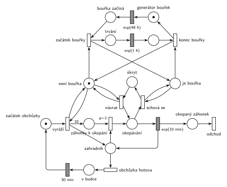

# 12–01 – Zahradnictví a bouřka

## Zadání

> Zahradnictví tvoří 10 záhonků, jeden zahradník a zahradní budka. Zahradník pravidelně vyráží na obchůzku okopávat všechny záhonky. Okopání jednoho záhonku se řídí exponenciálním rozložením (EXP) se středem 10 minut. Po okopání všech záhonků zahradník 30 minut odpočívá v zahradní budce. V intervalech EXP(48hod) začne bouřka, jejíž délka se řídí EXP(1h). Zahradník nevyráží na obchůzku za bouřky. Pokud ho bouřka zastihne při práci, pak se schová v budce, dokud bouřka neskončí. Po bouřce pokračuje zahradník na záhonku, u kterého byl bouřkou přerušen, ovšem **začíná okopávání od začátku**.
>
> Zadaný systém modelujte formou Petriho sítě s vyznačením všech potřebných parametrů. **V modelu jednoznačně ukažte (přechodem) moment, kdy transakce opouští systém.**

Podobné úlohy: [12–10 – Zahradník na FIT](<../12–10 - Zahradník na FIT/12–10 - Zahradník na FIT.md>) (obchůzka po květinách), [03–02 – Porucha vrací transakci do fronty](<../03–02 - Porucha vrací transakci do fronty/03–02 - Porucha vrací transakci do fronty.md>) (přerušení a opakování od začátku).

## Interpretace

Zobrazit interpretaci (nápověda)

- Model má tři části, jak si je Hrubý vypsal: život zahradníka, život bouřky a jejich interakci.
- **Obchůzka:** přechod *vyráží* vezme značku *začátek obchůzky*, vloží 10 značek (váha hrany 10) do *záhonky k okopání* a jednu značku do *zahradník*. Zahradník je zařízení: *okopat* (`p=1`) vezme záhonek a zahradníka, `exp(10 min)` zahradníka vrátí. Když záhonky dojdou, provede se *obchůzka hotova* (p=0). Priorita zajistí, že obchůzka skončí, až když nic nezbývá.
- **„Pravidelně vyráží“** bez udaného intervalu: po 30 min v budce vyráží hned znovu (stejně u Hrubého).
- **„Nevyráží za bouřky“:** *vyráží* testuje místo *není bouřka* (hrana tam a zpět). Za bouřky čeká v *začátku obchůzky*. Bouřka během odpočinku v budce odpočinek neovlivní.
- **Bouřka** je samostatný proces: *generátor bouřek* → `exp(48 h)` → *začátek bouřky* (vezme *není bouřka*, dá *je bouřka*) → `exp(1 h)` → *konec bouřky* (vrátí *není bouřka* i generátor). Generátor se vrací až po konci bouřky, takže se bouřky nepřekrývají. Stav bouřky je v jiných místech než odpočty `exp(48 h)` a `exp(1 h)`. Testovací hrany tak nikdy neberou značku časovanému přechodu a jeho odpočet se nepřeruší.
- **Interakce:** *schová se* je okamžitý přechod. Vezme značku z *okopávání* (zahradník + rozpracovaný záhonek), takže odpočet `exp(10 min)` zanikne (slajd 139). Značka čeká v *úkrytu*, dokud nepřijde *není bouřka*, a *návrat* ji vrátí do *okopávání*. Tam začne nový odpočet `exp(10 min)`, tedy okopávání **od začátku a na stejném záhonku** (značka záhonku se mezitím nevrátila do *záhonky k okopání*).
- **Odchod ze systému:** zahradník ani bouřka systém neopouštějí, jsou to cyklické procesy. Transakcí je tu „záhonek k okopání“: okopaný záhonek odchází přechodem *odchod*. Hrubý výstupní přechod nekreslí. Zadání ho ale výslovně chce, a takhle je jednoznačný.

## Řešení

Zobrazit řešení

| Požadavek | Prvek sítě |
|---|---|
| obchůzka po 10 záhoncích | *vyráží* → 10 značek do *záhonky k okopání* + značka *zahradník* |
| okopání exp(10 min) | `p=1`: záhonek + *zahradník* → *okopávání* → `exp(10 min)` vrací *zahradníka* |
| po obchůzce 30 min v budce | *obchůzka hotova* (p=0, záhonky došly) → *v budce* → `30 min` → *začátek obchůzky* |
| bouřka exp(48 h), délka exp(1 h) | *generátor bouřek* → `exp(48 h)` → *začátek bouřky* → `exp(1 h)` → *konec bouřky* |
| nevyráží za bouřky | *vyráží* testuje *není bouřka* |
| bouřka zastihne při práci | *schová se*: *okopávání* + test *je bouřka* → *úkryt* |
| po bouřce stejný záhonek od začátku | *návrat*: *úkryt* + test *není bouřka* → *okopávání* (nový odpočet) |
| odchod ze systému | *okopaný záhonek* → *odchod* |

Kontrola simulací: zahradník je vždy právě v jednom stavu (*začátek obchůzky* + *zahradník* + *okopávání* + *úkryt* + *v budce* = 1), *není bouřka* + *je bouřka* = 1. Za 500 simulovaných dní přišlo 244 bouřek (zhruba po 48 h) a 187 z nich zastihlo zahradníka při okopávání. To odpovídá tomu, že okopáváním tráví asi 100 ze 130 minut cyklu.

## Časté chyby

Zobrazit časté chyby

- Testování bouřky přímo na místě, které je vstupem časovaného přechodu bouřky. Testovací hrana značku vezme a hned vrátí, a tím by odpočet přerušila (slajd 139). Proto stav bouřky (*je/není bouřka*) a její odpočty patří do různých míst.
- Po bouřce vrátit záhonek do *záhonky k okopání* místo do *okopávání*. Pak by zahradník mohl začít jiný záhonek, ale zadání chce ten přerušený.
- Navázat přerušení i na odpočinek v budce nebo na čekání před obchůzkou. Bouřka mění jen práci na záhonku.
- Konec obchůzky bez priority: přechod *obchůzka hotova* by mohl předběhnout okopání a obchůzka by skončila s neokopanými záhonky.
- Více bouřek najednou: generátor bouřky musí být ve smyčce přes celou bouřku, ne jen přes `exp(48 h)`.

## Původ a zdroje

**Původ:** půlsemestrální písemka 2024/25, varianta A, 10 bodů.

**Zdroje:**

- `Fitcheats/Půlsemestrálky/Zadání z minulých let/2024-25.pdf`, str. 1 (koláž zadání všech čtyř variant)
- `Fitcheats/Půlsemestrálky/Hrubý - Řešení 2024-25.pdf`, str. 1 (řešení od Hrubého)

**Existující řešení:**

Zobrazit existující řešení

- **Hrubý (str. 1):** síť výše má stejnou strukturu. Místa *začátek* a *není bouřka* vedou do přechodu, který dá 10 značek do *práce* a značku zahradníkovi. Dál `p=1` → `exp(10m)` zpět k zahradníkovi, přechod do *hotovo* → `30m v budce` → *začátek*. Bouřka: `exp(48h)` → *je bouřka* + *proces bouřky* → `exp(1h)` → *konec*. Interakce: *je bouřka* + okopávání → *čekám na konec* → po bouřce zpět do místa před `exp(10m)`. Rozdíly: Hrubý nemá výstupní přechod a záhonek u něj zmizí už při zahájení okopávání (*práce* + zahradník → okopávání). Tady záhonek odchází až po okopání přes *odchod*.

