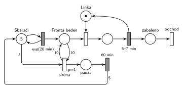

# 12–02 – Sběrači jahod

## Zadání

> Na poli pracuje 5 sběračů jahod. Každému sběrači zabere dobu danou exponenciálním rozložením se středem 20 minut nasbírat bedýnku jahod a donést ji do sběrného místa. Ve sběrném místě pracuje jedna balicí linka. Lince zabere 5-7 minut rovnoměrně zabalit obsah jedné bedýnky. Pokud fronta k lince dosáhne délky alespoň 10 bedýnek, pak linka hlásí sirénou přeplněnost. Na signál sirény si všichni sběrači dají pauzu v práci na dobu 60 minut a pak obnoví činnost od počátku.
>
> *Zadaný systém modelujte formou Petriho sítě s vyznačením všech potřebných parametrů.*

Věta „V modelu jednoznačně ukažte (přechodem) moment, kdy transakce opouští systém“ přibyla až v roce 2022/23. Výstupní přechod je v síti přesto, dnes se vyžaduje.

Podobné úlohy: [12–04 – Jahodová farma](<../12–04 - Jahodová farma/12–04 - Jahodová farma.md>), [05–05 – Přerušení příchodů při plné frontě](<../05–05 - Přerušení příchodů při plné frontě/05–05 - Přerušení příchodů při plné frontě.md>), [09–03 – Psí salon](<../09–03 - Psí salon/09–03 - Psí salon.md>).

## Interpretace

Zobrazit interpretaci (nápověda)

- **Sběrači** jsou místo s 5 značkami ve smyčce s `exp(20 min)`. Běžný časovaný přechod má pro každou značku vlastní odpočet (slajd 138), takže je to 5 nezávislých sběračů. Každé provedení přinese jednu bedýnku (transakci) do *Fronty beden*.
- **Siréna** testuje frontu dvojicí hran s váhou 10 (dovnitř a zpět), takže z fronty nic nebere. „Dosáhne délky alespoň 10“ znamená váhu 10, ne 11. Priorita `p=1` zajistí, že siréna zazní dřív, než linka desátou bedýnku z fronty odebere (oba okamžité přechody jsou v tu chvíli proveditelné).
- **Pauza:** siréna vezme všech 5 značek ze *Sběračů* (hrana s váhou 5). Značky čekají v časovaném přechodu sběru, takže jejich odpočty zaniknou (slajd 139). Po `60 min` se všech 5 vrátí a každý sběrač začíná nový sběr. To je „obnoví činnost od počátku“.
- **Siréna zazní jen jednou za pauzu:** během pauzy jsou *Sběrači* prázdní, takže siréna není proveditelná (Hrubý: „provede se JEDNOU“). Když je fronta i po hodině pořád alespoň 10, zazní hned znovu. To odpovídá zadání, fronta je pořád přeplněná.
- Linka během pauzy normálně balí dál. Zabalená bedýnka odchází ze systému přechodem *odchod*.
- Sběrači dodají v průměru 15 bedýnek za hodinu, linka zvládne 10. Bez sirény by fronta rostla do nekonečna, takhle nikdy nepřesáhne 10.

## Petriho síť

Zobrazit Petriho síť

| Požadavek | Prvek sítě |
|---|---|
| 5 sběračů, bedýnka za exp(20 min) | *Sběrači* (5 značek) ⇄ `exp(20 min)` → *Fronta beden* |
| balicí linka 5–7 min | *Linka* (1 značka), obsazení, `5–7 min` vrací značku → *zabaleno* → *odchod* |
| fronta alespoň 10 → siréna | *siréna* `p=1`, test fronty hranami s váhou 10 tam i zpět |
| všichni sběrači mají pauzu | siréna bere 5 značek ze *Sběračů* → *pauza* |
| po 60 min obnoví činnost | `60 min` vrací 5 značek do *Sběračů* |

Kontrola simulací: *Linka* + balená bedýnka = 1, *Sběrači* + 5 × *pauza* = 5, *Fronta beden* nikdy nepřesáhne 10. Siréna zaznívá zhruba každé 3 hodiny a linka zabalí asi 9,7 bedýnky za hodinu, je tedy téměř stále vytížená.

## Časté chyby

Zobrazit časté chyby

- Siréna, která bedýnky z fronty odebere (jen vstupní hrana s váhou 10 bez hrany zpět). Fronta se „vyprázdní“, ale nikdo bedýnky nezabalil.
- Test s váhou 11 („přesáhne 10“) místo „alespoň 10“.
- Siréna bez `p=1`: linka může desátou bedýnku odebrat dřív a siréna nezazní.
- Odvolání jen jednoho sběrače (hrana bez váhy 5), nebo vrácení jiného počtu, než se odebralo.
- Siréna, kterou nic neblokuje (jen test fronty, žádná spotřebovaná značka). Okamžitý přechod, který jen testuje, by se při plné frontě prováděl stále dokola. Blokovat ho musí značky *Sběračů* (nebo místo „Pracuje“ jako u Hrubého).

## Původ a zdroje

Zobrazit původ a zdroje

**Původ:** půlsemestrální písemka 2021/22, varianta B, 10 bodů.

**Zdroje:**

- `Fitcheats/Půlsemestrálky/Zadání z minulých let/2021-22.pdf`, str. 2 (zadání)
- `Fitcheats/Půlsemestrálky/Hrubý - Řešení 2021-22.pdf`, str. 2 (řešení od Hrubého, dvě varianty)

**Existující řešení:**

- **Hrubý (str. 2), hlavní varianta:** „Sběrači“ (5) ⇄ `exp(20min)` → „Fronta beden“ → „Linka“ → `5-7min`. Přechod `p=1` „Spouštěcí podmínka (jednou proveditelné)“ testuje frontu hranami s váhou 10 a bere značku z místa „Pracuje“ (červeně zakroužkované). Dál přes místo na přechod „odvolání sběračů“ (červeně „(přerušení práce)“), který bere 5 sběračů, a přes místo na `1h` „pauza“. Ta vrací 5 sběračů a značku do „Pracuje“. Místo „Pracuje“ brání opakovanému spuštění během pauzy.
- **Hrubý (str. 2), „Alternativně“:** totéž bez místa „Pracuje“. Přechod rovnou testuje frontu (10/10) a bere 5 sběračů, poznámka „provede se JEDNOU“. Váhu 5 na hraně ze sběračů má červeně zakroužkovanou s vykřičníkem. Síť výše je tato alternativa, jen s `p=1` z hlavní varianty.
- V obou variantách bedýnka zaniká v přechodu linky. Výstupní přechod se tehdy nevyžadoval.

