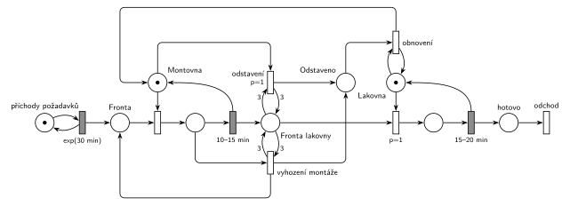

# 12–03 – Výrobní hala

## Zadání

> Výrobní hala se skládá z montovny a lakovny. Obě linky mají výrobní kapacitu jedna. Do haly přichází požadavky na výrobu jednoho produktu v intervalech daných exponenciálním rozložením se středem 30 minut. Každý požadavek musí projít nejprve montovnou a pak lakovnou. Montování produktu trvá 10-15 minut. Montovaný meziprodukt vstupuje do fronty lakovny. Lakování trvá 15-20 minut. Pokud dosáhne délka fronty k lakování počtu 3 čekající meziprodukty, pak se montážní linka odstaví, případná rozpracovaná výroba se vyhodí a požadavek se vrací do fronty. Montovna se opět uvede do provozu až potom, co se zcela vyprázdní fronta Lakovny.
>
> *Zadaný systém modelujte formou Petriho sítě s vyznačením všech potřebných parametrů.*

Věta „V modelu jednoznačně ukažte (přechodem) moment, kdy transakce opouští systém“ v tehdejších zadáních ještě nebyla. Výstupní přechod je v síti přesto, dnes se vyžaduje.

Podobné úlohy: [09–04 – Centrum MM1 s rychlým režimem](<../09–04 - Centrum MM1 s rychlým režimem/09–04 - Centrum MM1 s rychlým režimem.md>), [09–06 – Klientské centrum](<../09–06 - Klientské centrum/09–06 - Klientské centrum.md>), [03–02 – Porucha vrací transakci do fronty](<../03–02 - Porucha vrací transakci do fronty/03–02 - Porucha vrací transakci do fronty.md>).

## Interpretace

Zobrazit interpretaci (nápověda)

- **Montovna a lakovna** jsou dvě zařízení (místa s jednou značkou) za sebou. Uvolnění je sloučené s časovaným přechodem.
- **„Dosáhne délky 3“** = test hranami s váhou 3 do přechodu a zpět. Z *Fronty lakovny* se nic neodebere. Lakovaný meziprodukt je v jiném místě, takže se do délky fronty nepočítá („3 čekající“).
- **Odstavení** vezme značku *Montovny* a přesune ji do *Odstaveno*. Tím je montovna mimo provoz a přechod se nemůže provést znovu. Priorita `p=1` zajistí, že odstavení vyhraje nad obsazením montovny dalším požadavkem.
- **Rozpracovaná výroba v tu chvíli ve skutečnosti nikdy není.** Fronta lakovny roste jen dokončením montáže a v témž okamžiku se montovna uvolní. Odstavení s `p=1` ji tedy zabere dřív, než ji obsadí další požadavek. Přechod *vyhození montáže* je v síti proto, že ho zadání výslovně požaduje (a hodnotitel ho bude hledat). Vrací požadavek do *Fronty* a uvolní montovnu, kterou odstavení hned zabere. Je to stejný vzor jako přerušení obsluhy poruchou. V simulaci se neprovede ani jednou.
- **Obnovení** má `p=0` a testuje volnou *Lakovnu*. Obsazení lakovny má `p=1`, takže dokud je ve *Frontě lakovny* něco, vyhraje obsazení. Obnovení se tedy provede, až je fronta prázdná *a* lakovna volná. To je stejná podmínka jako na democvičení. Montovna se tak rozjede až po nalakování posledního meziproduktu, nejvýš o jedno lakování (15–20 min) později než v okamžiku, kdy se fronta vyprázdní. Přesný test prázdné fronty bez inhibiční hrany by potřeboval doplňkové místo (počet volných míst ve frontě, nejvýš 3), což je zbytečně složité.
- Požadavky během odstavení dál přicházejí a čekají ve *Frontě*.

## Petriho síť

Zobrazit Petriho síť

| Požadavek | Prvek sítě |
|---|---|
| požadavky exp(30 min) | *generátor* ⇄ `exp(30 min)` → *Fronta* |
| montovna, kapacita 1, 10–15 min | *Montovna* (1 značka), obsazení, `10–15 min` vrací značku → *Fronta lakovny* |
| lakovna, kapacita 1, 15–20 min | *Lakovna* (1 značka), obsazení `p=1`, `15–20 min` vrací značku → *hotovo* → *odchod* |
| fronta lakovny dosáhne 3 → odstavení | *odstavení* `p=1`: test *Fronty lakovny* vahou 3 tam i zpět, *Montovna* → *Odstaveno* |
| rozpracovaná výroba se vyhodí, požadavek zpět do fronty | *vyhození montáže*: test vahou 3, rozpracovaný požadavek → *Fronta*, značka → *Montovna* |
| provoz až po vyprázdnění fronty lakovny | *obnovení* (`p=0`): *Odstaveno* + test volné *Lakovny* → *Montovna* |

Kontrola simulací: *Montovna* + montáž + *Odstaveno* = 1, *Lakovna* + lakování = 1, *Fronta lakovny* nikdy nepřesáhne 3. Odstavení nastává zhruba jednou za 50 hodin a pokaždé po něm následuje obnovení. *Vyhození montáže* se podle očekávání neprovede.

## Časté chyby

Zobrazit časté chyby

- Test fronty jen vstupní hranou s váhou 3 (bez hrany zpět): tři meziprodukty z fronty zmizí.
- Váha 4 („přesáhne 3“) místo 3.
- Odstavení, které nebere žádnou značku (jen testuje frontu). Okamžitý přechod by se pak při plné frontě prováděl pořád dokola.
- Obnovení bez podmínky prázdné fronty, nebo podmínka přes prioritu s chybějícím `p=1` u obsazení lakovny. Pak se montovna rozjede hned při první příležitosti.
- Vyhozený požadavek, který zmizí ze systému. Zadání říká, že se vrací do fronty.
- Ztracená značka montovny: vyhození, které vrátí jen požadavek, nebo obnovení, které značku nevrátí.

## Původ a zdroje

**Původ:** půlsemestrálky 2014–19 (přehled zadání), úloha Z24. Rok, varianta ani body nejsou známé.

**Zdroje:**

- `Fitcheats/Půlsemestrálky/Zadání z minulých let/Přehled zadání 2014-19.pdf`, str. 6 (zadání)
- `Fitcheats/Půlsemestrálky/Democvičení 2020-21 - Z4 zadání a řešení.pdf`, str. 7 (řešení z democvičení)
- `Fitcheats/Půlsemestrálky/Zadání z minulých let/2024-25 - Varianta A (fotky).pdf`, str. 9–10 (zadání a řešení kreslené na konzultaci, fotky projektoru)

**Existující řešení:**

Zobrazit existující řešení

- **Democvičení (str. 7):** stejná struktura jako síť výše. Montovna a lakovna jako zařízení, obsazení lakovny má zeleně `p=1`. Modře dva přechody s testem *FL* vahou 3: jeden bere volnou montovnu, druhý rozpracovaný požadavek, který vrací do fronty. Oba dávají značku do místa „OP“ (odstaveno). Zeleně obnovení: „OP“ + test volné lakovny → montovna. Rozdíly: odstavovací přechody nemají prioritu (náhodný souboj s obsazením montovny, výsledek je ale stejný) a vyhození dává značku rovnou do „OP“ místo přes *Montovnu*. Lakování má napsané zřejmě „20-25m“ místo 15–20 min.
- **Konzultace 2024/25 (fotky, str. 10):** obsazení lakovny „pr1“. Odstavení testuje frontu lakovny vahou 3 a bere značku z řídicího místa. Přes další místo pak spustí přechod, který bere rozpracovaný požadavek a vrací ho do fronty. Případ volné montovny řešen není: montovna se „odstaví“ až tím, že další obsazený požadavek je hned vrácen. Přechod obnovení vpravo testuje volnou lakovnu a vrací značky montovně a řídicímu místu. Na fotce ale není vidět, že by bral nějakou značku stavu odstavení. Tak, jak je nakreslený, by se prováděl stále dokola. Kresba je přetahaná, konce některých hran nejsou jisté.

