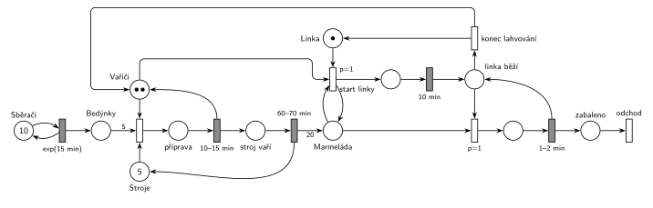

# 12–04 – Jahodová farma

## Zadání

> Na jahodové farmě pracuje 10 sběračů jahod a dva vařiči marmelády. Dále je v systému 5 strojů na vaření marmelády a jedna balící linka. Sběr jedné bedýnky a transport do varny sběrači zabere dobu exp(15min). Vařič zahajuje proces vaření na stroji, když je k dispozici 5 potřebných bedýnek jahod (tj. 1 vaření = 5 bedýnek). Příprava vaření zabere 10-15 minut. Pak stroj bez potřeby obsluhy samostatně vaří 60-70 minut. Výsledkem vaření je 20 jednotek marmelády, kterou je třeba prioritně zabalit do sklenic. Pokud je nějaká uvařená marmeláda, pak jeden z vařičů nastartuje balící linku (zabere 10 minut) a lahvuje marmeládu, dokud existuje z libovolné varny nějaká nezabalená vyprodukovaná marmeláda. Lahvování jedné jednotky marmelády trvá 1-2 minuty.
>
> *Zadaný systém modelujte formou Petriho sítě s vyznačením všech potřebných parametrů.*

Věta „V modelu jednoznačně ukažte (přechodem) moment, kdy transakce opouští systém“ v tehdejších zadáních ještě nebyla. Výstupní přechod je v síti přesto, dnes se vyžaduje.

Podobné úlohy: [12–02 – Sběrači jahod](<../12–02 - Sběrači jahod/12–02 - Sběrači jahod.md>), [12–06 – Moštárna](<../12–06 - Moštárna/12–06 - Moštárna.md>).

## Interpretace

Zobrazit interpretaci (nápověda)

- **Sběrači** jsou stejně jako v [12–02](<../12–02 - Sběrači jahod/12–02 - Sběrači jahod.md>) místo s 10 značkami ve smyčce s `exp(15 min)`. Každá značka má vlastní odpočet, takže je to 10 nezávislých sběračů. Každé provedení přinese bedýnku do místa *Bedýnky*.
- **Zahájení vaření** potřebuje vařiče, stroj a 5 bedýnek (hrana s váhou 5). Během *přípravy* jsou obsazení vařič i stroj. Časovaný přechod `10–15 min` vrátí vařiče, stroj zůstává obsazený a sám vaří `60–70 min`. Teprve pak se vrátí do *Strojů* a vznikne 20 jednotek *Marmelády* (hrana s váhou 20).
- **Vařiči** jsou sklad se dvěma značkami. Každý vařič dělá jen jednu věc najednou: buď připravuje vaření, nebo obsluhuje linku.
- **„Prioritně zabalit“:** *start linky* má `p=1`, zahájení vaření `p=0`. Když se vařič uvolní a je uvařená marmeláda, jde přednostně k lince. Probíhající přípravu nepřerušuje, zadání o přerušení nic neříká.
- **Start linky** testuje, že je nějaká *Marmeláda* (hrana tam a zpět), a bere vařiče a *Linku* (jedna značka, linka je jen jedna). Rozjezd trvá `10 min`, pak je vařič s linkou ve stavu *linka běží*.
- **Lahvování** je obsluha s „linkou běží“ jako zařízením: plnění (`p=1`) vezme jednotku marmelády, `1–2 min` vrátí značku *linka běží* a jednotka (sklenice) odchází ze systému. Marmeláda z jakékoli varny jde do stejného místa, takže se lahvuje vše („z libovolné varny“).
- **Konec lahvování** (`p=0`) se provede, až plnění nemůže, tj. když marmeláda došla. Vrátí vařiče i *Linku*. Při další marmeládě se linka znovu startuje 10 minut.
- **Zadaná čísla nejsou vyvážená.** Sběrači přinesou 40 bedýnek za hodinu, 5 strojů jich zpracuje nejvýš asi 19 (stroj je obsazený asi 77,5 min na 5 bedýnek). Stroje uvaří až asi 77 jednotek za hodinu, linka zabalí nejvýš 40. Bedýnky i marmeláda se proto hromadí bez omezení a linka po prvním startu už nikdy nedoběhne. Síť je přesto správně, jen se v takovém provozu některé části (konec lahvování) neuplatní.

## Petriho síť

Zobrazit Petriho síť

| Požadavek | Prvek sítě |
|---|---|
| 10 sběračů, bedýnka za exp(15 min) | *Sběrači* (10) ⇄ `exp(15 min)` → *Bedýnky* |
| vaření začne s 5 bedýnkami, vařičem a strojem | zahájení: *Bedýnky* (váha 5) + *Vařiči* + *Stroje* → *příprava* |
| příprava 10–15 min | `10–15 min` vrací vařiče → *stroj vaří* |
| stroj vaří sám 60–70 min, výsledek 20 jednotek | `60–70 min` vrací stroj, do *Marmelády* hrana s váhou 20 |
| balení má přednost, start linky 10 min | *start linky* `p=1`: test *Marmelády* + *Vařiči* + *Linka* → `10 min` → *linka běží* |
| lahvování jednotky 1–2 min, dokud je marmeláda | plnění `p=1` → `1–2 min` vrací *linka běží* → *zabaleno* → *odchod* |
| marmeláda došla | *konec lahvování* (`p=0`) vrací vařiče a *Linku* |

Kontrola simulací: platí *Vařiči* + vařiči v přípravě, při startu a u linky = 2, *Stroje* + stroje v přípravě a při vaření = 5 a *Linka* + obsazená linka = 1. Se zadanými čísly *Bedýnky* a *Marmeláda* rostou (viz výše) a konec lahvování se neprovede. Se sběrem zpomaleným na `exp(90 min)` se linka střídavě startuje a zastavuje (konec lahvování asi každou hodinu a půl) a všechny invarianty platí.

## Časté chyby

Zobrazit časté chyby

- Vařič obsazený po celou dobu vaření (vrací se až s koncem `60–70 min`). Stroj vaří „bez potřeby obsluhy“, vařič se uvolní po přípravě.
- Chybějící hrany s vahou 5 (bedýnky) a 20 (marmeláda).
- Lahvování jako jeden přechod s hranou s váhou 20. Marmeláda z různých varen se míchá a lahvuje se po jednotkách, dokud nějaká je.
- Start linky před každou jednotkou. Rozjezd 10 min je jen jednou za běh linky, pak se lahvuje dokola.
- Konec lahvování bez nižší priority než plnění. Vařič by pak mohl linku opustit, i když marmeláda zbývá.
- Chybějící místo *Linka*: dva vařiči by mohli lahvovat zároveň, ale linka je jen jedna.

## Původ a zdroje

Zobrazit původ a zdroje

**Původ:** půlsemestrálky 2014–19 (přehled zadání), úloha Z23. Rok, varianta ani body nejsou známé.

**Zdroje:**

- `Fitcheats/Půlsemestrálky/Zadání z minulých let/Přehled zadání 2014-19.pdf`, str. 5–6 (zadání, bez řešení)

**Existující řešení:**

- K této úloze v materiálech žádné řešení není. Nejbližší je moštárna (Z16, [12–06](<../12–06 - Moštárna/12–06 - Moštárna.md>)), řešená na democvičení (`Fitcheats/Půlsemestrálky/Democvičení 2020-21 - Z4 zadání a řešení.pdf`, str. 4): sběrači „5“ → bedýnky → lisy obsluhované moštaři → váha „20“ do nádoby. Lahvování začne přechodem `p=1` (linka + moštař + mošt), po každé lahvi pokračuje dalším `p=1`, dokud je nádoba neprázdná, jinak přechod bez priority vrátí linku i moštaře. To je stejný vzor jako lahvování výše, jen bez 10minutového startu linky.

