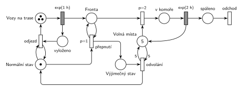

# 12–05 – Spalovna se třemi vozy

## Zadání

> V provozu městské spalovny pracují tři svozové vozy a jedna spalovací komora. Svozové vozy přijíždí v intervalech exp(1h) s jednotkovým balíkem odpadu, balík vyloží do fronty ke spalovací komoře a za normálních okolností odjíždí na další sběrnou trasu. Kapacita spalovací komory je pět balíků. Doba spalování jednoho balíku se řídí exp(2h). Pokud se naplní kapacita komory a stále je její fronta neprázdná, pak se systém přepne do výjimečného stavu, kdy svozové vozy po vyložení balíku čekají na místě do jeho odvolání. Výjimečný stav se odvolá až po tom, co se veškerá spalovací práce v komoře a ve frontě dokončí.
>
> *Zadaný systém modelujte formou Petriho sítě s vyznačením všech potřebných parametrů.*

Věta „V modelu jednoznačně ukažte (přechodem) moment, kdy transakce opouští systém“ v tehdejších zadáních ještě nebyla. Výstupní přechod je v síti přesto, dnes se vyžaduje.

Podobné úlohy: [12–07 – Spalovna](<../12–07 - Spalovna/12–07 - Spalovna.md>), [12–02 – Sběrači jahod](<../12–02 - Sběrači jahod/12–02 - Sběrači jahod.md>), [12–03 – Výrobní hala](<../12–03 - Výrobní hala/12–03 - Výrobní hala.md>).

## Interpretace

Zobrazit interpretaci (nápověda)

 

- **Vozy** jsou místo se 3 značkami a časovaný přechod `exp(1 h)`. Každá značka má vlastní odpočet (slajd 138), takže jsou to tři nezávislé vozy. „V intervalech exp(1h)“ je doba jedné sběrné trasy každého vozu.
- **Příjezd = vyložení:** časovaný přechod rozdělí transakci na dvě značky. Balík jde do *Fronty*, vůz do místa *vyloženo*. Odtud odjíždí přechodem *odjezd*, který testuje (hrana tam a zpět) *Normální stav*. Ve výjimečném stavu značka *Normální stav* chybí, a vozy proto čekají ve *vyloženo*.
- **Komora** je sklad s 5 místy (*Volná místa komory*). Každý balík v komoře hoří samostatně `exp(2 h)` (každá značka má vlastní odpočet). Spálený balík opouští systém.
- **Přepnutí** se provede, když je ve *Frontě* balík (test) a ten nejde vložit do komory. Podmínku „komora je plná“ zajišťuje priorita: vložení má `p=2`, takže přepnutí (`p=1`) přijde na řadu, jen když nejsou volná místa.
- **Proč `p=1` u přepnutí:** v okamžiku příjezdu do plné komory jsou proveditelné přepnutí i odjezd právě přijetého vozu. Vůz, jehož balík výjimečný stav vyvolal, má podle zadání také čekat, proto přepnutí vyhraje.
- **Odvolání** testuje všech 5 volných míst (hrany s váhou 5 tam i zpět), tj. komora je prázdná. Prázdnou frontu zajišťuje opět priorita: dokud je ve *Frontě* balík a komora má volné místo, vyhraje vložení (`p=2`). Po odvolání se vrátí *Normální stav* a všechny čekající vozy hned odjedou.
- Fronta je omezená sama: ve výjimečném stavu vozy postupně uvíznou ve *vyloženo*, takže ve frontě mohou být nejvýš 3 balíky.

## Petriho síť

Zobrazit Petriho síť

 

| Požadavek | Prvek sítě |
|---|---|
| 3 vozy, příjezd s balíkem exp(1 h) | *Vozy na trase* (3 značky) → `exp(1 h)` → balík do *Fronty*, vůz do *vyloženo* |
| za normálních okolností odjíždí | *odjezd*: *vyloženo* + test *Normální stav* → *Vozy na trase* |
| komora pro 5 balíků, spalování exp(2 h) | *Volná místa komory* (5), vložení `p=2`, `exp(2 h)` vrací místo → *spáleno* → *odchod* |
| plná komora a neprázdná fronta → výjimečný stav | *přepnutí* `p=1`: *Normální stav* + test *Fronty* → *Výjimečný stav* |
| vozy po vyložení čekají | *odjezd* není proveditelný, vozy zůstávají ve *vyloženo* |
| odvolání po dokončení veškeré práce | *odvolání*: *Výjimečný stav* + test 5 volných míst (prázdnou frontu hlídá `p=2` vložení) → *Normální stav* |

Kontrola simulací: platí *Vozy na trase* + *vyloženo* = 3, volná místa + balíky v komoře = 5 a *Normální* + *Výjimečný stav* = 1. Fronta nikdy nemá víc než 3 balíky. Vozy přivezou průměrně 3 balíky za hodinu a komora spálí nejvýš 2,5, takže výjimečný stav nastává často (asi každých 9 hodin).

## Časté chyby

Zobrazit časté chyby

 

- Generátor s jedním vozem (`exp(1 h)` ve smyčce s jednou značkou). Zadání má tři vozy, které mohou čekat. Vozy musí být značky, které se vrací.
- Komora jako jedna linka, nebo spalování všech 5 balíků najednou jako jedna dávka. Každý balík hoří samostatně.
- Přepnutí bez podmínky plné komory (jen test fronty): přepnulo by se při každém příjezdu.
- Odvolání bez testu všech 5 volných míst, nebo jen s jedním: výjimečný stav by skončil dřív, než komora dohoří.
- Test „komora prázdná“ odebráním 5 značek bez hrany zpět: komora přijde o kapacitu.
- Výjimečný stav, který zastaví vozy už na trase. Podle zadání vozy normálně dojedou, vyloží balík a teprve potom čekají.

## Původ a zdroje

Zobrazit původ a zdroje

 

**Původ:** půlsemestrálky 2014–19 (přehled zadání), úloha Z20. Rok, varianta ani body nejsou známé.

**Zdroje:**

- `Fitcheats/Půlsemestrálky/Zadání z minulých let/Přehled zadání 2014-19.pdf`, str. 5 (zadání)
- `Fitcheats/Půlsemestrálky/Democvičení 2020-21 - Z4 zadání a řešení.pdf`, str. 6 (řešení z democvičení)

**Existující řešení:**

- **Democvičení (str. 6):** vozy „3“ → `exp(1h)` → „Fronta“ → vložení `p=1` (bere místo z „Volné“ s 5 značkami) → místo s balíky v komoře → `exp(2h)` → zpět „Volné“. Režim: místo „Nor“ (značka) a „Výjim.“. Přepnutí testuje frontu a bere „Nor“, odvolání testuje „Volné“ hranami s váhou 5 a vrací „Nor“. Podmínky „komora plná“ a „fronta prázdná“ hlídá stejně jako výše priorita vložení. Rozdíly:
  - Vůz je ve *Frontě* spolu se svým balíkem a uvolní se (do místa, odkud odjíždí přes test „Nor“) až při vložení balíku do komory. Chování je stejné: v normálním stavu se balík vloží hned, jinak nastane výjimečný stav a vůz čeká tak jako tak. Síť výše odděluje balík a vůz hned při vyložení, což víc odpovídá textu.
  - Spálený balík zaniká v přechodu `exp(2h)`, výstupní přechod chybí (tehdy se nevyžadoval).

